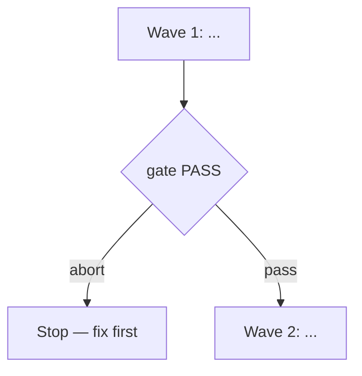

<!-- Copy into docs/specs/<slug>/<slug>-spec.md; fill every placeholder, delete these comments. -->

# <title>

**Source:** `docs/prds/<slug>/<slug>-prd.md` (status `stable`) — or the
confirmed ask, quoted in one line, when there is no PRD.
**Next:** After the Human approves → `code-plan` → `code-execute`; wave
**1 → 2** for multi-batch work.
**Named proof (this spec's own structural gate):** `proof-<slug>-spec-obligations`

## Repository grounding

<!-- Disk and prior ADRs only; never invent a surface. -->

| Surface | Present today | Role for this initiative |
|---------|----------------|----------------------------|
| … | yes / no | … |

## Surface walk

<!-- Mutate scope vs. left untouched. -->

- **In scope:** …
- **Out of mutate scope (unchanged):** … — cite these again from any `n/a`
  landing below

## Waves

<!-- Multi-batch only; omit for one wave. Name each wave and its gate; a
failed gate stops the next. -->

## Requirements (obligation ↔ proof)

<!-- One obligation, one named proof. -->

### R1 — ...

| ID | Obligation | Named proof | Evidence shape |
|----|------------|--------------|------------------|
| R1.1 | … | `proof-<slug>-…` | Inspect / command / grep |

## Nine-dimension landings

<!-- Name all nine. Each row is an obligation/proof pair, an `n/a` naming
the unchanged surface it means, or a typed row under Unresolved — never
invented behavior. -->

| Dimension | Landing kind | Landing |
|-----------|---------------|---------|
| validation | … | … |
| failure modes | … | … |
| idempotency and retry | … | … |
| authorization | … | … |
| concurrency and ordering | … | … |
| data lifecycle | … | … |
| external-dependency failure | … | … |
| state transitions | … | … |
| observability | … | … |

## Unresolved

<!-- Absent product or contract decisions; never invent behavior. -->

| Identifier | Decision needed | Owner | Blocking effect | Disposition |
|------------|-------------------|-------|-------------------|--------------|
| `U-<topic>` | … | Human | Blocks wave N / non-blocking | Resolve before … / defer with a trigger / refuse |

## Out of scope

- …

## Pragmatic-guard refuses

- …

## Acceptance

### Wave 1

- [ ] A verifiable artifact or command (pairs with an obligation ID above)

## Eval / gates

| Gate | Command / check | When | PASS | Abort |
|------|-------------------|------|------|-------|
| Integrity | `harness:validate` | End of each wave | exit 0 | Fix; do not proceed |
| Spec obligations | `proof-<slug>-spec-obligations` — obligation ↔ proof matrix; all nine landings; every `n/a` cites an unchanged surface | Before `code-plan` | all hold | Do not plan |

## Cross-domain leak table

| Leak | Refuse |
|------|--------|
| … | … |
| An executable plan from this skill | `code-plan` only |

## ADR

<!-- A durable architecture decision goes through the `adr` skill — create,
promote or supersede — which owns numbering. Placeholder tokens only:
`ADR-NNN` / `adr-NNN-<slug>`, never a concrete number. -->

… — or "None needed this initiative."

## Section checklist

| Section | Required when |
|---------|-----------------|
| Source | Always |
| Repository grounding | Always |
| Surface walk | Always |
| Waves | Multi-batch work |
| Requirements with obligation ↔ proof | Always |
| Nine-dimension landings | Always — all nine named |
| Unresolved | Always — an empty table is fine |
| Out of scope | Always |
| Pragmatic-guard refuses | Always |
| Acceptance | Always — tick only with evidence |
| Eval / gates | Always |
| Cross-domain leak table | Always |
| ADR | Always |
