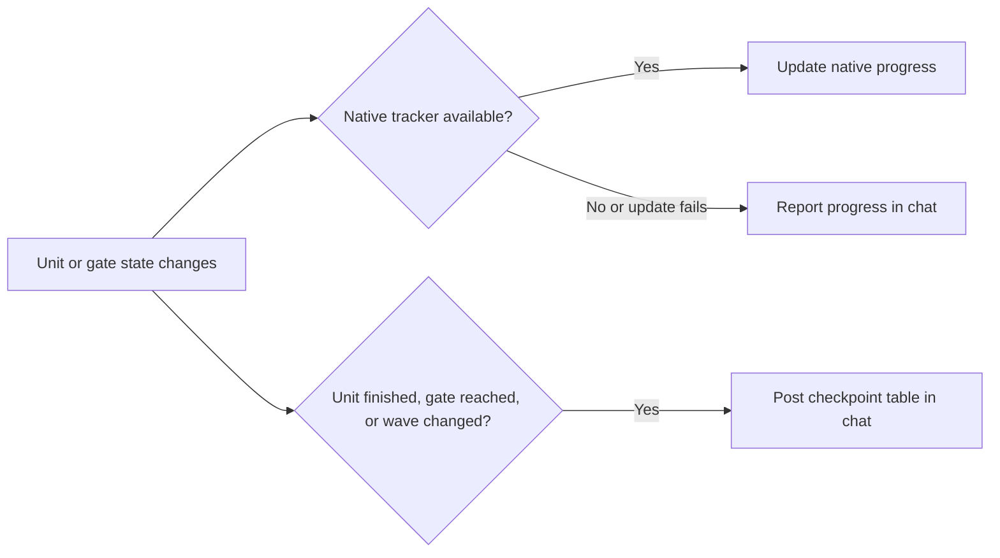

# Approval summaries and execution checkpoints

**Source** — [Approval summaries and execution progress](../../prds/approval-summary/approval-summary-prd.md), `stable`.\
**Next** — Human approval → `code-plan` → `code-execute`.\
**Structural proof** — `proof-approval-summary-spec-obligations`.

## Repository grounding

| Surface | Present today | Role |
| --- | --- | --- |
| `.agents/skills/{create-prd,code-spec,code-plan}/SKILL.md` and shipped equivalents | Yes | Own artifact creation, revisions, approval and handoff. Their templates supply the fields for each summary. |
| `.agents/skills/code-execute/SKILL.md` and shipped equivalent | Yes | Own plan frontier, `spawn` or `inline` dispatch, pre-start output, proof checks, and the inline execution/resume record. |
| `.agents/skills/code-review/SKILL.md` and `code-pr/references/pr-body-template.md` in both trees | Yes | Review verdict and finding severities already exist. The three-section PR body has an optional Task field under Summary. |
| `src/setup/skill-sets.ts`, `src/setup/apply.ts`, `test/skills-command.test.ts` | Yes | `code-spec` and `code-plan` are core. `create-prd` is optional and can be installed by itself. |
| `test/helpers/skill-contract.ts`, `test/skill-copies.test.ts`, and `test/skill-*.test.ts` | Yes | Test skill instructions, file links and repo/template parity. The link helper already permits one specific shared reference between skill folders. |
| `scripts/known-forms.mjs`, `known-forms.json` | Yes | Record shipped template forms for offline drift classification under ADR-007. |
| [Native progress tools research](../../notes/native-progress-tools/native-progress-tools-note.md) | Yes | Documents the callable session tools and the client notifications separately. Local CLI probes observed Claude and Cursor updates. |

## Surface walk

- **In scope** — The six skill folders under `.agents/skills/` and `templates/.agents/skills/`, their workflow contract tests, the shared link allowlist in `test/helpers/skill-contract.ts`, and generated template fingerprints in `known-forms.json`.
- **Out of mutate scope** — PRD, spec and plan schemas and templates, setup and doctor code, runtime wiring, permission checks, commit cadence, and the plan's inline execution/resume schema. Existing approval, dispatch, validation, and commit rules still determine what can proceed.

### Reporting flow

The approval skills read the shared format at the point they present a draft. `code-execute` reports state already observed by its existing workflow. It updates the native tracker during work and posts the chat table at milestones.



When a fallback update and a checkpoint are due at the same milestone, one chat checkpoint can carry both.

## Requirements (obligation ↔ proof)

The AC column traces each requirement to its source. Each named proof is a contract assertion or fixture in the existing test files named under Eval / gates. The assertions verify the workflow instructions and reference contents. The scenario review in Acceptance checks how those instructions read as a chat response.

### R1 — First approval summary

| ID | AC | Obligation | Named proof and evidence |
| --- | --- | --- | --- |
| R1.1 | AC-1.1 | Before the first approval request, link the real artifact and show status, commit state, requirements, material findings, Human decisions with where they landed, open items, and the decision requested. **PRD** opens with the confirmed problem, then uses `Entrega / Resultado esperado / Casos de aceite` or equivalent headings in the chat language, with one row per story and its case count. **Spec** opens with source and scope and summarizes the technical flow. Add a small Mermaid diagram when it clarifies the flow. Show affected surfaces and obligation IDs paired with named proofs and evidence. Use one row per wave when waves exist, and one row per obligation for unphased work. **Plan** leads with wave blocks and gates, naming what each gate blocks. Put a horizontal divider before the first wave, between waves, and after the last. Show units only for a single wave or fewer than ten units overall, with unit, dependency, owned paths, `Subagent`, and Done when. | `proof-approval-summary-format` — assert shared fields and each skill's section, including the plan table cutoff and separators. |
| R1.2 | AC-1.2 | Render empty findings or open items as “None” or its chat-language equivalent. Omit the delta on the first draft. Present unphased work without inventing a wave. | `proof-approval-summary-empty` — assert the reference distinguishes first draft, empty sections, and unphased work. |
| R1.3 | AC-1.3 | Highlight each Human gate separately from automatic gates. State who decides, what they decide, and what waits. Show automatic check and stop conditions under the affected wave when present. | `proof-approval-summary-human-gate` — assert distinct Human and automatic gate instructions. |

### R2 — Material revisions

| ID | AC | Obligation | Named proof and evidence |
| --- | --- | --- | --- |
| R2.1 | AC-2.1 | Use the same summary and link the revised artifact before asking for approval again. Add a concise delta, map decisions from the round to the artifact, and surface remaining questions, typed Unresolved rows, and Human gates. | `proof-approval-summary-revision` — assert the revision format and delta fields. |
| R2.2 | AC-2.2 | Keep feedback that is still pending in the open section and separate it from incorporated changes. | `proof-approval-summary-open-feedback` — assert the reference distinguishes pending feedback from completed changes. |

### R3 — Shared format and drift checks

| ID | AC | Obligation | Named proof and evidence |
| --- | --- | --- | --- |
| R3.1 | AC-3.1 | Author the format once in `code-spec/references/approval-summary.md` under the skill tree. `code-spec` reads it locally and `code-plan` links to that exact sibling reference. `create-prd` links to an identical local copy because standalone install copies only its own folder. Keep repo and shipped versions identical. In both trees, each of the three approval workflows explicitly invokes the reference for first drafts and material revisions before asking for approval. Limit the cross-skill link exception to the exact new reference. | `proof-approval-summary-wiring` — verify relative link resolution, required workflow instructions in both trees, byte equality for the mirror, and local reference availability in the existing standalone install fixture. |
| R3.2 | AC-3.2 | Fail the repository contract check if any covered workflow loses the approval step, either trigger, or the reference. Identify the affected file. Fail on reference content drift too. | `proof-approval-summary-drift` — remove the step, a trigger, or the reference in isolated inputs to the check and verify each failure names the affected copy. |

### R4 — Execution reporting

| ID | AC | Obligation | Named proof and evidence |
| --- | --- | --- | --- |
| R4.1 | AC-4.1 | At execution start or resume and on state changes, report plan link when present, wave, unit ID and title, current activity and status, and executor. For `spawn`, use the actual dispatched agent name or ID once available. For `inline`, report `inline`. Track concurrent units separately. At a gate, report the observed result and what can proceed. | `proof-execution-progress-fields` — assert required fields and concurrent unit, executor and gate rules in the execution workflow. |
| R4.2 | AC-4.2 | If the active Claude, Cursor or Codex session exposes a callable native progress tool, update it on start or resume, unit state changes and gate outcomes using the runtime rules below. Use the exposed schema and supplement missing fields in chat. | `proof-execution-native-tracker` — assert the capability check, the three runtime rules, update points and chat supplement rule in both skill copies. |
| R4.3 | AC-4.3 | When the native tool is absent or an update fails, report progress in chat at the applicable milestones. For unphased or planless work, show the work and mode using the evidence available. | `proof-execution-chat-fallback` — assert the absent-tool, failed-tool and unphased branches. |
| R4.4 | AC-4.4 | Report blocked work, failed dispatch or checks, and the next action. Keep completion pending until the existing proof gate passes. The tracker projects observed execution state and the plan retains resume authority. | `proof-execution-progress-failure` — assert the failure and completion rules alongside the existing verify-before-claim and dispatch checks. |
| R4.5 | AC-4.5 | When an existing Human gate is reached, post the decision needed, the owner, and the work in wait. Resume the affected work only after recording the decision. | `proof-execution-human-gate` — assert the wait and resume conditions. |
| R4.6 | AC-4.6 | Post a checkpoint in chat at unit finish, at a gate, and between waves, even with native tracking active. Link the real plan when present. Give the wave and a compact table of relevant units with **Unidade / Quem executa / Estado / Última atividade ou resultado** or equivalent chat-language headings. Prefix the validated state with ✅ after its proof gate passes. Show the observed gate outcome when known and what comes next or stays blocked. | `proof-execution-chat-checkpoint` — assert checkpoint triggers, link, table, next action and coexistence with native tracking. |

#### Runtime rules for R4.2

| Runtime | How to update native progress |
| --- | --- |
| Claude Code | With `TaskCreate` and `TaskUpdate` available, create missing entries with the wave and unit ID in the subject and update by returned task ID. Use `TaskList` when available to reconcile entries on resume. If the session exposes `TodoWrite` instead, send the current list using its schema. |
| Cursor | Use the exposed Agent To-dos updater. Identify items by the wave and unit ID, and use the updater's merge behavior when available to preserve unrelated items. `updateTodosToolCall` is the observed CLI stream key and `cursor/update_todos` is an ACP client notification. Select the callable tool from the session rather than using either event name as a tool. |
| Codex | When `update_plan` is exposed and callable, send the complete checklist using `step` and `status`. Keep at most one item `in_progress`. For parallel work, use one active wave-level entry and show each unit in the chat checkpoint. |

Apply R4.3 when the session has no callable updater or an update fails. Keep tool selection inside the active session, with its existing configuration and permissions.

### R5 — Review outcome in chat

| ID | AC | Obligation | Named proof and evidence |
| --- | --- | --- | --- |
| R5.1 | AC-5.1 | At review closeout, use a review-specific chat summary with a clickable link to the PR, the actual verdict from review criteria, blocking findings, minor adjustments, and the next action from the existing handoff. Map the existing Nit severity to “Ajustes menores” in Portuguese and “Non-blockers” in English in the chat summary. Use links to relevant posted findings when available. The existing host posting workflow owns the review record. | `proof-review-chat-summary` — assert the chat fields, localized heading, closeout trigger and preservation of the host review path in both skill copies. |
| R5.2 | AC-5.2 | Show an empty finding category explicitly. Carry unchecked axes into the chat summary when they affect the handoff, including the existing ADR-claims rule when validation cannot run. | `proof-review-chat-gaps` — assert empty and incomplete-review branches in both skill copies. |

### R6 — Context and formatting in the existing PR body

| ID | AC | Obligation | Named proof and evidence |
| --- | --- | --- | --- |
| R6.1 | AC-6.1 | Keep Summary, Verification and Before merge. In Summary, use the existing Task line for relevant PRD, spec, plan or ticket links that resolve for a reviewer from the PR. Link a repository artifact at a revision where it exists. Put a decision that explains the diff in the existing Why or How field. Keep the existing field limits. | `proof-pr-body-artifact-context` — assert existing sections and a filled example with a link and a relevant decision on the existing lines. |
| R6.2 | AC-6.2 | Omit Task if no relevant reference exists. When no decision is recorded, use the ordinary Why and How supported by the diff. Preserve current-session evidence and the Before merge checkbox reset when opening or amending. | `proof-pr-body-optional-context` — assert optional Task, grounded decisions and preservation of the current verification rules. |
| R6.3 | AC-6.3 | Separate the existing headings from their content with blank lines and render What, Why, How and optional Task as separate Markdown paragraphs. Keep command bullets and task-list syntax. Keep Before merge as the final section, after Summary and Verification. Within Before merge, put CI and conditional Pre-merge closure before the `### Manual test` subsection. Give each PR-specific manual scenario its own checkbox and apply the existing evidence and checkbox reset rules to each one. Apply the same formatting in the normative template and the filled example. | `proof-pr-body-readable-layout` — assert the top-level section order, Markdown spacing, code-formatted commands, the nested Manual test heading and separate scenario checkboxes within the existing size limits. |

## Nine-dimension landings

| Dimension | Landing kind | Landing |
| --- | --- | --- |
| validation | Obligation / proof | R3.1 and R3.2 check reference resolution and drift. R4.4 preserves proof before completion. |
| failure modes | Obligation / proof | R4.3 and R4.4 cover tool failure, blocked units and failed checks. |
| idempotency and retry | Obligation / proof | R4.1 and R4.2 refresh from the reconciled execution state on resume and update the current unit status. |
| authorization | Obligation / proof | R1.3 and R4.5 expose existing decision authority and keep affected work waiting. |
| concurrency and ordering | Obligation / proof | R1.1 exposes plan sequencing. R4.1 tracks simultaneous units separately. R4.4 preserves gate ordering. |
| data lifecycle | n/a | Artifact schemas, the plan's execution/resume section, and setup/doctor persistence remain out of mutate scope. Chat and tracker output are views of execution. |
| external-dependency failure | Obligation / proof | R4.3 falls back to chat if the session tool is absent or fails. |
| state transitions | Obligation / proof | R4.1, R4.4 and R4.6 distinguish active, validated, blocked and pending work. |
| observability | Obligation / proof | R1.1 and R2.1 link approval evidence. R4.2 and R4.6 make progress visible. R5.1 and R6.1 expose review outcomes and artifact context. |

## Unresolved

| Identifier | Decision needed | Owner | Blocking effect | Disposition |
| --- | --- | --- | --- | --- |
| | | | | |

## Out of scope

- Changes to host posting, verdict policy, merge authority, or the three-section PR body structure.
- Retroactive changes to consumer files. Existing setup and doctor behavior govern upgrades.
- A new approval gate, PRD verdict, or runtime requirement.

## Pragmatic-guard refuses

- A tracking CLI, per-runtime adapters, extra resume file, or live-runtime test harness. A short instruction branch uses capabilities already exposed by the session. Existing contract tests verify the branch instructions.
- A separate PR body section for approval summaries. Use the current Task, Why and How lines.
- A new package or skill set for the shared reference. One checked mirror keeps standalone `create-prd` self-contained.

## Acceptance

- [ ] **R1.1** — `proof-approval-summary-format` passes in Approval contract.
- [ ] **R1.2** — `proof-approval-summary-empty` passes in Approval contract.
- [ ] **R1.3** — `proof-approval-summary-human-gate` passes in Approval contract.
- [ ] **R2.1** — `proof-approval-summary-revision` passes in Approval contract.
- [ ] **R2.2** — `proof-approval-summary-open-feedback` passes in Approval contract.
- [ ] **R3.1** — `proof-approval-summary-wiring` passes in Approval contract and Template fingerprints pass.
- [ ] **R3.2** — `proof-approval-summary-drift` passes in Approval contract.
- [ ] **R4.1** — `proof-execution-progress-fields` passes in Execution contract.
- [ ] **R4.2** — `proof-execution-native-tracker` passes in Execution contract.
- [ ] **R4.3** — `proof-execution-chat-fallback` passes in Execution contract.
- [ ] **R4.4** — `proof-execution-progress-failure` passes in Execution contract.
- [ ] **R4.5** — `proof-execution-human-gate` passes in Execution contract.
- [ ] **R4.6** — `proof-execution-chat-checkpoint` passes in Execution contract.

- [ ] **R5.1** — `proof-review-chat-summary` passes in Review and PR contracts.
- [ ] **R5.2** — `proof-review-chat-gaps` passes in Review and PR contracts.
- [ ] **R6.1** — `proof-pr-body-artifact-context` passes in Review and PR contracts.
- [ ] **R6.2** — `proof-pr-body-optional-context` passes in Review and PR contracts.
- [ ] **R6.3** — `proof-pr-body-readable-layout` passes in Review and PR contracts.

For the scenario review, inspect a first draft and material revision, a single-wave plan, multi-wave plans with nine and ten units, a unit checkpoint while native tracking is active, parallel units under the Codex one-active-item limit, a missing tracker or failed update, a blocked Human gate, a review with no minor adjustments, and a rendered PR body with and without artifact context. The walkthrough checks rendering and interpretation.

## Eval / gates

| Gate | Command or check | When | PASS | Abort |
| --- | --- | --- | --- | --- |
| Spec obligations | `proof-approval-summary-spec-obligations` below | Before `code-plan` | Every source AC maps once, every obligation maps to Acceptance and has a distinct proof, and the nine landings are present | Fix spec before planning |
| Approval contract | `pnpm exec tsx --test test/skill-create-prd.test.ts test/skill-code-spec.test.ts test/skill-code-plan.test.ts test/skill-copies.test.ts test/skills-command.test.ts` | Before closing the batch | Exit 0, including the new named assertions and link/standalone fixtures | Fix before handoff |
| Execution contract | `pnpm exec tsx --test test/skill-code-execute.test.ts` | Before closing the batch | Exit 0, including the six new named assertions | Fix before handoff |
| Review and PR contracts | `pnpm exec tsx --test test/skill-code-review.test.ts test/skill-code-pr.test.ts` | Before closing the batch | Exit 0, including the five new named assertions and existing body shape tests | Fix before handoff |
| Template fingerprints | `pnpm gen:known-forms` | After updating shipped templates | The generated table retains prior entries and includes current forms | Refresh before handoff |
| Integrity | `pnpm validate` (package repo's `harness:validate` gate) and `pnpm comments` | End of batch | Both exit 0 | Fix before handoff |

Run the structural proof from the repository root:

```sh
node --input-type=module <<'JS'
import assert from 'node:assert/strict';
import { readFileSync } from 'node:fs';

const prd = readFileSync('docs/prds/approval-summary/approval-summary-prd.md', 'utf8');
const spec = readFileSync('docs/specs/approval-summary/approval-summary-spec.md', 'utf8');
const rows = [...spec.matchAll(/^\| (R\d\.\d) \| (AC-\d\.\d) \| .*? \| `(proof-[\w-]+)`/gm)];
assert.deepEqual(rows.map((row) => row[2]).sort(), [...prd.matchAll(/^#### (AC-\d\.\d):/gm)].map((row) => row[1]).sort());
assert.equal(new Set(rows.map((row) => row[1])).size, rows.length);
assert.equal(new Set(rows.map((row) => row[3])).size, rows.length);
const acceptance = spec.split('## Acceptance\n')[1].split('## Eval / gates')[0];
const covered = [...acceptance.matchAll(/^- \[ \] \*\*(R\d\.\d)\*\* — `(proof-[\w-]+)`/gm)];
assert.deepEqual(covered.map((row) => row.slice(1)), rows.map((row) => [row[1], row[3]]));
const landings = spec.split('## Nine-dimension landings\n')[1].split('## Unresolved')[0];
assert.deepEqual([...landings.matchAll(/^\| ([a-z][^|]+?) \|/gm)].map((row) => row[1]), [
  'validation', 'failure modes', 'idempotency and retry', 'authorization',
  'concurrency and ordering', 'data lifecycle', 'external-dependency failure',
  'state transitions', 'observability',
]);
assert.match(landings, /^\| data lifecycle \| n\/a \| .*out of mutate scope/m);
JS
```

## Cross-domain leak table

| Leak | Lane |
| --- | --- |
| Numbered units, ordering and ownership assignment | `code-plan` after spec approval |
| Runtime tool adapters or installer changes | Separate scoped initiative |
| Consumer repair, commit or performing a review or PR operation | Existing `harness-doctor`, `code-commit`, `code-review` or `code-pr` workflow with its own authorization |

## ADR

None needed for this initiative. The reference uses the existing checked cross-skill reference pattern and preserves the installation and execution contracts.
