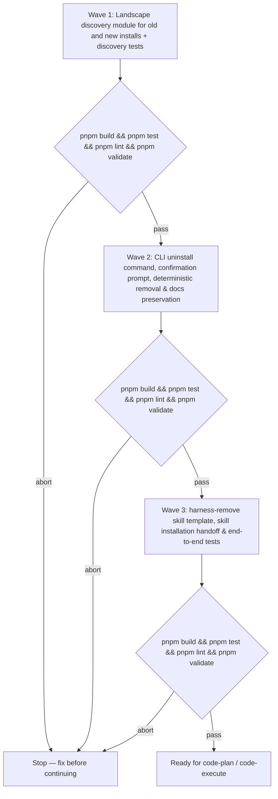

# Harness uninstall and agentic removal

**Source:** `docs/prds/archived/harness-uninstall/harness-uninstall-prd.md` (status `stable`)
**Next:** After the Human approves → `code-plan` → `code-execute`, waves **1 → 2 → 3**
**Named proof (this spec's own structural gate):** `proof-harness-uninstall-spec-obligations`

## Terms

- **Local landscape:** The target folder (`--dir`, defaulting to current working directory), its immediate parent, child or nested git repositories, any linked `harnessHome` or `codeRepo` paths, and global skill load paths (`~/.claude/skills/`, `~/.agents/skills/`).
- **New landscape (quiet install / linked layout):** Installs following [ADR-007](../../../adrs/adr-007-quiet-install-contract.md) where `.wolven-harness.json` records `layout: "linked"` and `harnessHome: ".wolven-harness"` (or custom path). Harness scaffolding lives inside `.wolven-harness/`, accompanied by root bootstrap links/symlinks.
- **Old landscape (full install / home layout / standalone skills):** Installs where `.wolven-harness.json` records `layout: "home"` or no layout, scaffolding harness directories (`.agents/`, `.qmd/`, `WOLVEN.md`, runtime wiring) directly in the repository root or parent folder, or standalone skill copies in global/project load paths.
- **Intertwined edits:** Files shared between user code and harness configuration (`package.json`, root `AGENTS.md`, `.gitignore`, CI workflow files) that contain harness references alongside user-authored content.
- **`harness-remove`:** An ask-only skill installed into a chosen runtime at the end of CLI uninstall to guide human-supervised removal of intertwined edits, cleaning up its own folder upon completion.
- **Preserved paths:** All authored documentation under `docs/` (`docs/adrs/`, `docs/prds/`, `docs/specs/`, `docs/notes/`, `docs/deferrals/`, `docs/maps/`, and `docs/WRITING-PROFILE.md`), whether located in the repository root or inside `.wolven-harness/docs/`.

## Repository grounding

| Surface | Present today | Role for this initiative |
|---------|----------------|----------------------------|
| `src/cli.ts` | yes | Top-level command router; gains `uninstall` command routing |
| `src/setup/config.ts` | yes | Provides `CONFIG_FILENAME`, `readConfig`, `homeInsideRoot`, and config types |
| `src/setup/runtimes.ts` | yes | Provides `RUNTIME_REGISTRY`, machine and folder markers, and quiet install wiring |
| `src/setup/types.ts` | yes | Provides `Io`, `Runtime`, and error definitions |
| `src/doctor/index.ts` | yes | Provides root and linked `harnessHome` path resolution |
| `templates/.agents/skills/` | yes | Shipped skills directory; gains `harness-remove/SKILL.md` |
| `.agents/skills/` | yes | Harness repo skills mirror; gains `.agents/skills/harness-remove/SKILL.md` |
| `src/uninstall/` | no | New module implementing landscape discovery, confirmation, deterministic removal, and skill handoff |
| `test/uninstall-discover.test.ts` | no | Tests discovery of old, new, linked, and standalone harness footprints |
| `test/uninstall-remove.test.ts` | no | Tests confirmed removal, abort without confirmation, and `docs/` preservation |
| `test/harness-remove-skill.test.ts` | no | Tests `harness-remove` template presence, validity, and runtime install path |
| `pnpm test`, `pnpm lint`, `pnpm validate` | yes | Wave gates and integrity validation |

## Surface walk

- **In scope:**
  - `src/cli.ts` (routing `uninstall` command and usage text)
  - `src/uninstall/index.ts` (command orchestration, flag parsing, confirmation prompt, summary output)
  - `src/uninstall/discover.ts` (scanning local landscape for new/quiet, old/full, linked, and standalone installs)
  - `src/uninstall/remove.ts` (safe deterministic deletion of harness-owned files and symlinks with strict preservation of `docs/`)
  - `src/uninstall/skill-handoff.ts` (installing `harness-remove` skill into user's chosen runtime)
  - `templates/.agents/skills/harness-remove/SKILL.md` and `.agents/skills/harness-remove/SKILL.md`
  - Unit and integration tests under `test/`
- **Out of mutate scope (unchanged):**
  - `src/setup/**` (scaffolding and installation logic remains create-only per ADR-007)
  - `src/validate/**` (profile and claim verification rules unchanged)
  - `src/doctor/**` (drift and diagnostic checks unchanged)
  - `src/comments/**` (comment enforcement unchanged)
  - `renderer/**`, `site/**`, release workflows
  - Deleting or altering user git history or unconfirmed shared files

## Waves

A failed gate aborts before the next wave starts.

## Requirements (obligation ↔ proof)

### R1 — Landscape discovery (new and old landscapes)

Traces to PRD US-1 (AC-1.1, AC-1.3) and Goals.

| ID | Obligation | Named proof | Evidence shape |
|----|------------|--------------|------------------|
| R1.1 | `discoverLandscape(root, env)` detects a new landscape (quiet install / linked layout) by discovering `.wolven-harness.json` (`layout: "linked"`), the `.wolven-harness/` directory, and runtime bootstrap symlinks. | `proof-uninstall-discover-new-landscape` | `pnpm test` fixture test |
| R1.2 | `discoverLandscape(root, env)` detects an old landscape (full install / home layout) by discovering root `.wolven-harness.json` (`layout: "home"` or missing), `.agents/`, `.qmd/`, `WOLVEN.md`, and runtime-specific config stubs. | `proof-uninstall-discover-old-landscape` | `pnpm test` fixture test |
| R1.3 | `discoverLandscape(root, env)` discovers linked landscapes in parent, sibling, or child repositories linked via `harnessHome` or `codeRepo`. | `proof-uninstall-discover-linked-landscape` | `pnpm test` fixture test |
| R1.4 | `discoverLandscape(root, env)` detects standalone harness skills in global skill load paths (`~/.claude/skills/`, `~/.agents/skills/`). | `proof-uninstall-discover-global-skills` | `pnpm test` fixture test |
| R1.5 | When no harness artifacts exist across the target folder and its local landscape, `discoverLandscape` returns an empty result set. | `proof-uninstall-discover-empty` | `pnpm test` fixture test |

### R2 — CLI `uninstall` invocation, confirmation, and abort

Traces to PRD US-1 (AC-1.1, AC-1.2, AC-1.3).

| ID | Obligation | Named proof | Evidence shape |
|----|------------|--------------|------------------|
| R2.1 | `wolven-harness uninstall` parses `--dir <path>`, `--yes`, `--verbose`, and `--debug`. Unknown arguments write an error to stderr, usage to stdout, and exit 1. | `proof-uninstall-cli-args` | `pnpm test` CLI runner test |
| R2.2 | Running `wolven-harness uninstall` prints every discovered install location, the files slated for deletion, and preserved paths before any filesystem mutation. | `proof-uninstall-cli-dry-list` | `pnpm test` stdout inspect |
| R2.3 | When no harness install is found, `wolven-harness uninstall` prints that no install was found, prompts for nothing, makes zero filesystem changes, and exits 0. | `proof-uninstall-cli-noop-exit0` | `pnpm test` CLI runner test |
| R2.4 | Without `--yes`, declining or cancelling the confirmation prompt aborts immediately: zero files or symlinks are removed or altered, and exits 0. | `proof-uninstall-cli-cancel-abort` | `pnpm test` CLI runner test |

### R3 — Deterministic removal with strict docs preservation

Traces to PRD US-1 (AC-1.1) and Goals.

| ID | Obligation | Named proof | Evidence shape |
|----|------------|--------------|------------------|
| R3.1 | In a new landscape (quiet install), confirmed removal unlinks root bootstrap symlinks, deletes `.wolven-harness.json`, and deletes `.wolven-harness/.agents/`, `.wolven-harness/.qmd/`, `.wolven-harness/AGENTS.md`, and `.wolven-harness/.gitignore`. | `proof-uninstall-remove-new-landscape` | `pnpm test` filesystem assert |
| R3.2 | In a new landscape where `.wolven-harness/docs/` contains authored documentation, `docs/` is left completely intact with byte-identical contents. If the rest of `.wolven-harness/` is emptied, `.wolven-harness/docs/` remains preserved. | `proof-uninstall-preserve-quiet-docs` | `pnpm test` content hash assert |
| R3.3 | In an old landscape (full install), confirmed removal unlinks/deletes `.wolven-harness.json`, `WOLVEN.md`, `.qmd/`, `.agents/rules/`, `.agents/hooks/`, and harness-owned skills under `.agents/skills/`. | `proof-uninstall-remove-old-landscape` | `pnpm test` filesystem assert |
| R3.4 | In an old landscape where root `docs/` exists, all files under `docs/` (`adrs/`, `prds/`, `specs/`, `notes/`, `deferrals/`, `maps/`, `WRITING-PROFILE.md`) are left completely intact with byte-identical contents. | `proof-uninstall-preserve-root-docs` | `pnpm test` content hash assert |
| R3.5 | Confirmed removal removes standalone harness skills from global skill directories (`~/.claude/skills/`, `~/.agents/skills/`) when discovered. | `proof-uninstall-remove-global-skills` | `pnpm test` filesystem assert |
| R3.6 | Intertwined files (`package.json`, root `AGENTS.md`, `.gitignore`, CI workflows) are never deleted or truncated by the deterministic CLI removal; they are reported as remaining for agent-assisted cleanup. | `proof-uninstall-leave-intertwined-files` | `pnpm test` assert files intact |

### R4 — `harness-remove` skill and runtime handoff

Traces to PRD US-2 (AC-2.1, AC-2.2) and US-3 (AC-3.1, AC-3.2).

| ID | Obligation | Named proof | Evidence shape |
|----|------------|--------------|------------------|
| R4.1 | After deterministic removal, `wolven-harness uninstall` prompts the user whether to install `harness-remove`. If confirmed, it prompts for a target runtime and copies `harness-remove` into that runtime's skill load path. | `proof-uninstall-handoff-install-skill` | `pnpm test` interactive mock test |
| R4.2 | If the user declines installing `harness-remove`, the CLI prints the final summary, installs nothing, and exits 0. | `proof-uninstall-handoff-decline` | `pnpm test` CLI runner test |
| R4.3 | `templates/.agents/skills/harness-remove/SKILL.md` ships with frontmatter `name: harness-remove`, `description: "Guides thorough removal of remaining harness edits and configuration while preserving docs/"`. | `proof-harness-remove-template-frontmatter` | Inspect template file |
| R4.4 | `harness-remove/SKILL.md` instructs the agent to inspect remaining intertwined files (`package.json`, `AGENTS.md`, `.gitignore`, CI workflows), show each proposed edit to the human for confirmation before applying, preserve `docs/`, and delete the `harness-remove` skill directory as its final action. | `proof-harness-remove-skill-instructions` | Inspect skill markdown content |

## Nine-dimension landings

| Dimension | Landing kind | Landing |
|-----------|---------------|---------|
| validation | obligation ↔ proof | R2.1 parses `--dir`, `--yes`, `--verbose`, and `--debug`, rejecting unknown flags with usage. |
| failure modes | obligation ↔ proof | Filesystem permission errors or missing paths during deletion report descriptive errors without crashing unhandled; exit code 1 on unhandled IO failure. |
| idempotency and retry | obligation ↔ proof | R2.3: Re-running `uninstall` against an already-uninstalled directory finds nothing, makes no modifications, and exits 0. |
| authorization | n/a | Operates strictly with user filesystem permissions; does not escalate privileges or invoke sudo. |
| concurrency and ordering | obligation ↔ proof | Discovery pass runs fully and computes the manifest before prompt; confirmation must be obtained before any deletion commences. |
| data lifecycle | obligation ↔ proof | R3.2 and R3.4 guarantee `docs/` is never deleted; deterministic harness files are unlinked; `harness-remove` self-deletes upon completion. |
| external-dependency failure | n/a | Uses Node.js built-in modules (`node:fs`, `node:path`) and existing `@clack/prompts` only; no external network or API dependencies. |
| state transitions | obligation ↔ proof | Transitions repo from installed (`.wolven-harness.json`, harness stubs present) to uninstalled (no config, no harness stubs, docs preserved). |
| observability | obligation ↔ proof | R2.2 prints discovered items before confirmation; `--verbose` reports every file unlinked; summary prints removed items and remaining paths. |

## Unresolved

| Identifier | Decision needed | Owner | Blocking effect | Disposition |
|------------|-------------------|-------|-------------------|--------------|
| `U-boundary-split` | Boundary between deterministic CLI vs `harness-remove` on shared files | Rafael | Blocks Wave 2 | Settled in R3.6: CLI removes only unambiguous harness files; shared/intertwined files are left for `harness-remove`. |
| `U-quiet-docs-location` | In quiet install uninstall, whether `.wolven-harness/docs/` remains in `.wolven-harness/` or is migrated to `<repo>/docs/` | Rafael | Non-blocking | Default: leave intact at current path (`.wolven-harness/docs/`) to avoid moving files without explicit user consent; `harness-remove` can offer to move if desired. |

## Out of scope

- Deleting `docs/` or any file under `docs/`.
- Automatic regex rewriting of user-authored prose in `AGENTS.md` without Human confirmation.
- Modifying git commit history or creating automated commits during uninstall.
- Uninstalling global Node binaries (`wolven-harness`, `qmd`) from system package managers.

## Pragmatic-guard refuses

- Refuse speculative dry-run undo/backup tarballs (git already tracks repo state; user must confirm deletions).
- Refuse recursive scanning of the entire home directory (`~`) outside specified load paths.
- Refuse unprompted or silent deletion when `--yes` is not passed.

## Acceptance

### Wave 1

- [ ] `discoverLandscape` detects new landscape quiet installs, old landscape full installs, linked homes, and global skills (`proof-uninstall-discover-new-landscape`, `proof-uninstall-discover-old-landscape`, `proof-uninstall-discover-linked-landscape`, `proof-uninstall-discover-global-skills`).
- [ ] Returns empty when no harness is found (`proof-uninstall-discover-empty`).

### Wave 2

- [ ] CLI parses arguments and shows dry-run list before deletion (`proof-uninstall-cli-args`, `proof-uninstall-cli-dry-list`).
- [ ] Exits cleanly with no mutation on decline or empty landscape (`proof-uninstall-cli-noop-exit0`, `proof-uninstall-cli-cancel-abort`).
- [ ] Confirmed removal unlinks all deterministic harness files across new and old landscapes (`proof-uninstall-remove-new-landscape`, `proof-uninstall-remove-old-landscape`, `proof-uninstall-remove-global-skills`).
- [ ] All `docs/` files remain byte-identical after uninstall (`proof-uninstall-preserve-quiet-docs`, `proof-uninstall-preserve-root-docs`).
- [ ] Intertwined files (`package.json`, `AGENTS.md`, `.gitignore`) remain untouched by CLI (`proof-uninstall-leave-intertwined-files`).

### Wave 3

- [ ] CLI prompts and installs `harness-remove` into selected runtime (`proof-uninstall-handoff-install-skill`, `proof-uninstall-handoff-decline`).
- [ ] `harness-remove` template ships in `templates/` and `.agents/` (`proof-harness-remove-template-frontmatter`, `proof-harness-remove-skill-instructions`).

## Eval / gates

| Gate | Command / check | When | PASS | Abort |
|------|-------------------|------|------|-------|
| Integrity | `pnpm build && pnpm validate` | End of each wave | exit 0 | Fix; do not proceed |
| Test suite | `pnpm test` | End of each wave | all pass | Fix; do not proceed |
| Linter | `pnpm lint` | End of each wave | exit 0 | Fix; do not proceed |
| Spec obligations | `proof-harness-uninstall-spec-obligations` — all obligation ↔ proof pairs verified; all nine dimensions landed; every `n/a` cites unchanged surface | Before `code-plan` | all hold | Do not plan |

## Cross-domain leak table

| Leak | Refuse |
|------|--------|
| Modifying `setup` to support uninstall flags | `setup` is strictly create-only per ADR-007; uninstall lives in `uninstall` command |
| Editing shared files automatically without human confirmation | Handed off to `harness-remove` skill for supervised editing |
| An executable plan from this skill | `code-plan` only |

## ADR

A superseding ADR (`ADR-NNN` / `adr-NNN-uninstall-command-contract`) will be recorded to add `uninstall` to the public CLI contract commands established in [ADR-007](../../../adrs/adr-007-quiet-install-contract.md).

## Section checklist

| Section | Required when | Status |
|---------|-----------------|--------|
| Source | Always | Present |
| Repository grounding | Always | Present |
| Surface walk | Always | Present |
| Waves | The work spans more than one mutate batch | Present (3 waves) |
| Requirements with obligation ↔ proof | Always | Present (R1–R4) |
| Nine-dimension landings | Always — all nine named | Present (all 9 landed) |
| Unresolved | Always | Present (`U-boundary-split`, `U-quiet-docs-location`) |
| Out of scope | Always | Present |
| Pragmatic-guard refuses | Always | Present |
| Acceptance | Always | Present (Wave 1, Wave 2, Wave 3) |
| Eval / gates | Always | Present |
| Cross-domain leak table | Always | Present |
| ADR | Always | Present |

