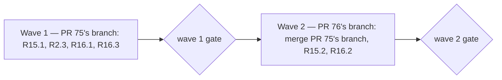

# Install and use experience — iteration 2 spec

**Source:** the two blocking findings of the [PR 75 review](https://github.com/WolvenTech/wolven-harness/pull/75), both reproduced on PR 75's head `5b7e393` and on PR 76's head `e1a58ca`. This file holds only the delta. Every row of `install-experience-spec.md` and `install-experience-iteration-1-spec.md` stands as written unless a row below amends it. The review posted no nits, and the Human chose to spec only these two findings.

## Findings in this round

Numbering continues from iteration 1, whose findings run F1 to F14.

| Finding | Where | Reproduced | Lands in |
|---|---|---|---|
| F15 A setup rerun drops `layout`, `codeRepo` and `commitConvention` | `src/setup/options.ts:494` | A config holding all three, then `setup` again: exit 0, and none of the three keys is left. On PR 76, `harnessHome` is dropped the same way | R15.1, R15.2 |
| F16 Gemini gets no `GEMINI.md` in inline mode | `src/setup/runtimes.ts:365` | `setup --runtimes gemini,codex`: exit 0, and no `GEMINI.md`. Gemini reads `GEMINI.md`, not `AGENTS.md`, so it loads neither the guide nor the rules | R2.3 (amended), R16.1, R16.2, R16.3 |

## Design decisions this iteration

| # | Decision | Alternative | Why |
|---|---|---|---|
| D1 | **Setup copies every key it does not own.** On a rerun, setup sets `version`, `gitHost`, `runtimes`, `skillSets`, `packageVersion` and `packageManager`, and copies every other key of the existing config unchanged, typed or not | Add each typed key to the rebuild by name | The bug comes from naming keys one by one: `readConfig` moved three keys out of `extra`, and the rebuild kept copying only `ignore` and `extra`. PR 76 adds a fourth typed key, `harnessHome`, and drops it the same way |
| D2 | **Gemini's row gains an entry file.** The row gets `entryFile: GEMINI.md` holding `@AGENTS.md`. Its rules wiring stays the `file` kind at the same path. Where a row's entry path is also its `file` rules path, setup writes that path once: the rendered rules file in native mode, the entry alone in inline mode | Make Gemini an `imports` row like Amp, with the rule imports in the harness section | D2 keeps native-mode output byte-identical to what PR 75 ships today, and keeps the change inside the registry and one setup branch. The alternative changes every native Gemini install and moves Gemini's rules into `harness-init`'s text |
| D3 | **Gemini stays a supported runtime.** | Drop the `gemini` runtime id, which the Human offered if the fix was hard | The fix is one registry field and one setup branch. Dropping it changes the public runtime list in the install contract ADR on both branches, the guide, the registry and `doctor`. No release ever wired Gemini (`v0.3.2` knew only `claude`, `codex` and `cursor`), so neither choice breaks an installed copy |
| D4 | **`doctor` code is unchanged.** | Teach `doctor` the entry rule from D2 | `entryProblem` in `src/doctor/runtime-checks.ts` already treats a `file` row whose output imports `@AGENTS.md` as that runtime's entry, in both modes. On PR 76 today it reports the missing `GEMINI.md`; once setup writes it, the check passes. Only a regression proof is added (R16.2) |

## Repository grounding

| Path or thing | Exists | Role here |
|---|---|---|
| `resolveOptions` in `src/setup/options.ts` | yes | Rebuilds the config on every run; copies only `ignore` and `extra` (F15) |
| `readConfig`, `writeConfig` and `Config` in `src/setup/config.ts` | yes | Types `layout`, `codeRepo` and `commitConvention` (and, on PR 76, `harnessHome`), so they leave `extra` |
| `wireRuntimes`, the Gemini row and `geminiMd` in `src/setup/runtimes.ts` | yes | Writes `entryFile`s in both modes and `file` rules wiring only in native mode; Gemini has no `entryFile` (F16) |
| `ownsEntry` and the wiring groups in `src/setup/summary.ts` | yes | Group by `entryFile` and `rules` paths; a shared path must be reported once |
| `entryProblem` in `src/doctor/runtime-checks.ts` (PR 76) | yes | Already checks `GEMINI.md` as Gemini's entry in both modes (D4) |
| `docs/notes/runtime-instruction-loading/runtime-instruction-loading-note.md` | yes | Gemini's default context file is `GEMINI.md`; it reads `AGENTS.md` only when `context.fileName` lists it |
| The install contract ADR under `docs/adrs/` (the wiring contract on PR 75, its check-and-repair successor on PR 76) | yes | The config table and "Existing keys keep their order"; the runtime list keeps `gemini`. Neither changes |
| `site/runtimes.md` | yes | Its Gemini row and section say `GEMINI.md` imports every rule, which is true in native mode only |
| `test/setup-native-wiring.test.ts`, `test/config-keys.test.ts`, `test/setup-options.test.ts`, `test/runtime-registry.test.ts`, `test/doctor.test.ts` (PR 76) | yes | Homes for the proofs below |

## Surface walk

- **In scope, wave 1 (PR 75's branch):** `src/setup/options.ts`, the Gemini row and `wireRuntimes` in `src/setup/runtimes.ts`, `src/setup/summary.ts` only if a shared path is reported twice, `site/runtimes.md`, and the tests that hold R15.1, R2.3, R16.1 and R16.3.
- **In scope, wave 2 (PR 76's branch):** a merge of PR 75's branch, and the tests that hold R15.2 and R16.2.
- **Out of scope:** `src/doctor/**` source (D4), both contract ADRs, the known forms table (`GEMINI.md` and the config file are not template paths), and every other runtime row.

## Waves

- **Wave 1** runs on `claude/install-wiring`. Its gate is `pnpm build && pnpm test && pnpm lint && pnpm validate && pnpm comments`.
- **Wave 2** runs on `claude/install-check-and-repair`, after merging `claude/install-wiring` into it. Its gate is the same five commands. If the merge changes any template, `pnpm gen:known-forms` runs first and its output is part of the wave.
- A failed gate aborts before the next wave.

## Requirements (obligation ↔ proof)

### Amended row

| ID | Obligation | Proof | Verification |
|---|---|---|---|
| R2.3 | As in iteration 1, with one addition. A runtime whose entry is a file of its own still gets that entry in inline mode, with no rule imports: Gemini's `GEMINI.md` holds `@AGENTS.md` and nothing else. No runtime reads the rules twice | `proof-install-experience-gemini-entry` | `test/setup-native-wiring.test.ts`: `--runtimes gemini,codex` and `--runtimes gemini,antigravity` each create `GEMINI.md` byte-equal to `@AGENTS.md` and a newline, with no `@.agents/rules/` line, and create no `.claude/rules` |

### R15 — A rerun keeps the keys setup does not own

| ID | Obligation | Proof | Verification |
|---|---|---|---|
| R15.1 | A `setup` run over an existing `.wolven-harness.json` sets only `version`, `gitHost`, `runtimes`, `skillSets`, `packageVersion` and `packageManager`. Every other key keeps its value and its place in the key order: `ignore`, `layout`, `codeRepo`, `commitConvention`, `comments` and any unknown key (D1) | `proof-install-experience-config-rerun` | `test/setup-options.test.ts`: a config holding `ignore`, `layout: "home"`, `codeRepo: "../client"`, a `pattern` `commitConvention`, `comments.paths` and one unknown key; `setup` runs again with flags; exit 0; each listed key deep-equals its value before the run, and their relative order is unchanged |
| R15.2 | On PR 76, R15.1 also holds for `layout: "linked"` with `harnessHome` | `proof-install-experience-config-rerun-linked` | Same test file on PR 76's branch: a config holding `layout: "linked"` and `harnessHome: ".."`; `setup` runs again; exit 0; both keys keep their values |

### R16 — Gemini's entry in both modes

| ID | Obligation | Proof | Verification |
|---|---|---|---|
| R16.1 | Gemini's registry row carries `entryFile` `GEMINI.md` with `@AGENTS.md`. Where a row's entry path is also its `file` rules path, setup writes that path once per run: the rendered rules file in native mode, the entry content in inline mode. The summary names the path once, and an existing file at that path is left byte-identical and named as needing `harness-init`, as R2.2 says | `proof-install-experience-shared-entry` | `test/setup-native-wiring.test.ts`: `--runtimes gemini` writes `GEMINI.md` equal to the rendered rules file (the existing "gemini imports AGENTS.md and every rule" case); a second run leaves it byte-identical and creates nothing; the summary lists `GEMINI.md` once; `test/runtime-registry.test.ts` still finds no runtime path outside the registry |
| R16.2 | On PR 76, `doctor` passes a `gemini,codex` install whose `AGENTS.md` holds the harness section and a complete inline block, and fails `doctor-entry` when `GEMINI.md` is missing (D4) | `proof-install-experience-doctor-gemini` | `test/doctor.test.ts`: `setup --runtimes gemini,codex`, a complete inline block, commit, `doctor` exits 0; delete `GEMINI.md`, `doctor` exits 1 with `doctor-entry` naming Gemini |
| R16.3 | `site/runtimes.md` says Gemini's `GEMINI.md` imports `@AGENTS.md` and every rule in native mode, and `@AGENTS.md` only in inline mode | `proof-install-experience-gemini-docs` | `test/readme-install.test.ts`: the Gemini row and section of `site/runtimes.md` name both modes; `pnpm docs:build` exits 0 |

## Nine-dimension landings

| Dimension | Landing | Where |
|---|---|---|
| validation | obligation ↔ proof | R15.1 / `proof-install-experience-config-rerun`: copied keys go through the same `writeConfig`, so a key `readConfig` rejects never reaches a rewrite |
| failure modes | obligation ↔ proof | R16.1 / `proof-install-experience-shared-entry`: an existing `GEMINI.md` is left as it is and reported, never overwritten |
| idempotency and retry | obligation ↔ proof | R16.1: a second run creates nothing and leaves `GEMINI.md` byte-identical. R15.1: a rerun is a no-op on keys setup does not own |
| authorization | n/a | Unchanged surface: setup writes only inside the folder it runs in (the contract's setup guarantees); no new path or permission |
| concurrency and ordering | obligation ↔ proof | R15.1: key order is kept, as the contract's "Existing keys keep their order" requires |
| data lifecycle | obligation ↔ proof | R15.1, R15.2: `codeRepo`, `commitConvention` and `harnessHome`, recorded by `harness-init`, live until the Human edits them; setup never removes them |
| external-dependency failure | n/a | Unchanged surface: no network, and no new tool; Gemini's file-loading rules come from the cited note |
| state transitions | obligation ↔ proof | R2.3, R16.1: adding `codex` or `antigravity` to a native Gemini install switches the install to inline mode. An existing `GEMINI.md` with rule imports is left as it is and reported, as R2.2 and iteration 1's R11 already require |
| observability | obligation ↔ proof | R16.1: the summary names `GEMINI.md` once. R16.2: `doctor-entry` names Gemini when the file is missing |

## Unresolved

None. Each row above follows from a reproduced finding and a decision recorded here.

## Out of scope

- Changing `doctor` source (D4).
- Any contract ADR edit. The config table and the runtime list stay as they are.
- Review nits; none were posted, and the Human chose these two findings only.
- Dropping the `gemini` runtime id (D3).

## Pragmatic-guard refuses

- A per-key allow-list in the config rebuild (D1).
- A new rules-wiring kind for Gemini when one field and one branch cover it (D2).

## Acceptance

### Wave 1 — PR 75's branch

- [x] `proof-install-experience-gemini-entry` PASS — R2.3
- [x] `proof-install-experience-config-rerun` PASS — R15.1
- [x] `proof-install-experience-shared-entry` PASS — R16.1
- [x] `proof-install-experience-gemini-docs` PASS — R16.3

### Wave 2 — PR 76's branch

- [x] `proof-install-experience-config-rerun-linked` PASS — R15.2
- [x] `proof-install-experience-doctor-gemini` PASS — R16.2

## Eval / gates

| Gate | Command / check | When | PASS | Abort |
|------|-------------------|------|------|-------|
| Build | `pnpm build` | End of each wave | exit 0 | Fix; do not proceed |
| Tests | `pnpm test` | End of each wave | exit 0, 0 todo | Fix; do not proceed |
| Lint | `pnpm lint` | End of each wave | exit 0 | Fix; do not proceed |
| Integrity | `pnpm validate` (`harness:validate`) | End of each wave | exit 0, 0 claim failures | Fix; do not proceed |
| Comments | `pnpm comments` | End of each wave | exit 0 | Fix the added comment |
| Repro | `setup --runtimes gemini,codex` in a fresh `git init` folder, and a rerun over a config holding `codeRepo` | End of wave 1 | `GEMINI.md` is `@AGENTS.md`; `codeRepo` survives | Fix; do not proceed |
| Spec obligations | `proof-install-experience-iteration-2-spec-obligations`: every acceptance box names one row; every new or amended row has one proof no other row uses; F15 and F16 each map to a row; all nine landings named; every `n/a` cites an unchanged surface | Before `code-plan` | all hold | Do not plan |

## Cross-domain leak table

| Leak | Refuse |
|------|--------|
| Units and their order | `code-plan` |
| Running the units | `code-execute`, in Codex |
| Pushing both branches and refreshing the PR 75 and PR 76 bodies | `code-pr`, on the Human's ask |
| Replying to and resolving the two review threads on PR 75 | `code-ci`, on the Human's ask |
| Re-reviewing PR 75 or PR 76 | `code-review`, on the Human's ask |

## ADR

None owed. D1 restores what the config contract already implies, D2 adds a registry field, and the public runtime list and config table stay as written.
