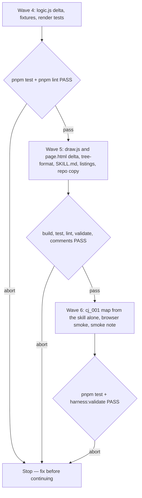

# Journey Map Skill, Iteration 1

**Source:** `docs/prds/archived/journey-map/journey-map-prd.md` (status `stable`, amended after the cj_001 test and the journey-details prototype).
**Base:** `docs/specs/archived/journey-map/journey-map-spec.md`. Waves 1 to 3 shipped on PR #58 and stay as frozen. This file holds only the delta. Where the two disagree, this file wins, and the rows it removes are listed under Removed.
**Prototype:** [`journey-details-prototype/` at `385d5fc`](https://github.com/WolvenTech/wolven-harness/tree/385d5fcc88a86d58f448b9f2db3a8199659be84e/docs/notes/visual-map-kinds/journey-details-prototype), removed from `docs/notes/` before merge. Verdict: promote layout H, with the thought cloud's scalloped bumps removed. Its data, rows and drawing are the starting point; layouts A to F and G are not ported.
**Next:** After the Human approves → `code-plan` → `code-execute`, waves **4 → 5 → 6**.
**Named proof (this spec's own structural gate):** `proof-journey-map-iter1-spec-obligations`

## Term challenge

| Term | Resolution |
|------|------------|
| Journey map | As the amended PRD defines it. A user journey is an action path, not the swim-lane grid (deferred to `service-blueprint`). This replaces the base spec's "Not the UX persona artifact" |
| Journey step | A `waypoint` drawn as a journey card. A waypoint is a journey step when the map has a `persona` or the waypoint carries any journey field. Any other waypoint draws dashed, as before. This replaces the prototype's `journey: true` flag |
| Journey fields | `mood`, `thought`, `touchpoints`, `pains`, `opportunities`, valid only on a `waypoint` |
| Mood | A whole number from −2 to +2: −2 🙁 Frustrated, −1 😕 Uneasy, 0 😐 Neutral, +1 🙂 Positive, +2 😃 Delighted. Each has a fixed colour and a soft tint, from the prototype's `MOOD` table. The word is used only in tooltips and labels for screen readers, never drawn |
| Header band | The strip across the top of a journey card: mood colour, face and the persona's first name on the left, card actions on the right |
| Thought cloud | The rounded bubble above a journey card holding its `thought` |
| Mood timeline | The docked chart at the bottom of the page. It replaces the PRD's earlier "mood strip" and the prototype's "dock" |
| Step by step | A page mode where the walk also holds at every waypoint until "Next" |
| Walked path | The ordered node ids from the first flow tree's start along the chosen options. Under "Show whole map" it follows each choice's `default`, then its first option |
| Ticket | Removed from this skill (PRD non-goal; the wayfinder work on PR #57) |

## Repository grounding

| Surface | Present today | Role for this iteration |
|---------|----------------|----------------------------|
| `templates/.agents/skills/journey-map/renderer/logic.js` | yes | Loses tickets. Gains journey validation, card zones in `rows`, the step-by-step reveal, `walked`, `pending` and the new feedback line |
| `templates/.agents/skills/journey-map/renderer/draw.js` | yes | Loses ticket drawing. Gains the header band, cloud, details, stickies, mood arrows, persona header, timeline, toolbar menu, Prev and Next, shortcuts and the three fixes |
| `templates/.agents/skills/journey-map/renderer/page.html` | yes | Gains the toolbar menu, Prev, the timeline island and the mood and sticky tokens. Loses the ticket tokens |
| `templates/.agents/skills/journey-map/references/tree-format.md` | yes | Loses the ticket kind. Gains persona, scenario and the journey fields |
| `templates/.agents/skills/journey-map/SKILL.md` | yes | New description, artifact by default, the mood mapping step |
| `templates/.agents/skills/journey-map/scripts/build-map.mjs` | yes | Unchanged |
| `test/journey-map-render.test.ts`, `test/skill-journey-map.test.ts` | yes | Ticket tests removed, new tests added |
| `test/fixtures/journey-map/lotr-map.json`, `malformed-map.json` | yes | Ticket nodes and ticket cases removed |
| `test/fixtures/journey-map/harness-init-redesign-map.json` | yes | Must still validate and build unchanged |
| [`journey-details-prototype/` at `385d5fc`](https://github.com/WolvenTech/wolven-harness/tree/385d5fcc88a86d58f448b9f2db3a8199659be84e/docs/notes/visual-map-kinds/journey-details-prototype) | yes | The approved prototype: `cj-001-journey.json`, `renderer/logic.js`, `renderer/draw.js`, `renderer/page.html` |
| `docs/notes/visual-map-kinds/cj-001-source.json` | yes | The cj_001 source, which scores mood from −1 to 4 |
| `docs/notes/journey-map-smoke/journey-map-smoke-note.md` | yes | Gains the wave 6 smoke |
| `AGENTS.md` skills table, `site/skills.md` | yes | Both repeat the description that says "ticket graph" |
| `.agents/skills/journey-map/**` | yes | The repo copy, held identical by `test/skill-copies.test.ts` |
| `test/fixtures/journey-map/cj-001-map.json` | no | New, for the journey fixture |

## Surface walk

- **In scope:**
  - `templates/.agents/skills/journey-map/**` except `scripts/build-map.mjs`, and its repo copy `.agents/skills/journey-map/**`
  - `test/journey-map-render.test.ts`, `test/skill-journey-map.test.ts`, `test/fixtures/journey-map/**`
  - the journey-map rows in `AGENTS.md` and `site/skills.md`
  - `docs/notes/journey-map-smoke/journey-map-smoke-note.md`
  - the base spec's header, which gains one line pointing here
- **Out of mutate scope (unchanged):**
  - `scripts/build-map.mjs`, `src/**`, `package.json`
  - `SET_SKILLS`, the partition test and the skill count: the skill stays, in `discovery`
  - [`journey-details-prototype/` at `385d5fc`](https://github.com/WolvenTech/wolven-harness/tree/385d5fcc88a86d58f448b9f2db3a8199659be84e/docs/notes/visual-map-kinds/journey-details-prototype), the prototype's record
  - the deferral folders and every other shipped skill

## Design

### Map tree delta (`version: 1` stays)

```json
{
  "version": 1,
  "title": "Alex Rivera: spreadsheets to invoicing software",
  "persona": { "name": "Alex Rivera", "role": "Small Business Owner", "goal": "Find a reliable and affordable invoicing software" },
  "scenario": "Alex needs to switch from manual spreadsheets to an automated invoicing tool to save time.",
  "trees": [{ "id": "journey", "nodes": [
    { "id": "start", "kind": "start", "label": "Alex Rivera", "next": "aw-2" },
    { "id": "aw-2", "kind": "waypoint", "tag": "Awareness", "label": "Searches Google for invoicing tools",
      "mood": -1, "thought": "Which one is actually simple to use?",
      "touchpoints": ["Google Search"], "pains": ["Unclear pricing tiers"], "opportunities": ["A clear pricing guide"] }
  ]}]
}
```

- `persona` is optional: `name` (required string), `role?`, `goal?`. `scenario?` is a string. Both draw as the header of the first flow tree's start card.
- On a `waypoint`: `mood?` (whole number −2 to +2), `thought?` (string), `touchpoints?`, `pains?`, `opportunities?` (lists of strings).
- A journey field on any kind other than `waypoint` is an error naming the node.
- `kind: "ticket"` is now an unknown kind, and so are `ticket`, `status`, `claimed_by` and `blocked_by` as fields that mean anything. A tree needs exactly one `start` with no ticket-only exception.

### Journey card (layout H)

Rows sit in three zones, so layout reserves all of them and nothing covers a neighbour:

- **Top:** the thought cloud, when `thought` is set. It is a rounded rectangle in Caveat with a soft shadow, with three shrinking circles trailing down to the card. It has no scalloped bumps. It always shows.
- **Card:**
  - The 32px header band. With a mood, the band is the mood colour, with the face and the persona's first name in white. With no mood, it is neutral grey with the name in muted ink. With no `persona`, the band shows the face only.
  - The band's right end holds the only two card actions: expand or collapse (a chevron, dimmed and inert with nothing to expand) and add note (the pencil). The body has no pencil.
  - The tag eyebrow in the mood colour, then the title.
  - Collapsed: one row of icon counts (📍 touchpoints, ⚠ pains, 💡 opportunities), shown only for the lists present. Expanded: touchpoint chips inside the card.
- **Bottom, expanded only:** pains as a red sticky and opportunities as a green sticky, slightly rotated, below the card.

A step with no thought and no lists draws its band and title only. Expanded state lives in the page, and so it changes layout. That is the one exception to the base spec's "positions don't depend on answers": expanding or collapsing moves the cards below and beside it, never on a choice.

The flow edge into a journey step takes that step's mood colour at 3.2px. Choice edges keep their own colour.

### Page delta

- **Toolbar:** title on the left. On the right: "Prev" and "Next" while step by step is on, "Start over", a ⋯ menu, and "Copy for agent".
  - The menu holds "Step by step" (P), "Show whole map" (W) and "Expand all" (E), with the shortcut in a `kbd` beside each. It closes on Escape and on a click outside.
  - Shortcuts: `n` Next, `b` Prev, `r` Start over, plus the three above. They listen on `window`, the stage takes focus on load, and they are ignored in an input or with a modifier key.
- **Step by step:** on by default when the map has any journey step, off otherwise.
  - While on, the reveal also holds at every waypoint until it carries `done: true`. "Next" sets it and moves the camera to the new step. "Next" is disabled while the walk waits on a choice, checklist or text box.
  - "Prev" clears the latest answer on the walked path that revealed something (a waypoint's `done` or a choice), so the last node shown hides. Every earlier answer stays.
- **Mood timeline:** a docked island at the bottom centre, 120px tall, shown when the walked path holds a step with a mood.
  - It plots each such step in walk order on a −2 to +2 scale, with segments in the mood colour and the newest point ringed. Clicking a point moves the camera to it.
  - Its width is at most the viewport minus 32px and it scrolls sideways. Its lowest point stays inside the box. Camera fits reserve its height, and the variant bar is gone, so it collides with nothing.
- **Show whole map** refits the camera to everything drawn, and turning it off refits to the revealed nodes.
- **Expand all** expands every journey step with lists, or collapses all when every one is open, then refits to the revealed nodes.
- **Fixes:**
  - Enter in a text box acts as its "Continue".
  - A note under an annotated node sits between the card and the annotation, and layout reserves room for both.
  - Feedback for a checklist continued with no box changed is `<id> "<label>": continued with no change`.
- **Feedback:** "Next" writes no feedback line. A waypoint's `done` is pacing, not an answer.

### Removed from the base spec

- R5.1, R5.2 and their acceptance boxes. Every ticket clause in R1.3 and R2.1, the ticket row of the kind table, the ticket-column rule in Layout, and the ticket term.
- R3.3's "when artifact publishing is available, also publish", which R3-iter below replaces.

## Waves



A failed gate aborts before the next wave.

## Requirements (obligation ↔ proof)

### J1 — Tickets out

| ID | Obligation | Named proof | Evidence shape |
|----|------------|--------------|------------------|
| J1.1 | No shipped file in the skill folder, and no fixture, names a ticket. `validate` reports `kind ticket` as an unknown kind, and a ticket-only tree as having no `start` (PRD non-goal; PR #57) | `proof-journey-map-iter1-no-tickets` | Test: a tree with a `ticket` node gives an `unknown kind` error naming it; `rg -n -i "ticket\|claimed_by\|blocked_by" templates/.agents/skills/journey-map test/fixtures/journey-map` is empty |

### J2 — Walk delta (US-2)

| ID | Obligation | Named proof | Evidence shape |
|----|------------|--------------|------------------|
| J2.1 | Enter in a text box sets its `done`, reveals what follows and moves the view to it (AC-2.5) | `proof-journey-map-iter1-enter-continues` | Smoke: type in a text box, press Enter; recorded in the smoke note |
| J2.2 | "Show whole map" refits the camera to every drawn node, and turning it off refits to the revealed nodes (AC-2.6) | `proof-journey-map-iter1-whole-map-refit` | Smoke: on cj_001, the last step is inside the viewport after the toggle, with no Fit press |
| J2.3 | With `stepwise`, `revealed` holds at each waypoint until it carries `done`. `pending` names that waypoint. Without `stepwise`, the reveal is unchanged. Clearing the latest answer on the walked path hides exactly the last node shown (AC-2.7) | `proof-journey-map-iter1-step-by-step` | Test on `cj-001-map.json`: stepwise empty answers show `start` and the first step; `done` on it adds the next; the LotR fixture's `revealed` without `stepwise` matches the base expectation |
| J2.4 | In a browser: "Next" and `n` add one step and move the view; "Prev" and `b` hide it again; both show only while step by step is on (AC-2.7) | `proof-journey-map-iter1-prev-next-smoke` | Smoke, recorded in the smoke note |
| J2.5 | The toolbar shows exactly "Copy for agent", "Start over" and the ⋯ menu, plus "Prev" and "Next" while step by step is on. The menu lists Step by step, Show whole map and Expand all with their keys, and closes on Escape and an outside click. Every shortcut works straight after load, before any click (AC-2.8) | `proof-journey-map-iter1-toolbar` | Test: the built page's toolbar holds those buttons and the menu entries; smoke: a shortcut works on a fresh load at 1440px and 800px widths |

### J3 — Feedback delta (US-3)

| ID | Obligation | Named proof | Evidence shape |
|----|------------|--------------|------------------|
| J3.1 | `feedback` writes `<id> "<label>": continued with no change` for a checklist with `done` and no `checks`, and writes nothing for a waypoint's `done` (AC-3.1) | `proof-journey-map-iter1-feedback-lines` | Test: exact expected string for a no-change checklist, plus a done waypoint that adds no line |
| J3.2 | A note on an annotated node draws between the card and the annotation, with no overlap, and layout reserves room for both (AC-3.4) | `proof-journey-map-iter1-note-annotation` | Test: an annotated node's layout box leaves the note slot plus the annotation's lines under the card; smoke: both stickies readable on a fixture |
| J3.3 | `SKILL.md` publishes the page as an artifact without asking first when the runtime is Claude. On a comment it revises, rebuilds and republishes to the same URL. It hands over the local file when the Human said not to publish, the runtime isn't Claude, or publishing fails or can't carry the page. On a failure it says what blocked publishing and asks whether to retry or stay local (AC-3.2, AC-3.5) | `proof-journey-map-iter1-artifact-default` | Skill-contract test: grep for "without asking", "same URL", "not to publish" and "retry or stay local" |

### J4 — Journey details (US-5)

| ID | Obligation | Named proof | Evidence shape |
|----|------------|--------------|------------------|
| J4.1 | `validate` accepts `persona`, `scenario` and the journey fields as Design describes. It names the node for each of these: <ul><li>a `mood` that isn't a whole number from −2 to +2</li><li>a `thought` that isn't a string</li><li>a list field that isn't a list of strings</li><li>a journey field on a non-waypoint</li></ul> It names `map:` for a `persona` with no string `name`. The build exits 1 with those lines (AC-5.8, AC-1.4) | `proof-journey-map-iter1-journey-validate` | Test: one malformed case per item in `malformed-map.json` run through `validate`; `cj-001-map.json` gives no errors |
| J4.2 | `rows` puts the cloud in the top zone, the band, eyebrow, title and count row or chips in the card zone, and pains and opportunities in the bottom zone only when expanded. `layout` with every step expanded has no two boxes overlapping, counting clouds and stickies, and `height` equals the sum of the zones (AC-5.3 to AC-5.5) | `proof-journey-map-iter1-journey-layout` | Test on `cj-001-map.json`: zone membership per row kind, collapsed and expanded; no overlap with every step open; the height sum |
| J4.3 | A journey step is a waypoint on a map with `persona`, or one carrying a journey field. Any other waypoint keeps the dashed look | `proof-journey-map-iter1-journey-step` | Test: `isStep` on the LotR fixture's plain waypoint is false; on `cj-001-map.json`'s no-mood step it is true |
| J4.4 | `walked` returns the walk order through chosen options, follows `default` under show-all, and stops at the first pending step under `stepwise`. The timeline plots the walked path's mood steps in that order (AC-5.7) | `proof-journey-map-iter1-walked-path` | Test on `cj-001-map.json`: walked ids before and after choosing the competitor branch, and with show-all on |
| J4.5 | In a browser, cj_001 shows: <ul><li>each band's colour and face, with the first name and no mood word, and grey on the no-mood step</li><li>mood-coloured arrows</li><li>the chevron and pencil only in the band</li><li>the cloud above its card with trailing circles and no bumps</li><li>the count row when collapsed</li><li>chips inside and red and green stickies below when expanded</li><li>"Expand all" with no overlap, and a refit</li><li>the persona header</li><li>a timeline that follows a branch change, keeps its height and doesn't clip at −2</li></ul> All at 1440px and 800px (AC-5.1 to AC-5.7) | `proof-journey-map-iter1-journey-smoke` | Smoke on the wave 6 map, recorded in the smoke note with one line per item |
| J4.6 | Labels, thoughts, touchpoints, pains, opportunities and persona text render through `textContent`. The timeline is built with DOM calls, not `innerHTML` | `proof-journey-map-iter1-no-html-injection` | Test: a fixture with `</script>` in a thought and a pain builds to a page where it isn't present unescaped; grep shows no `innerHTML` in `draw.js` |
| J4.7 | `SKILL.md` and `tree-format.md` tell the agent to map a source's mood scale onto −2 to +2 and to write that mapping in the doc beside the map (AC-5.9) | `proof-journey-map-iter1-mood-mapping` | Skill-contract test: grep for "−2 to +2" and "mapping" in both files |
| J4.8 | An agent given only the installed skill folder and `cj-001-source.json` writes a cj_001 map that builds with exit 0. It has the persona, one step per user action, every source thought, touchpoint, pain and opportunity, a mood on every step, and the mapping in its note (PRD goal 5) | `proof-journey-map-iter1-cj001-reference` | Wave 6: a fresh subagent's JSON is committed as `test/fixtures/journey-map/cj-001-reference-map.json`, beside the hand-written `cj-001-map.json` the wave 4 tests use; a test asserts the build exits 0 and the counts match the source |

### J5 — Skill text and listings

| ID | Obligation | Named proof | Evidence shape |
|----|------------|--------------|------------------|
| J5.1 | The skill description reads "a flow, a set of options, or a user journey" in place of "a ticket graph". `AGENTS.md` and `site/skills.md` repeat it, and the repo copy matches the template | `proof-journey-map-iter1-listings` | `pnpm test` (`test/skill-copies.test.ts`, `test/skill-journey-map.test.ts`); `rg -n "ticket graph" AGENTS.md site/skills.md templates .agents` is empty |

## Nine-dimension landings

| Dimension | Landing kind | Landing |
|-----------|---------------|---------|
| validation | obligation ↔ proof | J4.1 / `proof-journey-map-iter1-journey-validate`; J1.1 / `proof-journey-map-iter1-no-tickets` |
| failure modes | obligation ↔ proof | J4.1 writes the error page and exits 1, as the base R1.3 does; J3.3 / `proof-journey-map-iter1-artifact-default` covers a failed publish |
| idempotency and retry | obligation ↔ proof | The base R7.1 / `proof-journey-map-deterministic` still runs on every fixture, `cj-001-map.json` included. Republishing goes to the same URL (J3.3) |
| authorization | `n/a` | Unchanged surface: a static local page with no credential. Artifact publishing goes through the runtime's own approval, unchanged by this skill |
| concurrency and ordering | obligation ↔ proof | J4.4 / `proof-journey-map-iter1-walked-path`: the timeline's order is the walk order, and branch changes reorder it |
| data lifecycle | `n/a` | Unchanged surface: the base R6.4 lifecycle (JSON source of truth, HTML derived, both move with the doc folder). Expanded state, like answers, lives only in the page |
| external-dependency failure | `n/a` | Unchanged surface: the base R7.3 rough.js and font fallback, with no new host |
| state transitions | obligation ↔ proof | Per page, adding to the base list: <ul><li>step pending → done → cleared by "Prev" (J2.3, J2.4)</li><li>card collapsed ↔ expanded, one or all (J4.2, J4.5)</li><li>menu closed ↔ open (J2.5)</li><li>step by step on ↔ off (J2.3)</li></ul> |
| observability | obligation ↔ proof | The status line still counts revealed nodes and notes; J2.5's menu names every shortcut; J4.1 prints one line per error |

## Unresolved

| Identifier | Decision needed | Owner | Blocking effect | Disposition |
|------------|-------------------|-------|-------------------|--------------|
| — | None. The prototype settled the card, the stepper and the toolbar | — | — | — |

## Out of scope

- Everything the PRD lists under Non-goals, including the grid, the blueprint and architecture kinds.
- Layouts A to F from the prototype, the `?variant=` switch, `?strip=` and `?pace=`.
- An inspector panel, a lane-style timeline drawn in the canvas, and the mood word on the band.
- Remembering expanded cards or step-by-step mode across reloads.

## Pragmatic-guard refuses

- A second map format or a `kind: "journey"`: a journey is a flow (PRD).
- A `journey: true` flag: the `persona` rule decides which waypoints are journey steps.
- A configurable mood scale, colours or faces.
- A browser test runner to prove the new drawing; the wave 6 smoke proves it, as in the base spec.

## Acceptance

### Wave 4

- [x] `proof-journey-map-iter1-no-tickets` PASS: tickets are an unknown kind, and nothing names them
- [x] `proof-journey-map-iter1-step-by-step` PASS: the stepwise reveal holds and releases; without it, unchanged
- [x] `proof-journey-map-iter1-feedback-lines` PASS: the no-change line, and no line for a done waypoint
- [x] `proof-journey-map-iter1-note-annotation` PASS (test part): the note and annotation slots are reserved
- [x] `proof-journey-map-iter1-journey-validate` PASS: each journey error names its node
- [x] `proof-journey-map-iter1-journey-layout` PASS: the zones, no overlap with every step open, and the height sum
- [x] `proof-journey-map-iter1-journey-step` PASS: the persona rule
- [x] `proof-journey-map-iter1-walked-path` PASS: walk order, the branch change and show-all

### Wave 5

- [x] `proof-journey-map-iter1-toolbar` PASS (test part): the toolbar buttons and menu entries
- [x] `proof-journey-map-iter1-no-html-injection` PASS: journey text stays escaped, and there's no `innerHTML`
- [x] `proof-journey-map-iter1-artifact-default` PASS
- [x] `proof-journey-map-iter1-mood-mapping` PASS
- [x] `proof-journey-map-iter1-listings` PASS: no "ticket graph" anywhere, and the repo copy is identical

### Wave 6

- [x] `proof-journey-map-iter1-cj001-reference` PASS: a subagent's cj_001 map builds and covers the source
- [x] `proof-journey-map-iter1-journey-smoke` PASS: every item recorded at both widths
- [x] `proof-journey-map-iter1-prev-next-smoke` PASS
- [x] `proof-journey-map-iter1-toolbar` PASS (smoke part): shortcuts on a fresh load at both widths
- [x] `proof-journey-map-iter1-enter-continues` PASS
- [x] `proof-journey-map-iter1-whole-map-refit` PASS
- [x] `proof-journey-map-iter1-note-annotation` PASS (smoke part): both stickies readable

## Eval / gates

| Gate | Command / check | When | PASS | Abort |
|------|-------------------|------|------|-------|
| Tests | `pnpm test` | End of each wave | exit 0 | Fix; do not proceed |
| Lint | `pnpm lint` | End of waves 4 and 5 | exit 0 | Fix; do not proceed |
| Build | `pnpm build` | Before validate and comments | exit 0 | Fix; do not proceed |
| Integrity | `node dist/cli.js validate` (`harness:validate`) | End of waves 5 and 6 | `validate: ok` | Fix; do not proceed |
| Comments | `pnpm comments` | End of wave 5 | `comments: ok` | Fix; do not proceed |
| Spec obligations | `proof-journey-map-iter1-spec-obligations`: every acceptance box names a proof from a J-row, every J-row has a box, all nine landings are present, and each `n/a` cites an unchanged surface | Before `code-plan` | all hold | Do not plan |

## Cross-domain leak table

| Leak | Refuse |
|------|--------|
| Ticket trees and the wayfinder map | PR #57 |
| Swim-lane grids, blueprints and a full-page mood spine | `docs/deferrals/archived/service-blueprint/service-blueprint-deferral.md` |
| C4 and architecture diagrams | `docs/deferrals/architectural-map/architectural-map-deferral.md` |
| A release or version bump | release-please, after merge |
| An executable plan from this skill | `code-plan` only |

## ADR

None needed this iteration. ADR-004 lists template contents as not contract, and `validate` doesn't change.
