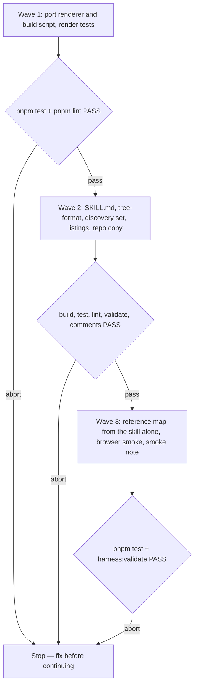

# Journey Map Skill

**Source:** `docs/prds/archived/journey-map/journey-map-prd.md` (status `stable`, amended after the prototype).
**Prototype:** `docs/notes/journey-map-prototype/journey-map-prototype-note.md`. Verdict: promote. Wave 1 ported its renderer and build script; the throwaway source isn't kept.
**Next:** After the Human approves → `code-plan` → `code-execute`, waves
**1 → 2 → 3**.
**Iteration 1:** `docs/specs/archived/journey-map/journey-map-iteration-1-spec.md` freezes the delta from the amended PRD. It removes R5 and every ticket clause here, and replaces R3.3's artifact rule.
**Named proof (this spec's own structural gate):** `proof-journey-map-spec-obligations`

## Term challenge

| Term | Resolution |
|------|------------|
| Journey map | As the PRD defines it: a pan-and-zoom drawing of a flow's branches, choices and steps. Not the UX persona artifact. |
| Map tree | The JSON file `<slug>-map.json`. It is the source of truth. The HTML is derived from it and is never edited by hand. |
| Map page | The generated `<slug>-map.html`. |
| Renderer | The page shell, logic and drawing files shipped in the skill folder, copied into every map page unchanged. |
| Waypoint | As the PRD defines it: a step the agent performs with no question, drawn dashed. |
| Answers | The page's in-memory record per node: `choice`, `checks`, `text`, `note`, `done`. It is lost on reload; the "Copy for agent" text is the record (PRD non-goal). |
| Revealed | A node the Human has reached on the current answers. Only revealed nodes draw unless "Show whole map" is on. |
| Ticket | A node with `ticket`, `status`, `claimed_by` and `blocked_by`, using the field names and values of the frozen wayfinder design in `docs/specs/archived/wolven-harness-d-code-lane/wolven-harness-d-code-lane-spec.md`. This spec renders tickets. It does not write, claim or resolve them. |
| Discovery set | `SET_SKILLS.discovery` in `src/setup/skill-sets.ts`. |

## Repository grounding

| Surface | Present today | Role for this initiative |
|---------|----------------|----------------------------|
| `docs/notes/journey-map-prototype/journey-map-prototype-note.md` | yes | The accepted prototype's verdict, feedback rounds and lessons. Wave 1 ported its renderer, build script and samples; the copies were then removed |
| `src/setup/skill-sets.ts` (`SET_SKILLS`, `CORE_SKILLS`) | yes | Gains `journey-map` under `discovery` |
| `test/skill-sets.test.ts` partition test | yes | Must pass with the new folder; its folder count goes from 18 to 19 |
| `test/setup-skill-sets.test.ts`, `test/skills-command.test.ts` | yes | Read set membership from `SET_SKILLS`; the hard-coded count of 18 changes |
| `src/skills/install.ts`, `src/setup/apply.ts` | yes | Copy every file in a skill folder. Reused unchanged |
| `test/helpers/skill-contract.ts` (`assertSkillBasics`, `readSkill`) | yes | Shared skill checks for the new skill |
| `test/skill-copies.test.ts` | yes | Holds the repo's installed copy identical to the template |
| `src/comments/index.ts` (`findCommentFindings`) | yes | Judges `.js` and `.mjs` comment lines. A consumer's `harness:comments` judges the shipped scripts on the install diff |
| `docs/adrs/adr-004-standalone-skills-contract.md` | yes, `stable` | "Not contract" covers the set of skills, set membership and template contents. No amendment |
| `docs/WRITING-PROFILE.md` | yes | Extra files in a slug folder aren't checked, so map files and the prototype files pass `validate` |
| `code-pr/references/pre-merge-closure.md` | yes | Moves whole PRD and spec folders to `archived/`, so map files move with their doc |
| `docs/deferrals/wayfinder-maps/wayfinder-maps-deferral.md` | yes | Its non-goal "no references to `wayfinder` or maps from other shipped skills" still holds |
| `README.md`, `site/skills.md` | yes | List the discovery set and the skill count |
| `test/fixtures/` | no | New, for the map-tree fixtures |

## Surface walk

- **In scope:**
  - `templates/.agents/skills/journey-map/**` (new skill)
  - its installed copy at `.agents/skills/journey-map/**` and a row in this repo's `AGENTS.md` skills table
  - `src/setup/skill-sets.ts`
  - the skill counts in `test/skill-sets.test.ts` and `test/setup-skill-sets.test.ts`
  - new `test/skill-journey-map.test.ts`, `test/journey-map-render.test.ts` and `test/fixtures/journey-map/**`
  - the discovery lists in `README.md` and `site/skills.md`
  - `docs/notes/journey-map-smoke/journey-map-smoke-note.md`
- **Out of mutate scope (unchanged):**
  - `src/validate/**`: no check on map files
  - `src/skills/**` and `src/setup/apply.ts`: copying is reused as-is
  - `src/comments/**`
  - `docs/WRITING-PROFILE.md`
  - ADR-004
  - every other shipped skill, `grilling` included
  - `package.json` dependencies
  - `docs/notes/journey-map-prototype/journey-map-prototype-note.md`, the prototype's record

## Design

### Skill folder

```
journey-map/
  SKILL.md
  references/tree-format.md   the map tree format, with one small example
  renderer/page.html          the page shell and CSS, with marked slots
  renderer/logic.js           pure functions: validate, rows, layout, revealed, faded, feedback, blocked
  renderer/draw.js            the SVG drawing, input, camera and the "Show whole map" toggle
  scripts/build-map.mjs       Node built-ins only
```

`logic.js` is a classic script with no DOM access. It sets `globalThis.JourneyMapLogic`, so the page, the build script (through `node:vm`) and the tests all run the same code.

Wave 1 ports the prototype's four files. It keeps their behaviour and rewrites them as readable code that follows the repo's comment rule. The prototype's dense one-line functions are not shipped as-is.

### Build

`node <skill-dir>/scripts/build-map.mjs <dir>/<slug>-map.json` writes `<dir>/<slug>-map.html`:

- The script reads the tree and runs `JourneyMapLogic.validate`.
- It inlines `logic.js`, `draw.js`, the tree and the input path into the `page.html` slots. The tree is JSON with `<`, U+2028 and U+2029 escaped. The renderer sits between `<!-- journey-map:renderer -->` markers.
- It writes the page even when the tree is invalid, so the page shows the error. Then it exits 1 and prints one line per error to stderr.
- On success it prints `journey-map: wrote <path> (<n> nodes)` and exits 0.
- An input path that doesn't end in `-map.json`, or that can't be read or parsed as JSON, exits 1 and writes nothing.
- The output depends only on the tree bytes, the renderer files and the input path string, with no timestamps.

### Map tree (`version: 1`)

```json
{
  "version": 1,
  "title": "…",
  "subtitle": "…",
  "trees": [{ "id": "setup", "label": "Setup", "nodes": [ … ] }],
  "links": [{ "from": "setup-leaf", "to": "init-start", "label": "then, in your agent" }],
  "annotations": [{ "id": "a1", "target": "init-start", "text": "nothing is written until you say yes" }]
}
```

**Tree-level rules:**
- Node ids are unique across the whole map. Every node has `id`, `kind` and `label`.
- A tree has exactly one `start` node, unless every node in it is a `ticket`.
- Each tree is a graph with no cycles: `next` edges in a flow tree, and `blocked_by` edges in a ticket tree.
- `next`, `gates` and `blocked_by` point only inside their own tree. Only `links` cross between trees.
- A tree's optional `label` names it on the canvas. The heading is left out when it would repeat the start node's label.

| `kind` | Extra fields | Draws as |
|--------|--------------|----------|
| `start` | `sub?`, `next` | A tinted pill |
| `choice` | `tag?`, `note?`, `default?` (an option key), `options: [{ key, label, hint?, badge?, next }]` | A card with one radio row per option. `default` is a recommendation shown as a "recommended" pill, never a pre-chosen answer |
| `checklist` | `sub?`, `items: [{ key, label, hint?, on? (default true), gates?: [waypointId] }]`, `next` | A card of checkboxes and a "Continue" button. `gates` point only at `waypoint` nodes |
| `text` | `sub?`, `placeholder?`, `next?` | A card with one input and a "Continue" button |
| `waypoint` | `tag`, `next?` | A dashed, muted card |
| `card` | `sub?`, `sections: [{ head, items: [string], numbered? }]` | A closing card with an accent bar and no outgoing edge |
| `ticket` | `ticket: research \| prototype \| grilling \| task`, `status: open \| claimed \| closed`, `claimed_by?`, `blocked_by?: [ticketId]` | A card with a status stripe and dot, an initial avatar for `claimed_by`, and a "blocked" pill while any blocker isn't `closed` |

### Layout

- One metrics table (`JourneyMapLogic.M`) and a per-node `rows(node)` list drive both `layout` and drawing, so a drawn card is always exactly as tall as its layout box.
- Text wraps by a per-row character budget. A word longer than the budget breaks at the budget.
- Layout runs left to right, with trees stacked top to bottom. A flow node's column is its longest path from the start, and a ticket's column is its `blocked_by` depth. Rows follow first-visit order, and each column is centred on its tree's midline.
- Positions don't depend on answers. Revealing a node never moves another node.

### Page behaviour

- **Reveal.** In a flow tree, `revealed` walks from the start. It passes through `start` and `waypoint` nodes. At a `choice` it continues only through the chosen option, and at a `checklist` or `text` only once `done` is set. Every node in a ticket tree is always revealed.
- **Show whole map.** A top-bar toggle that also draws every unrevealed node and edge, faint. It is reachable by keyboard and reports its state with `aria-pressed`. Turning it off keeps every answer.
- **Fading.** A revealed node fades when every path to it from the start passes through an unchosen option of an answered choice. A waypoint gated by an unticked checklist item fades and shows a "later" pill. Unchosen option rows dim.
- **Camera.** It waits for a non-zero canvas size before its first fit. After a choice or a Continue, it moves to the newly revealed nodes. Focusing a node outside the viewport scrolls it into view.
- **Notes.** A pencil button on each card opens a one-line note input below the card. A saved note shows as a sticky.
- **Edges.** Edges run centre to centre. A choice edge starts at its option row. Links between trees are dashed and carry a label pill.
- **"Copy for agent"** writes plain text. The first line is `journey-map feedback for <input path>`. Then come touched nodes in layout order. An answer and a note on the same node give separate lines, and labels and typed text are JSON-escaped:
  - `<id> "<label>": chose <key> "<option label>"`
  - `<id> "<label>": ticked <keys>; unticked <keys>` (keys separated by a comma and a space, in item order)
  - `<id> "<label>": typed "<text>"`
  - `<id> "<label>": note "<text>"`

  The page writes the same lines into a selectable box when the clipboard write is refused.

### Look

- **Interface:** Inter (400, 500 and 600) for all interface text. Caveat 500 only for annotations and notes. Both come from Google Fonts, with system fallbacks.
- **Cards:** plain SVG with a soft drop shadow on a dotted, light-grey canvas. Each card has a small kind label in capitals ("Question", "Checklist", "Your answer", "Step", "Summary", "<kind> ticket").
- **rough.js 4.6.6:** draws only arrows, with low roughness. The page loads it from jsDelivr, pinned with `integrity` and `crossorigin`.
- **Light only.** Themes and dark mode are PRD non-goals.

## Waves



A failed gate aborts before the next wave.

## Requirements (obligation ↔ proof)

### R1 — Tree to page (US-1)

| ID | Obligation | Named proof | Evidence shape |
|----|------------|--------------|------------------|
| R1.1 | `build-map.mjs` turns a valid `<slug>-map.json` into a sibling `<slug>-map.html` that holds the whole renderer and tree, loads only rough.js and Google Fonts from the network, and exits 0 with the `wrote` line (AC-1.1) | `proof-journey-map-build-writes-page` | Test: build a fixture in a temp dir; assert the exit code, the stdout line, the sibling file, and that every `src` or `href` points at `cdn.jsdelivr.net/npm/roughjs@4.6.6`, `fonts.googleapis.com` or `fonts.gstatic.com` |
| R1.2 | Two different trees built by the script carry a renderer region that is byte-identical to `logic.js` and `draw.js` in both pages (goal 2) | `proof-journey-map-renderer-identical` | Test: build `test/fixtures/journey-map/lotr-map.json` and a second fixture; the text between the markers equals the files' bytes in each |
| R1.3 | `JourneyMapLogic.validate` names the node for each of these: <ul><li>an unknown `kind`</li><li>a duplicate id</li><li>a `next`, `gates`, link or annotation target that doesn't exist</li><li>a `next`, `gates` or `blocked_by` that crosses trees</li><li>a `gates` target that isn't a waypoint</li><li>a `blocked_by` entry that names a missing node or a non-ticket node</li><li>a cycle</li><li>a bad `status` or `ticket` value</li><li>a `default` that isn't an option key</li><li>a missing `label`</li><li>a tree with no `start` or two of them</li></ul> The page shows those errors in a visible panel instead of a canvas, and the build prints the same lines and exits 1 (AC-1.4, AC-5.2) | `proof-journey-map-malformed` | Test: one malformed fixture per case run through `validate` in `node:vm`; the build of `malformed-map.json` exits 1, its stderr names the nodes, and the written page carries the error-panel element |
| R1.4 | Layout puts every node on one canvas with no two boxes overlapping. A node's column is its longest path from the start. For every node, `height` equals the sum of its `rows` plus padding (goal 1) | `proof-journey-map-layout` | Test: `layout` on both fixtures; no box overlaps; the column of a node two paths reach; `height(n)` against `rows(n)` for every node |

### R2 — Walk the flow (US-2)

| ID | Obligation | Named proof | Evidence shape |
|----|------------|--------------|------------------|
| R2.1 | `revealed(map, {})` holds only each flow tree's start and its first stop, plus every ticket. Choosing an option adds that option's path and nothing behind the other options. Shared nodes appear once reached (AC-2.1) | `proof-journey-map-reveal-choice` | Test on the LotR fixture: empty answers give `shire` and `route` plus the four tickets; `route: road` adds `bree`, `rivendell` and `pack` but not `forest` |
| R2.2 | A checklist or text node stops the reveal until its answers carry `done: true` (AC-2.5) | `proof-journey-map-reveal-continue` | Test: `pack` without `done` hides `pony`; with `done` it shows `pony` and not `meal` |
| R2.3 | `faded(map, answers)` fades exactly the nodes reachable only through unchosen options, and a node two branches share stays unfaded (AC-2.1) | `proof-journey-map-fade-choice` | Test on the LotR fixture: `route: road` fades `forest` and not `rivendell` |
| R2.4 | Unticking a checklist item fades the waypoints it gates and marks them "later"; ticking it again clears both (AC-2.2) | `proof-journey-map-fade-checklist` | Test: toggle `rope` twice; compare the `faded` and `later` sets |
| R2.5 | In a browser: <ul><li>choosing an option and pressing Continue move the camera to the newly revealed nodes</li><li>"Show whole map" draws every node faint and back again, keeping answers</li><li>Tab reaches every option, checkbox, text box, note button, Continue, the toggle and the top-bar and zoom buttons, and Enter or Space operates each</li><li>a pointer drag of 4px or more pans and chooses nothing</li><li>a link to a tree above its source draws without crossing a card</li></ul> (AC-2.1, AC-2.3 to AC-2.6) | `proof-journey-map-browser-smoke` | Manual smoke in a browser, recorded step by step in the smoke note |
| R2.6 | Labels, hints and notes render through `textContent` or an input's `value`, never through HTML parsing, and the embedded tree escapes `<` as `<` | `proof-journey-map-no-html-injection` | Test: a fixture with `</script>` in a label builds to a page where that string is not present unescaped; grep shows no `innerHTML` in `draw.js` |

### R3 — Feedback (US-3)

| ID | Obligation | Named proof | Evidence shape |
|----|------------|--------------|------------------|
| R3.1 | `JourneyMapLogic.feedback(tree, answers, path)` returns the frozen text format above: each touched node by id and label, in layout order, with separate answer and note lines, comma-and-space key lists, and JSON-escaped text. Untouched nodes are left out (AC-3.1) | `proof-journey-map-feedback-text` | Test: answers with a choice, a note on the same node, a checklist toggle and a typed text give the exact expected string |
| R3.2 | When the clipboard write rejects, the page shows the same text in a selected, read-only `<textarea>` (AC-3.3) | `proof-journey-map-clipboard-fallback` | Smoke: serve the page with a `Permissions-Policy` that denies `clipboard-write`; recorded in the smoke note |
| R3.3 | `SKILL.md` tells the agent to ask the Human to press "Copy for agent" and paste the result, then to revise the JSON, rebuild and reopen. In Claude with artifact publishing available, it also publishes the page, and on a comment it revises, rebuilds and republishes to the same URL (AC-3.1, AC-3.2) | `proof-journey-map-skill-feedback-loop` | Skill-contract test: grep for "Copy for agent", "same URL" and the rebuild step |

### R4 — Install (US-4)

| ID | Obligation | Named proof | Evidence shape |
|----|------------|--------------|------------------|
| R4.1 | `journey-map` is listed in `SET_SKILLS.discovery`, and the partition test passes with 19 template folders (AC-4.2) | `proof-journey-map-partition` | `pnpm test` (`test/skill-sets.test.ts`) |
| R4.2 | `setup --skills discovery` and `skills --skills journey-map` copy `journey-map/` with `SKILL.md`, the renderer and the script into each chosen runtime's skills folder, and `--skills ship` or `--skills none` leaves it out (AC-4.1, AC-4.2) | `proof-journey-map-install` | Test: run both commands into temp dirs; assert the file list, and assert the folder is absent for `ship` and `none` |
| R4.3 | Every comment line in the shipped `.js` and `.mjs` files passes `findCommentFindings`, so a consumer's `harness:comments` stays green on the install diff | `proof-journey-map-comments-clean` | Test: commit a temp repo, add the skill's scripts, then `findCommentFindings` returns `[]` |
| R4.4 | `README.md` and `site/skills.md` list `journey-map` in the discovery set and give the new skill count. The repo's installed copy matches the template | `proof-journey-map-listings` | `pnpm test` (`test/skill-copies.test.ts`, plus `test/readme-install.test.ts` where it applies); `rg -n "journey-map" README.md site/skills.md` |

### R5 — Tickets (US-5)

| ID | Obligation | Named proof | Evidence shape |
|----|------------|--------------|------------------|
| R5.1 | `open`, `claimed` and `closed` tickets draw with distinct styles, a claimed ticket shows its `claimed_by`, and a ticket-only tree is fully revealed with empty answers (AC-5.1) | `proof-journey-map-ticket-status` | Test: `ticketStyle` gives three distinct values, and `revealed(map, {})` holds every ticket; the smoke note confirms the look |
| R5.2 | Each `blocked_by` entry draws an edge from blocker to blocked, and `blocked` is true while any blocker isn't `closed` (AC-5.2) | `proof-journey-map-ticket-blocked` | Test on the LotR fixture: the dependency edges and the `blocked` value before and after a blocker closes |

### R6 — Skill text (US-1)

| ID | Obligation | Named proof | Evidence shape |
|----|------------|--------------|------------------|
| R6.1 | `SKILL.md` passes `assertSkillBasics`, has a third-person "Use when" description, isn't ask-only, and says it runs when the Human asks or accepts a one-line offer | `proof-journey-map-skill-basics` | Skill-contract test |
| R6.2 | The skill writes the map files beside the doc they serve under `docs/<folder>/<slug>/`. With no doc it first writes `docs/notes/<slug>/<slug>-note.md` (`type: note`, `status: draft`) and runs `harness:validate` (AC-1.1, AC-1.3) | `proof-journey-map-skill-placement` | Skill-contract test: grep for both paths, the frontmatter values and `harness:validate` |
| R6.3 | The skill tells the agent to write only the JSON, never edit the HTML, run `build-map.mjs` after every write, fix the tree on exit 1, and open the page once in a browser tool when the runtime has one (AC-1.1, AC-1.4) | `proof-journey-map-skill-build-step` | Skill-contract test |
| R6.4 | The skill says a map is a design aid that is not kept in sync with shipped code and moves with its doc folder on archive (AC-1.5). No shipped file names `wayfinder` or `docs/maps/` | `proof-journey-map-skill-lifecycle` | Skill-contract test: grep for the sentence; `rg -n "wayfinder\|docs/maps" templates/.agents/skills/journey-map` is empty |
| R6.5 | An agent given only the installed skill folder writes the `harness-init` redesign tree. It builds with exit 0 and holds both paths, the goal text box, the "How much should we change your current AGENTS.md?" choice, the full-tour checklist, the skills fork, the checks choice, the commits checklist and the hand-back card, reached from a `setup` tree by a link (AC-1.2, goal 1) | `proof-journey-map-reference-map` | Wave 3: a fresh subagent gets only the skill folder and the step list from the published `harness-init` prototype; its JSON is committed as `test/fixtures/journey-map/harness-init-redesign-map.json`; a test asserts the build exits 0 and each listed node exists |

### R7 — Dimension landings

| ID | Obligation | Named proof | Evidence shape |
|----|------------|--------------|------------------|
| R7.1 | Building the same tree twice gives byte-identical HTML | `proof-journey-map-deterministic` | Test: build twice; compare the bytes |
| R7.2 | A bad input path, unreadable file or invalid JSON exits 1 with a one-line reason and writes no HTML | `proof-journey-map-build-input-errors` | Test: three cases, each asserting exit 1 and no output file |
| R7.3 | If rough.js fails to load, the page shows a readable message naming the CDN URL instead of a blank canvas, and text falls back to system fonts. Validation runs first, so a malformed tree still shows its node errors. The rough.js tag pins `4.6.6` with the `integrity` hash recorded in the prototype note and `crossorigin` | `proof-journey-map-cdn-failure` | Test: the page has the pinned URL and the hash computed from the fetched file; smoke: block the URL with a test CSP and record the message |
| R7.4 | The first camera fit waits for a non-zero canvas size | `proof-journey-map-camera-wait` | Smoke: open the page in a pane that is still sizing; it opens at a readable zoom, not the minimum |

## Nine-dimension landings

| Dimension | Landing kind | Landing |
|-----------|---------------|---------|
| validation | obligation ↔ proof | R1.3 / `proof-journey-map-malformed`, and R7.2 / `proof-journey-map-build-input-errors` |
| failure modes | obligation ↔ proof | R1.3 writes the error page and exits 1; R3.2 / `proof-journey-map-clipboard-fallback`; R7.4 / `proof-journey-map-camera-wait` |
| idempotency and retry | obligation ↔ proof | R7.1 / `proof-journey-map-deterministic`. Rerunning the build overwrites only its own `<slug>-map.html` |
| authorization | `n/a` | Unchanged surface: the map is a static local file with no credential. Artifact publishing goes through the runtime's own Artifact approval, which this skill doesn't change. Install permissions are the unchanged `src/skills/**` and `src/setup/apply.ts` |
| concurrency and ordering | `n/a` | Unchanged surface: one agent writes one map tree per slug folder, and the build writes one sibling file. Multi-folder install ordering stays in the unchanged `src/skills/install.ts` |
| data lifecycle | obligation ↔ proof | R6.4 / `proof-journey-map-skill-lifecycle`: the JSON is the source of truth, the HTML is derived from it, and both move with the doc folder through the unchanged `pre-merge-closure.md`. Answers live only in the page (Term challenge) |
| external-dependency failure | obligation ↔ proof | R7.3 / `proof-journey-map-cdn-failure`. Opening maps with no network stays a PRD non-goal |
| state transitions | obligation ↔ proof | Per node: <ul><li>hidden → revealed (R2.1, R2.2)</li><li>unanswered → chosen, re-choosable (R2.3)</li><li>ticked ↔ unticked (R2.4)</li><li>not done → done</li><li>the toggle: hiding upcoming ↔ showing the whole map (R2.5)</li></ul> Ticket status is read-only here (R5.1) |
| observability | obligation ↔ proof | R1.1 prints the `wrote` line, R1.3 prints one stderr line per error plus the on-page panel, and the status line counts revealed nodes and notes |

## Unresolved

| Identifier | Decision needed | Owner | Blocking effect | Disposition |
|------------|-------------------|-------|-------------------|--------------|
| `U-cdn-client-repos` | Whether maps that load jsDelivr and Google Fonts are acceptable in a client's repo for the UX engagement | Rafael | Non-blocking | Decided 2026-10-13 by Rafael: CDNs are acceptable in a client's repo. A client that restricts them vendors rough.js and the fonts by hand; the skill doesn't change |

## Out of scope

- Everything the PRD lists under Non-goals: computed text, offline maps, `validate` checks, a new doc folder or `type`, the wayfinder skill, changes to other skills, the `harness-init` update, map sync, client stakeholders, saving answers across reloads, themes and image export.
- A browser test harness or any new dev dependency. Interaction is proven by the wave 3 smoke.
- Linting the shipped renderer with Biome; `pnpm lint` keeps its current scope.
- Measuring rendered text width for wrapping; the character budget stays.

## Pragmatic-guard refuses

- A bundler, npm package or build step beyond the one Node built-ins script.
- Playwright or another browser runner added to prove interaction.
- Schema-versioning machinery beyond the `version: 1` field and its check.
- Pre-filled answers in the map tree. A decided answer is written as static text in the node instead.
- Any change to `grilling` or to a skill that calls `journey-map`.

## Acceptance

### Wave 1

- [x] `proof-journey-map-build-writes-page` PASS: the build writes the sibling page and loads only the three allowed hosts
- [x] `proof-journey-map-renderer-identical` PASS: the renderer region is byte-identical across two maps
- [x] `proof-journey-map-malformed` PASS: each malformed case names its node, and the build exits 1
- [x] `proof-journey-map-layout` PASS: no overlaps, columns follow the longest path, heights match rows
- [x] `proof-journey-map-reveal-choice` PASS: only the chosen path is revealed
- [x] `proof-journey-map-reveal-continue` PASS: checklist and text wait for Continue
- [x] `proof-journey-map-fade-choice` PASS: choice fading spares shared nodes
- [x] `proof-journey-map-fade-checklist` PASS: an unticked item fades its waypoint as "later"
- [x] `proof-journey-map-no-html-injection` PASS: no unescaped label, and no `innerHTML`
- [x] `proof-journey-map-feedback-text` PASS: the exact feedback string
- [x] `proof-journey-map-ticket-status` PASS (test part): three distinct styles, and tickets are always revealed
- [x] `proof-journey-map-ticket-blocked` PASS: blocked edges and state
- [x] `proof-journey-map-deterministic` PASS: same bytes twice
- [x] `proof-journey-map-build-input-errors` PASS: three input errors, no output
- [x] `proof-journey-map-cdn-failure` PASS (test part): pinned URL with `integrity`

### Wave 2

- [x] `proof-journey-map-partition` PASS: 19 folders, partition holds
- [x] `proof-journey-map-install` PASS: present with `discovery` and `--skills journey-map`, absent with `ship` and `none`
- [x] `proof-journey-map-comments-clean` PASS: shipped scripts give zero comment findings
- [x] `proof-journey-map-listings` PASS: README and site list it, and the repo copy is identical
- [x] `proof-journey-map-skill-feedback-loop` PASS
- [x] `proof-journey-map-skill-basics` PASS
- [x] `proof-journey-map-skill-placement` PASS
- [x] `proof-journey-map-skill-build-step` PASS
- [x] `proof-journey-map-skill-lifecycle` PASS

### Wave 3

- [x] `proof-journey-map-reference-map` PASS: a subagent's tree from the skill alone builds and holds every listed node
- [x] `proof-journey-map-browser-smoke` PASS: reveal, toggle, keyboard, drag-is-not-click and the upward link recorded
- [x] `proof-journey-map-clipboard-fallback` PASS: the fallback box is recorded
- [x] `proof-journey-map-camera-wait` PASS: a sizing pane opens at a readable zoom
- [x] `proof-journey-map-ticket-status` PASS (smoke part): the ticket look is checked by eye
- [x] `proof-journey-map-cdn-failure` PASS (smoke part): the blocked-CDN message is recorded

## Eval / gates

| Gate | Command / check | When | PASS | Abort |
|------|-------------------|------|------|-------|
| Tests | `pnpm test` | End of each wave | exit 0 | Fix; do not proceed |
| Lint | `pnpm lint` | End of waves 1 and 2 | exit 0 | Fix; do not proceed |
| Build | `pnpm build` | Before validate and comments | exit 0 | Fix; do not proceed |
| Integrity | `node dist/cli.js validate` (`harness:validate`) | End of waves 2 and 3 | `validate: ok` | Fix; do not proceed |
| Comments | `pnpm comments` | End of wave 2 | `comments: ok` | Fix; do not proceed |
| Spec obligations | `proof-journey-map-spec-obligations`: every acceptance box names a proof from an R-row, every R-row has a box, all nine landings are present, and each `n/a` cites an unchanged surface | Before `code-plan` | all hold | Do not plan |

## Cross-domain leak table

| Leak | Refuse |
|------|--------|
| Charting, claiming or resolving tickets | The wayfinder PRD, owned by Rafael |
| Updating `harness-init` to the redesign drawn on the map | Its own initiative (the harness-init basics path PRD) |
| A `validate` check or a governed folder for maps | Needs an ADR-004 amendment; a PRD non-goal |
| A release or version bump | release-please, after merge |
| An executable plan from this skill | `code-plan` only |

## ADR

None needed this initiative. ADR-004 lists the set of skills, set membership and template contents as not contract, and `validate` doesn't change.

## Section checklist

| Section | Required when |
|---------|-----------------|
| Source | Always |
| Repository grounding | Always |
| Surface walk | Always |
| Waves | The work spans more than one mutate batch |
| Requirements with obligation ↔ proof | Always |
| Nine-dimension landings | Always, with all nine named |
| Unresolved | Always; an empty table is fine when no product or contract decision is open |
| Out of scope | Always |
| Pragmatic-guard refuses | Always |
| Acceptance | Always; tick a box only once its evidence exists |
| Eval / gates | Always |
| Cross-domain leak table | Always |
| ADR | Always, even when the answer is "none needed this initiative" |
