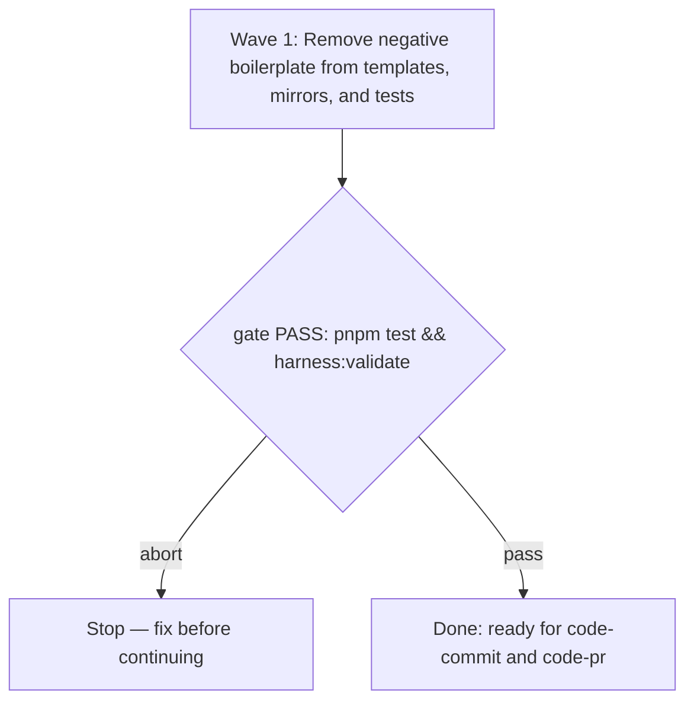

# Pragmatic-guard consult alignment spec

**Source:** `docs/prds/archived/pragmatic-guard-consult/pragmatic-guard-consult-prd.md` (status `deprecated`)
**Next:** After the Human approves → `code-plan` → `code-execute`, wave **1**
**Named proof (this spec's own structural gate):** `proof-pragmatic-guard-consult-spec-obligations`

## Repository grounding

| Surface | Present today | Role for this initiative |
|---------|----------------|----------------------------|
| `templates/.agents/skills/code-commit/SKILL.md` | yes | Ship template: remove mandatory negative boilerplate |
| `templates/.agents/skills/code-pr/SKILL.md` | yes | Ship template: remove mandatory negative boilerplate |
| `templates/.agents/skills/code-review/SKILL.md` | yes | Ship template: remove mandatory negative boilerplate |
| `templates/.agents/skills/code-ci/SKILL.md` | yes | Ship template: remove mandatory negative boilerplate |
| `.agents/skills/code-{commit,pr,review,ci}/SKILL.md` | yes | Repository copies: match template updates |
| `test/skill-code-pr.test.ts` | yes | Test suite: assert consult contract without mandatory negative boilerplate |
| `test/skill-code-ci.test.ts` | yes | Test suite: assert consult contract without mandatory negative boilerplate |
| `test/skill-code-review.test.ts` | yes | Test suite: assert consult contract without mandatory negative boilerplate |
| `test/skill-code-commit.test.ts` | yes | Test suite: assert consult contract for code-commit |

## Surface walk

- **In scope:**
  - `templates/.agents/skills/{code-commit,code-pr,code-review,code-ci}/SKILL.md`
  - `.agents/skills/{code-commit,code-pr,code-review,code-ci}/SKILL.md`
  - `test/skill-code-pr.test.ts`
  - `test/skill-code-ci.test.ts`
  - `test/skill-code-review.test.ts`
  - `test/skill-code-commit.test.ts`
- **Out of mutate scope (unchanged):**
  - `src/**` — no CLI or binary changes; `setup` and `validate` remain unchanged
  - `docs/adrs/**` — no ADR changes
  - `.agents/rules/**` — standing rules (`yagni-strict.md`, `comments.md`, etc.) remain unchanged
  - other skills (`create-prd`, `code-spec`, `code-plan`, `code-execute`, `pragmatic-guard`, `adr`, `qmd`, `grilling`)

## Waves

Single-wave initiative: all modifications land and pass validation in Wave 1.

## Requirements (obligation ↔ proof)

### R1 — Remove mandatory negative boilerplate from ship skills

| ID | Obligation | Named proof | Evidence shape |
|----|------------|--------------|------------------|
| R1.1 | `templates/.agents/skills/code-commit/SKILL.md` and `templates/.agents/skills/code-pr/SKILL.md` do not require `pragmatic-guard was not consulted` in commit messages, pull request bodies, or replies, while preserving the rule that a folder on disk or a remembered name is not loaded and that no sentence claims the guard ran when it did not. | `proof-guard-consult-no-negative-commit-pr` | Grep / test inspection of `templates/.agents/skills/code-commit/SKILL.md` and `templates/.agents/skills/code-pr/SKILL.md` verifies the negative requirement is absent and non-execution is not claimed as executed. |
| R1.2 | `templates/.agents/skills/code-review/SKILL.md` and `templates/.agents/skills/code-ci/SKILL.md` do not require `pragmatic-guard was not consulted` in reviews, replies, or durable text, while preserving the rule that reading an existing negative note does not treat the guard as having run. | `proof-guard-consult-no-negative-review-ci` | Grep / test inspection of `templates/.agents/skills/code-review/SKILL.md` and `templates/.agents/skills/code-ci/SKILL.md` verifies the negative requirement is absent and reader safety is maintained. |
| R1.3 | Repository skill copies under `.agents/skills/{code-commit,code-pr,code-review,code-ci}/SKILL.md` match the updated content of their respective templates. | `proof-guard-consult-mirrors-match` | Diff / byte comparison between `.agents/skills/<name>/SKILL.md` and `templates/.agents/skills/<name>/SKILL.md` for all four skills reports no divergence. |
| R1.4 | Tests in `test/skill-code-pr.test.ts`, `test/skill-code-ci.test.ts`, `test/skill-code-review.test.ts`, and `test/skill-code-commit.test.ts` verify the updated consult contract: runtime session list governs loading, disk presence does not count, and no test demands the negative boilerplate. | `proof-guard-consult-tests-verify` | `pnpm test` runs all skill contract tests green without requiring `pragmatic-guard was not consulted` in consult sections. |

## Nine-dimension landings

| Dimension | Landing kind | Landing |
|-----------|---------------|---------|
| validation | obligation ↔ proof | R1.4 pairs test execution via `pnpm test` and doc check via `harness:validate`. |
| failure modes | obligation ↔ proof | R1.1 and R1.2 require that when `pragmatic-guard` is absent or unconsulted, no false claim of execution is emitted and no deferrals are created. |
| idempotency and retry | n/a | Skill Markdown files are static documentation; applying the text edit repeatedly produces the identical clean state. Cited unchanged surface: `templates/` and `.agents/skills/`. |
| authorization | n/a | No runtime access control or permission checks are added or modified. Cited unchanged surface: `src/**`. |
| concurrency and ordering | n/a | Single-wave static file edits with no concurrent processes or order dependencies. Cited unchanged surface: `src/**`. |
| data lifecycle | obligation ↔ proof | R1.1 and R1.2 eliminate unwanted durable text pollution (`pragmatic-guard was not consulted`) from git commits and PR descriptions. |
| external-dependency failure | n/a | Zero external dependencies added or invoked. Cited unchanged surface: `package.json`. |
| state transitions | n/a | No persistent state machine or cross-session tracker added. Cited unchanged surface: `src/**`. |
| observability | obligation ↔ proof | R1.4 verifies test assertions and gate output via `pnpm test` and `node dist/cli.js validate`. |

## Unresolved

| Identifier | Decision needed | Owner | Blocking effect | Disposition |
|------------|-------------------|-------|-------------------|--------------|
| None | All decisions settled in PRD and issue #55 maintainer clarification | Human | Non-blocking | Empty table |

## Out of scope

- Adding automated skill install commands or package dependencies.
- Adding a session tracking daemon, log analyzer, or database to track prior consults across processes.
- Modifying `pragmatic-guard`'s own internal rules or evaluation scoring.
- Changing CLI flags or contracts under ADR-006.

## Pragmatic-guard refuses

- Refuse introducing a cross-session consult tracker: present need is low and complexity is high; removing the negative boilerplate solves the problem without state tracking.
- Refuse making `pragmatic-guard` a universal mandatory consult across all skills: each skill consults only when pertinent to its immediate operational scope.

## Acceptance

### Wave 1

- [x] `code-commit` and `code-pr` templates remove mandatory negative boilerplate (pairs with R1.1, `proof-guard-consult-no-negative-commit-pr`)
- [x] `code-review` and `code-ci` templates remove mandatory negative boilerplate (pairs with R1.2, `proof-guard-consult-no-negative-review-ci`)
- [x] Repository `.agents/skills/` mirrors match templates (pairs with R1.3, `proof-guard-consult-mirrors-match`)
- [x] Test suite updates pass with zero failures (pairs with R1.4, `proof-guard-consult-tests-verify`)

## Eval / gates

| Gate | Command / check | When | PASS | Abort |
|------|-------------------|------|------|-------|
| Integrity | `pnpm build && node dist/cli.js validate` | End of Wave 1 | exit 0 | Fix; do not proceed |
| Test suite | `pnpm test` | End of Wave 1 | exit 0, all tests pass | Fix failing tests |
| Lint | `pnpm lint` | End of Wave 1 | exit 0 | Format/fix with Biome |
| Spec obligations | `proof-pragmatic-guard-consult-spec-obligations` — structural pairing of R1.1-R1.4 with acceptance and proofs | Before `code-plan` | all hold | Do not plan |

## Cross-domain leak table

| Leak | Refuse |
|------|--------|
| CLI flag changes or consumer drift detection | Belongs to issue #45 (`setup --check`), not this skill alignment |
| Behavioral testing of QMD or search eval | Belongs to issue #53 / PR #54, not this initiative |
| An executable plan from this skill | `code-plan` only |

## ADR

None needed this initiative. This work refines prompt and template contract text within established ADR-006 guidelines and does not alter architecture decisions.

## Section checklist

| Section | Required when | Present |
|---------|-----------------|---------|
| Source | Always | yes |
| Repository grounding | Always | yes |
| Surface walk | Always | yes |
| Waves | The work spans more than one mutate batch | yes |
| Requirements with obligation ↔ proof | Always | yes |
| Nine-dimension landings | Always — all nine named | yes |
| Unresolved | Always | yes |
| Out of scope | Always | yes |
| Pragmatic-guard refuses | Always | yes |
| Acceptance | Always | yes |
| Eval / gates | Always | yes |
| Cross-domain leak table | Always | yes |
| ADR | Always | yes |
