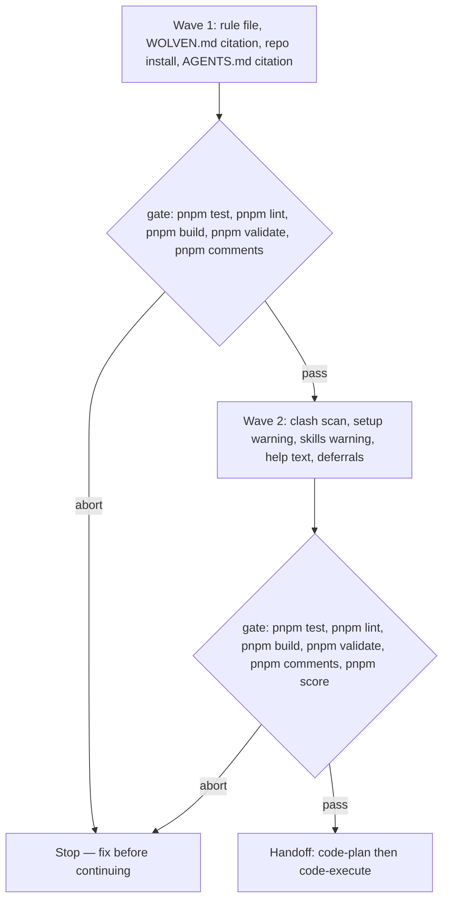

# Project skill precedence over same-named user-level skills

**Source:** confirmed ask — [issue #59](https://github.com/WolvenTech/wolven-harness/issues/59):
"Whenever a project has a skill installed, agents always use the project-level
copy and never a user-level skill with the same name", with the constraint
"The runtime (Claude Code, Codex, Cursor) decides how skills resolve. The
harness can't change that order, so the fix has to steer agents and surface
clashes", and acceptance "when the Human invokes that skill, the agent follows
the project copy" and "`setup` or `skills` prints a warning naming the
clashing skill and both paths".

**Superseded:** This implementation spec is retained as historical context.
The approved [iteration 1 remediation spec](project-skill-precedence-iteration-1-spec.md)
replaces its scanner and warning requirements with the project-first rule
scope. The three deferral records originally requested here were later removed
by Human direction; no follow-up scanner or marker work is tracked.

**Next:** After the Human approves → `code-plan` → `code-execute`, wave 1.

**Root cause, and the alternative ruled out.** In the session that filed #59, two
skills with no user-level twin — `clickup-ops` and `okf-authoring` — loaded from
the project, in the same session where a same-named `grilling` loaded from the
user directory. Project skills therefore do register through the wired
`.claude/skills` symlink, and the failure is shadowing rather than discovery. A
symlink-discovery bug would have failed all three, and it would move the fix to
`src/setup/runtimes.ts`. It is ruled out by that observation.

**Structural gate:** see the Spec obligations row of Eval / gates below. It is a
check with an owning unit, not a named proof, because a proof name with no
artifact behind it reads as coverage that does not exist.

## Repository grounding

| Surface | Present today | Role for this initiative |
|---------|----------------|----------------------------|
| `templates/.agents/rules/` | yes — `comments.md`, `qmd-first.md`, `yagni-strict.md` | Where the new rule file ships |
| `templates/WOLVEN.md` | yes — hand-maintained "## Standing rules" list of three bullets | The only path that carries a rule to a consumer, since `setup` never edits `AGENTS.md` |
| `templates/.agents/skills/` | yes — 19 skill folders, each with `SKILL.md` | The names a project can clash on |
| `.agents/rules/`, `.agents/skills/` | yes — this repo's installed copies (22 skills, 3 rules) | This repo is a live instance of the bug, so it installs the rule too |
| `src/setup/apply.ts` `applyTemplates` | yes — walks `templates/` and creates missing paths only | Copies the new rule into a consumer; skips any existing path, `AGENTS.md` included |
| `src/setup/index.ts` | yes — `ui.warn(...)` notes for the missing devDependency and the harness-score version | The channel `setup`'s clash warning prints through |
| `src/setup/harness-score.ts` `harnessScoreWarning(ctx)` | yes — pure, returns `string \| undefined`, carries the exact fix command | The shape the clash warning follows |
| `src/skills/install.ts` `destinationDirs(choices, projectRoot, home)` | yes — `claude` → `<root>/.claude/skills/<skill>`, `codex`/`cursor` → `<root>/.agents/skills/<skill>` | Reused for the project/user load-path constants |
| `src/skills/install.ts` `globalHome(io)` | yes — `io.env.HOME` when non-empty, else `os.homedir()` | The home resolution `setup` gains for detection |
| `src/skills/index.ts` | yes — `skills` with `--runtimes`, `--scope`, `--skills` | The second warning site; `--scope global` is how a user-level clash is created |
| `src/validate/spine.ts` `rule-missing` | yes — every cited `.agents/rules/<name>.md` must exist | Turns a drifted citation into an error |
| `src/setup/render-wolven.ts` | yes — substitutes `{{skills_table}}` only | The standing-rules list stays hand-maintained, so the citation is part of this change |
| `templates/.agents/skills/harness-init/references/entry-modes.md` | yes — folds `WOLVEN.md`'s Standing rules bullets into the `AGENTS.md` block verbatim | Carries the new bullet into consumer context, so each bullet must stand alone |
| `docs/adrs/adr-004-standalone-skills-contract.md` | yes, `stable` | Decides the contract question: template contents, skill text and human-readable messages are **Not contract** |
| [skill load paths note](../../notes/skill-load-paths/skill-load-paths-note.md) | yes, `stable` | The primary-source record of the four user roots and each runtime's documented behaviour |

## Surface walk

- **In scope:** `templates/.agents/rules/project-skill-precedence.md` (new),
  `templates/WOLVEN.md`, `.agents/rules/project-skill-precedence.md` (new),
  `AGENTS.md`, `src/skills/clash.ts` (new), `src/setup/index.ts`,
  `src/skills/index.ts`, `src/skills/parse.ts` (help text), `src/setup/ui.ts`
  (the addressee of the warning line), and the test suites named below.
- **Out of mutate scope (unchanged):** `src/validate/**` (no new finding code,
  no home scan) — cited by R7.1; `templates/.agents/skills/**` (no skill body
  is edited) — cited by R6.1; `src/skills/install.ts` copy behaviour, the
  `.claude/skills` symlink target, `.wolven-harness.json`, and every exit code
  — cited by R7.2 and R7.3.

## Requirements (obligation ↔ proof)

### R1 — The rule ships and is cited

| ID | Obligation | Named proof | Evidence shape |
|----|------------|--------------|------------------|
| R1.1 | `templates/.agents/rules/project-skill-precedence.md` exists with frontmatter `description` and `alwaysApply: true`, in the shape of the three shipped rules | `proof-project-skill-precedence-rule-file` | Inspect: frontmatter keys and the three sections |
| R1.2 | The rule states the project copy is authoritative and gives the check: when the loaded skill's base directory is not the project's `.agents/skills/<name>/` (or `.claude/skills/<name>/`), read the project copy and follow it instead | `proof-project-skill-precedence-rule-imperative` | Test: the body matches the directory check and the re-read instruction |
| R1.3 | `templates/WOLVEN.md`'s Standing rules list cites `.agents/rules/project-skill-precedence.md`, and the bullet carries the imperative itself, because `entry-modes.md` copies bullets into `AGENTS.md` without the rule file | `proof-project-skill-precedence-router` | Test: the bullet exists, cites the path, and names the re-read action |
| R1.4 | This repo installs its own copy: `.agents/rules/project-skill-precedence.md` is byte-identical to the template, and `AGENTS.md`'s Standing rules list cites it | `proof-project-skill-precedence-self-install` | Inspect + `validate`: exit 0 with the new citation resolved |
| R1.5 | A new rule file does not drift the harness-init fold: the `<standing-rules>` block a consumer gets cites the new rule | `proof-project-skill-precedence-harness-init-fold` | Test: rendered block contains the citation |
| R1.6 | `test/claims.test.ts`'s self-claim fixture carries the new rule file, so a citation added to `AGENTS.md` without the file fails the suite | `proof-project-skill-precedence-claim-fixture` | Test: the fixture lists the file and `validate` exits 0 |

### R2 — Clash detection reads real load paths

| ID | Obligation | Named proof | Evidence shape |
|----|------------|--------------|------------------|
| R2.1 | The project side is enumerated once: every name directly under `<root>/.agents/skills/` or `<root>/.claude/skills/` that carries a readable `SKILL.md`. Candidate directories are deduplicated by resolved path, because `.claude/skills` is a symlink to `../.agents/skills` in every repo the harness wires | `proof-project-skill-precedence-project-roots` | Test: the wired symlink shape yields one project entry per skill, never the same path twice |
| R2.2 | The user roots scanned are exactly `~/.claude/skills`, `~/.agents/skills`, `~/.cursor/skills` and `~/.codex/skills`, with `~` from `io.env.HOME` when non-empty, else `os.homedir()`. Flags shape the message, never the scan | `proof-project-skill-precedence-user-roots` | Test: a clash in each of the four roots is reported; a name only at user level is not |
| R2.3 | A user-level entry counts only when `<user root>/<name>/SKILL.md` is readable, so a stray directory or Claude Code's reserved `~/.claude/skills/synced/` never warns | `proof-project-skill-precedence-user-entry-guard` | Test: `synced/` and a bare directory do not fire |
| R2.4 | Two distinct dedupes, and they must not be conflated. User candidates are deduplicated by resolved file, so a user root that aliases another — `~/.claude/skills/<name>` symlinked into `~/.agents/skills/<name>` — is counted once. A project-versus-user pair is never suppressed by that dedupe: the project copy is a different file, so a real clash behind an aliased user root is still reported, exactly once, against the user path that owns the file | `proof-project-skill-precedence-identity-suppression` | Test: an aliased user root yields one candidate, and a divergent project clash behind that alias still reports exactly once |
| R2.5 | The message names the skill and both paths, and claims a resolution order for Claude Code only, attributed to that runtime's documentation; it names no deletion command | `proof-project-skill-precedence-clash-shape` | Test: message shape for one clash |
| R2.6 | The scan reads through `lstat` without following directory symlinks, treats an absent, unreadable or dangling candidate as no skill, and writes nothing | `proof-project-skill-precedence-scan-safety` | Test: dangling symlink, unreadable directory, and a before/after directory listing |
| R2.7 | Clashes are reported sorted by skill name, then by user root, so repeated runs are byte-identical | `proof-project-skill-precedence-scan-order` | Test: two runs produce identical output |
| R2.8 | A user-level copy byte-identical to the project copy is not reported. This is a deliberate false negative — following either copy is harmless while the bytes match — and it keeps the harness's own global install quiet. It is not a standing guarantee: once the copies diverge, the clash is reported on the next run of either command, and neither command runs on its own | `proof-project-skill-precedence-identical-silent` | Test: identical content produces no warning; divergent content does |

### R3 — `setup` prints the warning

| ID | Obligation | Named proof | Evidence shape |
|----|------------|--------------|------------------|
| R3.1 | `setup` prints one note per clash through the existing note channel (`ui.warn`), after the summary, alongside the devDependency and harness-score notices. The note names the skill and both paths, and states that it is a snapshot of the home directory at that moment so later installs are not covered | `proof-project-skill-precedence-setup-warning` | Command: `setup` over a fixture with a user-level twin; stderr carries the names and paths |
| R3.2 | With no clash, `setup` prints no clash line and its existing output is unchanged | `proof-project-skill-precedence-setup-silent` | Test: stderr has no clash text |
| R3.3 | The warning cannot change `setup`'s exit code: every home read is best-effort, so an unset `HOME`, an unreadable home or a dangling candidate yields no warning rather than a failure, and nothing is written under the project root | `proof-project-skill-precedence-setup-inert` | Test: exit 0, directory listing unchanged, unreadable home exits 0 with no note |

### R4 — `skills` prints the warning

| ID | Obligation | Named proof | Evidence shape |
|----|------------|--------------|------------------|
| R4.1 | `skills` scans unconditionally, whatever `--scope` says, so the E2 case (`--scope project` in a repo with a user-level twin) still warns | `proof-project-skill-precedence-skills-scope-independent` | Command: `skills --scope project` over a fixture with a twin; the warning names it |
| R4.2 | The warning goes to **stderr**, because `skills` writes nothing to stdout on success, and the run still exits 0 | `proof-project-skill-precedence-skills-stream` | Test: stdout stays empty, stderr carries the line, exit 0 |
| R4.3 | The scan runs after the copy, so a `--scope global` run that creates the clash reports the clash it just created, and removing the user copy clears the warning with no write outside the chosen destinations | `proof-project-skill-precedence-skills-after-copy` | Command: two runs, before and after deleting the twin |
| R4.4 | `skills --help` still writes only to stdout and exits 0, and its help text names the four user directories the scan reads | `proof-project-skill-precedence-skills-help` | Command: `skills --help` |

### R5 — Detection lives in one place

| ID | Obligation | Named proof | Evidence shape |
|----|------------|--------------|------------------|
| R5.1 | `src/skills/clash.ts` exports the load-path constants and the scan result; `setup` and `skills` both consume it and neither reimplements a path | `proof-project-skill-precedence-single-source` | Inspect: one definition, two call sites |
| R5.2 | The scan adds no runtime dependency; it uses `node:fs/promises`, `node:os` and `node:path` only | `proof-project-skill-precedence-no-deps` | Inspect: `package.json` dependencies unchanged |
| R5.3 | The rule text is the one document that carries the full guidance: the directory check, the re-read, and the human remedies each runtime documents for a personal copy (delete or rename the twin, or Claude Code's `skillOverrides` `"off"`). The warning stays one line per clash and points at the rule | `proof-project-skill-precedence-rule-remedy` | Test: the rule names both remedies and the warning does not |

### R6 — What is deliberately not built

| ID | Obligation | Named proof | Evidence shape |
|----|------------|--------------|------------------|
| R6.1 | No shipped `SKILL.md` body or description is edited, so no consumer copy starts differing and no replacement prompt is added | `proof-project-skill-precedence-no-skill-edits` | `git diff --stat` touches no `templates/.agents/skills/**` file |
| R6.2 | The deferrals this initiative creates exist under `docs/deferrals/`, each with observable triggers: the self-identifying skill line, the standing check at check time, and the user-level symlink into a project tree | `proof-project-skill-precedence-deferrals` | Inspect: three deferral files with `- [ ]` triggers |

### R7 — Contract and blast radius

| ID | Obligation | Named proof | Evidence shape |
|----|------------|--------------|------------------|
| R7.1 | No new `validate` finding code, no new config key, no new command flag, and no new exit code: `validate` and `harness-score` are not touched | `proof-project-skill-precedence-contract` | Test: the finding-code list in `test/contract.test.ts` is unchanged; exit codes unchanged |
| R7.2 | This repo is a live instance: a `setup` run inside a fixture that copies this repo's `.agents/skills/` reports the divergent `grilling`, `handoff` and `prototype` clashes, claims no resolution order beyond Claude Code's documented one, and prints no deletion command | `proof-project-skill-precedence-live-clashes` | Command: `setup` over the fixture with a home dir carrying the three twins |
| R7.3 | Running `setup` twice reports the same clashes, and the scan never creates, deletes or edits a file | `proof-project-skill-precedence-idempotent` | Command: two `setup` runs, identical warnings, unchanged tree |

## Nine-dimension landings

| Dimension | Landing kind | Landing |
|-----------|---------------|---------|
| validation | obligation/proof | R1.1–R1.6 and R2.1–R2.8; the structural gate is `validate` (`rule-missing` resolves the new citation) plus the named tests. Note what `rule-missing` cannot do: it checks cited-path→file only, so an installed-but-uncited rule passes green, which is why R1.4 and R1.5 are tests rather than validate findings |
| failure modes | obligation/proof | R2.6 and R3.3 — a dangling, unreadable or absent candidate contributes nothing and never fails the command; a non-git directory is fine for `skills`, and `setup` already requires the git top-level |
| idempotency and retry | obligation/proof | R7.3 — the scan writes nothing, so repeated `setup`/`skills` runs report the same clashes; R2.7 makes the order deterministic; the copy half keeps its existing idempotency |
| authorization | n/a — no new permission or prompt. Both commands stay read-only over `$HOME`; the existing per-replacement question in `installChoices` is unchanged (R6.1 keeps it from firing on untouched skills) |
| concurrency and ordering | obligation/proof | R2.7 — deterministic order; R4.3 — the scan runs after the copy so the warning describes the state the run produced. No lock is needed because nothing is written |
| data lifecycle | n/a — nothing new is stored. `.wolven-harness.json` and the templates' file set are unchanged apart from one new rule file |
| external-dependency failure | obligation/proof | R5.2 — no new dependency; R3.3 — a home read that fails (unset `HOME`, unreadable directory, network mount) degrades to no warning instead of failing a command whose exit code is contract |
| state transitions | n/a — no state machine; the commands stay one-shot. The user-level copy is the state, and the harness only reads it |
| observability | obligation/proof | R3.1 and R4.2 — the clash is reported on stderr through the existing channels, stays silent without a clash (R3.2), and says it is a snapshot of the home directory at that moment rather than a standing check |

## Unresolved

The Human ruled every row below on 2026-10-14, before this spec was frozen.

| Identifier | Decision as ruled | Owner | Effect on this spec |
|------------|-------------------|-------|-----------------------|
| `U-1` | The warning names the skill, both paths, and Claude Code's documented order, and points at the rule. The rule carries the remedies, including `skillOverrides` `"off"` and deleting or renaming the twin. The CLI prints no deletion command for a home directory | Human | R2.5, R5.3 |
| `U-2` | All four user roots, unconditionally. Flags shape the message, never the scan | Human | R2.2 |
| `U-3` | No `--quiet` flag; the warning goes to stderr, so stdout consumers are unaffected | Human | R4.2 |
| `U-4` | New clash tests inject `HOME` and stay deterministic; existing tests keep their current environment. `skills` refuses `--skills none`, so R7.2's live-instance proof is a `setup` over a fixture | Human | R7.2 and every `proof-project-skill-precedence-*` command |
| `U-5` | Suppress the same-file and identical-copy shapes and defer the repair, with the trigger recorded | Human | R2.4, R2.8 |

## Out of scope

- Changing skill resolution itself. The runtime owns it; the harness steers and
  reports.
- Scanning plugin skill directories (`~/.claude/plugins/**`, `~/.cursor/plugins/local/**`)
  or machine-scope roots (`/etc/codex/skills`).
- Repairing a user-level symlink that points into a project tree; no repair is
  planned, and its historical deferral record was removed by Human direction.
- Editing shipped skill bodies or adding a check-time or CI-time standing
  check; neither is part of the superseding rule-only scope.

## Pragmatic-guard refuses

- **Option (c) as shipped work** — need 3/10 (the rule already covers the
  behaviour; the marker only helps a marker-aware agent), complexity 6/10
  (36 files across two trees, plus a replacement-prompt tax on every existing
  consumer, plus every context-pinned skill test). Not selected; its historical
  deferral record was later removed by Human direction.
- **A standing check in `validate`** — need 2/10 (the failure is a clash, not a
  repo defect; a consumer with a user-level twin would gate CI on their own
  machine state), complexity 5/10 (a new finding code, home access in
  `validate`, and a contract entry). Not selected; its historical deferral
  record was later removed by Human direction.
- **A `--quiet` flag, a config key for the scan roots, or a plugin-dir scan** —
  refused outright: no present need.
- **Fixing skill resolution in the runtimes** — out of the harness's control
  (issue #59's constraint).

## Waves

A failed gate aborts before the next wave. Wave 1 is the rule and its delivery,
which is what the behavioural acceptance rests on; wave 2 adds the reporting
half and the deferrals. The deferral records were later removed by Human
direction; this deprecated spec records the original scope, not current work.

**What the issue's first acceptance criterion can and cannot be given here.**
"When the Human invokes that skill, the agent follows the project copy" cannot
be asserted by a test: the runtime resolves the skill, and Claude Code is
documented to load the personal copy first. This spec meets that criterion by
steering — a shipped rule that tells the agent to check the loaded skill's base
directory and read the project copy when it is not the project's — and by
surfacing, so a human can remove the twin. A five-seat jury recorded that this
leg is verifiable as wiring and not as observed runtime behaviour. The
self-identifying skill line, which could make the wrong copy recognisable
inside loaded text, was later declined and is no longer tracked as a deferral.
Readers should treat the first acceptance criterion as steered, not enforced.
Verify the rule itself rather than the criterion: the named proofs
show the text exists, is cited where sessions load it, and survives the fold.

## Acceptance

### Wave 1

- [ ] `templates/.agents/rules/project-skill-precedence.md` exists in the
      shipped shape and states the directory check and the re-read (R1.1, R1.2)
- [ ] `templates/WOLVEN.md` cites it, with the imperative inside the bullet (R1.3)
- [ ] `.agents/rules/project-skill-precedence.md` matches the template and
      `AGENTS.md` cites it (R1.4)
- [ ] The harness-init folded block carries the citation (R1.5)
- [ ] The self-claim fixture carries the file (R1.6)

### Wave 2

- [ ] Detection finds a clash behind the `.claude/skills` symlink once, across
      all four user roots, requires a readable `SKILL.md` on the user side,
      suppresses same-file pairs and identical copies, and never throws
      (R2.1–R2.8)
- [ ] `setup` prints the clash note, says it is a home-directory snapshot, and
      stays silent without one (R3.1–R3.3)
- [ ] `skills` prints it on stderr under any `--scope`, after the copy
      (R4.1–R4.4)
- [ ] One module holds the paths and the scan, and the rule carries the
      remedies the warning does not (R5.1–R5.3)
- [ ] No shipped skill body changed, and every deferral this spec creates
      exists (R6.1, R6.2)
- [ ] `validate` and `harness-score` are untouched, and repeated runs are
      identical (R7.1, R7.3)

## Eval / gates

| Gate | Command / check | When | PASS | Abort |
|------|-------------------|------|------|-------|
| Tests | `pnpm test` | End of each wave | 696 existing tests plus the new ones pass | Fix; do not proceed |
| Lint and format | `pnpm lint` | End of each wave | exit 0 | Fix; do not proceed |
| Build | `pnpm build` | End of each wave | exit 0 | Fix; do not proceed |
| Integrity | `pnpm validate` (`harness:validate`) | End of each wave | `validate: ok` | Fix; do not proceed |
| Comments | `pnpm comments` | End of each wave | no findings | Fix; do not proceed |
| Score | `pnpm score` | End of wave 2 | at or above the configured minimum | Fix; do not proceed |
| Spec obligations | Structural check owned by plan unit 08: every acceptance box cites an `R` row that carries a `proof-` name, every `proof-project-skill-precedence-*` name in this spec appears in the plan, and all nine dimensions land. Run by listing the proof names in both files and comparing them | Before `code-plan`, and again at unit 08 | every acceptance box pairs with a proof that the plan builds | Do not plan / do not ship |
| Runtime observation (Human) | Fold the rule, keep a divergent user-level twin, invoke the skill, and record the base directory the skill tool reports. Nothing in this repository can observe it | Before the PR is opened | the reported base directory is the project's | Record the result in the PR body; the criterion is steered, so a failure here is a finding, not a test failure |

## Cross-domain leak table

| Leak | Refuse |
|------|--------|
| Changing how a runtime resolves a clashing skill | Claude Code, Codex and Cursor own resolution; the harness steers and reports |
| A CI gate that fails on a user-level twin | Human machine state, not repo state; deferred, not built |
| Snippet edits across 19 shipped skills | Deferred with a trigger |
| Editing this temp-directory handoff or committing it | Not a repo artifact |
| An executable plan from this skill | `code-plan` only |

## ADR

None needed this initiative. `adr-004-standalone-skills-contract` already
decides every contract question this change raises: "The contents of template
files", "The set of skills and their text", and human-readable messages are all
**Not contract**, and the change adds no command, flag, config key or finding
code. If `U-1` or `U-2` is resolved towards a new flag or config key, this
section must be revisited before `code-plan`.

## Section checklist

| Section | Required when | Present |
|---------|-----------------|---------|
| Source | Always | yes |
| Repository grounding | Always | yes |
| Surface walk | Always | yes |
| Waves | More than one mutate batch | yes — two |
| Requirements with obligation ↔ proof | Always | yes — R1–R7 |
| Nine-dimension landings | Always | yes — all nine named |
| Unresolved | Always | yes — four rows |
| Out of scope | Always | yes |
| Pragmatic-guard refuses | Always | yes |
| Acceptance | Always | yes — per wave, unticked |
| Eval / gates | Always | yes |
| Cross-domain leak table | Always | yes |
| ADR | Always | yes — none needed, with the condition that would change it |
