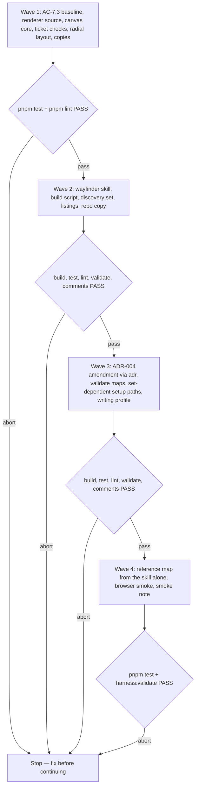

# Wayfinder Skill

**Source:** `docs/prds/wayfinder/wayfinder-prd.md` (status `stable`, approved 2026-10-14). Its prototype verdict picks the inward radial canvas; the prototype code is discarded. A jury on 2026-10-14 chose per-skill renderer files over whole-folder copies, unanimously after deliberation at medium confidence; the Human confirmed "identical" means per file.
**Next:** After the Human approves → `adr` (the ADR-004 amendment, the first unit of wave 3) → `code-plan` → `code-execute`, waves **1 → 2 → 3 → 4**.
**Named proof (this spec's own structural gate):** `proof-wayfinder-spec-obligations`

## Term challenge

| Term | Resolution |
|------|------------|
| Map | As the PRD defines it: a `docs/maps/<slug>/` folder holding `<slug>-map.md` and one file per ticket. Not `journey-map`'s `<slug>-map.json`, which the canvas never writes. |
| Ticket | As the PRD defines it: `<nn>-<ticket-slug>.md` with `title`, `ticket`, `status`, `blocked_by`, and optional `claimed_by`, `claimed_at` and `undermined_by`. `ticket` reuses the `research \| prototype \| grilling \| task` values `journey-map` once rendered (commit `2238220`). |
| Ticket number | The two-digit prefix `<nn>`, written in `blocked_by` and `undermined_by` as the same two-digit string (`"03"`). Never reused. |
| Frontier | As the PRD defines it: every `open` ticket whose blockers are all `closed` and none undermined, plus every undermined ticket. |
| Frontier ring | The canvas ring that holds the frontier and every `claimed` ticket. A new term, defined at its first use in AC-4.4. |
| Fog | The canvas band between the destination and the frontier ring. It holds every blocked ticket and one patch per item under Not yet specified. |
| Fog patch | One item under the map's Not yet specified section, drawn as a labelled cloud in the fog. It is not a ticket. |
| Ticket state | What the canvas derives per ticket: `now` (take now), `redo` (undermined), `claimed`, `blocked`, `decided` or `oos` (out of scope). The stored `status` stays the four PRD values; `state` is never written to a file. |
| Canvas | The renderer, as the PRD defines it. Its two outputs are the canvas JSON `<slug>-canvas.json` and the canvas page `<slug>-canvas.html`, both derived and gitignored. |
| Renderer manifest | The list in `renderer/sync.mjs` of the renderer files each skill loads: `journey-map` gets `logic.js`, `canvas.js`, `draw.js` and `page.html`; `wayfinder` gets `logic.js`, `canvas.js`, `radial.js`, `radial-draw.js` and `radial.html`. A skill's `renderer/` folder holds exactly its manifest. |
| Renderer source | The one copy of the renderer files in the package, at `renderer/` in the repo root, outside `"files"`. The copies under each skill's `renderer/` folder ship; the source does not. |
| Canvas core | `renderer/canvas.js`: the camera (pan, zoom, fit, animated moves, pointer and wheel input), the error panel, copy with the `<textarea>` fallback, and the SVG element helpers, moved out of `draw.js` unchanged. It sets `globalThis.CanvasCore`. Both `draw.js` and `radial-draw.js` use it, so a fix to any of those lands once. The Human chose this over sharing `validate` alone on 2026-10-14. |
| Radial layout | The renderer files `radial.js` (pure functions), `radial-draw.js` (SVG and panel) and `radial.html` (page shell). Only a map whose nodes are all `ticket` nodes uses them. |
| Discovery set | `SET_SKILLS.discovery` in `src/setup/skill-sets.ts`. |
| Set-dependent path | A template path `setup` writes only when a named skill set is chosen. None exists today; `docs/maps/` is the first. |

## Repository grounding

| Surface | Present today | Role for this initiative |
|---------|----------------|----------------------------|
| `templates/.agents/skills/journey-map/renderer/{logic.js,draw.js,page.html}` | yes | Becomes one copy of the renderer source. `logic.js` sets `globalThis.JourneyMapLogic`; its `validate` checks a hard-coded `KINDS` list with no `ticket` |
| `templates/.agents/skills/journey-map/scripts/build-map.mjs` | yes | Unchanged. It calls `validate(map)` with no kinds, so the default list keeps `ticket` out |
| Commit `2238220` (under `refs/pull/58/head`) | yes, off `main` | Source of the removed ticket checks: `blocked_by` targets, cycles, `status` and `ticket` values |
| `test/journey-map-render.test.ts`, `test/fixtures/journey-map/*.json` | yes | Must pass. Only its renderer-region assertion (`logic.js` + `draw.js`) gains `canvas.js`; every other assertion stays as on `main`. Its fixtures seed the AC-7.3 baseline |
| `draw.js`'s `showErrors`, `el`, `applyCam`, `animateTo`, `fitTarget`, `zoomAt`, pointer and wheel handlers, and its clipboard write | yes | Move into `canvas.js` with the same behaviour; `draw.js` calls them through `CanvasCore` |
| `test/skill-journey-map.test.ts` | yes | Asserts `rg -n "wayfinder\|docs/maps"` over the whole `journey-map` folder is empty. It passes unchanged, because `journey-map` receives no radial file and its shared files (`logic.js`, `canvas.js`) name neither |
| `test/skill-copies.test.ts` | yes | Holds `.agents/skills/<skill>/` identical to the template copy; covers both renderer copies in this repo |
| `src/setup/skill-sets.ts`, `test/skill-sets.test.ts`, `test/setup-skill-sets.test.ts` | yes | Gains `wayfinder` under `discovery`; the folder count of 19 becomes 20 |
| `src/setup/apply.ts` (`applyTemplates`, `INSTALLED_AS`) | yes | Copies every non-skill template file on every run. Gains set-dependent paths and the `docs/maps/gitignore` → `.gitignore` rename, since npm drops a `.gitignore` from the tarball |
| `src/setup/render-wolven.ts` | yes | Renders `WOLVEN.md`. Gains the set-marker rule; `.qmd/index.yml` is rendered through the same rule instead of copied verbatim |
| `templates/WOLVEN.md`, `templates/.qmd/index.yml`, `templates/docs/WRITING-PROFILE.md` | yes | Gain the maps row, the `maps` collection and the folder and `type: map` lines |
| `src/validate/profile.ts` (`DIR_TYPE`, `SLUG_FILE_RE`, `profile-iteration-doc`) | yes | Gains `maps` → `map`. The iteration-doc downgrade is the precedent for a check that only warns |
| `docs/adrs/adr-004-standalone-skills-contract.md` | yes, `stable` | Lists finding codes and `setup` guarantees. Amended through `adr` for `profile-map-doc` and set-dependent paths |
| `src/comments/index.ts` (`findCommentFindings`) | yes | Judges the shipped `.js` and `.mjs` files on a consumer's install diff |
| `test/helpers/skill-contract.ts` (`assertSkillBasics`, `readSkill`) | yes | Shared checks for the new skill |
| `docs/deferrals/wayfinder-maps/wayfinder-maps-deferral.md` | yes | Closed with this spec: trigger 2 ticked, `status: deprecated`, moved to `docs/deferrals/archived/wayfinder-maps/` |
| `README.md`, `site/skills.md`, `AGENTS.md` | yes | List the discovery set, the skill count ("Nineteen") and the skills table |
| `renderer/` at the repo root, `test/fixtures/wayfinder/` | no | New: the renderer source and the ticket fixtures |

## Surface walk

- **In scope:**
  - `renderer/**` (new source and its sync script) and both copies: `templates/.agents/skills/{journey-map,wayfinder}/renderer/**` and the repo's installed `.agents/skills/{journey-map,wayfinder}/renderer/**`
  - `templates/.agents/skills/wayfinder/**` (new skill) and its installed copy; a row in this repo's `AGENTS.md` skills table and a `renderer/` line under Layout
  - `templates/.agents/skills/journey-map/scripts/build-map.mjs`: its inline list gains `canvas.js`, and nothing else changes
  - `src/setup/skill-sets.ts`, `src/setup/apply.ts`, `src/setup/render-wolven.ts`
  - `src/validate/profile.ts`
  - `templates/WOLVEN.md`, `templates/.qmd/index.yml`, `templates/docs/WRITING-PROFILE.md`, new `templates/docs/maps/{.gitkeep,gitignore}`, and this repo's `docs/WRITING-PROFILE.md`
  - `docs/adrs/adr-004-standalone-skills-contract.md` (amendment, through `adr`)
  - tests: the skill counts, new `test/renderer-copies.test.ts`, `test/wayfinder-canvas.test.ts`, `test/skill-wayfinder.test.ts`, `test/validate-maps.test.ts`, `test/setup-maps.test.ts`, and `test/fixtures/wayfinder/**`
  - the discovery lists in `README.md` and `site/skills.md`, and `package.json` gains a `sync:renderer` script
  - `docs/notes/wayfinder-smoke/wayfinder-smoke-note.md`
- **Out of mutate scope (unchanged):**
  - `templates/.agents/skills/journey-map/{SKILL.md,references/**}`
  - `logic.js`'s layout, reveal, fade and feedback functions, `page.html`, and `draw.js` beyond moving the canvas core out of it
  - `src/skills/**`: `skills --skills wayfinder` copies the folder as-is
  - `src/comments/**`, `src/validate/{claims,legacy,spine}.ts`
  - every other shipped skill, `grilling`, `research`, `prototype`, `create-prd` and `code-spec` included
  - `package.json` dependencies
  - `.qmd/index.yml` and `AGENTS.md` in a consumer repo

## Design

### Renderer source and copies

```
renderer/                  source, outside "files", never shipped
  logic.js                 validation (shared) and journey-map's layout, reveal and feedback
  canvas.js                the canvas core (shared): camera, error panel, copy, SVG helpers
  draw.js  page.html       journey-map's tree drawing and page shell
  radial.js  radial-draw.js  radial.html  the radial layout
  sync.mjs                 holds the renderer manifest and copies each skill only its files
```

- `pnpm sync:renderer` runs `node renderer/sync.mjs`. It overwrites `templates/.agents/skills/{journey-map,wayfinder}/renderer/<file>` and the installed copies under `.agents/skills/`, and prints one line per file it changed.
- Only `wayfinder` receives the radial files, so they may name it. No file `journey-map` receives names `wayfinder` or `docs/maps`, so its whole-folder test stays as on `main`.
- `canvas.js` is a classic script that needs the DOM. It holds only the code moved out of `draw.js`, with no behaviour change, and exposes it as `globalThis.CanvasCore`. Neither drawing file defines its own camera, error panel or clipboard write.
- `logic.js` changes only in `validate(map, { kinds })`. `kinds` defaults to the six flow kinds. When it includes `ticket`, the ticket checks from commit `2238220` run: a `blocked_by` or `undermined_by` entry that names no node or a non-ticket node, a `blocked_by` cycle, a bad `ticket` or `status` value (`open`, `claimed`, `closed`, `out_of_scope`), `claimed_by` without `claimed_at` or the reverse, and `undermined_by` on a ticket that isn't `closed` or `claimed`. A tree of only tickets needs no `start` node.
- `radial.js` is a classic script with no DOM. It sets `globalThis.RadialLayout = { model, layout, labels, focusOrder, handoff, copyText }`, so the page, the build script and the tests run the same code. `radial-draw.js` reads `RadialLayout`, draws the SVG, and builds the panel with `textContent` only.
- `radial.html` loads Inter from Google Fonts and nothing else. There is no rough.js. The page is light only, like `journey-map`.

### Wayfinder build

`node <skill-dir>/scripts/build-canvas.mjs <dir>/<slug>-map.md` writes `<dir>/<slug>-canvas.json` and `<dir>/<slug>-canvas.html`:

- It reads `<slug>-map.md` and every `<nn>-*.md` beside it, using Node built-ins only. Frontmatter is a flat subset: `key: value` scalars and inline lists such as `blocked_by: ["01", "03"]`. Anything else exits 1 naming the file and line.
- Destination is the first paragraph under `## Destination`. Fog patches are the list items under `## Not yet specified`. A ticket's gist is the text of the Decisions so far item that links to its file.
- Each ticket becomes a `ticket` node: `id` (the number), `label` (`title`), `ticket`, `status`, `blocked_by`, `undermined_by`, `claimed_by`, `claimed_at`, `file`, `question` (the `## Question` body), `gist` and `resolution` (the newest `## Resolution` body). Map fields: `version: 1`, `title`, `destination`, `fog: [{ label }]`, and `dir: "docs/maps/<slug>"`.
- Status rule: `open` has no `## Resolution`. `closed` and `out_of_scope` have one. `claimed` has one only when `undermined_by` is set. Any other pairing is an error naming the ticket.
- It runs `validate(map, { kinds: ["ticket"] })`, then inlines the JSON and `logic.js`, `canvas.js`, `radial.js` and `radial-draw.js` into `radial.html`. `journey-map`'s `build-map.mjs` inlines `logic.js`, `canvas.js` and `draw.js` into `page.html`.
- On any error it still writes the page, which shows an error panel, prints one line per error to stderr, and exits 1. On success it prints `wayfinder: wrote <dir>/<slug>-canvas.html (<n> tickets)` and exits 0.
- An input that doesn't end in `-map.md`, or a folder with no `docs/maps/.gitignore` above it, exits 1 and writes nothing (AC-6.4).
- Output bytes depend only on the files read, the renderer files and the input path. Staleness (72 hours) is computed in the page at view time, so the JSON carries no clock.

### Radial page

- **Rings, inside out:** the destination, the fog, the frontier ring, the decided ring, and beyond a dashed scope ring the out-of-scope tickets. Within each ring, the order around the circle follows a depth-first walk along `blocked_by` from the root tickets, so a chain stays in one sector, then each item is pushed at least a minimum gap from its ring neighbours.
- **Tickets:** a numbered circle whose fill and outline differ for each of the seven looks: `now`, `claimed`, `claimed` past 72 hours, `redo`, `blocked`, `decided`, `oos`. A claimed circle carries `claimed_by` initials.
- **Edges:** `blocked_by` and dependent edges draw only while a ticket is hovered, focused or tapped. Each undermined ticket's arc to the ticket that broke it is always drawn, travelling along the frontier ring.
- **Header counts:** take now, redo, in progress, waiting in the fog, fog patches, decided and out of scope. A zero count is left out.
- **Labels:** frontier-ring and fog-patch labels show by default, the others on hover, focus or the "All labels" toggle (`L`). A label box is its character count times a fixed width budget, as in `journey-map`. A default label that would overlap a shown label is hidden.
- **Panel:** a ticket's question, gist or resolution, depends-on and unblocks lists, file path, a note box, and one button: "Take this ticket" on the frontier ring, "Copy for agent" elsewhere. With no ticket open, it lists "On the frontier", or, once the destination is reached, names `create-prd` or `code-spec`.
- **Keyboard and touch:** Tab walks the frontier ring first, then the fog, the decided ring and the out-of-scope tickets. Enter or a tap opens the panel and Escape closes it. A tap shows a ticket's edges as hover does. Scroll zooms, drag pans, and double-click fits.

### Copy text

`handoff(model, id, note)`, for "Take this ticket":

```
Use the wayfinder skill to <lead> on <dir>/.

Ticket: <dir>/<file> — <title> (<ticket>)
Destination: <destination>
Question: <question>
Premise broken by: <dir>/<file> — <title> — <gist>    one line per undermined_by entry
Decided blockers:                                      only when blocked_by is non-empty
- <dir>/<file> — <title> — <gist>
Unblocks: <nn> <title>; <nn> <title>                  only when it has dependents

Note from the Human: <note>                            only when the note is non-blank
```

`<lead>` is `take ticket <nn>`, `re-resolve ticket <nn> in place` for a `redo` ticket, or `take ticket <nn>, which <claimed_by> claimed at <claimed_at>; confirm with me before taking it over` for a `claimed` one.

`copyText(model, id, note)`, for "Copy for agent":

```
wayfinder feedback for <dir>/
Ticket: <dir>/<file> — <title> (<ticket>), <blocked | decided | out of scope>
Note from the Human: <note>                            only when the note is non-blank
```

Both write through `CanvasCore`'s copy, which falls back to a selected, read-only `<textarea>` when the clipboard write is refused, the same code `journey-map`'s "Copy for agent" uses.

### Setup and validate

- `SET_PATHS: Record<SkillSet, readonly string[]>` in `skill-sets.ts` holds `discovery: ["docs/maps/"]`. `applyTemplates` skips a template file under a set path whose set wasn't chosen. `INSTALLED_AS` gains `docs/maps/gitignore` → `docs/maps/.gitignore`, whose lines are `*-canvas.json` and `*-canvas.html`.
- A template line that ends in a set marker, `<!-- set:discovery -->` in Markdown or `# set:discovery` in YAML, is written without the marker when that set is chosen and left out otherwise. `WOLVEN.md` and `.qmd/index.yml` both render through this rule; `.qmd/index.yml`'s `maps` collection (`path: ./docs/maps`, `pattern: "!(archived)/**/*.md"`) is three marked lines.
- `validate` adds `maps: 'map'` and matches `docs/maps/`. Every finding on a maps path is re-emitted as `warn` with code `profile-map-doc` and the original code in its message, as `profile-iteration-doc` does. That covers a flat file, a missing `<slug>-map.md`, and any frontmatter fault in it. Ticket files and `archived/` aren't checked.

## Waves



A failed gate aborts before the next wave. Wave 1 captures the AC-7.3 baseline from `main`'s `logic.js` before it edits any renderer file, and extracts the canvas core before it writes any radial code, so `radial-draw.js` is built on the core from its first line.

## Requirements (obligation ↔ proof)

### R1 — Shared renderer (US-7)

| ID | Obligation | Named proof | Evidence shape |
|----|------------|--------------|------------------|
| R1.1 | Each skill's `renderer/` folder, template and installed, holds exactly its manifest, and each file is byte-identical to `renderer/<file>`. A file that differs, a manifest file that is missing, and a file outside the manifest each fail naming the file. `pnpm sync:renderer` restores them (AC-7.2) | `proof-wayfinder-renderer-copies` | Test: compare each skill's folder with its manifest and the source; then, in a temp tree, alter one file, delete one and add a stray `radial.js` to `journey-map`, assert each failure names its file, run `sync.mjs` and assert it passes |
| R1.2 | For every `journey-map` fixture, `validate(map)` and `layout(map)` equal the baseline captured from `main`'s `logic.js` before wave 1 edits, and the existing render tests pass with only the renderer-region assertion widened to `canvas.js` (AC-7.3) | `proof-wayfinder-journey-map-unchanged` | Test against `test/fixtures/journey-map/baseline.json`, committed in the first wave 1 unit; `git diff main -- test/journey-map-render.test.ts` touches only that assertion |
| R1.3 | `validate(map)` with the default kinds names a `ticket` node as an unknown kind, so `journey-map`'s build exits 1 on it, while `validate(map, { kinds: ["ticket"] })` accepts a ticket-only tree with no `start` (AC-7.3) | `proof-wayfinder-kinds-gate` | Test: one ticket fixture through both calls; `build-map.mjs` on a JSON holding a ticket exits 1 naming it |
| R1.4 | With `ticket` allowed, `validate` names the node for each ticket fault listed under Design | `proof-wayfinder-ticket-checks` | Test: one malformed fixture per fault |
| R1.5 | No file in the `journey-map` folder, `renderer/` included, names `wayfinder` or `docs/maps` | `proof-wayfinder-journey-map-silent` | Test: `test/skill-journey-map.test.ts`, unchanged from `main` |
| R1.6 | `skills --skills wayfinder` and `skills --skills journey-map` each copy only the chosen folder, with its own `renderer/`, and that skill's build succeeds with the other absent and writes a page that inlines every script in its manifest (AC-7.1) | `proof-wayfinder-standalone` | Test: each command into a temp dir; assert the folder list, run its build script on a fixture there, and assert the page holds each manifest script's bytes |
| R1.7 | `canvas.js` holds the camera, error panel, copy-with-fallback and SVG helpers; `draw.js` and `radial-draw.js` both call them through `CanvasCore`, and neither defines its own `zoomAt`, `showErrors` or clipboard write | `proof-wayfinder-canvas-core` | Test: `CanvasCore` exposes the named functions in a stub DOM; grep shows `navigator.clipboard`, `function zoomAt` and `function showErrors` only in `canvas.js` |
| R1.8 | After the extraction, a `journey-map` page still pans, zooms, fits, moves the camera on a choice, shows the error panel for a malformed tree, and copies with the fallback, as on `main` (AC-7.3) | `proof-wayfinder-journey-map-smoke` | Wave 4 smoke: the LotR fixture and `malformed-map.json` built from `main` and from the branch, compared step by step in the smoke note |
| R1.9 | A change to a file only `wayfinder` loads leaves every file in `journey-map`'s folder byte-identical, so `skills --skills journey-map` over an install of the previous build asks no replace question (the jury's concrete test) | `proof-wayfinder-subset-isolation` | Test: in a temp copy of the package, edit `renderer/radial-draw.js`, run `sync.mjs`, assert `journey-map/renderer/` is unchanged and `wayfinder/renderer/radial-draw.js` changed; then run `skills --skills journey-map` without a terminal over the earlier install and assert no folder is reported as differing |

### R2 — Canvas build (US-4)

| ID | Obligation | Named proof | Evidence shape |
|----|------------|--------------|------------------|
| R2.1 | `build-canvas.mjs` turns a fixture map folder into `<slug>-canvas.json` and `<slug>-canvas.html` beside the map, exits 0 with the `wrote` line, and the page loads only Google Fonts from the network (AC-4.1) | `proof-wayfinder-build-writes-canvas` | Test: build `test/fixtures/wayfinder/billing-migration/` in a temp copy; assert the files, the line, and every `src` and `href` host |
| R2.2 | A `blocked_by` naming no ticket, a cycle, and each status-rule breach exit 1 naming the ticket, and the page carries the error panel (AC-4.1) | `proof-wayfinder-build-errors` | Test: one fixture folder per case |
| R2.3 | A non-flat frontmatter value, an input not ending in `-map.md`, and a map with no `docs/maps/.gitignore` above it each exit 1 and write nothing (AC-6.4) | `proof-wayfinder-build-input-errors` | Test: three cases, asserting exit 1 and no output files |
| R2.4 | Building the same folder twice gives byte-identical JSON and HTML | `proof-wayfinder-build-deterministic` | Test: build twice; compare bytes |
| R2.5 | `model` derives each ticket's state, the frontier, the header counts and the reached flag as Design and AC-4.4 and AC-4.7 state; an undermined blocker blocks its open dependents (AC-2.2, AC-4.4, AC-4.7) | `proof-wayfinder-model-states` | Test on the 30-ticket fixture and its reached variant: exact counts per state, frontier membership, `reached` false then true |
| R2.6 | `layout` places every ticket in its state's ring, out-of-scope tickets beyond the scope ring, and one fog patch per Not yet specified item; no two ticket circles overlap (AC-4.4) | `proof-wayfinder-layout-rings` | Test: radius bands per state; pairwise circle distances on the 30-ticket fixture |
| R2.7 | On the 30-ticket fixture at its fitted zoom, `labels` shows no two overlapping label boxes, hides a frontier-ring or patch label only when it would overlap, and the panel's frontier list names every ticket on the frontier ring (AC-4.5) | `proof-wayfinder-labels-30` | Test: box intersection over the shown set; each hidden default label intersects a shown one |
| R2.8 | `focusOrder` lists the frontier ring first, then the fog, decided and out-of-scope tickets (AC-4.6) | `proof-wayfinder-focus-order` | Test on the 30-ticket fixture |
| R2.9 | `handoff` and `copyText` return the frozen text for a `now`, a `redo` and a `claimed` ticket, and for a decided, a blocked and an out-of-scope ticket, with and without a note (AC-4.3) | `proof-wayfinder-copy-text` | Test: exact strings |
| R2.10 | Labels, questions, gists, notes and file names render through `textContent`, never HTML parsing, and the embedded JSON escapes `<` | `proof-wayfinder-no-html-injection` | Test: a ticket titled `</script>` builds to a page without it unescaped; no `innerHTML` in `radial-draw.js` |
| R2.11 | In a browser, on a canvas page: Tab, Enter, Escape and `L` work as AC-4.6 states; a tap opens the panel and shows edges; hover shows a ticket's edges and only then; undermined arcs always draw; "Take this ticket" copies, and the textarea fallback appears when the clipboard is refused; the destination-reached map shows the reached centre (AC-4.3 to AC-4.7) | `proof-wayfinder-browser-smoke` | Manual smoke, recorded step by step in the smoke note |

### R3 — Skill text (US-1, US-2, US-3, US-4, US-5)

| ID | Obligation | Named proof | Evidence shape |
|----|------------|--------------|------------------|
| R3.1 | `SKILL.md` passes `assertSkillBasics`, has a third-person "Use when" description, isn't ask-only, runs on an ask or an accepted one-line offer, and credits the method's origin in one line | `proof-wayfinder-skill-basics` | Skill-contract test |
| R3.2 | Charting runs `grilling` for the destination, writes the map with `type: map`, `status: draft` and its five sections, numbers tickets from `01` with `status: open`, records answers given while charting as closed tickets, resumes an existing slug without overwriting, shows the frontier and stops unclaimed (AC-1.1 to AC-1.3) | `proof-wayfinder-skill-chart` | Skill-contract test: grep for each section name, the frontmatter values, "recording an answer" and the resume rule |
| R3.3 | Working a ticket claims it with `claimed_by` and `claimed_at` first, resolves it through `research`, `prototype` or `grilling` by kind or records a `task`, writes `## Resolution`, closes it, updates Decisions so far, and stops after one ticket; a claim older than 72 hours is named stale and the Human is asked; a missing resolving skill is named with its install command (AC-2.1, AC-2.3, AC-2.4, AC-2.6) | `proof-wayfinder-skill-work` | Skill-contract test |
| R3.4 | The pre-commit checklist lists every AC-2.5 check verbatim in meaning, and the skill says to fix each failure before committing (AC-2.5) | `proof-wayfinder-skill-checklist` | Skill-contract test: one assertion per check |
| R3.5 | New unknowns become tickets, ruled-out tickets get `out_of_scope` with a reason after the Human agrees and each dependent edge is resolved, undermined tickets keep `closed` with `undermined_by` and are re-resolved in place under `## Superseded resolution`, newest first (AC-3.1 to AC-3.4) | `proof-wayfinder-skill-update` | Skill-contract test |
| R3.6 | The canvas is built only on an ask or an accepted one-line offer after a chart or a close, the offer isn't repeated until the next one, feedback edits ticket files and never the canvas, and a "Copy for agent" note that challenges a decided ticket starts the undermine step (AC-4.1 to AC-4.3) | `proof-wayfinder-skill-canvas` | Skill-contract test |
| R3.7 | Handoff names `create-prd` or `code-spec` with Decisions so far, sets `status: deprecated`, moves the folder to `docs/maps/archived/<slug>/` and rewrites inbound relative links; open, claimed or undermined tickets are listed and confirmed first (AC-5.1, AC-5.2) | `proof-wayfinder-skill-handoff` | Skill-contract test |
| R3.8 | On an install missing `docs/maps/`, its `.gitignore`, the `maps` collection or the router row, the skill names each with the exact lines to add and edits neither `.qmd/index.yml` nor `AGENTS.md` (AC-6.4) | `proof-wayfinder-skill-missing-pieces` | Skill-contract test: the exact lines appear in the skill |
| R3.9 | An agent given only the installed skill folder charts a five-ticket map with one blocker chain and one Not yet specified item, and builds its canvas with exit 0 (goal 1) | `proof-wayfinder-reference-map` | Wave 4: a fresh subagent; its folder is committed as `test/fixtures/wayfinder/reference/`, and a test asserts the build exits 0 |

### R4 — Install and validate (US-6)

| ID | Obligation | Named proof | Evidence shape |
|----|------------|--------------|------------------|
| R4.1 | `wayfinder` is in `SET_SKILLS.discovery`, and the partition test passes with 20 folders (AC-6.2) | `proof-wayfinder-partition` | `pnpm test` (`test/skill-sets.test.ts`) |
| R4.2 | `setup --skills discovery` installs `wayfinder/` and creates `docs/maps/.gitkeep`, `docs/maps/.gitignore` with exactly the two canvas lines, the `maps` collection and the maps row; no marker text remains in either rendered file (AC-6.1) | `proof-wayfinder-setup-discovery` | Test: run setup into a temp repo; assert the files and their contents |
| R4.3 | `setup --skills ship` and `--skills none` create none of those paths, lines or folders (AC-6.2) | `proof-wayfinder-setup-absent` | Test: both runs; assert absence |
| R4.4 | A second `setup` run with discovery over an existing install leaves every existing file byte-identical and creates only missing maps paths | `proof-wayfinder-setup-rerun` | Test: run twice; compare bytes |
| R4.5 | `validate` passes with `type: map`, warns `profile-map-doc` for another type, a missing main doc and a flat file, exits 0 on those warnings alone, ignores ticket files, and skips `docs/maps/archived/**` (AC-6.3) | `proof-wayfinder-validate-maps` | Test: fixture repos per case, asserting level, code and exit code |
| R4.6 | `WRITING-PROFILE.md`, in the template and this repo, documents `docs/maps/<slug>/<slug>-map.md` and `type: map` | `proof-wayfinder-writing-profile` | Test: grep both files |
| R4.7 | Every comment line in the shipped `.js` and `.mjs` files of both skills passes `findCommentFindings` | `proof-wayfinder-comments-clean` | Test, as `journey-map`'s R4.3 does |
| R4.8 | `README.md` and `site/skills.md` list `wayfinder` in the discovery set and say twenty skills; `AGENTS.md` lists it; the repo copy matches the template | `proof-wayfinder-listings` | `pnpm test` (`test/skill-copies.test.ts`, `test/readme-install.test.ts`); `rg -n wayfinder README.md site/skills.md AGENTS.md` |

### R5 — Contract

| ID | Obligation | Named proof | Evidence shape |
|----|------------|--------------|------------------|
| R5.1 | ADR-004 carries a dated amendment adding `profile-map-doc` as a warning code and the set-dependent `setup` paths, its finding-code table lists the code, and the release commit is a `feat` | `proof-wayfinder-adr-amendment` | Inspect the ADR; `test/contract.test.ts` gains the code; `pnpm validate` resolves every ADR-004 claim |

## Nine-dimension landings

| Dimension | Landing kind | Landing |
|-----------|---------------|---------|
| validation | obligation ↔ proof | R1.4 / `proof-wayfinder-ticket-checks`, R2.2 / `proof-wayfinder-build-errors`, R2.3 / `proof-wayfinder-build-input-errors`, R4.5 / `proof-wayfinder-validate-maps` |
| failure modes | obligation ↔ proof | R2.2 writes the error page and exits 1; R2.11 and R1.8 record the clipboard fallback and error panel through the shared core; R3.3 names a missing resolving skill |
| idempotency and retry | obligation ↔ proof | R2.4 / `proof-wayfinder-build-deterministic`; R4.4 / `proof-wayfinder-setup-rerun`; R1.1's sync is safe to rerun |
| authorization | `n/a` | Unchanged surface: the canvas is a static local file with no credential, and installs go through the unchanged `src/skills/**` and `applyTemplates`' create-only rule |
| concurrency and ordering | `n/a` | Unchanged surface: one session works a map (PRD non-goal), and claims lock nothing. Install ordering stays in the unchanged `src/skills/install.ts` |
| data lifecycle | obligation ↔ proof | Ticket files are canonical and the canvas is derived and gitignored (R2.1, R4.2); a map moves to `archived/` on handoff (R3.7); ticket numbers and files are never reused or deleted (R3.4) |
| external-dependency failure | obligation ↔ proof | R2.1: Google Fonts is the only network load, and the page falls back to system fonts, checked in R2.11. No rough.js |
| state transitions | obligation ↔ proof | Stored: `open → claimed → closed`, `open → out_of_scope`, `closed → closed + undermined_by → claimed → closed` (R3.3, R3.5). Derived: R2.5 / `proof-wayfinder-model-states` |
| observability | obligation ↔ proof | R2.1 prints the `wrote` line, R2.2 prints one stderr line per error plus the page's error panel, and R4.5 prints `profile-map-doc` warnings |

## Unresolved

| Identifier | Decision needed | Owner | Blocking effect | Disposition |
|------------|-------------------|-------|-------------------|--------------|
| `U-first-real-map` | Whether the UX engagement goes ahead and supplies the first real map | Rafael | Non-blocking: R3.9 uses a map a subagent charts from the skill alone | Carried from the PRD's open question; revisit when the engagement is decided |

## Out of scope

- Everything the PRD lists under Non-goals.
- A browser test runner or any new dev dependency. Interaction is proven by the wave 4 smoke.
- A dark theme for the canvas. It stays light only, as `journey-map` is.
- Anchoring fog patches to tickets: patches spread evenly around the fog.
- Measuring rendered text width; the character budget stays.
- Linting `renderer/` with Biome; `pnpm lint` keeps its current scope.

## Pragmatic-guard refuses

- A YAML or Markdown parser dependency for the build script; the flat frontmatter subset and section matching cover the format.
- A generic set-to-path registry beyond `SET_PATHS` and the line marker.
- Any `validate` check on ticket files, or an error-level maps finding.
- Ticket-state persistence in the canvas, such as a saved note or a claim made from the page.
- Moving `journey-map`'s layout into a shared module, or any refactor of `logic.js` beyond the `kinds` option and the ticket checks.
- Copying a renderer file to a skill that doesn't load it.
- Putting anything in `canvas.js` beyond the camera, error panel, copy-with-fallback and SVG helpers, or changing their behaviour while moving them.

## Acceptance

### Wave 1

- [x] `proof-wayfinder-journey-map-unchanged` PASS: the baseline was committed before any renderer edit, and every fixture matches it Evidence: `test/renderer-baseline.test.ts` (baseline committed in `93b2d28`) and `test/journey-map-render.test.ts`.
- [x] `proof-wayfinder-renderer-copies` PASS: each folder holds exactly its manifest, byte-identical, and sync restores a drifted, missing or stray file Evidence: `test/renderer-copies.test.ts`.
- [x] `proof-wayfinder-canvas-core` PASS: one camera, error panel and clipboard write, in `canvas.js` only Evidence: `test/canvas-core.test.ts`.
- [x] `proof-wayfinder-kinds-gate` PASS: a ticket fails by default and passes with `kinds: ["ticket"]` Evidence: `test/renderer-kinds.test.ts`.
- [x] `proof-wayfinder-ticket-checks` PASS: each ticket fault names its node Evidence: `test/renderer-kinds.test.ts`.
- [x] `proof-wayfinder-journey-map-silent` PASS: the whole `journey-map` folder names neither Evidence: `test/skill-journey-map.test.ts`, unchanged from `main`.
- [x] `proof-wayfinder-subset-isolation` PASS: a radial-only change leaves `journey-map`'s folder byte-identical Evidence: the test of that name, in the 794-test run at the ship gate.
- [x] `proof-wayfinder-model-states` PASS: exact counts, frontier and reached flag Evidence: `test/radial-model.test.ts`.
- [x] `proof-wayfinder-layout-rings` PASS: every ticket in its ring, no overlaps Evidence: `test/radial-model.test.ts`.
- [x] `proof-wayfinder-labels-30` PASS: no shown overlaps, and the frontier list is complete Evidence: the test of that name, in the 794-test run at the ship gate.
- [x] `proof-wayfinder-focus-order` PASS: frontier ring first Evidence: the test of that name, in the 794-test run at the ship gate.
- [x] `proof-wayfinder-copy-text` PASS: six exact strings, with and without a note Evidence: the test of that name, in the 794-test run at the ship gate.

### Wave 2

- [x] `proof-wayfinder-build-writes-canvas` PASS: both files, the `wrote` line, one network host Evidence: the test of that name, in the 794-test run at the ship gate.
- [x] `proof-wayfinder-build-errors` PASS: each fault exits 1 naming the ticket Evidence: the test of that name, in the 794-test run at the ship gate.
- [x] `proof-wayfinder-build-input-errors` PASS: three cases write nothing Evidence: the test of that name, in the 794-test run at the ship gate.
- [x] `proof-wayfinder-build-deterministic` PASS: same bytes twice Evidence: the test of that name, in the 794-test run at the ship gate.
- [x] `proof-wayfinder-no-html-injection` PASS: no unescaped title, no `innerHTML` Evidence: the test of that name, in the 794-test run at the ship gate.
- [x] `proof-wayfinder-standalone` PASS: either skill builds alone, and its page holds every manifest script Evidence: the test of that name, in the 794-test run at the ship gate.
- [x] `proof-wayfinder-skill-basics` PASS Evidence: the test of that name, in the 794-test run at the ship gate.
- [x] `proof-wayfinder-skill-chart` PASS Evidence: the test of that name, in the 794-test run at the ship gate.
- [x] `proof-wayfinder-skill-work` PASS Evidence: the test of that name, in the 794-test run at the ship gate.
- [x] `proof-wayfinder-skill-checklist` PASS Evidence: the test of that name, in the 794-test run at the ship gate.
- [x] `proof-wayfinder-skill-update` PASS Evidence: the test of that name, in the 794-test run at the ship gate.
- [x] `proof-wayfinder-skill-canvas` PASS Evidence: the test of that name, in the 794-test run at the ship gate.
- [x] `proof-wayfinder-skill-handoff` PASS Evidence: the test of that name, in the 794-test run at the ship gate.
- [x] `proof-wayfinder-skill-missing-pieces` PASS Evidence: the test of that name, in the 794-test run at the ship gate.
- [x] `proof-wayfinder-partition` PASS: 20 folders Evidence: `test/skill-sets.test.ts`.
- [x] `proof-wayfinder-comments-clean` PASS: zero findings in both skills' scripts Evidence: the test of that name, in the 794-test run at the ship gate.
- [x] `proof-wayfinder-listings` PASS Evidence: the test of that name, in the 794-test run at the ship gate.

### Wave 3

- [x] `proof-wayfinder-adr-amendment` PASS: amendment, code table and claims Evidence: ADR-004 amendment dated 2026-10-14, approved by the Human, and `test/contract.test.ts`.
- [x] `proof-wayfinder-validate-maps` PASS: warnings only, tickets and archive skipped Evidence: `test/validate-maps.test.ts`.
- [x] `proof-wayfinder-setup-discovery` PASS: four maps pieces, no marker text left Evidence: the test of that name, in the 794-test run at the ship gate.
- [x] `proof-wayfinder-setup-absent` PASS: nothing for `ship` and `none` Evidence: the test of that name, in the 794-test run at the ship gate.
- [x] `proof-wayfinder-setup-rerun` PASS: existing files byte-identical Evidence: the test of that name, in the 794-test run at the ship gate.
- [x] `proof-wayfinder-writing-profile` PASS Evidence: `test/writing-profile-maps.test.ts`.

### Wave 4

- [x] `proof-wayfinder-reference-map` PASS: a subagent's map from the skill alone builds Evidence: the test of that name, in the 794-test run at the ship gate.
- [x] `proof-wayfinder-browser-smoke` PASS: keyboard, tap, hover, arcs, copy, fallback, fonts fallback and reached state recorded Evidence: `docs/notes/wayfinder-smoke/wayfinder-smoke-note.md`; a real clipboard success is untested because the pane denies the permission.
- [x] `proof-wayfinder-journey-map-smoke` PASS: `journey-map` pans, zooms, fits, shows errors and copies as on `main` Evidence: `docs/notes/wayfinder-smoke/wayfinder-smoke-note.md`; pinch zoom is untested because the pane has no multi-touch.

## Eval / gates

| Gate | Command / check | When | PASS | Abort |
|------|-------------------|------|------|-------|
| Tests | `pnpm test` | End of each wave | exit 0 | Fix; do not proceed |
| Lint | `pnpm lint` | End of waves 1 to 3 | exit 0 | Fix; do not proceed |
| Build | `pnpm build` | Before validate and comments | exit 0 | Fix; do not proceed |
| Integrity | `node dist/cli.js validate` (`harness:validate`) | End of waves 2 to 4 | `validate: ok` | Fix; do not proceed |
| Comments | `pnpm comments` | End of waves 2 and 3 | `comments: ok` | Fix; do not proceed |
| Renderer drift | `pnpm sync:renderer` prints no changed file | End of each wave | no output | Sync, then rerun the tests |
| Spec obligations | `proof-wayfinder-spec-obligations`: every acceptance box names a proof from an R-row, every R-row has a box, all nine landings are present, and each `n/a` cites an unchanged surface | Before `code-plan` | all hold | Do not plan |

## Cross-domain leak table

| Leak | Refuse |
|------|--------|
| Wiring `wayfinder` into `grilling`, `research`, `prototype`, `create-prd` or `code-spec` | A PRD non-goal |
| Syncing tickets with Linear, ClickUp or another tracker | Not this lane; the Human named trackers as the board option they don't want here |
| Redesigning `harness-init` | Its own initiative |
| A release or version bump | release-please, after merge |
| An executable plan from this skill | `code-plan` only |

## ADR

An ADR-004 amendment is owed: `profile-map-doc` is a new warning code, and `docs/maps/` with its `.gitignore`, the `maps` collection and the router row are the first `setup` paths that depend on the chosen skill set. Both are additive under ADR-004's change policy and ship as a `feat`. The `adr` skill writes the amendment as the first unit of wave 3, before any validate or setup code changes.

## Section checklist

| Section | Required when |
|---------|-----------------|
| Source | Always |
| Repository grounding | Always |
| Surface walk | Always |
| Waves | The work spans more than one mutate batch |
| Requirements with obligation ↔ proof | Always |
| Nine-dimension landings | Always, with all nine named |
| Unresolved | Always; an empty table is fine when no product or contract decision is open |
| Out of scope | Always |
| Pragmatic-guard refuses | Always |
| Acceptance | Always; tick a box only once its evidence exists |
| Eval / gates | Always |
| Cross-domain leak table | Always |
| ADR | Always, even when the answer is "none needed this initiative" |
