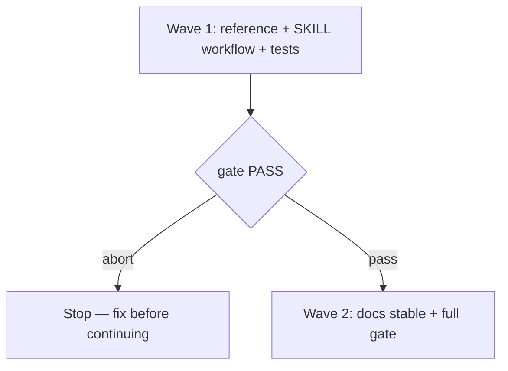

# Artifact approval summary

**Source:** GitHub issue [#81](https://github.com/WolvenTech/wolven-harness/issues/81) (confirmed ask).
**Next:** After the Human approves → `code-plan` → `code-execute`, wave **1 → 2**.
**Named proof (this spec's own structural gate):** `proof-artifact-approval-summary-spec-obligations`

## Term challenge

| Term | Resolution |
|------|------------|
| normalized summary | Reused from issue #81 — the fixed five-part chat block before each Human approval gate |
| material revision | Any in-place edit that changes requirements, scope, units, or status fields the Human must re-read |
| Human gate | Explicit approval that moves `status` to `stable` or unlocks the next skill |

## Repository grounding

| Surface | Present today | Role for this initiative |
|---------|----------------|---------------------------|
| `.agents/skills/create-prd/SKILL.md` | yes | Gains workflow step + local reference link |
| `.agents/skills/code-spec/SKILL.md` | yes | Same |
| `.agents/skills/code-plan/SKILL.md` | yes | Same |
| `templates/.agents/skills/{create-prd,code-spec,code-plan}/` | yes | Package copies kept identical to `.agents` via `test/skill-copies.test.ts` |
| `test/helpers/skill-contract.ts` | yes | Link rules stay per-skill; no cross-skill reference link |
| `test/skill-create-prd.test.ts`, `test/skill-code-plan.test.ts` | yes | Extended or complemented for new workflow language |
| `src/validate/spine.ts` | yes | Unchanged — skill-frontmatter only |

## Surface walk

- **In scope:** `references/artifact-approval-summary.md` under each of the three skills (both trees), edits to the three `SKILL.md` files (both trees), `test/skill-artifact-approval-summary.test.ts`, this spec/plan under `docs/specs/artifact-approval-summary/`
- **Out of mutate scope (unchanged):** `code-review`, `code-execute`, `code-pr` bodies; CLI; setup; site catalog; adopting the summary in PR bodies

## Waves

- Wave 1 gate: `pnpm test test/skill-artifact-approval-summary.test.ts` and `test/skill-copies.test.ts` exit 0
- Wave 2 gate: `pnpm test`, `pnpm lint`, `pnpm build`, `pnpm validate` exit 0
- A failed gate aborts before the next wave

## Requirements (obligation ↔ proof)

### R1 — Shared reference shape (define once, enforce thrice)

| ID | Obligation | Named proof | Evidence shape |
|----|------------|--------------|------------------|
| R1.1 | Each of `create-prd`, `code-spec`, and `code-plan` ships `references/artifact-approval-summary.md` listing the five summary sections in order (where and status; what it requires; grounding found; decisions folded in and open; what changed on updates only) and skill-specific table rules | `proof-artifact-approval-summary-reference` | Inspect the three files in `templates/.agents/skills/` |
| R1.2 | The three reference files are byte-identical to each other in templates and stay identical between template and installed copies | `proof-artifact-approval-summary-identical` | `test/skill-artifact-approval-summary.test.ts` |

### R2 — Workflow step in each skill

| ID | Obligation | Named proof | Evidence shape |
|----|------------|--------------|------------------|
| R2.1 | `create-prd` requires the normalized summary after the first draft and after every material revision, before asking for approval, citing the local reference | `proof-artifact-approval-summary-create-prd-step` | `test/skill-artifact-approval-summary.test.ts` |
| R2.2 | `code-spec` requires the same timing and citation | `proof-artifact-approval-summary-code-spec-step` | Same test file |
| R2.3 | `code-plan` requires the same timing and citation | `proof-artifact-approval-summary-code-plan-step` | Same test file |
| R2.4 | Each skill forbids repeating the full artifact or dumping raw paths in the summary | `proof-artifact-approval-summary-anti-dump` | Same test file |

### R3 — Copies and gates

| ID | Obligation | Named proof | Evidence shape |
|----|------------|--------------|------------------|
| R3.1 | Template and installed copies of all three skills remain identical | `proof-lean-init-copies-identical` | `test/skill-copies.test.ts` |
| R3.2 | All template skills still pass skill-contract basics | `proof-artifact-approval-summary-validate` | `pnpm build && node dist/cli.js validate` exits 0 |

## Nine-dimension landings

| Dimension | Landing kind | Landing |
|-----------|---------------|---------|
| validation | obligation ↔ proof | R3.2 / `proof-artifact-approval-summary-validate` |
| failure modes | obligation ↔ proof | R1.2 — drift between copies fails CI before merge |
| idempotency and retry | `n/a` | Unchanged surface: static skill templates |
| authorization | `n/a` | Unchanged surface: Human explicit approval still required to set `stable` |
| concurrency and ordering | `n/a` | Unchanged surface: chat-only summary; no runtime state |
| data lifecycle | `n/a` | Unchanged surface: markdown skills only |
| external-dependency failure | `n/a` | Unchanged surface: no external services |
| state transitions | obligation ↔ proof | R2.1–R2.3 — summary precedes each approval ask |
| observability | obligation ↔ proof | R2.1–R2.3 — Human sees structured summary in chat |

## Unresolved

| Identifier | Decision needed | Owner | Blocking effect | Disposition |
|------------|-------------------|-------|-------------------|-------------|
| U1 | Should `code-review` and `code-execute` adopt the same summary shape at wave end? | Human | non-blocking | Parked — note in PR body as follow-up |
| U2 | Should the summary copy into the PR body via `code-pr`? | Human | non-blocking | Parked — note in PR body as follow-up |

## Out of scope

- Extending the summary to `code-review`, `code-execute`, or PR bodies (issue open questions)
- Changing skill-contract cross-link allowlist
- New npm dependencies or CLI verbs

## Cross-domain leak table

| Ask | Belongs in |
|-----|------------|
| PR body template change | `code-pr` / future issue |
| Review verdict shape | `code-review` / future issue |

## Eval / gates

| Gate | Command |
|------|---------|
| Structural obligations | Every R row has a named proof above |
| Integrity | `pnpm harness:validate` |
| Unit tests | `pnpm test` |
| Lint | `pnpm lint` |
| Build | `pnpm build` |

## Acceptance

- [ ] R1.1–R3.2 proofs PASS
- [ ] `pnpm harness:validate` PASS
