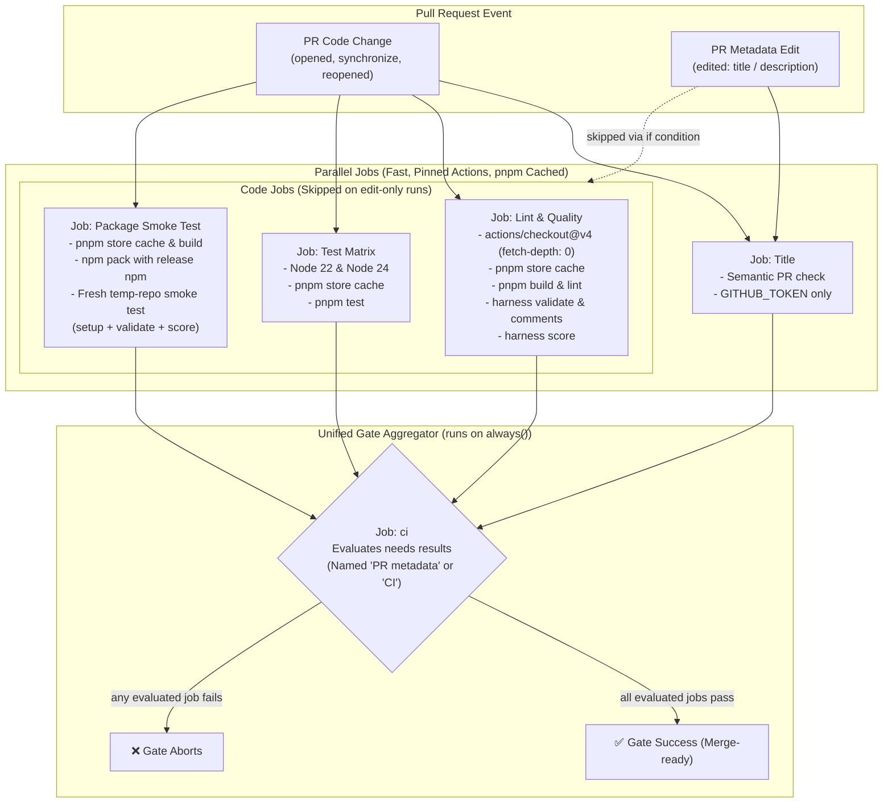
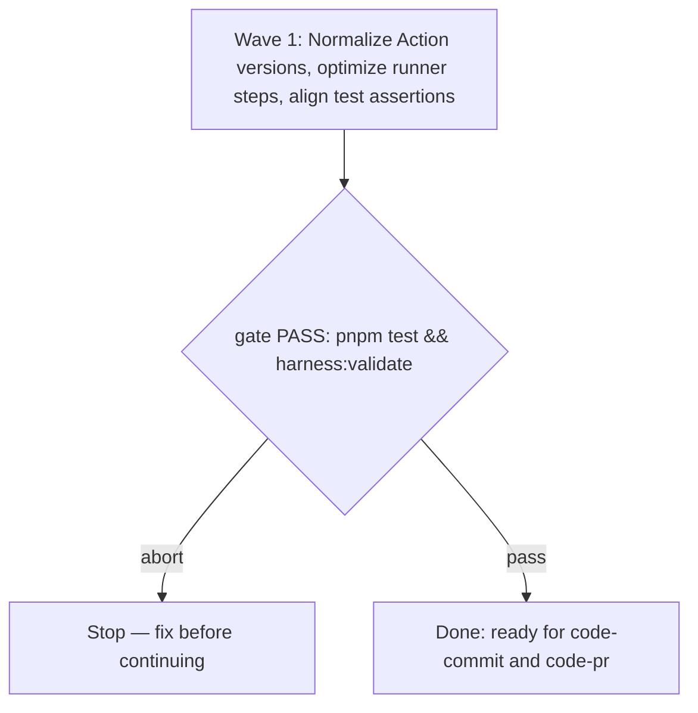

# Lean GitHub Actions Workflows Spec

**Source:** `docs/prds/gha-lean-workflows/gha-lean-workflows-prd.md` (status `stable`)
**Next:** After the Human approves → `code-plan` → `code-execute`, wave **1**
**Named proof (this spec's own structural gate):** `proof-gha-lean-workflows-spec-obligations`

## Repository grounding

| Surface | Present today | Role for this initiative |
|---------|----------------|----------------------------|
| `.github/workflows/ci.yml` | yes | Primary PR gate: parallel lint, test, package smoke-test, and status aggregation |
| `.github/workflows/pages.yml` | yes | Documentation deploy: build and publish VitePress site to GitHub Pages |
| `.github/workflows/release.yml` | yes | Release automation: release-please, build, and OIDC trusted publishing to npmjs |
| `test/pr-gate.test.ts` | yes | Test suite enforcing structural and security rules on `ci.yml` |
| `test/release.test.ts` | yes | Test suite enforcing release workflow integrity and npm version sync |
| `docs/adrs/adr-002-public-npm-oidc.md` | yes | Invariant anchor: tokenless OIDC npm publishing with zero install in publish job |
| `harness:validate` | yes | Integrity gate: checks writing profile and ADR claims |

## Surface walk

- **In scope:**
  - `.github/workflows/ci.yml`
  - `.github/workflows/pages.yml`
  - `.github/workflows/release.yml`
  - `test/pr-gate.test.ts`
  - `test/release.test.ts`
- **Out of mutate scope (unchanged):**
  - `src/**` — CLI source (`cli.ts`, `setup/`, `validate/`, `comments/`) remains unchanged
  - `docs/adrs/**` — ADR-002 and related decisions are preserved as invariants
  - `.agents/**` — skills and standing rules remain unchanged
  - `site/**` — VitePress documentation content and config remain unchanged

### CI Pipeline Topology (`ci.yml`)

## Waves

Single-wave initiative: all workflow optimizations, action version normalizations, and test assertions land and pass validation in Wave 1.

## Requirements (obligation ↔ proof)

### R1 — Action Version Normalization and Pinned Baseline

| ID | Obligation | Named proof | Evidence shape |
|----|------------|--------------|------------------|
| R1.1 | All GitHub Actions referenced across `ci.yml`, `pages.yml`, and `release.yml` use valid, pinned major version tags matching official upstream releases (`actions/checkout@v4`, `actions/setup-node@v4`, `pnpm/action-setup@v4`, `actions/upload-artifact@v4`, `actions/download-artifact@v4`, `actions/configure-pages@v5`, `actions/upload-pages-artifact@v3`, `actions/deploy-pages@v4`, `amannn/action-semantic-pull-request@v6`, `googleapis/release-please-action@v5`), eliminating phantom or non-existent action versions. | `proof-gha-action-versions-pinned` | Inspect YAML files under `.github/workflows/`; verify zero `@v7`/`@v8` phantom versions exist. |

### R2 — Lean PR Gate Optimization (`ci.yml`)

| ID | Obligation | Named proof | Evidence shape |
|----|------------|--------------|------------------|
| R2.1 | `ci.yml` maintains strict concurrency separation between metadata edits (`'edit'`) and code changes (`'code'`), canceling obsolete in-progress runs when new commits or edits are pushed. | `proof-gha-ci-concurrency` | YAML inspection and `test/pr-gate.test.ts` confirm concurrency group expressions and `cancel-in-progress: true`. |
| R2.2 | `ci.yml` parallel jobs (`lint`, `test`, `package`) use uniform Node 22 / pnpm setup with `cache: pnpm` configured on `actions/setup-node` after `pnpm/action-setup`, preserving parallel execution without serialization bottlenecks. | `proof-gha-ci-caching` | Inspect job steps in `ci.yml`; verify `cache: pnpm` is present on every job running `pnpm install`. |
| R2.3 | `ci.yml` gate job (`ci`) runs with `if: always()`, evaluates all predecessor jobs (`needs: [title, lint, test, package]`), and exits with code 1 if any required check fails, while allowing edit-only runs to validate PR title alone. | `proof-gha-ci-gate-integrity` | `test/pr-gate.test.ts` validates gate job condition, dependency list, and bash evaluation loop. |
| R2.4 | `ci.yml` restricts top-level permissions to `contents: read`, `pull-requests: read`, `checks: read`, introduces zero per-job permission widening, and exposes zero secrets beyond standard `secrets.GITHUB_TOKEN` for the title check. | `proof-gha-ci-least-privilege` | `test/pr-gate.test.ts` asserts exact permissions and secrets array `['GITHUB_TOKEN']`. |
| R2.5 | Every job across `ci.yml`, `pages.yml`, and `release.yml` defines an explicit `timeout-minutes` limit (e.g. `timeout-minutes: 5` for title, `timeout-minutes: 10` for lint, test, package, and release build), preventing hung network requests, interactive prompts, or stalled processes from leaving PR status checks indefinitely stuck in a "running" state up to GitHub's 6-hour default. | `proof-gha-job-timeouts` | Inspect all workflow files; verify every job sets `timeout-minutes <= 15`. |

### R3 — Lean Documentation Publishing (`pages.yml`)

| ID | Obligation | Named proof | Evidence shape |
|----|------------|--------------|------------------|
| R3.1 | `pages.yml` executes minimal build and deploy steps (`pnpm docs:build`, `actions/configure-pages`, `actions/upload-pages-artifact`, `actions/deploy-pages`) targeting the `github-pages` environment with least-privilege permissions (`contents: read`, `pages: write`, `id-token: write`). | `proof-gha-pages-minimal` | Inspect `.github/workflows/pages.yml`; verify steps and permissions. |
| R3.2 | `pages.yml` sets `cancel-in-progress: false` to ensure sequential atomic deploys without corrupting Pages release artifacts. | `proof-gha-pages-concurrency` | Inspect `.github/workflows/pages.yml` concurrency block. |

### R4 — Strict OIDC Release Invariant and Security Isolation (`release.yml`)

| ID | Obligation | Named proof | Evidence shape |
|----|------------|--------------|------------------|
| R4.1 | In accordance with ADR-002, only the `publish` job in `release.yml` carries `id-token: write`, downloads the pre-built `dist` artifact, and runs `npm publish --access public --ignore-scripts` with npm CLI pinned to `>= 11.20.0` without installing project dependencies. | `proof-gha-release-oidc` | Inspect `.github/workflows/release.yml` and run `test/release.test.ts`. |
| R4.2 | The `build` job in `release.yml` verifies release tag and package version equality before building and testing, and uploads `dist` artifact with `if-no-files-found: error`. | `proof-gha-release-build-artifact` | Inspect `.github/workflows/release.yml` build steps. |

### R5 — Test Suite Alignment

| ID | Obligation | Named proof | Evidence shape |
|----|------------|--------------|------------------|
| R5.1 | `test/pr-gate.test.ts` and `test/release.test.ts` pass completely and assert all workflow contracts: triggers, permissions, step names, pinned pnpm/Node versions, and GITHUB_TOKEN-only secret exposure. | `proof-gha-tests-pass` | `pnpm test` executes with exit code 0 and all tests passing. |

## Nine-dimension landings

| Dimension | Landing kind | Landing |
|-----------|---------------|---------|
| validation | obligation ↔ proof | R5.1 pairs `pnpm test` and `harness:validate` validating workflow schema, step sequence, and doc claims. |
| failure modes | obligation ↔ proof | R2.3 (`ci` aggregator job fails if any predecessor fails; edit-only fails if PR title is non-semantic), R2.5 (job-level `timeout-minutes` aborts hanging runs automatically), and R4.2 (`publish` job aborted if `build` or version verification fails). |
| idempotency and retry | obligation ↔ proof | R4.1 permits manual `workflow_dispatch` retry with `inputs.tag` for an existing release if publish fails, without rebuilding or re-tagging (per ADR-002). |
| authorization | obligation ↔ proof | R2.4 (`ci.yml` strictly limits permissions to `contents: read`, `pull-requests: read`, `checks: read`), R3.1 (`pages.yml` limits to `contents: read`, `pages: write`, `id-token: write`), R4.1 (`release.yml` restricts `id-token: write` strictly to publish job). |
| concurrency and ordering | obligation ↔ proof | R2.1 (`ci.yml` cancels in progress with separate edit/code groups), R3.2 (`pages.yml` serializes without cancel-in-progress for deployment safety), R4.1 (`release.yml` enforces `needs: [release-please, build]` before `publish`). |
| data lifecycle | obligation ↔ proof | R4.2 (`dist` build artifact uploaded and consumed with single-use retention for release; `RUNNER_TEMP` cleaned after tarball smoke test). |
| external-dependency failure | obligation ↔ proof | R1.1 (pinning action versions to stable major releases prevents upstream action breakage; `pnpm install --frozen-lockfile` fails fast on uncommitted lockfile changes). |
| state transitions | obligation ↔ proof | R2.3 (`ci` aggregator maps individual job results `success\|failure\|skipped` to final check state; edit-only transitions `opened/synchronize → code gate` vs `edited → metadata gate`). |
| observability | obligation ↔ proof | R2.2 and R5.1 (every step in every job has an explicit `name` display field; workflow logs emit exact tool versions, build outputs, and test results). |

## Unresolved

| Identifier | Decision needed | Owner | Blocking effect | Disposition |
|------------|-------------------|-------|-------------------|--------------|
| `U-artifact-reuse` | Should `package` job reuse build artifact or build independently? | Human / Settled | Non-blocking | Settled: Keep independent build in `package` to maintain full parallel job isolation without pipeline serialization. |
| `U-action-versions` | Should action versions be normalized to upstream major releases? | Human / Settled | Non-blocking | Settled: Normalize action versions to verified upstream releases (`actions/checkout@v4`, `actions/setup-node@v4`, `pnpm/action-setup@v4`, `actions/upload-artifact@v4`, `actions/download-artifact@v4`, `actions/configure-pages@v5`, `actions/upload-pages-artifact@v3`, `actions/deploy-pages@v4`). |

## Out of scope

- Introducing Docker container registries, image builds, or multi-stage Dockerfiles.
- Adding Kubernetes or cloud deployment workflows.
- Introducing external commercial/third-party security scanning tools (e.g. Snyk, Trivy) that require external API keys, tokens, or network egress.
- Modifying CLI source code or runtime dependencies.

## Pragmatic-guard refuses

- Refuse containerization (Docker, Podman) or container registries: this is an npm CLI package and TypeScript library; container builds add unnecessary build minutes and maintenance overhead without functional benefit.
- Refuse external third-party vulnerability scanners (Snyk, Trivy) that require external API keys, tokens, or network calls: `pnpm audit` and standard PR checks satisfy present needs without SaaS lock-in or leaking metadata.
- Refuse cross-job serialized workflow call chains: parallel runner jobs with pnpm store caching provide faster wall-clock PR feedback than serializing setup across interdependent jobs.

## Acceptance

### Wave 1

- [x] All action versions normalized to verified upstream releases (pairs with R1.1, `proof-gha-action-versions-pinned`)
- [x] PR gate concurrency groups preserved with cancel-in-progress (pairs with R2.1, `proof-gha-ci-concurrency`)
- [x] Parallel PR jobs configure pnpm store caching without serialization (pairs with R2.2, `proof-gha-ci-caching`)
- [x] PR gate aggregation and edit-only title validation preserved (pairs with R2.3, `proof-gha-ci-gate-integrity`)
- [x] PR gate permissions remain least-privilege with GITHUB_TOKEN-only secrets (pairs with R2.4, `proof-gha-ci-least-privilege`)
- [x] Explicit timeout-minutes configured across all workflow jobs (pairs with R2.5, `proof-gha-job-timeouts`)
- [x] GitHub Pages deploy workflow verified minimal and serial (pairs with R3.1 and R3.2, `proof-gha-pages-minimal`, `proof-gha-pages-concurrency`)
- [x] OIDC release publishing and build verification preserved per ADR-002 (pairs with R4.1 and R4.2, `proof-gha-release-oidc`, `proof-gha-release-build-artifact`)
- [x] Test suites in `test/pr-gate.test.ts` and `test/release.test.ts` pass cleanly (pairs with R5.1, `proof-gha-tests-pass`)

## Eval / gates

| Gate | Command / check | When | PASS | Abort |
|------|-------------------|------|------|-------|
| Integrity | `pnpm validate` | End of Wave 1 | exit 0 | Fix writing profile / ADR claims |
| Test suite | `pnpm test` | End of Wave 1 | exit 0, all tests pass | Fix failing tests |
| Lint | `pnpm lint` | End of Wave 1 | exit 0 | Format/fix with Biome |
| Spec obligations | `proof-gha-lean-workflows-spec-obligations` — structural pairing of R1.1-R5.1 with acceptance and proofs | Before `code-plan` | all hold | Do not plan |

## Cross-domain leak table

| Leak | Refuse |
|------|--------|
| Introducing Docker / K8s / Trivy / Snyk | Refused — violates repo YAGNI rules |
| CLI source code modifications (`src/**`) | Refused — workflow changes must not alter CLI runtime code |
| An executable plan from this skill | Refused — handoff to `code-plan` only |

## ADR

None needed this initiative. This spec refines workflow implementation and action version pinning within established ADR-001 (claims) and ADR-002 (OIDC npm publishing) guidelines without altering architecture contracts.

## Section checklist

| Section | Required when | Present |
|---------|-----------------|---------|
| Source | Always | yes |
| Repository grounding | Always | yes |
| Surface walk | Always | yes |
| Waves | The work spans more than one mutate batch | yes |
| Requirements with obligation ↔ proof | Always | yes |
| Nine-dimension landings | Always — all nine named | yes |
| Unresolved | Always | yes |
| Out of scope | Always | yes |
| Pragmatic-guard refuses | Always | yes |
| Acceptance | Always | yes |
| Eval / gates | Always | yes |
| Cross-domain leak table | Always | yes |
| ADR | Always | yes |
