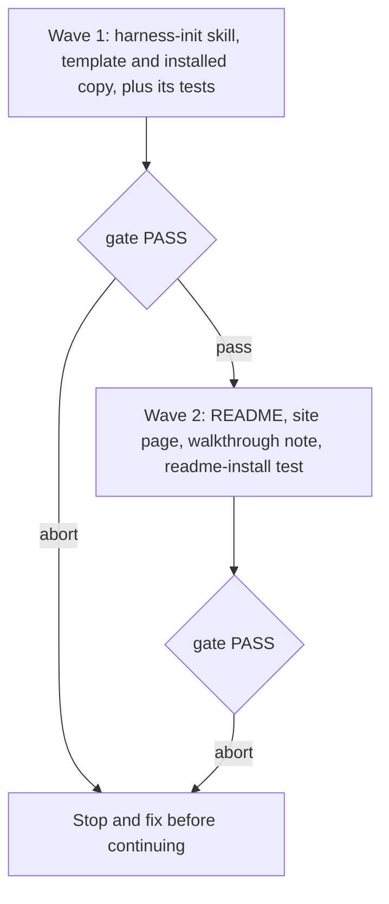

# Harness-init basics path and a trimmable full tour

**Source:** `docs/prds/harness-init-basics-path/harness-init-basics-path-prd.md` (status `stable`). Evidence: `docs/notes/harness-init-flow-map-review/harness-init-flow-map-review-note.md`.
**Next:** After the Human approves → `code-plan` → `code-execute`, wave **1 → 2**.
**Named proof (this spec's own structural gate):** `proof-harness-init-basics-path-spec-obligations`

## Terms

This spec reuses the skill's existing names:

- **Lean path** and **full path**: the two paths, from `references/lean-path.md` and `SKILL.md`.
- **Entry modes**: full, light and mention-only, from `references/entry-modes.md`.
- **Hand-back**: the end of step 6.
- **Session note**: from `references/session-note-template.md`.

New terms, each defined here at first use:

- **Path question:** the first question of a run, "How much setup do you want right now?". Its answer labels are "Just the basics", which picks the lean path, and "The full tour", which picks the full path.
- **Coverage checklist:** the full path's "What should this run cover?" card, with six items.
- **Later:** a step this run does not run. It replaces "deferred" in everything the Human reads.
- **Leaked-credential checks:** the harness-score checks `HYG-03`, `HYG-04` and `HYG-06`, which `references/harness-score.md` already says can never be dropped.

## Repository grounding

| Surface | Present today | Role for this initiative |
|---------|----------------|----------------------------|
| `templates/.agents/skills/harness-init/SKILL.md` | yes | Shipped skill. Its Lean path section, Workflow steps 2–6 and Anti-patterns change. |
| `templates/.agents/skills/harness-init/references/lean-path.md` | yes | Rewritten. It now holds the path question and the basics path instead of thin-evidence detection and the four-item deferral boundary. |
| `references/entry-modes.md` | yes | Gains the plain-language mode question and its three labels; the fold mechanics stay as they are. |
| `references/discovery.md` | yes | The Suggestions section gains the new-or-unexplored gate. File discovery and research rules stay. |
| `references/harness-score.md` | yes | Covered or later on the full path. The leaked-credential checks run on every path. |
| `references/validate-wiring.md` | yes | Gains the plain-language question and its three labels. The options and the write rules stay. |
| `references/session-note-template.md` | yes | The path, goal and later record and the hand-back record change. |
| `references/adr-migration.md`, `stub-template.md` | yes | Unchanged (out of mutate scope). |
| `.agents/skills/harness-init/` | yes | This repo's installed copy. `test/skill-copies.test.ts` (`proof-lean-init-copies-identical`) requires it to be byte-identical to the template. |
| `test/skill-harness-init.test.ts` | yes | Lean tests (lines 260–479) pin the four-item deferral boundary, thin-evidence detection and "skill proposals always run". They are replaced. |
| `test/harness-init-note.test.ts` | yes | Pins the `Deferred / skipped steps` section, `**Mode:**` and `**Immediate goal:**`. Updated. |
| `test/harness-init-discovery.test.ts` | yes | Pins the suggestion rules. Gains the gate tests. |
| `test/harness-init-entry.test.ts` | yes | Pins the entry-mode mechanics, which stay. Gains the label tests. |
| `test/readme-install.test.ts` | yes | Pins the README and `site/harness-init.md` lean-path wording. Updated in wave 2. |
| `site/harness-init.md`, `README.md` | yes | Describe the lean path as thin-evidence with skill proposals. Rewritten in wave 2. |
| `docs/notes/lean-init-walkthrough/lean-init-walkthrough-note.md` | yes | Shows the replaced lean path. Set to `deprecated` in wave 2. |
| ADR-004 (`docs/adrs/adr-004-standalone-skills-contract.md`) | yes, `stable` | Its "Not contract" list includes "the set of skills and their text", so this change needs no contract change. |
| `.agents/skills/test-sync/` | yes | Consulted when changing or retiring tests. |

## Surface walk

- **In scope:**
  - wave 1: `templates/.agents/skills/harness-init/SKILL.md` and `references/{lean-path,entry-modes,discovery,harness-score,validate-wiring,session-note-template}.md`, with the same files under `.agents/skills/harness-init/`, plus the tests that pin them;
  - wave 2: `site/harness-init.md`, `README.md`, `docs/notes/lean-init-walkthrough/`, `test/readme-install.test.ts`, and `test/harness-init-set.test.ts` if its page assertions break.
- **Out of mutate scope (unchanged):**
  - `src/**`, meaning the `setup`, `validate`, `comments` and `skills` commands, the CLI prompts and every finding code;
  - `references/adr-migration.md` and `references/stub-template.md`;
  - the `harness-score` tool and `.harness-score.json` rules;
  - `.wolven-harness.json`;
  - every other skill.

## Waves

Each wave's gate is the full Eval / gates table. A failed gate stops the run before the next wave starts.

## Requirements (obligation ↔ proof)

All proofs are test titles in the files named. A builder runs them with `pnpm test`.

### R1: The path question comes first, and the Human picks the path

| ID | Obligation | Named proof | Evidence shape |
|----|------------|--------------|------------------|
| R1.1 | After the re-run checks and the resume check, before step 0, the run asks "How much setup do you want right now?". "Just the basics" (lean) is listed first as recommended, then "The full tour" (full). The agent never picks the path from the tree's evidence, and no file under `harness-init/` says "thin-evidence". | `proof-basics-path-question` (`test/skill-harness-init.test.ts`) | Grep `lean-path.md` and `SKILL.md` for the question, the order and the labels; `doesNotMatch /thin-evidence/` across the folder |
| R1.2 | A `draft` note that records a path resumes on it, with its goal and coverage, and asks none of them again. A `stable` note does not block a new run: the re-run skips apply and the path question is asked. | `proof-basics-resume` (`test/skill-harness-init.test.ts`) | Grep the resume rules in `lean-path.md` |

### R2: The basics path is three questions long

| ID | Obligation | Named proof | Evidence shape |
|----|------------|--------------|------------------|
| R2.1 | The basics path asks only: the path question; "What do you want to get done first in this repo?" (one sentence, recorded as given, never composed for the Human); and the step 0 AGENTS.md question. It also asks the before-writing checks from `entry-modes.md`, but only when they find something. | `proof-basics-three-questions` (`test/skill-harness-init.test.ts`) | Grep `lean-path.md` for the ordered list of what runs |
| R2.2 | The basics path does not run: step 1; discovery, whether file reading or Q&A; research; skill proposals or stubs; score-gap questions; or the wiring question. Each one is recorded as later. | `proof-basics-skips` (`test/skill-harness-init.test.ts`) | Grep `lean-path.md` for the "does not run" list, which names steps 1–5 and both parts of 6 |
| R2.3 | An empty goal is recorded as "none given", and the run moves on to step 0 without asking again. | `proof-basics-empty-goal` (`test/skill-harness-init.test.ts`) | Grep `lean-path.md` |
| R2.4 | A basics run writes only the step 0 change (AGENTS.md, the `WOLVEN.md` change that goes with it, and any re-include or `CLAUDE.md` lines the Human agreed to) and the session note. It offers one commit, for the entry phase. | `proof-basics-writes` (`test/skill-harness-init.test.ts`) | Grep `lean-path.md` and the Phased commits section of `SKILL.md` |

### R3: The leaked-credential checks run on every path

| ID | Obligation | Named proof | Evidence shape |
|----|------------|--------------|------------------|
| R3.1 | Every run, basics or full tour, with the score covered or left for later, runs `harness:score` and reads the leaked-credential checks. A failure stops the run and shows the Human the finding before anything else is written. When the score is not covered, nothing else from the report is recorded or asked about. When `harness-score` is not installed, the run shows the pinned install command as today. If the Human declines, the run continues, and the hand-back and note list "leaked-credential checks not run" under later. | `proof-leak-checks-every-path` (`test/skill-harness-init.test.ts`) | Grep `harness-score.md` and `lean-path.md` |

### R4: The full tour is trimmed by one coverage checklist

| ID | Obligation | Named proof | Evidence shape |
|----|------------|--------------|------------------|
| R4.1 | On the full path, before step 0, the run shows "What should this run cover?" with every item ticked. The six items, in order, are: "Move old decision records" (step 1), "Ask about the project's stage and plans" (step 2 Q&A), "Look up your tools on the web" (step 3 web pass), "Suggest skills for this repo" (steps 4–5), "Check the harness score now" (step 6 score questions) and "Set up automatic checks" (step 6 wiring). | `proof-full-coverage-checklist` (`test/skill-harness-init.test.ts`) | Grep `SKILL.md` for a table with those six rows, labels and step mappings |
| R4.2 | An unticked item is never asked about or run, and it is recorded as later. File-based discovery and the repo and qmd search still run on the full path whatever is ticked. With every item unticked, the run makes only the step 0 change, runs the leaked-credential checks and hands back. | `proof-full-unticked-is-later` (`test/skill-harness-init.test.ts`) | Grep `SKILL.md` |
| R4.3 | The step 1 rule changes from "offered only when validate reports `legacy-adr`" to "runs when covered and validate reports `legacy-adr`". | `proof-full-step1-covered` (`test/skill-harness-init.test.ts`, replacing the "step 1 is offered only when" test) | Grep `SKILL.md` step 1 |

### R5: Skill proposals only for a new or unexplored repo

| ID | Obligation | Named proof | Evidence shape |
|----|------------|--------------|------------------|
| R5.1 | Before suggesting anything, step 4 judges the repo. It is **new or unexplored** when it has few source files and no recorded decisions: no ADRs, specs or project skills beyond those `setup` installed. It is **well understood** when it has any of those. The agent states its call and its reason to the Human. | `proof-skills-gate-call` (`test/harness-init-discovery.test.ts`) | Grep `discovery.md` Suggestions |
| R5.2 | On a well-understood repo, steps 4–5 are skipped, and the note says why, unless the Human overrules. An overrule runs the existing suggestion rules unchanged. On a new repo, the existing suggestion rules run. | `proof-skills-gate-skip-and-overrule` (`test/harness-init-discovery.test.ts`) | Grep `discovery.md` |

### R6: Plain-language questions and labels

| ID | Obligation | Named proof | Evidence shape |
|----|------------|--------------|------------------|
| R6.1 | Step 0 asks "How much should we change your current AGENTS.md?", with the labels "Just one line" (mention-only), "A short section" (light) and "The whole guide" (full). The recommended one is listed first, by the existing recommendation rule. Each label is explained by what it does to the repo's instructions. | `proof-entry-plain-labels` (`test/harness-init-entry.test.ts`) | Grep `entry-modes.md` |
| R6.2 | The wiring question is "How should we check the harness?", with the labels "On every pull request" (CI job), "With your existing checks" (chained script) and "Only when I run it" (local only). | `proof-wiring-plain-labels` (`test/skill-harness-init.test.ts`) | Grep `validate-wiring.md` |
| R6.3 | The note records each choice by its label first, with the mode or option name in brackets, as in "A short section (light)". | `proof-note-label-and-mode` (`test/harness-init-note.test.ts`) | Grep `session-note-template.md` Entry integration and Validate wiring placeholders |

### R7: The hand-back offers the next piece of work

| ID | Obligation | Named proof | Evidence shape |
|----|------------|--------------|------------------|
| R7.1 | The hand-back is a closing message with three parts. **What's installed**: the skills and the runtimes they are ready in, the AGENTS.md change, anything else done, the commits made, and the session note. **Left for later**: every item that did not run. **Next steps**, numbered and fitted to the installed skill sets. | `proof-handback-three-parts` (`test/skill-harness-init.test.ts`) | Grep `SKILL.md` step 6 hand-back |
| R7.2 | The message ends with "Should we start with a spec for “<goal>”?" when a goal was given, or "What should we build first?" when none was. On a yes, the run ends and `code-spec` starts as separate work on its own branch. Nothing starts without a yes. | `proof-handback-spec-offer` (`test/skill-harness-init.test.ts`) | Grep `SKILL.md` |

### R8: The session note records path, goal and later

| ID | Obligation | Named proof | Evidence shape |
|----|------------|--------------|------------------|
| R8.1 | The `Deferred / skipped steps` section becomes `Left for later`, with: `**Path:**` (as `<Just the basics (lean) or The full tour (full)>`); `**Goal:**` (the Human's words, "none given", or "n/a — full tour"); `**Covered:**` (the ticked items, or "n/a — basics"); and a table `Step \| Name \| Remaining work`. Sections for steps that did not run say "later" with the reason, rather than disappearing. | `proof-note-left-for-later` (`test/harness-init-note.test.ts`, replacing the lean-section tests) | Grep `session-note-template.md` |
| R8.2 | `Next steps for the Human` records the hand-back's next steps, the spec offer and the Human's answer. | `proof-note-handback` (`test/harness-init-note.test.ts`) | Grep `session-note-template.md` |

### R9: Copies, docs and retired material agree

| ID | Obligation | Named proof | Evidence shape |
|----|------------|--------------|------------------|
| R9.1 | `.agents/skills/harness-init/` stays byte-identical to the template. | `proof-lean-init-copies-identical` (existing, `test/skill-copies.test.ts`) | Existing test |
| R9.2 | The README and the `site/harness-init.md` section, renamed "Basics path", describe the path question, the basics path and the coverage checklist. They link `references/lean-path.md`, never say "thin-evidence" or "Skill proposals always run", and no longer link the walkthrough note. | `proof-docs-basics-path` (`test/readme-install.test.ts`, replacing "README and the harness-init page explain the lean path") | Grep both files |
| R9.3 | `docs/notes/lean-init-walkthrough/lean-init-walkthrough-note.md` has `status: deprecated`, and no test reads it as current behavior. | `proof-walkthrough-deprecated` (`test/readme-install.test.ts`) | Frontmatter check; the existing walkthrough test (`test/skill-harness-init.test.ts` line ~454) is retired via `test-sync` |
| R9.4 | The tests that pin removed behavior are retired, not left skipped, via `test-sync`: the four-item boundary, thin-evidence, "proposals never deferred", must-run steps, "a declined lean deferral runs on the full path", and the walkthrough beats. | `proof-no-stale-lean-tests` (grep in `test/skill-harness-init.test.ts`) | `doesNotMatch` on the retired phrases across `test/` |

## Nine-dimension landings

| Dimension | Landing kind | Landing |
|-----------|---------------|---------|
| validation | obligation | Each wave ends at the Eval / gates table: `pnpm test`, `pnpm lint`, `pnpm build && pnpm validate`, `pnpm comments`. R1–R9 are greppable proofs. |
| failure modes | obligation | A leaked credential stops every path (R3.1). A declined write keeps today's diff-then-yes gate (`SKILL.md` Phased commits, unchanged). A red validate at a phase end blocks that phase's commit offer, unchanged. |
| idempotency and retry | obligation | A draft note resumes its path, goal and coverage without asking again. A second run after a stable basics note asks the path question, and re-run skips keep step 0 from folding twice (R1.2; the re-run skips in `SKILL.md` are unchanged). |
| authorization | n/a | Who may write is unchanged: every writing step shows the diff and waits for the Human's yes (`SKILL.md` Phased commits and Hard gates, out of mutate scope in substance). R2.4 only narrows *what* basics writes. |
| concurrency and ordering | obligation | Order: re-run checks, then resume, then the path question, then the goal (basics) or the coverage checklist (full), then step 0 (R1.1, R4.1). Leaked-credential checks run before the hand-back on every path (R3.1). |
| data lifecycle | obligation | The note is created `draft` at step 0 and set `stable` at hand-back (unchanged); its later section is R8.1. The walkthrough note moves to `deprecated` (R9.3). `.harness-score.json` is written only when the score is covered (R3.1). |
| external-dependency failure | obligation | The web being unavailable keeps today's repo-only fallback (`discovery.md` research-cap, unchanged). If `harness-score` is not installed and the Human declines the install, the run continues and lists the leaked-credential checks under later (R3.1). |
| state transitions | obligation | Path: none → lean or full (R1.1). Coverage: all ticked → the Human's ticks, then frozen for the run (R4.1–R4.2). Skills gate: new or explored, then overruled or not (R5). Note: draft → stable (R8). |
| observability | obligation | The hand-back's three parts and spec offer (R7) and the note's `Left for later` section (R8.1) are the run's record. Every step that did not run is named in both. |

## Unresolved

| Identifier | Decision needed | Owner | Blocking effect | Disposition |
|------------|-------------------|-------|-------------------|--------------|

None open. `U-leak-check-unavailable` was resolved by the Human on 2026-10-13 and is now part of R3.1.

## Out of scope

- `wolven-harness setup`, its prompts and flags, and every `src/**` change.
- `harness-score`, its checks, and the shape of `.harness-score.json`.
- Building stubs or closing score gaps during the run.
- The journey-map skill and the deferred `wayfinder` skill.
- Rewriting the walkthrough note for the basics path.

## Pragmatic-guard refuses

- A new reference file for the coverage checklist. The six-row table lives in `SKILL.md` next to the steps it gates.
- Renaming `lean-path.md` or the lean and full path terms. The labels people see change; the skill's terms stay.
- Configurable checklist defaults or a remembered preference across runs.
- Any heuristic for "new or unexplored" beyond the stated signals: source-file count, ADRs, specs and project skills.

## Acceptance

### Wave 1

- [ ] R1.1 `proof-basics-path-question` passes
- [ ] R1.2 `proof-basics-resume` passes
- [ ] R2.1 `proof-basics-three-questions` passes
- [ ] R2.2 `proof-basics-skips` passes
- [ ] R2.3 `proof-basics-empty-goal` passes
- [ ] R2.4 `proof-basics-writes` passes
- [ ] R3.1 `proof-leak-checks-every-path` passes
- [ ] R4.1 `proof-full-coverage-checklist` passes
- [ ] R4.2 `proof-full-unticked-is-later` passes
- [ ] R4.3 `proof-full-step1-covered` passes
- [ ] R5.1 `proof-skills-gate-call` passes
- [ ] R5.2 `proof-skills-gate-skip-and-overrule` passes
- [ ] R6.1 `proof-entry-plain-labels` passes
- [ ] R6.2 `proof-wiring-plain-labels` passes
- [ ] R6.3 `proof-note-label-and-mode` passes
- [ ] R7.1 `proof-handback-three-parts` passes
- [ ] R7.2 `proof-handback-spec-offer` passes
- [ ] R8.1 `proof-note-left-for-later` passes
- [ ] R8.2 `proof-note-handback` passes
- [ ] R9.1 `proof-lean-init-copies-identical` passes
- [ ] R9.4 `proof-no-stale-lean-tests` passes

### Wave 2

- [ ] R9.2 `proof-docs-basics-path` passes
- [ ] R9.3 `proof-walkthrough-deprecated` passes

## Eval / gates

| Gate | Command / check | When | PASS | Abort |
|------|-------------------|------|------|-------|
| Tests | `pnpm test` | End of each wave | exit 0, every named proof passes | Fix; do not proceed |
| Lint | `pnpm lint` | End of each wave | exit 0 | Fix; do not proceed |
| Integrity | `pnpm build && pnpm validate` (`harness:validate`) | End of each wave | exit 0 | Fix; do not proceed |
| Comments | `pnpm comments` | End of each wave | exit 0 | Fix; do not proceed |
| Spec obligations | `proof-harness-init-basics-path-spec-obligations`: every Acceptance box names exactly one R-row and its proof; all nine landings named; the one `n/a` cites the unchanged `SKILL.md` Phased commits and Hard gates; Unresolved is empty | Before `code-plan` | all hold | Do not plan |

## Cross-domain leak table

| Leak | Refuse |
|------|--------|
| Changing `setup` prompts or flags to match the new labels | Out of scope; a `setup` change gets its own PRD |
| Changing `harness-score` checks or its presets | Out of scope; upstream tool |
| Building the journey-map renderer or skill | The journey-map `create-prd` handoff |
| Starting `code-spec` for a consumer's goal inside the init run | It happens after hand-back on a yes, as separate work (R7.2) |
| An executable plan from this skill | `code-plan` only |

## ADR

None needed this initiative. Skill text is outside the public contract per ADR-004's "Not contract" list, and the spec settles no durable architecture, dependency or convention choice.
