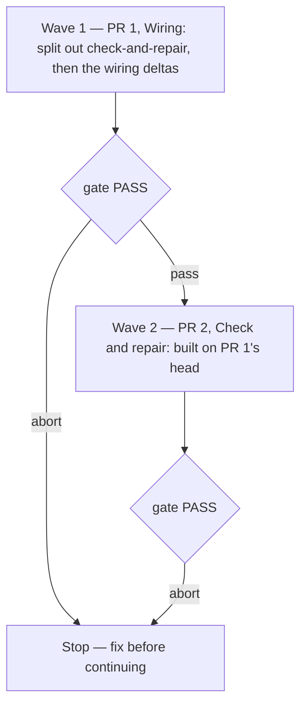

# Install and use experience — iteration 1 spec

**Source:** `docs/prds/install-experience/install-experience-prd.md` (status `stable`, amended for AC-1.6, AC-4.4, AC-5.1, US-8 and Scope › Delivery), and the design findings 7, 8, 9, 10 and 12 of the [PR 71 review](https://github.com/WolvenTech/wolven-harness/pull/71#pullrequestreview-5591524011) at `149dde6`. This file holds only the delta. Every row of `install-experience-spec.md` stands as written unless a row below amends or replaces it.
**Next:** After the Human approves → `code-plan` writes `install-experience-iteration-1-plan.md` in this folder → `code-execute`, wave **1 (PR 1) → 2 (PR 2)**.
**Named proof (this spec's own structural gate):** `proof-install-experience-iteration-1-spec-obligations`

## Findings in this round

| Finding | Where (at `149dde6`) | Kind | Lands in |
|---|---|---|---|
| F1 | `src/doctor/runtime-checks.ts:141` | Plan-only; its cause goes away with the install-wide switch | R2.3 (amended), then `code-plan` |
| F2 | `src/doctor/env-checks.ts:16` | Plan-only | `code-plan`, PR 2 |
| F3 | `src/setup/index.ts:64` | Plan-only | `code-plan`, PR 1 |
| F4 | `src/doctor/env-checks.ts:162` | Plan-only | `code-plan`, PR 2 |
| F5 | `src/setup/runtimes.ts:141` | Plan-only | `code-plan`, PR 1 |
| F6 | `templates/.agents/skills/harness-doctor/SKILL.md:61` | Plan-only | `code-plan`, PR 2 |
| F7 | `templates/.agents/skills/harness-init/references/layout.md:63`, `checkQmd` | Design | R5.2 and R7.1 (amended), R12 |
| F8 | `src/setup/manifest.ts:89`, `src/setup/apply.ts` | Design | R7.3 and R7.4 (amended), R13 |
| F9 | `wrapRule`, `missingFiles`, `rulesProblem` | Design | R11 |
| F10 | `src/setup/runtimes.ts:378` | Design | R2.1 and R2.3 (amended), R10.2 |
| F11 | `src/setup/options.ts:22`, `:376` | Now an obligation through PRD AC-1.6; the unit is plan's | R3.2 (amended), R3.4 |
| F12 | `runtimes.ts:288`, `summary.ts:17,30,178`, `runtime-checks.ts:140`, `env-checks.ts:16` | Design | R10.1 |
| F13 | `src/doctor/drift.ts` against `src/setup/**` | Plan-only | `code-plan`, PR 2 |
| F14 | — | Withdrawn by the reviewer | — |

## PRD delta → rows

| PRD change | Rows |
|---|---|
| AC-1.2 narrowed to "not inside any git repository" | R3.2 (amended) |
| AC-1.6 setup in a subfolder of a repository | R3.4 |
| AC-4.1 "the current text of the four standing rules" | R11.1 |
| AC-4.4 a changed rule reaches every runtime | R11.1, R11.2, R11.3 |
| AC-5.1 a `qmd` search from the open folder reaches the index | R5.2 (amended), R12.1, R12.2 |
| US-8 (AC-8.1 to AC-8.3) earlier installs | R7.3 and R7.4 (amended), R13.1, R13.2, R13.3 |
| Scope › Delivery, two pull requests | R9.1 (amended), R14.1, R14.2, Waves |

## Design decisions this iteration

These settle how the delta works. The Human confirms them by approving this spec.

| ID | Decision | Rejected alternative | Why |
|---|---|---|---|
| D1 | **Drift needs no manifest.** The package ships a table of every byte form a released `setup` wrote at each path (R13.1). `doctor` classifies a file against that table. `.wolven-harness.manifest.json` is dropped from the design. | Keep the manifest and add the table only as a fallback for files with no entry | With the table, the manifest decides nothing the table does not. Every install, old or new, is classified the same way, so AC-8.3 holds without an adoption step. PR 1 already ships without the manifest (R14.1), so no released install ever holds one. |
| D2 | **Antigravity reads the rules from the inline block.** Its registry row becomes `inline`, like Codex. The rule templates drop `trigger`, so Antigravity discards `.agents/rules/*.md` as its docs describe. | Generated copies under Antigravity's legacy `.agent/rules/` | Antigravity reads `AGENTS.md` natively. An `inline` row removes the double read with no new files and no dependence on a legacy path. The cost: wiring Antigravity puts the whole install in inline mode. |
| D3 | **A stale rule copy is repaired by deleting it and re-running `setup`.** `setup` stays create-only, and one renderer per wiring kind writes every copy. | `setup` rewrites copies whose source rule changed; or `harness-doctor` writes the copy text itself | The first breaks `setup`'s create-only guarantee. The second gives a second copy of the rendering logic, which is the drift F12 and F13 describe. |
| D4 | **`doctor` finds the qmd index the way `qmd` does.** It walks up from the open folder for `.qmd/index.yaml` or `.qmd/index.yml`, as `findLocalConfigPath` does in qmd 2.5.3 (`dist/collections.js`), and compares the folder it finds with the harness home's `.qmd`. | Running `qmd status` and parsing its output | `qmd status` prints human text only (`U-qmd-freshness` in the base spec). |
| D5 | **PR 1 revises ADR-005 in place, and PR 2 supersedes it.** ADR-005 exists only on the PR 71 branch and never reached `main`, so revising it before it merges changes no released contract. | Merge ADR-005 as written and supersede it immediately; or amend it again in PR 2 | PR 1 must not record `doctor` (PRD Handoff). A released contract changes only through a successor. |

## Repository grounding

| Surface | Present at `149dde6` | Role for this iteration |
|---------|----------------------|--------------------------|
| `RUNTIME_REGISTRY`, `RulesStrategy`, `wireNativeRules` (`switch` on `row.id`), `wireRuntimes` (`rows.some(...)`) in `src/setup/runtimes.ts` | yes | `rules` becomes wiring data (R10.1). The install-wide switch moves into one exported function (R10.2) |
| `RUNTIME_NAMES` and the path-to-runtime map in `src/setup/summary.ts` | yes | Replaced by registry data (R10.1) |
| `rulesProblem` (`switch` on `row.id`), `readRules`, `stripFrontmatter` in `src/doctor/runtime-checks.ts` | yes | Reads the registry data and the install-wide mode (R10.1, R10.2), and compares copies (R11.1) |
| `checkQmd` in `src/doctor/env-checks.ts` | yes | Checks reachability from the open folder (R12.1) |
| `runDriftChecks`, `expectedFiles`, `readManifest` in `src/doctor/drift.ts` | yes | Classifies against the known forms table, with no manifest (R13.2) |
| `src/setup/manifest.ts`, the `recorder?` arguments in `apply.ts` and `runtimes.ts` | yes | Removed (D1) |
| `isGitTopLevel` and `resolveOptions` in `src/setup/options.ts` | yes | Tell a repository subfolder from a folder outside any repository (R3.4) |
| `templates/.agents/rules/*.md` (`trigger: always_on`) | yes | Drop `trigger` (R2.1, amended) |
| `templates/.agents/skills/harness-init/references/layout.md` (linked layout links, bootstrap copies) | yes | Links `.qmd`; the bootstrap condition uses drift (R5.2, amended) |
| `templates/.agents/skills/harness-doctor/SKILL.md` (drift step, `doctor-rules` row) | yes | No manifest step; a `doctor-rules-stale` row (R8.2 amended, R11.2) |
| `findLocalConfigPath` in qmd 2.5.3 (`@tobilu/qmd/dist/collections.js`) | yes, external | The index lookup `doctor` mirrors (D4) |
| Release tags `v0.1.0`, `v0.1.1`, `v0.2.0`, `v0.3.0`, `v0.3.1`, `v0.3.2` | yes | Sources for the known forms table. None of them renders `.qmd/index.yml`; each copies it as is |
| `renderer/sync.mjs` and `test/renderer-copies.test.ts` | yes | The precedent for a generated, committed file with a drift test (R13.1) |
| `docs/adrs/adr-005-install-anywhere-contract.md` (`stable`, on this branch only) | yes | Revised for PR 1, superseded in PR 2 (D5, R9.1) |

## Surface walk

- **In scope:** the paths the base spec names, plus a committed known forms data file and the script that regenerates it (names are `code-plan`'s), and this folder's iteration plan.
- **Out of mutate scope (unchanged):**
  - `src/validate/**`, including `checkStep0Pending` (R2.5 stands).
  - `src/comments/**`, `src/skills/**` and the `skills` command.
  - `renderer/**`.
  - Package-manager resolution in `src/setup/package-manager.ts` (R4.1 to R4.3 stand).
  - The commit-convention steps (R6 stands).
  - The release workflow and the `release-please` config.

## Approved execution scope clarification

The Human authorized equivalent registry lookups in `src/skills/install.ts`
and `src/validate/spine.ts` to satisfy R10.1's source scan. This is the sole
exception to their unchanged status above. The `skills` command's load paths
and the validator's checked path set stay the same; no new behavior is added.

## Waves

Each wave is one pull request. Its gate is `pnpm build && pnpm test && pnpm lint && pnpm validate && pnpm comments`, plus that PR's surface proof (R14.1 or R14.2). A failed gate aborts before the next wave. Wave 2 starts from wave 1's head, so PR 2 builds on PR 1 as the PRD's Delivery section says.

## Requirements (obligation ↔ proof)

### Amended rows

Each row replaces the base row of the same ID. The proof name is the base row's unless the row says otherwise.

| ID | Obligation | Named proof | Evidence shape |
|----|------------|--------------|------------------|
| R2.1 | Every `templates/.agents/rules/*.md` frontmatter carries `alwaysApply: true` and `description`, and no `trigger` key. Antigravity therefore discards these files and reads the rules from the inline block (D2) | `proof-install-experience-rule-frontmatter` | `test/rules-frontmatter.test.ts`: each rule parses with no `trigger` key |
| R2.3 | The rules mode is one value for the whole install, worked out by R10.2: `inline` when any wired row's rules wiring is `inline` (Codex, Antigravity), otherwise `native`. In inline mode, the harness section holds the rule bodies between `<!-- wolven-harness:rules:start -->` and `<!-- wolven-harness:rules:end -->`. Setup then creates no rules wiring for any row, and `harness-init` writes no `@.agents/rules/…` imports for Amp. No runtime reads the rules twice | `proof-install-experience-inline-rules` | `test/setup-native-wiring.test.ts`: `--runtimes claude,antigravity` and `--runtimes claude,codex` create no `.claude/rules`; `harness-init`'s text says the Amp imports are written only in native mode |
| R3.2 | When the current folder is **not inside any git repository**, `setup` writes only the core skills to `.agents/skills/` (including `harness-init`), each selected runtime's skills wiring and `.wolven-harness.json`. It writes no `docs/`, `WOLVEN.md`, `.qmd/` or rules. It exits 0, and its next step says to open the agent in this folder and run `harness-init`. From PR 2 on, the core skills include `harness-doctor` | `proof-install-experience-outside-root` | `test/setup-outside-root.test.ts`: in a temp dir with no `.git` in it or above it, the written path set is exactly those paths; exit 0; the next-step text names `harness-init` |
| R5.2 | As in the base row, with two changes. The open folder links `.qmd` into the harness home, beside `AGENTS.md`, `.agents` and `.claude/skills`. A bootstrap copy `setup` wrote in the open folder is replaced by its symlink only when `doctor` reports no `doctor-drift-edited` file under it (R13.2) and no file was added there. Otherwise `harness-init` asks | `proof-install-experience-init-linked` | `test/harness-init-layout.test.ts`: the linked-layout step lists the four links, including `.qmd`, and the replacement condition names `doctor-drift-edited`, not a manifest |
| R7.1 | As in the base row, with these changes. Every check that asks whether an agent can reach something resolves its paths from the open folder, following symlinks: `doctor-entry`, `doctor-rules`, `doctor-rules-stale` (R11.1), `doctor-skills` and `doctor-qmd` (R12.1). In inline mode the rules are checked once for the install, and the finding names every wired runtime that reads the block. `doctor-qmd` also fails when the index is not reachable from the open folder (R12.1) | `proof-install-experience-doctor-checks` | `test/doctor.test.ts`: the base fixtures, plus a claude-and-codex install with a complete inline block that exits 0 |
| R7.3 | `setup` writes no install manifest. `.wolven-harness.manifest.json` is not part of the contract (D1) | `proof-install-experience-no-manifest` (replaces `proof-install-experience-manifest`) | `test/setup-apply.test.ts`: a root run and an outside run create no `.wolven-harness.manifest.json` |
| R7.4 | `doctor` warns `doctor-not-global` (R3.3, R4.4) and `doctor-version-behind` as in the base row. Drift is classified by R13.2, with no manifest | `proof-install-experience-drift` | `test/doctor-drift.test.ts`: one fixture per drift class, none holding a manifest |
| R8.2 | For `doctor-drift-stale`, `harness-doctor` offers to replace the file with the current template, one file at a time, after a yes. It records nothing else. For `doctor-drift-edited` it shows the diff with the current template and changes nothing. It never merges | `proof-install-experience-doctor-refresh` | `test/harness-doctor-skill.test.ts`: both branches' text; no mention of a manifest |
| R9.1 | The contract is recorded in two steps (D5). In PR 1, ADR-005 is revised to record only what PR 1 ships: `setup` outside any git repository as a supported mode; `setup` in a repository subfolder exiting 1 (R3.4); the `--package-manager` flag; the registry's runtime ids; and the optional config keys `packageManager`, `layout` (value `home` only), `codeRepo` and `commitConvention`. It names no `doctor` command, finding code, manifest, `harnessHome` key or `linked` value. The Human confirms the revised text. In PR 2, a successor ADR-NNN, created through the `adr` skill, carries ADR-005 forward and adds `doctor` with its flags, output, exits and codes (including `doctor-rules-stale`), the `layout` value `linked` and the `harnessHome` key. ADR-005 is then superseded, with every claim repointed | `proof-install-experience-contract` | PR 1: `test/contract.test.ts` targets the revised ADR-005; `pnpm validate` shows 0 claim failures. PR 2: `test/contract.test.ts` targets ADR-NNN and covers `doctor`; ADR-005 is `deprecated` with `superseded_by`; 0 claim failures |
| R9.2 | `README.md` and the site's install page lead with the global install and `setup` outside a repository, and show npm, yarn and pnpm forms (PR 1). PR 2 adds `doctor` to both | `proof-install-experience-docs` | `test/readme-install.test.ts`: PR 1 asserts no `doctor` text; PR 2 asserts it |

R3.1, R3.3, R4.2, R4.4, R5.3, R7.2, R7.5, R8.1, R8.3 and R9.3 stand. Where they mention `doctor`, `harness-doctor` or the manifest, they ship in PR 2 (R14.2).

### R3.4 — Setup refuses a repository subfolder

Traces to PRD AC-1.6. Covers F11.

| ID | Obligation | Named proof | Evidence shape |
|----|------------|--------------|------------------|
| R3.4 | When the current folder is inside a git work tree but is not its top-level, `setup` decides this before any prompt or write. It writes nothing and exits 1. Its stderr names the repository's top-level and says to run `setup` at that top-level or in a folder outside the repository | `proof-install-experience-subfolder-refused` | `test/setup-outside-root.test.ts`: `git init` a temp dir, run `setup` in a subfolder with every flag given; exit 1; the tree is byte-identical before and after; stderr contains the top-level path |

### R10 — Rules wiring is registry data

Traces to PRD US-4 (AC-4.1). Covers F10 and F12.

| ID | Obligation | Named proof | Evidence shape |
|----|------------|--------------|------------------|
| R10.1 | Each registry row's `rules` field states the row's rules wiring as data, as one of: `link` (a path and a symlink target); `per-rule` (a file path pattern holding the rule's base name, and the frontmatter to wrap each body in); `file` (one path, and the renderer that builds it from the rule list); `imports` (the harness section imports each rule); or `inline` (the runtime reads the inline block in `AGENTS.md`). Setup writes from this data, `doctor` checks against it, and the setup summary groups by it. No module under `src/` other than the registry switches on a runtime id or holds a runtime's name, wiring path or generated file name | `proof-install-experience-registry-data` | `test/runtime-registry.test.ts`: every row has one of the five kinds; for each row, the paths a fixture `setup` run creates equal the paths its data names; a scan of `src/**/*.ts` outside the registry module finds no `case '<id>'` and no runtime name or wiring path literal |
| R10.2 | One exported function works out the rules mode from the wired runtimes (R2.3). Setup, the summary and `doctor` call it, and none of them derives the mode another way | `proof-install-experience-rules-mode` | `test/runtime-registry.test.ts`: a table of runtime sets → mode, including `[claude, antigravity]` → `inline` and `[claude, cursor, kiro]` → `native`; a scan finds no other `.rules ===` comparison under `src/` |

### R11 — A changed rule reaches every runtime

Traces to PRD AC-4.1 and AC-4.4. Covers F9. Ships in PR 2, except R11.3, which ships in PR 1.

| ID | Obligation | Named proof | Evidence shape |
|----|------------|--------------|------------------|
| R11.1 | `doctor` compares every copy of a standing rule with the current rule in the harness home's `.agents/rules/`. In native mode, each `per-rule` file whose bytes differ from what the row's data renders from the current rule is `error [doctor-rules-stale]`, naming the runtime and the file. So is a `wolven-`-prefixed file in a `per-rule` folder whose source rule no longer exists. In inline mode, the block must hold exactly the current rule bodies, frontmatter removed, in file-name order and with nothing added; `harness-init` writes it that way (base R2.4). Whitespace runs count as one space. A block that differs fails, and the finding names every runtime that reads the block. Each finding's fix line names `harness-doctor`. Link, file and import wiring point at the rules themselves and are not compared | `proof-install-experience-rules-stale` | `test/doctor-runtime.test.ts`: for Cursor, Copilot and Kiro, edit one rule after `setup` and `doctor` exits 1 with `doctor-rules-stale` naming that runtime; inline fixture, likewise for Codex and Antigravity; delete a rule and its orphan copy is reported; an untouched install gives no such finding |
| R11.2 | For `doctor-rules-stale`, `harness-doctor` shows the difference between the copy and the current rule, and asks. On a yes it deletes each stale or orphan copy and re-runs `wolven-harness setup`, which creates the missing copies from the current rules (D3). For the inline block, on a yes it replaces the text between the rules markers with the current rule bodies. On a no it changes nothing, and the closing summary lists the check as still failing | `proof-install-experience-rules-refresh` | `test/harness-doctor-skill.test.ts`: the `doctor-rules-stale` row and step text name the diff, the consent gate, the delete-then-`setup` path and the inline-block replacement |
| R11.3 | `setup` stays create-only for rule copies. A re-run leaves a copy that differs from its current rule byte-identical | `proof-install-experience-rules-create-only` | `test/setup-native-wiring.test.ts`: edit a rule after `setup`, re-run `setup`; each copy's bytes are unchanged |

### R12 — qmd reachable from the open folder

Traces to PRD AC-5.1 and the goal "a `qmd` search returns the project's docs". Covers F7. Ships in PR 2.

| ID | Obligation | Named proof | Evidence shape |
|----|------------|--------------|------------------|
| R12.1 | `doctor-qmd` walks up from the open folder to the first folder holding `.qmd/index.yaml` or `.qmd/index.yml` (D4). It is an error when no such folder is found, when that `.qmd` folder's real path is not the harness home's `.qmd`, or when it holds no `index.sqlite`. Each case has its own message, and the fix line names the missing link or the `qmd update` to run in the harness home | `proof-install-experience-qmd-reach` | `test/doctor-env.test.ts`, with a stub `qmd` on the injected `PATH`: a linked fixture without the `.qmd` link fails; with it, no `doctor-qmd` finding; a fixture whose nearest `.qmd` belongs to another folder fails |
| R12.2 | In a linked layout, `doctor` reads each runtime's skills and rules wiring under the open folder, not under the harness home. Wiring present only in the harness home fails `doctor-skills` or `doctor-rules` | `proof-install-experience-doctor-open-folder` | `test/doctor-runtime.test.ts`: a linked fixture whose Cursor rule files exist only in the harness home fails `doctor-rules`; after linking them into the open folder, it passes |

### R13 — Earlier installs are classified without network

Traces to PRD US-8 (AC-8.1 to AC-8.3) and AC-5.5. Covers F8. Ships in PR 2.

| ID | Obligation | Named proof | Evidence shape |
|----|------------|--------------|------------------|
| R13.1 | The package ships a known forms table. It maps each path `setup` installs from `templates/` to the sha-256 of every byte form written there by any release from `v0.1.0` to the current version, including the current templates and the current rendered `.qmd/index.yml` for each skill-set choice. A script regenerates the table from the release tags and the working tree, and a committed copy ships. Entries are only ever added | `proof-install-experience-known-forms` | A test fails when a current template form, or a current rendered `.qmd/index.yml` form, is absent from the table; the table holds a form for each release tag's copy of a shipped template |
| R13.2 | For each expected file, `doctor` classifies it this way, with no network and no manifest. Absent: `doctor-drift-missing`. Bytes equal to the current form: no finding. Bytes equal to any other known form: `doctor-drift-stale`. Anything else: `doctor-drift-edited`. `WOLVEN.md` is not classified; `step0-pending` covers it until `harness-init` folds it in | `proof-install-experience-drift-earlier` | `test/doctor-drift.test.ts`: a fixture built from `v0.3.2`'s templates, with one file edited; untouched files that changed since are `doctor-drift-stale`; the edited file is `doctor-drift-edited`; the run makes no network call |
| R13.3 | After `harness-doctor` refreshes the stale files the developer agrees to, `doctor` reports no drift for them. Files left stale stay stale, and edited files stay edited | `proof-install-experience-drift-after-refresh` | Same test file: replace the stale files with the current templates in the fixture, rerun; only the edited file and any declined stale file are reported |

### R14 — Delivery in two pull requests

Traces to PRD Scope › Delivery.

| ID | Obligation | Named proof | Evidence shape |
|----|------------|--------------|------------------|
| R14.1 | PR 1, **Wiring**, is cut from `149dde6`. It carries R1, R2 (as amended), R3.1, R3.2 (as amended), R3.3 for `setup`, R3.4, R4.1 to R4.3, R5.1, R6, R10, R11.3, the `validate` fix for tracked files deleted from disk (`50b8dea`), the revised ADR-005 (R9.1) and its half of R9.2. It ships no `src/doctor/`, no `doctor` command, no `harness-doctor` skill, no install manifest, no linked-layout section in `harness-init`, and no `linked` or `harnessHome` config value. `docs/deferrals/setup-drift-check/` stays | `proof-install-experience-pr1-surface` | On PR 1's head: `src/doctor/` and `templates/.agents/skills/harness-doctor/` are absent; `node dist/cli.js doctor` exits 1 as an unknown command; ADR-005 has no `doctor` command or finding code; a config with `layout: "linked"` is rejected; the gate in Waves passes |
| R14.2 | PR 2, **Check and repair**, starts from PR 1's head. It carries R3.3 for `doctor`, R4.2's doctor fixes, R4.4, R5.2 (as amended), R5.3, R7 (as amended), R8 (as amended), R9.1's successor ADR, R9.2's `doctor` half, R9.3, R11.1, R11.2, R12 and R13, plus the plan-only findings F1, F2, F4, F6 and F13 | `proof-install-experience-pr2-surface` | On PR 2's head: the successor ADR is `stable` and ADR-005 `deprecated`; `node dist/cli.js doctor --dir <fixture>` exits 1 on the audited-shape fixture and 0 on the repaired one; `docs/deferrals/setup-drift-check/` is absent; the gate in Waves passes |

## Nine-dimension landings

| Dimension | Landing kind | Landing |
|-----------|---------------|---------|
| validation | obligation ↔ proof | R3.4 / `proof-install-experience-subfolder-refused`: the subfolder case is decided before any prompt or write. R14.1 / `proof-install-experience-pr1-surface`: PR 1's config rejects the `linked` value it does not support |
| failure modes | obligation ↔ proof | R11.1 / `proof-install-experience-rules-stale`: an unreadable rule or copy becomes that check's finding, not a crash, as the base R7.1 requires. R3.4: with `git` not on `PATH`, setup cannot run `git rev-parse`; it then looks for a `.git` entry in the folder and its ancestors, and refuses when it finds one above the current folder |
| idempotency and retry | obligation ↔ proof | R11.3 / `proof-install-experience-rules-create-only`: re-running `setup` never rewrites a copy. R11.2: deleting a stale copy and re-running `setup` converges on the current rule, and a second pass finds nothing to do. `doctor` stays read-only (base R7.5) |
| authorization | `n/a` | Unchanged surface: no credential or permission is added. The `.qmd` link (R5.2) points inside the harness home like the other linked-layout links, so the import approval in the `runtime-instruction-loading` note does not apply. `src/skills/**` keeps its global-path writes as ADR-005 records |
| concurrency and ordering | `n/a` | Unchanged surface: one command per process, dispatched by `src/cli.ts`. The order of the two pull requests is set in Waves, not at run time |
| data lifecycle | obligation ↔ proof | R7.3 / `proof-install-experience-no-manifest`: no install writes a manifest, and no released version ever did (R14.1). R13.1: the known forms table only grows. R11.2: a stale copy is deleted and recreated, never edited in place |
| external-dependency failure | obligation ↔ proof | R12.1 / `proof-install-experience-qmd-reach`: `doctor` mirrors qmd 2.5.3's lookup (D4), and a missing `qmd` stays a `doctor-qmd` error. R13.2 / `proof-install-experience-drift-earlier`: drift uses only data shipped in the package. A change in qmd's lookup is tracked as `U-qmd-lookup` |
| state transitions | obligation ↔ proof | R13.2 / `proof-install-experience-drift-earlier`: a file moves from current to stale when a release changes its template, and back to current when refreshed; an edited file stays edited. A rule copy moves from current to stale when its rule changes, and back on a consented refresh (R11.1, R11.2). A subfolder run never enters any install state (R3.4) |
| observability | obligation ↔ proof | R11.1 / `proof-install-experience-rules-stale`: the new `doctor-rules-stale` code is contract from PR 2 (R9.1) and names the runtime. R10.1 / `proof-install-experience-registry-data`: the setup summary groups wiring by registry data. R3.4: the refusal names the top-level |

## Unresolved

| Identifier | Decision needed | Owner | Blocking effect | Disposition |
|------------|-------------------|-------|-------------------|--------------|
| `U-qmd-lookup` | What `doctor` does if a later qmd release changes how it finds `.qmd/` | Human | Non-blocking | R12.1 follows qmd 2.5.3. Revisit when qmd's release notes change `findLocalConfigPath` |

The base spec's Unresolved rows stand.

## Out of scope

- The plan-only findings F1 to F6, F11's unit and F13. `code-plan` writes their units.
- Merging consumer edits with new templates, for rule copies as well as templates.
- Running `qmd update` or `qmd embed` from `doctor`.
- Widening `skills --runtimes` beyond its three values.
- Anything the base spec puts out of scope.

## Pragmatic-guard refuses

- Keeping the manifest beside the known forms table (D1).
- A new CLI command to print or write the inline rules block. `harness-doctor` writes it from the rule files.
- `setup` rewriting a rule copy that already exists (D3).
- Generated Antigravity rule files under `.agent/rules/` (D2).
- Fetching earlier templates from the npm registry at run time. The table ships in the package.
- A per-runtime rules mode. There is one for the whole install (R10.2).

## Acceptance

### Wave 1 — PR 1, Wiring

- [x] `proof-install-experience-rule-frontmatter` PASS — R2.1
- [x] `proof-install-experience-inline-rules` PASS — R2.3
- [x] `proof-install-experience-outside-root` PASS — R3.2
- [x] `proof-install-experience-subfolder-refused` PASS — R3.4
- [x] `proof-install-experience-no-manifest` PASS — R7.3
- [x] `proof-install-experience-contract` PASS for ADR-005 — R9.1, PR 1 half
- [x] `proof-install-experience-docs` PASS without `doctor` — R9.2, PR 1 half
- [x] `proof-install-experience-registry-data` PASS — R10.1
- [x] `proof-install-experience-rules-mode` PASS — R10.2
- [x] `proof-install-experience-rules-create-only` PASS — R11.3
- [x] `proof-install-experience-pr1-surface` PASS — R14.1

### Wave 2 — PR 2, Check and repair

- [ ] `proof-install-experience-init-linked` PASS — R5.2
- [ ] `proof-install-experience-doctor-checks` PASS — R7.1
- [ ] `proof-install-experience-drift` PASS — R7.4
- [ ] `proof-install-experience-doctor-refresh` PASS — R8.2
- [ ] `proof-install-experience-contract` PASS for ADR-NNN — R9.1, PR 2 half
- [ ] `proof-install-experience-docs` PASS with `doctor` — R9.2, PR 2 half
- [ ] `proof-install-experience-rules-stale` PASS — R11.1
- [ ] `proof-install-experience-rules-refresh` PASS — R11.2
- [ ] `proof-install-experience-qmd-reach` PASS — R12.1
- [ ] `proof-install-experience-doctor-open-folder` PASS — R12.2
- [ ] `proof-install-experience-known-forms` PASS — R13.1
- [ ] `proof-install-experience-drift-earlier` PASS — R13.2
- [ ] `proof-install-experience-drift-after-refresh` PASS — R13.3
- [ ] `proof-install-experience-pr2-surface` PASS — R14.2

## Eval / gates

| Gate | Command / check | When | PASS | Abort |
|------|-------------------|------|------|-------|
| Build | `pnpm build` | End of each wave | exit 0 | Fix; do not proceed |
| Tests | `pnpm test` | End of each wave | exit 0 | Fix; do not proceed |
| Lint | `pnpm lint` | End of each wave | exit 0 | Fix; do not proceed |
| Integrity | `pnpm validate` (`harness:validate`) | End of each wave | exit 0, 0 claim failures | Fix; do not proceed |
| Comments | `pnpm comments` | End of each wave | exit 0 | Fix the added comment |
| PR 1 surface | `proof-install-experience-pr1-surface` | End of wave 1 | all hold | Do not open PR 1 |
| Doctor smoke | `node dist/cli.js doctor --dir <fixture>` on the audited-shape, repaired, linked and claude-and-codex fixtures | End of wave 2 | exit 1, 0, 0 and 0 | Fix; do not proceed |
| Spec obligations | `proof-install-experience-iteration-1-spec-obligations`: every acceptance box names one row; every new or amended row has one proof no other row uses; each PRD delta maps to a row; all nine landings named; every `n/a` cites an unchanged surface | Before `code-plan` | all hold | Do not plan |

## Cross-domain leak table

| Leak | Refuse |
|------|--------|
| Cutting the two branches, opening PR 1 and PR 2, and closing or retitling PR 71 | `code-pr`, on the Human's ask |
| Units and their order for F1 to F6, F11 and F13 | `code-plan` |
| Re-running the PR 71 review on the new PRs | `code-review`, on the Human's ask |
| An executable plan from this skill | `code-plan` only |

## ADR

Two ADR steps, both through the `adr` skill. In PR 1, ADR-005 is revised as R9.1 says and the Human confirms the revised text (D5). In PR 2, a successor ADR is created as a draft, promoted once the Human confirms it, and supersedes ADR-005 with every claim repointed. Until it is `stable`, this spec and the plan refer to it only as ADR-NNN.

## Section checklist

All sections present: Source, Findings in this round, PRD delta, Design decisions, Repository grounding, Surface walk, Waves, Requirements, Nine-dimension landings, Unresolved, Out of scope, Pragmatic-guard refuses, Acceptance, Eval / gates, Cross-domain leak table, ADR.
