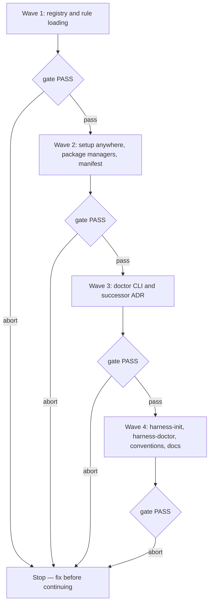

# Install and use experience

**Source:** `docs/prds/install-experience/install-experience-prd.md` (status `stable`).
**Research:** `docs/notes/runtime-instruction-loading/runtime-instruction-loading-note.md` and `docs/notes/skill-load-paths/skill-load-paths-note.md`.
**Next:** After the Human approves → `code-plan` → `code-execute`, waves **1 → 2 → 3 → 4**.
**Named proof (this spec's own structural gate):** `proof-install-experience-spec-obligations`

## Terms

- **Harness home:** the git repository that holds `.agents/`, `docs/`, `.qmd/` and `.wolven-harness.json`. Defined in the PRD.
- **Open folder:** the folder the agent runtime is started in. In the default layout it is the harness home. In a **linked layout** it is a folder above the harness home, wired to it by symlinks.
- **Code repository:** the one repository the install serves, recorded as `codeRepo`. Multi-repo installs are deferred (`docs/deferrals/multi-repo-install/multi-repo-install-deferral.md`).
- **Runtime registry:** the data table in `src/setup/runtimes.ts` that lists each supported runtime. It follows the shape of Compozy's `agentSpecs` (`runtime-instruction-loading` note).
- **Rules strategy:** how one runtime gets the four standing rules into context: `native` (a mechanism of its own) or `inline` (rule text inside `AGENTS.md`).
- **Harness section:** the part of `AGENTS.md` between `<!-- wolven-harness:start -->` and `<!-- wolven-harness:end -->`, written by `harness-init`.
- **Manifest:** `.wolven-harness.manifest.json`, the record of the sha-256 of every file the harness wrote.
- **Minimal install:** the four doctor checks from the PRD (router and rules, skills, docs home, qmd).

## Repository grounding

| Surface | Present today | Role for this initiative |
|---------|----------------|----------------------------|
| `src/setup/runtimes.ts` (`wireRuntimes`, `.claude/skills` symlink, `CLAUDE.md` stub) | yes | Becomes the runtime registry and the per-runtime wiring |
| `src/setup/options.ts` (`RUNTIME_MARKERS`, `detectRuntimes`, the top-level check) | yes | Detection widens to machine markers; the top-level check selects a mode instead of failing |
| `src/setup/types.ts` (`Runtime = 'claude' \| 'codex' \| 'cursor'`) | yes | The union widens to the registry ids |
| `src/setup/config.ts` (`KNOWN_KEYS`, `readConfig`, `writeConfig`) | yes | New optional keys |
| `src/setup/index.ts` (`nextSteps`, pnpm strings) | yes | Package-manager-aware messages; the outside-root mode |
| `src/setup/own-package.ts`, `src/setup/harness-score.ts` (pnpm fix strings) | yes | Package-manager-aware fix strings |
| `src/setup/apply.ts`, `src/setup/render-wolven.ts` | yes | Writes the manifest; renders the harness section markers into `WOLVEN.md` |
| `src/validate/spine.ts` (`checkStep0Pending`) | yes | Fires on a missing start marker instead of a missing mention |
| `src/cli.ts` (`setup`, `validate`, `comments`, `skills`) | yes | Gains `doctor` |
| `src/skills/` (`skills` command, project and global load paths) | yes | Unchanged; reused for skill path data |
| `templates/.agents/rules/*.md` (`alwaysApply: true`) | yes | Gains `trigger: always_on` |
| `templates/WOLVEN.md` (`pnpm harness:validate`, "load unconditionally") | yes | Package-manager-neutral and truthful wording, markers |
| `templates/.agents/skills/harness-init/**` (step 0 entry modes, `validate-wiring.md` pnpm-only CI) | yes | Full and Light only; layout and convention steps; CI per package manager |
| `templates/.agents/skills/code-commit/SKILL.md`, `code-pr/SKILL.md` | yes | Read the recorded convention for the code repository |
| `templates/.agents/skills/wayfinder/SKILL.md` (`pnpm exec`) | yes | Package-manager-neutral command |
| `templates/.agents/skills/harness-doctor/` | no | New core skill |
| `test/contract.test.ts`, `test/setup-*.test.ts`, `test/harness-init-*.test.ts`, `test/readme-install.test.ts` | yes | Extended; existing cases are the regression floor |
| The previous public-contract ADR | yes, `stable` until wave 3 | Superseded by ADR-006 (see ADR) |
| `docs/deferrals/setup-drift-check/setup-drift-check-deferral.md` | yes | Fulfilled by the doctor drift report; deleted when it ships |

## Surface walk

- **In scope:** `src/setup/**`, `src/validate/spine.ts`, `src/cli.ts`, a new `src/doctor/**`, `templates/WOLVEN.md`, `templates/.agents/rules/*.md`, `templates/.agents/skills/{harness-init,harness-doctor,code-commit,code-pr,wayfinder,code-execute}/**`, `test/**` for these surfaces, `README.md`, `site/` install pages, `docs/adrs/` (the successor ADR), `docs/deferrals/setup-drift-check/`.
- **Out of mutate scope (unchanged):**
  - `src/validate/` other than `spine.ts` (claims, profile, legacy, ignore rules).
  - `src/comments/**`.
  - `src/skills/**`, the `skills` command.
  - `renderer/**`.
  - Every skill not named above.
  - The release workflow and `release-please` config.

## Waves

Every wave's gate is `pnpm build && pnpm test && pnpm lint && pnpm validate`. A failed gate aborts before the next wave.

## Requirements (obligation ↔ proof)

### R1 — Runtime registry and detection

Traces to PRD US-1 (AC-1.4, AC-1.5) and the PRD's Who.

| ID | Obligation | Named proof | Evidence shape |
|----|------------|--------------|------------------|
| R1.1 | `src/setup/runtimes.ts` exports a registry with one row per runtime: `id`, `name`, machine markers (home, XDG and `CODEX_HOME` aware), folder markers, project skills path, and rules strategy. The v1 rows are `claude`, `codex`, `cursor`, `opencode`, `amp`, `copilot`, `gemini`, `kiro` and `antigravity`, with the paths and strategies in the table below this one | `proof-install-experience-registry` | `test/runtime-registry.test.ts`: every row is complete; marker paths resolve under overridden `HOME`, `XDG_CONFIG_HOME` and `CODEX_HOME` |
| R1.2 | On a TTY, `setup` pre-selects every runtime whose machine or folder marker exists and lets the Human confirm or change the set. `--runtimes` accepts every registry id. Without a TTY, a missing `--runtimes` stays an error naming the flag | `proof-install-experience-detect` | `test/setup-runtimes.test.ts` extended, with a fake home holding `.codex` and `.cursor`: the prompt's initial values are those two |
| R1.3 | With no marker found, the prompt lists every registry runtime with none pre-selected, and only the picked runtimes are wired | `proof-install-experience-detect-none` | Same test file, empty fake home: initial values are empty |

Registry rows (v1):

| id | Project skills path | Rules strategy | Native wiring |
|----|---------------------|----------------|---------------|
| `claude` | `.claude/skills` → `../.agents/skills` (symlink, as today) | native | `.claude/rules` → `../.agents/rules` (symlink) |
| `codex` | `.agents/skills` | inline | none |
| `cursor` | `.agents/skills` | native | generated `.cursor/rules/wolven-<rule>.mdc` |
| `opencode` | `.agents/skills` | native | `opencode.json` `instructions` holds `.agents/rules/*.md` |
| `amp` | `.agents/skills` | native | the harness section carries `@.agents/rules/*.md` |
| `copilot` | `.agents/skills` | native | generated `.github/instructions/wolven-<rule>.instructions.md` with `applyTo: "**"` |
| `gemini` | `.agents/skills` | native | `GEMINI.md` importing `@AGENTS.md` and each `@.agents/rules/<rule>.md` |
| `kiro` | `.kiro/skills` → `../.agents/skills` (symlink) | native | generated `.kiro/steering/wolven-<rule>.md` with `inclusion: always` |
| `antigravity` | `.agents/skills` | native | `.agents/rules/*.md` read directly, using the `trigger` frontmatter (R2.1) |

### R2 — Router and rules reach every wired runtime

Traces to PRD US-4 (AC-4.1, AC-4.2, AC-4.3).

| ID | Obligation | Named proof | Evidence shape |
|----|------------|--------------|------------------|
| R2.1 | Every `templates/.agents/rules/*.md` frontmatter carries `trigger: always_on` beside `alwaysApply: true` and `description` | `proof-install-experience-rule-frontmatter` | `test/rules-frontmatter.test.ts` parses each rule's frontmatter |
| R2.2 | When every wired runtime has a `native` strategy, `setup` creates each runtime's native wiring from the registry. It creates only missing paths, so an existing `opencode.json` or `GEMINI.md` is reported as needing `harness-init`, not edited | `proof-install-experience-native-wiring` | `test/setup-native-wiring.test.ts`: for each native row, a fixture run produces the listed path, and a pre-existing `opencode.json` is left byte-identical and named in the summary |
| R2.3 | When any wired runtime has the `inline` strategy, the harness section holds the four rule bodies between `<!-- wolven-harness:rules:start -->` and `<!-- wolven-harness:rules:end -->`. Setup then creates no native rule wiring for any runtime, so no runtime reads the rules twice | `proof-install-experience-inline-rules` | `test/setup-native-wiring.test.ts`: `--runtimes claude,codex` creates no `.claude/rules`; `harness-init` entry text (R2.4) inserts the rules block when `codex` is wired |
| R2.4 | `harness-init` step 0 offers only Full and Light. Both write the harness section between the start and end markers. Mention-only is removed from `SKILL.md` and `references/entry-modes.md`. The `WOLVEN.md` template carries the markers so a Full fold keeps them | `proof-install-experience-entry-modes` | `test/harness-init-entry.test.ts` updated: no "mention-only" text in the skill; both modes' held text contains both markers |
| R2.5 | `step0-pending` warns while `WOLVEN.md` exists and `AGENTS.md` lacks the start marker. A plain-text mention no longer clears it | `proof-install-experience-step0-marker` | `test/spine.test.ts` extended: an `AGENTS.md` with only the mention line yields `warn [step0-pending]`, and one with the markers yields nothing |
| R2.6 | `templates/WOLVEN.md` stops saying `.agents/rules/` "load unconditionally". `qmd-first.md` tells the agent to tell the Human which harness tool failed before using a fallback | `proof-install-experience-tool-report` | `test/rules-frontmatter.test.ts` greps both template texts |

### R3 — Setup from any folder, global CLI

Traces to PRD US-1 (AC-1.1, AC-1.2, AC-1.3).

| ID | Obligation | Named proof | Evidence shape |
|----|------------|--------------|------------------|
| R3.1 | At a git top-level, `setup` behaves as ADR-006 records, plus R1, R2, R4 and the manifest (R7.3) | `proof-install-experience-root-unchanged` | The existing `test/setup-*.test.ts` and `test/contract.test.ts` cases pass unchanged except where a later row names the change |
| R3.2 | Outside a git top-level (no repository, or a subfolder), `setup` writes only the core skills to `.agents/skills/` (including `harness-init` and `harness-doctor`), each selected runtime's skills wiring, `.wolven-harness.json` and the manifest (R7.3). It writes no `docs/`, `WOLVEN.md`, `.qmd/` or rules. It exits 0, and its next step says to open the agent in this folder and run `harness-init` | `proof-install-experience-outside-root` | `test/setup-outside-root.test.ts`: in a temp dir with no `.git`, the written path set equals exactly those paths; exit 0; the next-step text names `harness-init` |
| R3.3 | When `setup` or `doctor` runs from a non-global location (an `npx` cache or a project `node_modules/.bin`), its output recommends the global install in the detected package manager's form | `proof-install-experience-global-hint` | `test/setup-outside-root.test.ts` with an injected executable path under `node_modules/.bin`: the output contains the global install command |

### R4 — Package managers

Traces to PRD US-7 (AC-7.1 to AC-7.4).

| ID | Obligation | Named proof | Evidence shape |
|----|------------|--------------|------------------|
| R4.1 | The package manager resolves as follows. The `--package-manager` flag wins, then a recorded `packageManager` config key, then `package.json`'s `packageManager` field, then the single lockfile present (`pnpm-lock.yaml`, `yarn.lock`, `package-lock.json`), then `none` when there is no `package.json`. When several lockfiles exist, a TTY prompts once; without a TTY it is an error naming `--package-manager`. The result is recorded as `packageManager` (`npm`, `yarn`, `pnpm` or `none`) | `proof-install-experience-pm-detect` | `test/package-manager.test.ts`: one fixture per branch |
| R4.2 | Every command the CLI prints (setup next steps, the devDependency and `harness-score` warnings, doctor fixes, the global-install hint) uses the resolved manager's forms for run-script, exec-binary, add-dev-dependency and global-add. With `none`, it uses the bare `wolven-harness` and `harness-score` binaries | `proof-install-experience-pm-commands` | `test/package-manager.test.ts`: a table of manager × command kind → expected string, asserted through the real message builders |
| R4.3 | Templates and skills invoke the harness as `wolven-harness <command>`, never as `pnpm …`. The CI wiring reference in `harness-init` (`validate-wiring.md`) gives one branch per recorded package manager | `proof-install-experience-pm-templates` | `test/package-manager.test.ts` greps `templates/**`: no `pnpm ` outside the per-manager table in `validate-wiring.md` |
| R4.4 | `doctor`'s global-CLI check finds `wolven-harness` on `PATH` whichever manager installed it | `proof-install-experience-pm-global` | `test/doctor.test.ts` with an injected `PATH` holding a stub binary |

### R5 — Layout: harness home and linked layout

Traces to PRD US-2 (AC-2.1, AC-2.2, AC-2.3).

| ID | Obligation | Named proof | Evidence shape |
|----|------------|--------------|------------------|
| R5.1 | `harness-init`, run in a folder that is not a git repository, proposes the default layout. It asks for the code repository's path, runs `git init` only after the Human agrees, adds the code repository to the harness home's `.gitignore`, and records `layout: "home"` and `codeRepo` | `proof-install-experience-init-home` | `test/harness-init-layout.test.ts` asserts the skill's step text: the consent gate before `git init`, the `.gitignore` line, both config keys |
| R5.2 | When the open folder is not the harness home but reaches it through an entry file (an `@…/CLAUDE.md` import, or a symlinked skills folder), `harness-init` keeps the layout. It runs `wolven-harness setup` in the harness home when that has no `.wolven-harness.json`, and records `codeRepo` and `commitConvention` there. In the open folder it records `layout: "linked"` and `harnessHome`, and creates symlinks for `AGENTS.md`, `.agents` and `.claude/skills` into the harness home, plus each runtime's native wiring. Bootstrap copies that `setup` wrote in the open folder are replaced by the symlinks only when every file still matches its manifest hash; otherwise it asks. It moves no folder | `proof-install-experience-init-linked` | Same test file: the linked-layout step lists the three symlinks, the manifest-hash condition for replacing bootstrap copies, and forbids moves |
| R5.3 | No harness step writes a file under `codeRepo`. `doctor` errors with `doctor-code-repo` when a harness path exists there | `proof-install-experience-no-code-writes` | `test/doctor.test.ts`: a fixture with `.agents/` inside `codeRepo` yields `error [doctor-code-repo]` |

### R6 — Commit and PR convention

Traces to PRD US-3 (AC-3.1, AC-3.2, AC-3.3).

| ID | Obligation | Named proof | Evidence shape |
|----|------------|--------------|------------------|
| R6.1 | `harness-init` reads the code repository's last 30 commit subjects and proposes a pattern when at least 80% share one prefix shape (for example `^[A-Z]+-\d+: `). It records `commitConvention` as `{ "style": "conventional" }` or `{ "style": "pattern", "pattern": "<regex>", "example": "<subject>" }` after the Human confirms. With no clear pattern, or no commits, it asks, and Conventional Commits is the default | `proof-install-experience-convention-init` | `test/harness-init-layout.test.ts` asserts the convention step text, the threshold and both config shapes |
| R6.2 | `code-commit` and `code-pr` read `commitConvention` when they act on `codeRepo`, and write the subject or title in that shape. Validate, group and verify are unchanged. In the harness home they keep Conventional Commits | `proof-install-experience-convention-skills` | `test/convention-skills.test.ts` asserts both `SKILL.md` texts name the key, the `codeRepo` scope and the harness-home default |

### R7 — `wolven-harness doctor`

Traces to PRD US-5 (AC-5.1 to AC-5.5).

| ID | Obligation | Named proof | Evidence shape |
|----|------------|--------------|------------------|
| R7.1 | `wolven-harness doctor [--dir <path>]` runs from the open folder (default: the current directory). It reads `.wolven-harness.json` in that folder and follows `harnessHome` when `layout` is `linked`; a missing or invalid config is `doctor-config` and stops the run. For each wired runtime it then checks: `doctor-entry` (the runtime's instruction chain reaches the harness section), `doctor-rules` (the runtime's rules strategy holds), `doctor-skills` (the runtime's project skills path resolves to `.agents/skills` and contains every installed skill), `doctor-docs` (`docs/` is inside a git repository with at least one commit and is not ignored), `doctor-qmd` (`qmd` is on `PATH` and `.qmd/index.sqlite` exists in the harness home), and `doctor-code-repo` (R5.3). Every failure is an error with a `fix:` line naming the command or skill. There is no opt-out for `qmd` | `proof-install-experience-doctor-checks` | `test/doctor.test.ts`: an audited-shape fixture (mention-only `AGENTS.md`, `.md` rules, no qmd, docs repo without commits) exits 1 with exactly those codes; a folder with no config exits 1 with only `doctor-config`; a repaired fixture exits 0 |
| R7.2 | Output is one finding per line as `<level> [<code>] <message>`, then `fix: <text>` for each error. The last line is `doctor: ok` or `doctor: <X> error(s), <Y> warning(s)`. Exit 0 with no errors, 1 otherwise; warnings never change it | `proof-install-experience-doctor-output` | `test/doctor.test.ts` asserts the line shapes and exit codes |
| R7.3 | `setup` writes `.wolven-harness.manifest.json` as `{ "version": 1, "packageVersion": "<v>", "files": { "<path>": "<sha256>" } }`, covering every file it wrote this run, including generated rule files. It adds entries for new files and never rewrites an existing entry | `proof-install-experience-manifest` | `test/setup-apply.test.ts` extended: the manifest keys equal the created file set, and the hashes match |
| R7.4 | `doctor` warns `doctor-not-global` (R3.3, R4.4), `doctor-version-behind` (the recorded `packageVersion` is older than the running CLI), and drift: `doctor-drift-edited` (the file's hash differs from its manifest entry), `doctor-drift-stale` (the hash equals the manifest entry but not the current template), and `doctor-drift-missing` (a current template file absent from the project). With no manifest, every file that differs from its template is `doctor-drift-edited` | `proof-install-experience-drift` | `test/doctor.test.ts`: one fixture per drift class, plus one without a manifest |
| R7.5 | `doctor` writes nothing | `proof-install-experience-doctor-readonly` | `test/doctor.test.ts` compares the fixture tree's hashes before and after a run |

### R8 — `harness-doctor` skill

Traces to PRD US-6 (AC-6.1 to AC-6.4).

| ID | Obligation | Named proof | Evidence shape |
|----|------------|--------------|------------------|
| R8.1 | `templates/.agents/skills/harness-doctor/SKILL.md` is a core skill. It runs `wolven-harness doctor`, proposes one fix at a time, applies it only after the Human agrees, keeps the layout (it moves folders only when a check cannot pass otherwise), reruns `doctor`, and closes with a summary that lists declined checks as still failing | `proof-install-experience-doctor-skill` | `test/harness-doctor-skill.test.ts` asserts the frontmatter (via `skill-frontmatter`) and each step's text; `setup` installs it with the core set |
| R8.2 | For `doctor-drift-stale` it offers to replace the file with the current template and then updates that file's manifest entry. For `doctor-drift-edited` it shows the diff and changes nothing. It never merges | `proof-install-experience-doctor-refresh` | Same test file asserts both branches' text |
| R8.3 | For a mention-only `AGENTS.md`, it routes to `harness-init` step 0 (Full or Light) and verifies the start marker afterwards | `proof-install-experience-doctor-migrate` | Same test file |

### R9 — Contract and docs

| ID | Obligation | Named proof | Evidence shape |
|----|------------|--------------|------------------|
| R9.1 | A successor ADR (ADR-NNN) is `stable` before release. It carries the previous contract forward and records: `setup` outside a git top-level as a supported mode (additive, per the Human's call); the `--package-manager` flag; the registry runtime ids; the new optional config keys (`packageManager`, `layout`, `harnessHome`, `codeRepo`, `commitConvention`); the manifest file; and the `doctor` command, its codes and exits. The previous contract ADR is superseded, with every claim repointed | `proof-install-experience-contract` | `test/contract.test.ts` re-pointed to the successor ADR and extended for `doctor`; `pnpm validate` shows 0 claim failures |
| R9.2 | `README.md` and the site's install page lead with the global install, `setup` from any folder, and `doctor`, and show npm, yarn and pnpm forms | `proof-install-experience-docs` | `test/readme-install.test.ts` extended |
| R9.3 | `docs/deferrals/setup-drift-check/` is deleted when R7.4 ships, as that deferral asks | `proof-install-experience-drift-deferral` | `test -d docs/deferrals/setup-drift-check` fails after wave 3 |

## Nine-dimension landings

| Dimension | Landing kind | Landing |
|-----------|---------------|---------|
| validation | obligation | `--runtimes`, `--package-manager` and the new config keys are validated before any write. An unknown value exits 1 naming the flag or key (R1.2, R4.1, R9.1); `proof-install-experience-contract` covers the config rules |
| failure modes | obligation | A symlink that cannot be created raises the existing `SetupError` and exits 1 (`wireClaudeSkillsSymlink` pattern, extended to every symlink in R1.1 and R5.2). An unreadable file during `doctor` is an error finding for that check, not a crash (`proof-install-experience-doctor-checks`) |
| idempotency and retry | obligation | `setup` stays create-only. A re-run adds only missing native wiring and manifest entries (R2.2, R7.3). `harness-init` finds an existing start marker and refreshes the section instead of adding a second one (R2.4). `doctor` is read-only (R7.5) |
| authorization | n/a | No new credential or permission surface. The linked layout's symlinks point inside the open folder, so Claude Code's external-import approval does not apply (`runtime-instruction-loading` note). The unchanged surface is `src/skills/**`, whose global-path writes stay as ADR-006 records |
| concurrency and ordering | n/a | The CLI is a single process with no shared state between runs. The unchanged surface is `src/cli.ts`'s one-command-per-process dispatch |
| data lifecycle | obligation | The manifest is created by `setup`, updated only by `harness-doctor` refreshes (R8.2), and never by `doctor`. Generated rule files carry the `wolven-` prefix so they can be found and removed. `.wolven-harness.json` keeps preserving unknown keys (R9.1) |
| external-dependency failure | obligation | Missing `qmd` or missing `git` is a `doctor` error with a fix line (R7.1). The drift report needs no network: it uses the manifest, not the npm registry (R7.4). Runtime documentation that changes is absorbed by editing one registry row (R1.1) |
| state transitions | obligation | An install moves from wired (R3.2) to initialized (`harness-init`, R5) to healthy (`doctor` exit 0, R7.2). A mention-only install shows `step0-pending` (R2.5) and fails `doctor-entry` until it is migrated (R8.3) |
| observability | obligation | `doctor`'s codes and summary line are contract (R7.2). The `setup` summary names each runtime's wiring and any file left for `harness-init` (R2.2). `--debug` traces the new steps under the existing `[wolven-harness:setup] step <name>` format |

## Unresolved

| Identifier | Decision needed | Owner | Blocking effect | Disposition |
|------------|-------------------|-------|-------------------|--------------|
| `U-deepseek` | Which product "DeepSeek" names as a runtime. No DeepSeek agent with documented instruction files was found; Compozy lists Deep Agents (`~/.deepagents`) | Human | Non-blocking | Add a registry row once it is named and researched |
| `U-more-runtimes` | Native strategies for Compozy's other universal agents (Cline, Warp, Kimi Code CLI, Replit, Deep Agents, Firebender and others) | Human | Non-blocking | They are not registry rows in v1. A user can still wire them by hand through `.agents/skills` and an inline harness section. Add rows when each is researched |
| `U-copilot-surfaces` | Which Copilot surfaces read `AGENTS.md` and `.github/instructions/` | Human | Non-blocking | `doctor` checks the files only; revisit if a surface ignores them |
| `U-qmd-freshness` | Whether `doctor` should flag a stale index. `qmd status` prints human text only, so the count is not contract | Human | Non-blocking | v1 checks the binary and `.qmd/index.sqlite` only; revisit if qmd gains machine-readable status |

## Out of scope

- Several code repositories per install (deferral `multi-repo-install`).
- Non-interactive `harness-init` and headless `harness-doctor` (deferral `non-interactive-setup`).
- Renaming `code-review` or giving it a chat-only mode, and a `grilling` hand-off.
- A configurable docs root (deferral `docs-root`).
- Merging consumer edits with new templates.

## Pragmatic-guard refuses

- Installing `qmd`, `git` or any runtime from the CLI: `doctor` names the command, and `harness-doctor` runs it only with the Human's OK.
- Network access from `doctor`.
- Editing an existing consumer file from `setup` (`opencode.json`, `GEMINI.md`, `AGENTS.md`). That stays with `harness-init` and `harness-doctor`, after the Human agrees.
- Registry rows for runtimes nobody has researched.
- A second copy of the rules for a runtime that already gets them inline.

## Acceptance

### Wave 1 — registry and rule loading

- [x] `proof-install-experience-registry` PASS — R1.1
- [x] `proof-install-experience-rule-frontmatter` PASS — R2.1
- [x] `proof-install-experience-native-wiring` PASS — R2.2
- [x] `proof-install-experience-inline-rules` PASS — R2.3
- [x] `proof-install-experience-entry-modes` PASS — R2.4
- [x] `proof-install-experience-step0-marker` PASS — R2.5
- [x] `proof-install-experience-tool-report` PASS — R2.6

### Wave 2 — setup anywhere, package managers, manifest

- [x] `proof-install-experience-detect` PASS — R1.2
- [x] `proof-install-experience-detect-none` PASS — R1.3
- [x] `proof-install-experience-root-unchanged` PASS — R3.1
- [x] `proof-install-experience-outside-root` PASS — R3.2
- [x] `proof-install-experience-global-hint` PASS — R3.3
- [x] `proof-install-experience-pm-detect` PASS — R4.1
- [x] `proof-install-experience-pm-commands` PASS — R4.2
- [x] `proof-install-experience-pm-templates` PASS — R4.3
- [x] `proof-install-experience-manifest` PASS — R7.3

### Wave 3 — doctor and contract

- [x] `proof-install-experience-pm-global` PASS — R4.4
- [x] `proof-install-experience-no-code-writes` PASS — R5.3
- [x] `proof-install-experience-doctor-checks` PASS — R7.1
- [x] `proof-install-experience-doctor-output` PASS — R7.2
- [x] `proof-install-experience-drift` PASS — R7.4
- [x] `proof-install-experience-doctor-readonly` PASS — R7.5
- [x] `proof-install-experience-contract` PASS — R9.1
- [x] `proof-install-experience-drift-deferral` PASS — R9.3

### Wave 4 — harness-init, harness-doctor, conventions, docs

- [x] `proof-install-experience-init-home` PASS — R5.1
- [x] `proof-install-experience-init-linked` PASS — R5.2
- [x] `proof-install-experience-convention-init` PASS — R6.1
- [x] `proof-install-experience-convention-skills` PASS — R6.2
- [x] `proof-install-experience-doctor-skill` PASS — R8.1
- [x] `proof-install-experience-doctor-refresh` PASS — R8.2
- [x] `proof-install-experience-doctor-migrate` PASS — R8.3
- [x] `proof-install-experience-docs` PASS — R9.2

## Eval / gates

| Gate | Command / check | When | PASS | Abort |
|------|-------------------|------|------|-------|
| Build | `pnpm build` | End of each wave | exit 0 | Fix; do not proceed |
| Tests | `pnpm test` | End of each wave | exit 0 | Fix; do not proceed |
| Lint | `pnpm lint` | End of each wave | exit 0 | Fix; do not proceed |
| Integrity | `pnpm validate` (`harness:validate`) | End of each wave | exit 0, 0 claim failures | Fix; do not proceed |
| Comments | `pnpm comments` | End of each wave | exit 0 | Fix; do not proceed |
| Doctor smoke | `node dist/cli.js doctor --dir <fixture>` on the audited-shape and repaired fixtures | End of wave 3 | exit 1 and exit 0 respectively | Fix; do not proceed |
| Spec obligations | `proof-install-experience-spec-obligations`: every acceptance box names one R row; every R row has one distinct proof; all nine landings named; every `n/a` cites an unchanged surface | Before `code-plan` | all hold | Do not plan |

## Cross-domain leak table

| Leak | Refuse |
|------|--------|
| Building the preinstalled cloud desktop | Infrastructure work, outside this package |
| Renaming `code-review` or adding its chat-only mode | A separate PRD |
| Repairing the audited user's install | The repair handoff, run in that user's session |
| An executable plan from this skill | `code-plan` only |

## ADR

This spec changes the public contract, so it owes a successor to the previous contract ADR, created through the `adr` skill. It is a draft until the Human confirms it, then promoted. The supersede steps run in wave 3: repoint the claims to ADR-006 and deprecate the previous contract ADR. Until the new ADR is `stable`, this spec refers to it only as ADR-NNN.

## Section checklist

All sections present: Source, Repository grounding, Surface walk, Waves, Requirements, Nine-dimension landings, Unresolved, Out of scope, Pragmatic-guard refuses, Acceptance, Eval / gates, Cross-domain leak table, ADR.
