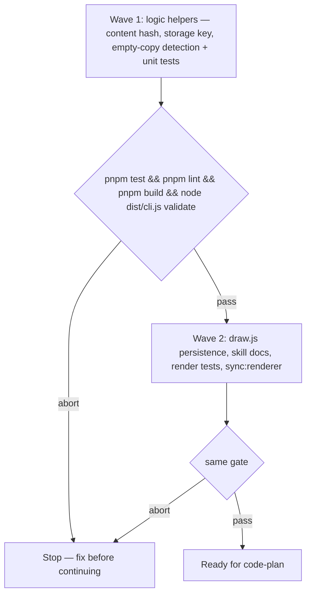

# Journey-map reload persistence

**Source:** `docs/prds/journey-map-reload-persistence/journey-map-reload-persistence-prd.md` (status `stable`)
**Next:** `code-plan` → `code-execute`, waves **1 → 2**
**Named proof (this spec's own structural gate):** `proof-journey-map-reload-persistence-spec-obligations`

## Terms

- **`state`:** Per-node answers in the page: `choice`, `checks`, `text`, `note`, `done` — same shape `draw.js` uses today. UI-only sets (`noteOpen`, expanded cards, camera, stepwise) stay out of scope per PRD.
- **Embedded `path`:** The string in `#map-data` beside `tree`, set at build time by `build-map.mjs` `pagePath()` (PRD AC-3.2 header line).
- **Map content hash:** A deterministic fingerprint of the embedded `tree` object so node-id or structure changes invalidate saved walks (PRD AC-1.2).
- **Storage identity:** The string segment that distinguishes one map file from another within an origin; paired with the content hash in the `localStorage` key.

## Repository grounding

| Surface | Present today | Role for this initiative |
|---------|----------------|--------------------------|
| `renderer/logic.js` | yes | `feedback()` and layout walk; gains content hash, empty-copy detection, and pure persistence helpers |
| `renderer/draw.js` | yes | In-memory `state`, `noteOpen`, copy/reset handlers; gains load/save/clear around `localStorage` |
| `renderer/sync.mjs` | yes | Copies renderer into skill templates after edits |
| `templates/.agents/skills/journey-map/scripts/build-map.mjs` | yes | Embeds `{ tree, path }` in built HTML — always supplies `path` today |
| `templates/.agents/skills/journey-map/SKILL.md`, `references/tree-format.md` | yes | Replace "not saved across reloads" with persistence rules |
| `.agents/skills/journey-map/**` | yes | Harness-home mirror of template skill |
| `test/journey-map-render.test.ts` | yes | Logic and built-page tests; extended for persistence and empty copy |
| `test/skill-journey-map.test.ts` | yes | Asserts skill copy about reload behavior — must track new wording |
| `pnpm test`, `pnpm lint`, `pnpm build`, `node dist/cli.js validate` | yes | Wave gates |
| `pnpm sync:renderer` | yes | Keeps template copies aligned with `renderer/` |

## Surface walk

- **In scope:**
  - `renderer/logic.js`, `renderer/draw.js`
  - `templates/.agents/skills/journey-map/SKILL.md`, `references/tree-format.md` (and synced copies under `.agents/skills/journey-map/`)
  - `test/journey-map-render.test.ts`, `test/skill-journey-map.test.ts` (or adjacent tests added beside them)
  - `pnpm sync:renderer` after renderer edits
- **Out of mutate scope (unchanged):**
  - `build-map.mjs` output shape (still embeds `path`; no build change required unless tests need a fixture)
  - Wayfinder radial/lanes renderers (`renderer/radial*.js`, `lanes*.js`)
  - Server-side storage, export/import, pruning policy
  - Persisting `open`, `showAll`, `stepwise`, `noteOpen`, camera, or expanded-card UI

## Design

### Storage key and identity (settled)

**Key shape:** `journey-map:v1:${storageIdentity}:${mapContentHash}`

- **`mapContentHash`:** 32-bit unsigned FNV-1a hex of `JSON.stringify(tree)` as embedded in the page (same bytes the build wrote). Recompute on every load; if the stored blob's hash segment differs from the current hash, discard saved `state` and do not write until the Human changes an answer (AC-1.2).
- **`storageIdentity`:**  
  1. If embedded `path` is a non-empty string after `trim`, use that string (matches the feedback header and PRD scope).  
  2. **Else** use `location.pathname` when it is non-empty (covers hand-edited or host-published pages that omit `path` but are still one HTML document per URL).  
  3. **Else** use the literal `(no-path)` (e.g. opaque `blob:` URLs where pathname is empty).

**Why not full `location.href`:** Query strings and fragments can change without a map change, which would strand saved walks or leak session tokens into keys. **Why not hash-only:** Two distinct map files could share identical tree JSON; embedded `path` (or pathname fallback) keeps keys distinct. **Why pathname over origin-only:** Same origin can serve many `*-map.html` files; pathname identifies the document when `path` is missing.

`build-map.mjs` always embeds `path` today; the fallback is defensive for artifacts and manual HTML, not the primary path.

### Persisted payload

JSON object: `{ v: 1, state: { … } }` where inner `state` matches the in-memory map (only answer fields). Serialize after every mutation that changes `state` (same events that call `render()` today). Wrap all `localStorage` read/write/remove in try/catch; on throw, continue in-memory only (PRD US-4).

### Load and restore

On parse of `#map-data`, attempt load. If valid and hash matches, replace initial empty `state` with saved `state`. **Do not** add ids to `noteOpen` on restore — notes render as sticky previews only (Rafael, PRD open questions).

### Start over

Existing reset handlers clear in-memory `state` and `noteOpen`; also `removeItem` for the current key inside try/catch (AC-1.3).

### Empty copy UX

When `feedback()` would return only the header line (no touched nodes with answer fields), open the feedback panel with an explicit message instructing the Human to pick options or use the pencil — do not copy header-only text to the clipboard (AC-3.1). When at least one answer or note exists, behavior stays as today (AC-3.2).

## Waves

A failed gate aborts before the next wave.

## Requirements (obligation ↔ proof)

### R1 — Reload restores answers and notes (US-1)

| ID | Obligation | Named proof | Evidence shape |
|----|------------|--------------|------------------|
| R1.1 | Saved `state` loads on page init when key matches current `storageIdentity` and `mapContentHash`; three pencil notes survive reload and appear in `feedback()` output (AC-1.1) | `proof-journey-map-reload-three-notes` | Test: simulate storage round-trip via logic helpers or built HTML fixture |
| R1.2 | When `mapContentHash` changes, prior saved `state` is ignored and the walk starts empty (AC-1.2) | `proof-journey-map-reload-hash-invalidate` | Unit test on hash + load gate |
| R1.3 | **Start over** (toolbar and confirmed **R** reset) clears memory and removes the storage entry (AC-1.3) | `proof-journey-map-reload-start-over-clears` | Test invoking reset path or exported clear helper |

### R2 — Copy includes off-path notes (US-2)

| ID | Obligation | Named proof | Evidence shape |
|----|------------|--------------|------------------|
| R2.1 | Unchanged from base journey-map: note on unrevealed node still appears in layout order in `feedback()` (AC-2.1) | `proof-journey-map-reload-unrevealed-note` | Existing or extended logic test |

### R3 — Empty copy is explicit (US-3)

| ID | Obligation | Named proof | Evidence shape |
|----|------------|--------------|------------------|
| R3.1 | Helper detects header-only feedback; copy handler shows panel message instead of copying lone header (AC-3.1) | `proof-journey-map-empty-copy-message` | Logic test + draw/copy test or DOM-less handler test |
| R3.2 | Non-empty copy still starts with `journey-map feedback for <path>` and following lines unchanged (AC-3.2) | `proof-journey-map-copy-header-unchanged` | Existing feedback test remains green |

### R4 — Storage failure degrades gracefully (US-4)

| ID | Obligation | Named proof | Evidence shape |
|----|------------|--------------|------------------|
| R4.1 | Throwing `setItem` on change does not throw to the caller; map updates in memory (AC-4.1) | `proof-journey-map-storage-write-fallback` | Test with mocked storage |
| R4.2 | Throwing `getItem` on load yields empty `state`; page remains interactive (AC-4.2) | `proof-journey-map-storage-read-fallback` | Test with mocked storage |

### R5 — Storage key fallback (PRD open question)

| ID | Obligation | Named proof | Evidence shape |
|----|------------|--------------|------------------|
| R5.1 | `storageKey(path, tree, locationLike)` uses embedded `path` when non-empty; when `path` is missing or blank, uses `location.pathname` or `(no-path)` per Design | `proof-journey-map-storage-key-fallback` | Unit tests: path present, path `''`, pathname-only fixture |

### R6 — Restore UX for notes (PRD open question)

| ID | Obligation | Named proof | Evidence shape |
|----|------------|--------------|------------------|
| R6.1 | After restore, `noteOpen` is empty while nodes with `state[id].note` render sticky preview (not open editor) | `proof-journey-map-restore-sticky-not-editor` | Test or render assertion on restored fixture |

### R7 — Skill documentation

| ID | Obligation | Named proof | Evidence shape |
|----|------------|--------------|------------------|
| R7.1 | Journey-map skill text documents localStorage persistence, hash invalidation, and empty-copy behavior; removes "not saved across reloads" | `proof-journey-map-skill-persistence-docs` | `test/skill-journey-map.test.ts` or grep in test |

### R8 — Regression floor

| ID | Obligation | Named proof | Evidence shape |
|----|------------|--------------|------------------|
| R8.1 | `pnpm test`, `pnpm lint`, `pnpm sync:renderer` (no drift), `node dist/cli.js validate` pass after wave 2 | `proof-journey-map-reload-gates-pass` | Commands |

## Nine-dimension landings

| Dimension | Landing kind | Landing |
|-----------|---------------|---------|
| validation | obligation ↔ proof | R1.2 / `proof-journey-map-reload-hash-invalidate` — corrupted or wrong-hash blobs never merge into `state` |
| failure modes | obligation ↔ proof | R4.1–R4.2 — storage throw paths; R3.1 — empty copy cannot silently succeed |
| idempotency and retry | obligation ↔ proof | R1.1 — repeated load with same key is stable; save after load overwrites same key (no duplicate entries) |
| authorization | n/a | Unchanged surface: client-only `localStorage` on the page origin; no new server auth. Cited unchanged surface: built static HTML under journey-map skill. |
| concurrency and ordering | n/a | Unchanged surface: single-threaded browser tab; one `state` object per page load. Cited unchanged surface: `renderer/draw.js` render loop. |
| data lifecycle | obligation ↔ proof | R1.3 — **Start over** and hash mismatch delete/ignore saved walks; PRD defers cross-map pruning (`U-storage-prune`) |
| external-dependency failure | obligation ↔ proof | R4.1–R4.2 — `localStorage` unavailable or quota throw on write |
| state transitions | obligation ↔ proof | R1.1 / R6.1 — empty → restored answers on load; in-session edits → persisted; R1.3 — persisted → cleared on reset; `noteOpen` stays closed after restore |
| observability | obligation ↔ proof | R3.1 — empty-copy message in feedback panel; R3.2 — successful copy status unchanged |

## Unresolved

| Identifier | Decision needed | Owner | Blocking effect | Disposition |
|------------|-------------------|-------|-------------------|--------------|
| `U-storage-prune` | Maximum keys or size policy when many maps share an origin | Rafael | Non-blocking | Defer until a reported `QuotaExceededError` or support ticket (PRD open questions). No LRU in this initiative. |
| `U-host-remount` | Whether claude.ai iframe remount clears `localStorage` | n/a | Non-blocking | Out of PRD scope — renderer restores when the page loads with storage available |

## Out of scope

- Persisting UI chrome (`open`, `showAll`, `stepwise`, `noteOpen`, camera, expanded cards).
- Cross-device sync, server storage, walk export/import.
- Changing journey-map JSON format or feedback line grammar (except empty-copy message text).
- `localStorage` pruning / LRU.
- Wayfinder lane/radial renderers.
- Proving host behavior for issue #92.

## Pragmatic-guard refuses

- Refuse a storage abstraction package or IndexedDB layer — `localStorage` only, per PRD.
- Refuse syncing `noteOpen` or other UI sets into the blob.
- Refuse full-URL storage keys — pathname fallback only when `path` is missing.
- Refuse pre-emptive prune / quota management without a reported failure.

## Acceptance

### Wave 1

- [x] Content hash and storage key helpers including path / pathname / `(no-path)` fallback (pairs with R1.2, R5.1, `proof-journey-map-reload-hash-invalidate`, `proof-journey-map-storage-key-fallback`)
- [x] Empty-copy detection helper (pairs with R3.1, `proof-journey-map-empty-copy-message`)
- [x] Unit tests for R2.1 baseline if not already covered (pairs with R2.1, `proof-journey-map-reload-unrevealed-note`)

### Wave 2

- [x] `draw.js` load/save/clear wired with try/catch; restore without opening note editors (pairs with R1.1, R1.3, R4.1, R4.2, R6.1)
- [x] Copy button uses empty-copy UX (pairs with R3.1, R3.2)
- [x] Skill docs updated; template synced via `pnpm sync:renderer` (pairs with R7.1, R8.1)
- [x] Full gate suite green (pairs with R8.1, `proof-journey-map-reload-gates-pass`)

## Eval / gates

| Gate | Command / check | When | PASS | Abort |
|------|-------------------|------|------|-------|
| Integrity | `pnpm build && node dist/cli.js validate` | End of each wave | exit 0 | Fix profile / ADR claims |
| Test suite | `pnpm test` | End of each wave | exit 0 | Fix failing tests |
| Lint | `pnpm lint` | End of each wave | exit 0 | Biome fix |
| Renderer sync | `pnpm sync:renderer` | End of wave 2 | no drift | Sync copies |
| Spec obligations | `proof-journey-map-reload-persistence-spec-obligations` — acceptance boxes pair with R-rows; nine landings; each `n/a` cites unchanged surface | Before `code-plan` | all hold | Do not plan |

## Cross-domain leak table

| Leak | Refuse |
|------|--------|
| IndexedDB, service worker cache, server session | PRD non-goals |
| Wayfinder copy panels | Out of mutate scope |
| Storage pruning policy | `U-storage-prune` deferral |
| An executable plan from this skill | `code-plan` only |

## ADR

None needed this initiative. Client-side `localStorage` for static HTML renderer state follows the existing journey-map architecture (JSON source, built page, no new runtime dependencies in the harness package).

## Section checklist

| Section | Required when | Present |
|---------|-----------------|---------|
| Source | Always | yes |
| Repository grounding | Always | yes |
| Surface walk | Always | yes |
| Waves | Multi-batch work | yes |
| Requirements | Always | yes |
| Nine-dimension landings | Always | yes |
| Unresolved | Always | yes |
| Out of scope | Always | yes |
| Pragmatic-guard refuses | Always | yes |
| Acceptance | Always | yes |
| Eval / gates | Always | yes |
| Cross-domain leak table | Always | yes |
| ADR | Always | yes |
