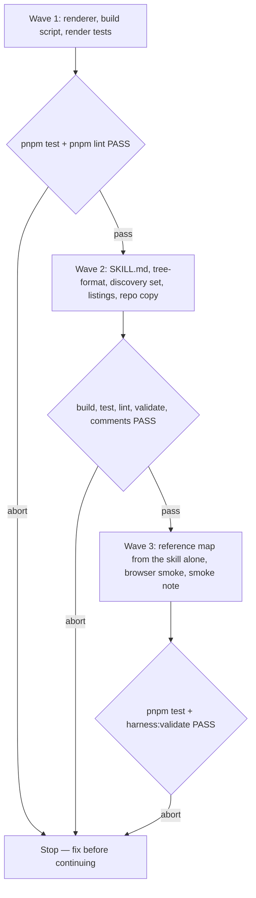

# Journey Map Skill

**Source:** `docs/prds/journey-map/journey-map-prd.md` (status `stable`).
**Next:** After the Human approves → `code-plan` → `code-execute`, waves
**1 → 2 → 3**.
**Named proof (this spec's own structural gate):** `proof-journey-map-spec-obligations`

## Term challenge

| Term | Resolution |
|------|------------|
| Journey map | As the PRD defines it: a pan-and-zoom drawing of a flow's branches, choices and steps. Not the UX persona artifact. |
| Map tree | The JSON file `<slug>-map.json`. It is the source of truth. The HTML is derived from it and is never edited by hand. |
| Map page | The generated `<slug>-map.html`. |
| Renderer | The page shell, logic and drawing files shipped in the skill folder, copied into every map page unchanged. |
| Waypoint | As the PRD defines it: a step the agent performs with no question, drawn dashed. |
| Ticket | A node with `ticket`, `status`, `claimed_by` and `blocked_by`, using the field names and values of the frozen wayfinder design in `docs/specs/archived/wolven-harness-d-code-lane/wolven-harness-d-code-lane-spec.md`. This spec renders tickets. It does not write, claim or resolve them. |
| Discovery set | `SET_SKILLS.discovery` in `src/setup/skill-sets.ts`. |

## Repository grounding

| Surface | Present today | Role for this initiative |
|---------|----------------|----------------------------|
| `src/setup/skill-sets.ts` (`SET_SKILLS`, `CORE_SKILLS`) | yes | Gains `journey-map` under `discovery` |
| `test/skill-sets.test.ts` partition test | yes | Must pass with the new folder; its folder count goes from 18 to 19 |
| `test/setup-skill-sets.test.ts`, `test/skills-command.test.ts` | yes | Read set membership from `SET_SKILLS`; the hard-coded count of 18 changes |
| `src/skills/install.ts`, `src/setup/apply.ts` | yes | Copy every file in a skill folder. Reused unchanged |
| `test/helpers/skill-contract.ts` (`assertSkillBasics`, `readSkill`) | yes | Shared skill checks for the new skill |
| `test/skill-copies.test.ts` | yes | Holds the repo's installed copy identical to the template |
| `src/comments/index.ts` (`findCommentFindings`) | yes | Judges `.js` and `.mjs` comment lines. A consumer's `harness:comments` judges the shipped scripts on the install diff |
| `docs/adrs/adr-004-standalone-skills-contract.md` | yes, `stable` | "Not contract" covers the set of skills, set membership and template contents. No amendment |
| `docs/WRITING-PROFILE.md` | yes | Extra files in a slug folder aren't checked, so map files beside a doc pass `validate` |
| `code-pr/references/pre-merge-closure.md` | yes | Moves whole PRD and spec folders to `archived/`, so map files move with their doc |
| `docs/deferrals/wayfinder-maps/wayfinder-maps-deferral.md` | yes | Its non-goal "no references to `wayfinder` or maps from other shipped skills" still holds |
| Prototype map ([published artifact](https://claude.ai/artifact/34b68WuinuZE25ZtjKS5dt)) | yes, outside the repo | The source for the look (rough.js 4.6.6, Kalam, Caveat, JetBrains Mono) and the interactions. It is hard-coded, so its draw code is reworked to read a tree |
| `README.md`, `site/skills.md` | yes | List the discovery set and the skill count |
| `test/fixtures/` | no | New, for the map-tree fixtures |

## Surface walk

- **In scope:**
  - `templates/.agents/skills/journey-map/**` (new skill)
  - its installed copy at `.agents/skills/journey-map/**` and a row in this repo's `AGENTS.md` skills table
  - `src/setup/skill-sets.ts`
  - the skill counts in `test/skill-sets.test.ts` and `test/setup-skill-sets.test.ts`
  - new `test/skill-journey-map.test.ts`, `test/journey-map-render.test.ts` and `test/fixtures/journey-map/**`
  - the discovery lists in `README.md` and `site/skills.md`
  - `docs/notes/journey-map-smoke/journey-map-smoke-note.md`
- **Out of mutate scope (unchanged):**
  - `src/validate/**`: no check on map files
  - `src/skills/**` and `src/setup/apply.ts`: copying is reused as-is
  - `src/comments/**`
  - `docs/WRITING-PROFILE.md`
  - ADR-004
  - every other shipped skill, `grilling` included
  - `package.json` dependencies

## Design

### Skill folder

```
journey-map/
  SKILL.md
  references/tree-format.md   the map tree format, with one small example
  renderer/page.html          the page shell and CSS, with marked slots
  renderer/logic.js           pure functions: validate, layout, fade, feedback text
  renderer/draw.js            the DOM, rough.js drawing, input and camera
  scripts/build-map.mjs       Node built-ins only
```

`logic.js` is a classic script with no DOM access. It sets `globalThis.JourneyMapLogic`, so the page, the build script (through `node:vm`) and the tests all run the same code.

### Build

`node <skill-dir>/scripts/build-map.mjs <dir>/<slug>-map.json` writes `<dir>/<slug>-map.html`:

- The script reads the tree and runs `JourneyMapLogic.validate`.
- It inlines `logic.js`, `draw.js`, the tree and the input path into the `page.html` slots, between `<!-- journey-map:renderer -->` markers.
- It writes the page even when the tree is invalid, so the page shows the error. Then it exits 1 and prints one line per error to stderr.
- On success it prints `journey-map: wrote <path> (<n> nodes)` and exits 0.
- An input path that doesn't end in `-map.json`, or that can't be read or parsed as JSON, exits 1 and writes nothing.
- The output depends only on the tree bytes, the renderer files and the input path string, with no timestamps.

### Map tree (`version: 1`)

```json
{
  "version": 1,
  "title": "…",
  "subtitle": "…",
  "trees": [{ "id": "setup", "nodes": [ … ] }],
  "links": [{ "from": "setup-leaf", "to": "init-start", "label": "then, in your agent" }],
  "annotations": [{ "id": "a1", "target": "init-start", "text": "nothing is written until you say yes" }]
}
```

Node ids are unique across the whole map. Every node has `id`, `kind` and `label`. A tree has exactly one `start` node, unless every node in it is a `ticket`.

| `kind` | Extra fields | Draws as |
|--------|--------------|----------|
| `start` | `sub?`, `next` | Hachured ellipse |
| `choice` | `tag?`, `note?`, `default?` (an option key), `options: [{ key, label, hint?, badge?, next }]` | One box per option. The default option is marked |
| `checklist` | `sub?`, `items: [{ key, label, hint?, on? (default true), gates?: [nodeId] }]`, `next` | A card of checkboxes |
| `text` | `sub?`, `placeholder?`, `next?` | A sketchy one-line input |
| `waypoint` | `tag`, `next?` | A dashed, muted box |
| `card` | `sub?`, `sections: [{ head, items: [string], numbered? }]` | A heavy-bordered closing card, with no outgoing edge |
| `ticket` | `ticket: research \| prototype \| grilling \| task`, `status: open \| claimed \| closed`, `claimed_by?`, `blocked_by?: [ticketId]` | A ticket card, styled by status |

Layout runs left to right, one tree under another. A node's column is its longest path from the start; ticket columns come from the `blocked_by` depth. Rows follow first-visit order. Links between trees draw as dashed arrows in the select colour.

### Page behaviour

- **Fading.** A node fades when every path to it from its tree's start passes through an unchosen option of an answered choice. A waypoint gated by an unticked checklist item fades and shows a "later" tag.
- **Notes.** Each node has a note control that opens a one-line input.
- **"Copy for agent"** writes plain text. The first line is `journey-map feedback for <input path>`. Then each node the Human touched gets one line, in layout order:
  - `<id> "<label>": chose <key> "<option label>"`
  - `<id> "<label>": ticked <keys>; unticked <keys>`
  - `<id> "<label>": typed "<text>"`
  - `<id> "<label>": note "<text>"`

  The page writes the same lines into a selectable box when the clipboard write is refused.

## Waves



A failed gate aborts before the next wave.

## Requirements (obligation ↔ proof)

### R1 — Tree to page (US-1)

| ID | Obligation | Named proof | Evidence shape |
|----|------------|--------------|------------------|
| R1.1 | `build-map.mjs` turns a valid `<slug>-map.json` into a sibling `<slug>-map.html` that holds the whole renderer and tree, loads only rough.js and Google Fonts from the network, and exits 0 with the `wrote` line (AC-1.1) | `proof-journey-map-build-writes-page` | Test: build a fixture in a temp dir; assert the exit code, the stdout line, the sibling file, and that every `src` or `href` points at `cdn.jsdelivr.net/npm/roughjs@4.6.6` or `fonts.googleapis.com` / `fonts.gstatic.com` |
| R1.2 | Two different trees built by the script carry a renderer region that is byte-identical to `logic.js` and `draw.js` in both pages (goal 2) | `proof-journey-map-renderer-identical` | Test: build both fixtures; the text between the markers equals the files' bytes in each |
| R1.3 | `JourneyMapLogic.validate` names the node for: an unknown `kind`, a duplicate id, a `next`, `gates`, link or annotation target that doesn't exist, a `blocked_by` entry that names a missing node or a non-ticket node, a bad `status` or `ticket` value, a missing `label`, and a tree with no `start` or two of them. The page shows those errors in a visible panel instead of a canvas, and the build prints the same lines and exits 1 (AC-1.4, AC-5.2) | `proof-journey-map-malformed` | Test: one malformed fixture per case run through `validate` in `node:vm`; the build exits 1 and its stderr names the node; the written page carries the error-panel element |
| R1.4 | Layout puts every node of every tree on one canvas with no two node boxes overlapping, and a node's column is its longest path from the start (goal 1) | `proof-journey-map-layout` | Test: `JourneyMapLogic.layout` on both fixtures; assert no box overlaps and the column of a node that two paths reach |

### R2 — Click through (US-2)

| ID | Obligation | Named proof | Evidence shape |
|----|------------|--------------|------------------|
| R2.1 | `JourneyMapLogic.faded(tree, answers)` fades exactly the nodes reachable only through unchosen options, and a node two branches share stays unfaded (AC-2.1) | `proof-journey-map-fade-choice` | Test on the reference fixture: choose the lean path; the full-tour checklist fades and the shared AGENTS.md choice doesn't |
| R2.2 | Unticking a checklist item fades the waypoints it gates and marks them "later"; ticking it again clears both (AC-2.2) | `proof-journey-map-fade-checklist` | Test: toggle one item twice; compare `faded` and the `later` set |
| R2.3 | In a browser, choosing an option moves the camera to that option's `next` node; Tab reaches every option, checkbox, text box, note control and button, and Enter or Space operates it; a pointer drag of 4px or more pans and chooses nothing (AC-2.1, AC-2.3, AC-2.4) | `proof-journey-map-browser-smoke` | Manual smoke in a browser, recorded step by step in the smoke note |
| R2.4 | Labels, hints and notes render through `textContent` or an input's `value`, never through HTML parsing, and the tree is embedded with `<` escaped as `<` | `proof-journey-map-no-html-injection` | Test: a fixture with `</script>` in a label builds to a page where that string is not present unescaped; grep shows no `innerHTML` in `draw.js` |

### R3 — Feedback (US-3)

| ID | Obligation | Named proof | Evidence shape |
|----|------------|--------------|------------------|
| R3.1 | `JourneyMapLogic.feedback(tree, state, path)` returns the frozen text format above, naming each touched node by id and label, in layout order, and omitting untouched nodes (AC-3.1) | `proof-journey-map-feedback-text` | Test: a scripted state of one choice, one checklist toggle, one typed text and one note gives the exact expected string |
| R3.2 | When the clipboard write rejects, the page shows the same text in a selected, read-only `<textarea>` (AC-3.3) | `proof-journey-map-clipboard-fallback` | Smoke: open the page over `file://` in a browser that refuses, or stub `navigator.clipboard.writeText` to reject in devtools; recorded in the smoke note |
| R3.3 | `SKILL.md` tells the agent to ask the Human to press "Copy for agent" and paste the result, then to revise the JSON, rebuild and reopen. In Claude with artifact publishing available, it also publishes the page, and on a comment it revises, rebuilds and republishes to the same URL (AC-3.1, AC-3.2) | `proof-journey-map-skill-feedback-loop` | Skill-contract test: grep for "Copy for agent", "same URL" and the rebuild step |

### R4 — Install (US-4)

| ID | Obligation | Named proof | Evidence shape |
|----|------------|--------------|------------------|
| R4.1 | `journey-map` is listed in `SET_SKILLS.discovery`, and the partition test passes with 19 template folders (AC-4.2) | `proof-journey-map-partition` | `pnpm test` (`test/skill-sets.test.ts`) |
| R4.2 | `setup --skills discovery` and `skills --skills journey-map` copy `journey-map/` with `SKILL.md`, the renderer and the script into each chosen runtime's skills folder, and `--skills ship` or `--skills none` leaves it out (AC-4.1, AC-4.2) | `proof-journey-map-install` | Test: run both commands into temp dirs; assert the file list, and assert the folder is absent for `ship` and `none` |
| R4.3 | Every comment line in the shipped `.js` and `.mjs` files passes `findCommentFindings`, so a consumer's `harness:comments` stays green on the install diff | `proof-journey-map-comments-clean` | Test: commit a temp repo, add the skill's scripts, then `findCommentFindings` returns `[]` |
| R4.4 | `README.md` and `site/skills.md` list `journey-map` in the discovery set and give the new skill count. The repo's installed copy matches the template | `proof-journey-map-listings` | `pnpm test` (`test/skill-copies.test.ts`, plus `test/readme-install.test.ts` where it applies); `rg -n "journey-map" README.md site/skills.md` |

### R5 — Tickets (US-5)

| ID | Obligation | Named proof | Evidence shape |
|----|------------|--------------|------------------|
| R5.1 | `open`, `claimed` and `closed` tickets draw with distinct fill and stroke, and a claimed ticket shows its `claimed_by` (AC-5.1) | `proof-journey-map-ticket-status` | Test: the style for each status from `JourneyMapLogic.ticketStyle` is distinct; the smoke note confirms it on the tickets fixture |
| R5.2 | Each `blocked_by` entry draws an edge from blocker to blocked, and `JourneyMapLogic.blocked` is true while any blocker isn't `closed` (AC-5.2) | `proof-journey-map-ticket-blocked` | Test on the tickets fixture: the edge list and the `blocked` value before and after a blocker closes |

### R6 — Skill text (US-1)

| ID | Obligation | Named proof | Evidence shape |
|----|------------|--------------|------------------|
| R6.1 | `SKILL.md` passes `assertSkillBasics`, has a third-person "Use when" description, isn't ask-only, and says it runs when the Human asks or accepts a one-line offer | `proof-journey-map-skill-basics` | Skill-contract test |
| R6.2 | The skill writes the map files beside the doc they serve under `docs/<folder>/<slug>/`. With no doc it first writes `docs/notes/<slug>/<slug>-note.md` (`type: note`, `status: draft`) and runs `harness:validate` (AC-1.1, AC-1.3) | `proof-journey-map-skill-placement` | Skill-contract test: grep for both paths, the frontmatter values and `harness:validate` |
| R6.3 | The skill tells the agent to write only the JSON, never edit the HTML, run `build-map.mjs` after every write, fix the tree on exit 1, and open the page once in a browser tool when the runtime has one (AC-1.1, AC-1.4) | `proof-journey-map-skill-build-step` | Skill-contract test |
| R6.4 | The skill says a map is a design aid that is not kept in sync with shipped code and moves with its doc folder on archive (AC-1.5). No shipped file names `wayfinder` or `docs/maps/` | `proof-journey-map-skill-lifecycle` | Skill-contract test: grep for the sentence; `rg -n "wayfinder\|docs/maps" templates/.agents/skills/journey-map` is empty |
| R6.5 | An agent given only the installed skill folder writes the `harness-init` redesign tree. It builds with exit 0 and holds both paths, the goal text box, the "How much should we change your current AGENTS.md?" choice, the full-tour checklist, the skills fork, the checks choice, the commits checklist and the hand-back card, reached from a `setup` tree by a link (AC-1.2, goal 1) | `proof-journey-map-reference-map` | Wave 3: a fresh subagent gets only the skill folder and the prototype's step list; its JSON is committed as `test/fixtures/journey-map/harness-init-redesign-map.json`; a test asserts the build exits 0 and each listed node exists |

### R7 — Dimension landings

| ID | Obligation | Named proof | Evidence shape |
|----|------------|--------------|------------------|
| R7.1 | Building the same tree twice gives byte-identical HTML | `proof-journey-map-deterministic` | Test: build twice; compare the bytes |
| R7.2 | A bad input path, unreadable file or invalid JSON exits 1 with a one-line reason and writes no HTML | `proof-journey-map-build-input-errors` | Test: three cases, each asserting exit 1 and no output file |
| R7.3 | If rough.js fails to load, the page shows a readable message naming the CDN URL instead of a blank canvas, and text falls back to system fonts. The rough.js tag pins `4.6.6` with an `integrity` hash and `crossorigin` | `proof-journey-map-cdn-failure` | Test: the page has `integrity=` and the pinned URL; smoke: block the URL in devtools and record the message |

## Nine-dimension landings

| Dimension | Landing kind | Landing |
|-----------|---------------|---------|
| validation | obligation ↔ proof | R1.3 / `proof-journey-map-malformed`, and R7.2 / `proof-journey-map-build-input-errors` |
| failure modes | obligation ↔ proof | R1.3 writes the error page and exits 1; R3.2 / `proof-journey-map-clipboard-fallback` |
| idempotency and retry | obligation ↔ proof | R7.1 / `proof-journey-map-deterministic`. Rerunning the build overwrites only its own `<slug>-map.html` |
| authorization | `n/a` | Unchanged surface: the map is a static local file with no credential. Artifact publishing goes through the runtime's own Artifact approval, which this skill doesn't change. Install permissions are the unchanged `src/skills/**` and `src/setup/apply.ts` |
| concurrency and ordering | `n/a` | Unchanged surface: one agent writes one map tree per slug folder, and the build writes one sibling file. Multi-folder install ordering stays in the unchanged `src/skills/install.ts` |
| data lifecycle | obligation ↔ proof | R6.4 / `proof-journey-map-skill-lifecycle`: the JSON is the source of truth, the HTML is derived from it, and both move with the doc folder through the unchanged `pre-merge-closure.md` |
| external-dependency failure | obligation ↔ proof | R7.3 / `proof-journey-map-cdn-failure`. Opening maps with no network stays a PRD non-goal |
| state transitions | obligation ↔ proof | Page state is per node: unanswered → chosen (re-choosable), and ticked ↔ unticked (R2.1, R2.2). Ticket status is read-only here (R5.1); no page or script action changes it |
| observability | obligation ↔ proof | R1.1 prints the `wrote` line, and R1.3 prints one stderr line per error plus the on-page panel |

## Unresolved

| Identifier | Decision needed | Owner | Blocking effect | Disposition |
|------------|-------------------|-------|-------------------|--------------|
| `U-cdn-client-repos` | Whether maps that load jsDelivr and Google Fonts are acceptable in a client's repo for the UX engagement | Rafael | Non-blocking: the reference map is in this repo | Carried from the PRD; revisit before the first client map |

## Out of scope

- Everything the PRD lists under Non-goals: computed text, offline maps, `validate` checks, a new doc folder or `type`, the wayfinder skill, changes to other skills, the `harness-init` update, map sync and client stakeholders.
- A browser test harness or any new dev dependency. Interaction is proven by the wave 3 smoke.
- Linting the shipped renderer with Biome; `pnpm lint` keeps its current scope.

## Pragmatic-guard refuses

- A bundler, npm package or build step beyond the one Node built-ins script.
- Playwright or another browser runner added to prove interaction.
- Schema-versioning machinery beyond the `version: 1` field and its check.
- Progressive reveal, themes, dark mode, or export to image.
- Any change to `grilling` or to a skill that calls `journey-map`.

## Acceptance

### Wave 1

- [ ] `proof-journey-map-build-writes-page` PASS: the build writes the sibling page and loads only the two allowed hosts
- [ ] `proof-journey-map-renderer-identical` PASS: the renderer region is byte-identical across two maps
- [ ] `proof-journey-map-malformed` PASS: each malformed case names its node, and the build exits 1
- [ ] `proof-journey-map-layout` PASS: no overlaps, and columns follow the longest path
- [ ] `proof-journey-map-fade-choice` PASS: choice fading spares shared nodes
- [ ] `proof-journey-map-fade-checklist` PASS: an unticked item fades its waypoint as "later"
- [ ] `proof-journey-map-no-html-injection` PASS: no unescaped label, and no `innerHTML`
- [ ] `proof-journey-map-feedback-text` PASS: the exact feedback string
- [ ] `proof-journey-map-ticket-status` PASS (test part): three distinct styles
- [ ] `proof-journey-map-ticket-blocked` PASS: blocked edges and state
- [ ] `proof-journey-map-deterministic` PASS: same bytes twice
- [ ] `proof-journey-map-build-input-errors` PASS: three input errors, no output
- [ ] `proof-journey-map-cdn-failure` PASS (test part): pinned URL with `integrity`

### Wave 2

- [ ] `proof-journey-map-partition` PASS: 19 folders, partition holds
- [ ] `proof-journey-map-install` PASS: present with `discovery` and `--skills journey-map`, absent with `ship` and `none`
- [ ] `proof-journey-map-comments-clean` PASS: shipped scripts give zero comment findings
- [ ] `proof-journey-map-listings` PASS: README and site list it, and the repo copy is identical
- [ ] `proof-journey-map-skill-feedback-loop` PASS
- [ ] `proof-journey-map-skill-basics` PASS
- [ ] `proof-journey-map-skill-placement` PASS
- [ ] `proof-journey-map-skill-build-step` PASS
- [ ] `proof-journey-map-skill-lifecycle` PASS

### Wave 3

- [ ] `proof-journey-map-reference-map` PASS: a subagent's tree from the skill alone builds and holds every listed node
- [ ] `proof-journey-map-browser-smoke` PASS: camera move, keyboard pass, and drag-is-not-click recorded
- [ ] `proof-journey-map-clipboard-fallback` PASS: the fallback box is recorded
- [ ] `proof-journey-map-ticket-status` PASS (smoke part): the tickets fixture is checked by eye
- [ ] `proof-journey-map-cdn-failure` PASS (smoke part): the blocked-CDN message is recorded

## Eval / gates

| Gate | Command / check | When | PASS | Abort |
|------|-------------------|------|------|-------|
| Tests | `pnpm test` | End of each wave | exit 0 | Fix; do not proceed |
| Lint | `pnpm lint` | End of waves 1 and 2 | exit 0 | Fix; do not proceed |
| Build | `pnpm build` | Before validate and comments | exit 0 | Fix; do not proceed |
| Integrity | `node dist/cli.js validate` (`harness:validate`) | End of waves 2 and 3 | `validate: ok` | Fix; do not proceed |
| Comments | `pnpm comments` | End of wave 2 | `comments: ok` | Fix; do not proceed |
| Spec obligations | `proof-journey-map-spec-obligations`: every acceptance box names a proof from an R-row, every R-row has a box, all nine landings are present, and each `n/a` cites an unchanged surface | Before `code-plan` | all hold | Do not plan |

## Cross-domain leak table

| Leak | Refuse |
|------|--------|
| Charting, claiming or resolving tickets | The wayfinder PRD, owned by Rafael |
| Updating `harness-init` to the redesign drawn on the map | Its own initiative (the harness-init basics path PRD) |
| A `validate` check or a governed folder for maps | Needs an ADR-004 amendment; a PRD non-goal |
| A release or version bump | release-please, after merge |
| An executable plan from this skill | `code-plan` only |

## ADR

None needed this initiative. ADR-004 lists the set of skills, set membership and template contents as not contract, and `validate` doesn't change.

## Section checklist

| Section | Required when |
|---------|-----------------|
| Source | Always |
| Repository grounding | Always |
| Surface walk | Always |
| Waves | The work spans more than one mutate batch |
| Requirements with obligation ↔ proof | Always |
| Nine-dimension landings | Always, with all nine named |
| Unresolved | Always; an empty table is fine when no product or contract decision is open |
| Out of scope | Always |
| Pragmatic-guard refuses | Always |
| Acceptance | Always; tick a box only once its evidence exists |
| Eval / gates | Always |
| Cross-domain leak table | Always |
| ADR | Always, even when the answer is "none needed this initiative" |
