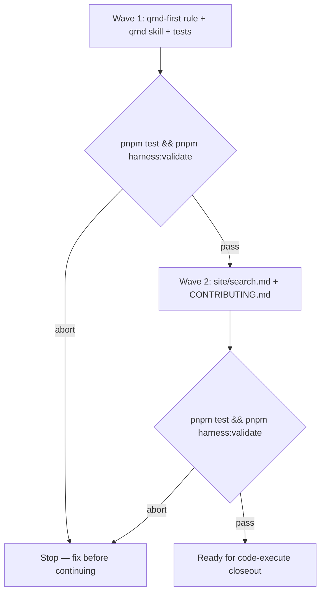

# QMD empty index handling in fresh worktrees

**Source:** `docs/prds/qmd-worktree-empty-index/qmd-worktree-empty-index-prd.md` (confirmed stable by owner Rafael, 2026-10-26)
**Next:** After the Human approves the plan → `code-execute`, wave **1 → 2**
**Named proof (this spec's own structural gate):** `proof-qmd-worktree-empty-index-spec-obligations`

## Term challenge

| Term | Resolution |
|------|------------|
| Unpopulated / empty index | The local QMD SQLite index exists or is creatable under `.qmd/` but indexes zero documents (fresh worktree, first clone, or never-run `qmd update`), while markdown under declared collections (for example `docs/adrs/`) is present on disk |
| Index readiness | Checked with `qmd status`: when **Documents → Total** reports `0 files indexed`, the index is unpopulated and `qmd update` is authorized before treating zero query hits as “no decisions exist”; when Total is greater than zero, routine search stays read-only |
| Self-repair | An agent following `qmd-first` runs the authorized bootstrap (`qmd update`) when readiness is false, then continues ADR-first search |
| Populated index | `qmd status` reports indexed files greater than zero (PRD AC-1.2 acceptance signal) |

## Repository grounding

| Surface | Present today | Role for this initiative |
|---------|----------------|--------------------------|
| `.agents/rules/qmd-first.md` | yes | Standing rule agents apply before web/memory; needs empty-index readiness step |
| `templates/.agents/rules/qmd-first.md` | yes | Consumer copy via `wolven-harness setup`; must match live rule text |
| `.agents/skills/qmd/SKILL.md` | yes | Skill contract; anti-pattern currently blocks unasked `qmd update` even when index is empty |
| `templates/.agents/skills/qmd/SKILL.md` | yes | Consumer skill copy; must match live skill |
| `templates/.qmd/gitignore` → `.qmd/.gitignore` (`index.sqlite*`) | yes | Keeps per-worktree SQLite out of Git; root cause of empty index in new worktrees |
| `test/setup-qmd-ignore.test.ts` | yes | Proves setup writes gitignore and Git ignores `index.sqlite*` |
| `test/seed-extract.test.ts` | yes | Invariant: ADR-first `-c adrs` ordering in template rule and qmd skill |
| `test/skill-qmd.test.ts` | yes | Shared skill contract checks for `qmd` |
| `.cursor/install.sh` | yes | Cloud Agent bootstrap already runs `qmd update` and `qmd embed` |
| `site/search.md` | yes | Contributor-facing index lifecycle; needs worktree note |
| `CONTRIBUTING.md` | yes | Cloud Agents section documents QMD bootstrap |
| Issue [#68](https://github.com/WolvenTech/wolven-harness/issues/68) | yes | Reported false-negative ADR search in a fresh worktree |

## Surface walk

- **In scope:**
  - `.agents/rules/qmd-first.md`
  - `templates/.agents/rules/qmd-first.md`
  - `.agents/skills/qmd/SKILL.md`
  - `templates/.agents/skills/qmd/SKILL.md`
  - `site/search.md`
  - `CONTRIBUTING.md`
  - New or extended tests under `test/` that assert the contract text and template/live parity (for example `test/skill-qmd-empty-index.test.ts` or extensions to `test/seed-extract.test.ts`)
- **Out of mutate scope (unchanged):**
  - `src/**`, `dist/**` — no CLI or setup binary behavior changes
  - `.cursor/install.sh`, `.cursor/environment.json` — bootstrap sequence stays as-is (AC-3.2)
  - `.qmd/index.yml`, `templates/.qmd/index.yml` — collection declarations unchanged
  - Upstream `@tobilu/qmd` package
  - Committing `.qmd/index.sqlite*` to version control
  - `.agents/skills/harness-init/**` — no step-0 QMD offer in this initiative
  - Git hooks or worktree post-checkout automation for QMD (none exist today)

## Waves

## Requirements (obligation ↔ proof)

### R1 — Empty index self-repair under qmd-first

| ID | Obligation | Named proof | Evidence shape |
|----|------------|--------------|------------------|
| R1.1 | Standing rule and skill text require verifying index readiness with `qmd status` before treating zero `qmd query` hits as absence of decision records; when Total indexed files is zero, authorize `qmd update` (not `qmd embed`), then continue ADR-first search. | `proof-qmd-empty-index-readiness-guidance` | Grep / test on `.agents/rules/qmd-first.md` and `.agents/skills/qmd/SKILL.md` plus templates; examples name `qmd status` |
| R1.2 | When the index is populated (`qmd status` shows indexed files > 0), guidance still treats routine `qmd query` / `qmd search` as read-only: no unasked `qmd update` or `qmd embed`. | `proof-qmd-empty-index-populated-no-mutate` | Grep / test on rule, skill, and anti-pattern sections |
| R1.3 | Repository copies under `.agents/` byte-match their `templates/.agents/` counterparts for the changed rule and skill files. | `proof-qmd-empty-index-mirrors-match` | Diff or test comparing template and live paths |

### R2 — Anti-pattern and setup contract refinement

| ID | Obligation | Named proof | Evidence shape |
|----|------------|--------------|------------------|
| R2.1 | `qmd` skill Anti-patterns and Setup and maintenance sections distinguish “unasked mutation of a populated index during routine search” from “bootstrap `qmd update` when the index is empty or missing,” without weakening the prohibition on unasked `qmd collection add` or unasked `qmd embed`. | `proof-qmd-empty-index-skill-antipattern-refine` | Test / grep on both skill copies |
| R2.2 | `qmd-first` search procedure includes index readiness before the “no ADR hit → widen → web” ladder when queries return no matches. | `proof-qmd-empty-index-rule-procedure` | Test / grep on both rule copies |

### R3 — Contributor documentation and bootstrap compatibility

| ID | Obligation | Named proof | Evidence shape |
|----|------------|--------------|------------------|
| R3.1 | `site/search.md` Index lifecycle (or equivalent section) explains that Git worktrees do not share the gitignored SQLite index and that `qmd update` or agent self-repair is expected in a fresh worktree. | `proof-qmd-empty-index-site-search` | Read / test phrase assertions |
| R3.2 | `CONTRIBUTING.md` Cloud Agents section remains accurate: `.cursor/install.sh` still documents `qmd update` and `qmd embed`; added worktree guidance does not contradict bootstrap. | `proof-qmd-empty-index-contributing` | Read / grep; no change required to `.cursor/install.sh` unless bootstrap breaks in manual check |
| R3.3 | `test/seed-extract.test.ts` ADR-first ordering invariant continues to pass after edits. | `proof-qmd-empty-index-seed-extract-adrs-first` | `pnpm test test/seed-extract.test.ts` |

## Nine-dimension landings

| Dimension | Landing kind | Landing |
|-----------|---------------|---------|
| validation | obligation ↔ proof | R1.1–R1.3, R2.1–R2.2, R3.1–R3.3 verified by `pnpm test` and `pnpm harness:validate` at each wave gate |
| failure modes | obligation ↔ proof | R1.1 — false-negative “no ADRs” when disk has `docs/adrs/` but index count is zero; guidance must block concluding absence until readiness passes or repair runs |
| idempotency and retry | obligation ↔ proof | R1.1 — repeated `qmd update` on an already-built index is safe but unnecessary; R1.2 keeps populated indexes from redundant updates during routine queries |
| authorization | n/a | No new credentials or ACLs. Cited unchanged surface: `src/**`, QMD local-only index |
| concurrency and ordering | obligation ↔ proof | R1.1 — readiness check and optional `qmd update` precede widening search or web fallback; preserves existing ADR-first ordering enforced by `test/seed-extract.test.ts` |
| data lifecycle | obligation ↔ proof | R3.1 — documents that `index.sqlite*` stays gitignored per `templates/.qmd/gitignore`; no binary committed |
| external-dependency failure | n/a | QMD CLI missing or `qmd update` failing remains a setup/environment failure; no new retry daemon. Cited unchanged surface: `.cursor/install.sh` installs global QMD for Cloud Agents |
| state transitions | obligation ↔ proof | R1.1 — empty/unpopulated → populated local index via `qmd update`; populated → queried without mutation per R1.2 |
| observability | obligation ↔ proof | R1.1 — readiness detection uses `qmd status` document total; no new logging surface beyond existing QMD CLI output |

## Unresolved

| Identifier | Decision needed | Owner | Blocking effect | Disposition |
|------------|-------------------|-------|-------------------|-------------|
| None | All blocking decisions settled for this initiative | Human (Rafael) | Non-blocking | `U-detection-method` resolved 2026-10-26: use `qmd status` (Documents Total) for readiness |

## Out of scope

- Committing `.qmd/index.sqlite` or other index binaries to Git
- Requiring `qmd embed` during empty-index repair (BM25 via `qmd update` is sufficient for initial ADR search)
- Changing the upstream `@tobilu/qmd` CLI
- Background daemons or file watchers to keep the index warm
- `wolven-harness doctor` or setup manifest changes (install-experience lane)
- Git worktree hooks or scripts that auto-run `qmd update` on checkout (`U-worktree-hook` — owner declined, 2026-10-26)
- `harness-init` step 0 detecting an empty index and offering `qmd update` (`U-harness-init-qmd` — owner declined, 2026-10-26)

## Pragmatic-guard refuses

- Refuse a new `wolven-harness` subcommand or setup flag solely to run `qmd update` on worktree add — documentation plus agent self-repair matches the present need
- Refuse auto-`qmd embed` on every fresh worktree — model download cost and Cloud Agent bootstrap already embed when appropriate
- Refuse committing the SQLite index to share state across worktrees — conflicts with `templates/.qmd/gitignore` and multi-machine clones

## Acceptance

### Wave 1

- [ ] `proof-qmd-empty-index-readiness-guidance` PASS — rule and skill authorize empty-index `qmd update` and readiness before “no decisions” (pairs with R1.1)
- [ ] `proof-qmd-empty-index-populated-no-mutate` PASS — populated index stays query-only (pairs with R1.2)
- [ ] `proof-qmd-empty-index-mirrors-match` PASS — `.agents/` matches `templates/.agents/` for changed files (pairs with R1.3)
- [ ] `proof-qmd-empty-index-skill-antipattern-refine` PASS — anti-pattern scoped to populated-index mutation (pairs with R2.1)
- [ ] `proof-qmd-empty-index-rule-procedure` PASS — qmd-first procedure includes readiness (pairs with R2.2)
- [ ] `proof-qmd-empty-index-seed-extract-adrs-first` PASS — ADR-first ordering preserved (pairs with R3.3)

### Wave 2

- [ ] `proof-qmd-empty-index-site-search` PASS — worktree lifecycle documented (pairs with R3.1)
- [ ] `proof-qmd-empty-index-contributing` PASS — Cloud Agent bootstrap text consistent (pairs with R3.2)

## Eval / gates

| Gate | Command / check | When | PASS | Abort |
|------|-------------------|------|------|-------|
| Integrity | `pnpm build && pnpm harness:validate` | End of each wave | exit 0 | Fix; do not proceed |
| Test suite | `pnpm test` | End of each wave | exit 0 | Fix failing tests |
| Lint | `pnpm lint` | End of Wave 2 | exit 0 | Biome fix |
| Comments | `pnpm harness:comments` | End of Wave 2 | exit 0, 0 findings on added comment lines | Fix comment style |
| Spec obligations | `proof-qmd-worktree-empty-index-spec-obligations` — obligation ↔ proof matrix; all nine landings; every `n/a` cites unchanged surface; Unresolved rows typed | Before `code-plan` | all hold | Do not plan |
| Manual spot-check | In a worktree with `qmd status` showing 0 indexed files and `docs/adrs/*.md` present: `qmd status` → `qmd update` → `qmd query -c adrs "architecture decisions"` returns hits | After Wave 1 (owner or agent) | ADR hits after repair | Revisit R1.1 wording |

## Cross-domain leak table

| Leak | Refuse |
|------|--------|
| Modifying `@tobilu/qmd` or adding npm dependencies | Out of scope; upstream CLI |
| `harness-init` step 0 QMD offer | Out of scope for this initiative; separate ask if needed later |
| `wolven-harness doctor` detecting empty QMD index | Install-experience / doctor lane (see install-experience PRD notes) |
| Git worktree post-checkout hooks | Out of scope; agent self-repair via `qmd-first` only |
| An executable plan from this skill | `code-plan` only |

## ADR

None needed this initiative. Guidance and template copy only; local index gitignore policy already lives in `templates/.qmd/gitignore` and setup proofs, not a new architecture decision.

## Section checklist

| Section | Required when | Present |
|---------|-----------------|---------|
| Source | Always | yes |
| Repository grounding | Always | yes |
| Surface walk | Always | yes |
| Waves | The work spans more than one mutate batch | yes |
| Requirements with obligation ↔ proof | Always | yes |
| Nine-dimension landings | Always — all nine named | yes |
| Unresolved | Always | yes |
| Out of scope | Always | yes |
| Pragmatic-guard refuses | Always | yes |
| Acceptance | Always | yes |
| Eval / gates | Always | yes |
| Cross-domain leak table | Always | yes |
| ADR | Always | yes |
