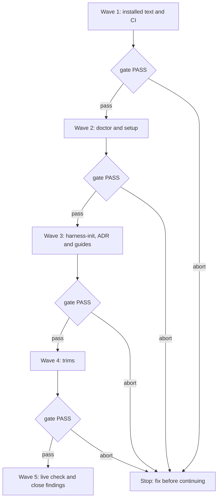

# Quiet install — iteration 1

**Source:** the independent Opus review of
[WolvenTech/wolven-harness#98](https://github.com/WolvenTech/wolven-harness/pull/98),
which said "not ready", and the Human's "Yes, plan the fixes". This spec holds
delta obligations only. `quiet-install-spec.md` stays the base contract, except
for the rows listed under **Base rows this iteration changes**.
**Next:** After the Human approves → `quiet-install-iteration-1-plan.md` →
`code-execute`, wave 1 → 5.
**Named proof (this spec's own structural gate):** `proof-iter1-spec-obligations`

## Findings

The review's findings, as this iteration tracks them. The plan maps each ID to
a unit, and its closing unit reports each as `fixed`, `skipped` or
`no_change_needed`.

| ID | Finding | Where | Obligation |
|----|---------|-------|------------|
| B1 | CI smoke test assumes a full install, so `Package` and `CI` are red | `.github/workflows/ci.yml:165` | I1.1 |
| B2 | The path map rewrites true root paths in installed skills | `layout.md:123,128-129,318,323-330`, `harness-doctor/SKILL.md:83` | I1.2 |
| B3 | The root `.qmd` link resolves `./docs/...` from the repo root and indexes the client's docs | `templates/.qmd/index.yml:3` | I1.5 |
| B4 | A stale, unedited quiet skill reports `doctor-drift-edited`, because known forms hash raw templates | `src/doctor/drift.ts:155`, `scripts/known-forms.mjs` | I1.6 |
| B5 | Rules are not mapped, and the guard message cites a path that is wrong in a quiet install | `yagni-strict.md:18`, `qmd-first.md:57`, `secret-path-guard.mjs:6` | I1.3, I1.4 |
| B6 | Doctor always reports Codex as an error | `src/doctor/runtime-checks.ts:129`, `test/doctor-runtime.test.ts:525` | I2.1 |
| B7 | The quiet branch skips the install hints, and the missing-CLI path and the score file's location are unresolved | `src/setup/index.ts:127-146`, `harness-score.md:15-20`, `SKILL.md:39,306` | I3.1, I4.5, I4.6 |
| B8 | The secret guard fails open in worktrees when hooks are unticked or uncommitted | `layout.md:164,311` | I4.3, I7.1 |
| B9 | A fresh tree reports 52 errors with wrong fixes | `src/doctor/runtime-checks.ts:54,116` | I2.2 |
| B10 | Stale guides | `README.md:36,44-47`, `site/commands.md:25,91-93,126-143`, `site/install.md:11,27,51`, `site/layout.md:11`, `AGENTS.md:31` | I5.1 |
| B11 | Agent-applied rewrites contradict the base spec | `layout.md` switch, `harness-doctor/SKILL.md` refresh | I4.1, I4.2 |
| B12 | A quiet install has no defined way to wire Cursor's secret guard: nothing gives `.cursor/hooks.json` its content, doctor never checks it, and the full-install config points at a path a quiet install lacks | `layout.md` Cursor row, `src/setup/runtimes.ts` `quietGeneratedFiles` | I4.10 |
| C1 | A rerun treats its own link as an occupied path | `src/setup/runtimes.ts:453,466` | I3.2 |
| C2 | A switch detail at `layout.md:142` is wrong | Moot once the switch is cut | I4.1 |
| C3 | Setup prompts for a package manager in a quiet install | `src/setup/options.ts:467` | I3.3 |
| V1 | "your client" in text people read | Skill and guide copy | I4.8 |
| V2 | `stub-template.md:74-100` says "you" and now means the agent | `stub-template.md` | I4.8 |
| V3 | Doctor says "harness home", "link" and "does not resolve" | `src/doctor/runtime-checks.ts:55,64` | I2.3 |
| V4 | `run "harness-init"` reads as a shell command | `src/setup/runtimes.ts:152,197,230,243`, `src/doctor/runtime-checks.ts:55` | I2.3 |
| V5 | "Nothing changed." appears where nothing could change | Doctor and validate messages | I2.3 |
| V6 | The audit overclaims, and the no-remote line is a non sequitur | `SKILL.md:125,297-304` | I4.4, I4.8 |
| V7 | Raw `check-ignore` output with a tab reaches people | `src/doctor/env-checks.ts:54` | I2.3 |
| V8 | Literal backticks print in the terminal | `src/setup/summary.ts` | I3.4 |
| V9 | "harness block" is never explained | `layout.md:133,284`, `SKILL.md:192` | I4.8 |
| V10 | The parity warning has an internal prefix, suggests `harness-init` from a worktree, and says "symlink" for a plain copy | `worktree-parity.mjs:15` | I4.7 |
| V11 | The hooks line says "scripts Claude Code runs" for a Cursor-only case, and two layout questions nearly match | `layout.md:101,160,164` | I4.1, I4.3 |
| T1 | Tests pin prose (about 346 lines) | `harness-init-layout`, `skill-harness-init`, `quiet-install-copy` | I6.1 |
| T2 | Skill text repeats itself | `entry-modes.md:283-322`, `SKILL.md:63,135,189,294-317`, `harness-score.md:70-91`, `lean-path.md:53,58`, `layout.md:153` | I4.9 |
| T3 | ADR-007 is long | Nit; `stable-contract-doc-deferral.md` keeps it | none, `no_change_needed` |
| Y1 | The quiet predicate exists four times | `drift.ts:108`, `doctor/index.ts:37`, `options.ts:404`, `validate/config.ts:70` | I6.2 |
| Y2 | Unused or one-caller surfaces | See I6.3 | I6.3 |
| Y3 | `harness-misplaced` reads every client `.md` | Re-check after rules are mapped | I6.4 |
| S1 | Stale artifacts can be deleted, archived or promoted | See I6.5 | I6.5 |
| P1 | Five proof follow-ups have no home | Proof note | Closed by I1.4, I4.5, I3.2, I4.7 |

## Decisions

Settled with the Human on 2026-11-04:

- **Layout switch: cut it.** harness-init no longer offers a full install or a
  switch. This is the only route the base spec gave to a full install, so the
  guide carries the replacement (I4.1).
- **Refresh: delete and rerun setup** (I4.2).
- **Secret guard: always track hooks** (I4.3).
- **Audit wording: say exactly what it reads** (I4.4).
- **Missing CLI: print hints, then ask** (I3.1, I4.5).
- **"your client" → "Everyone with repo access"** in text people read. Internal
  docs may keep "client repo".
- **"Nothing changed.": only where a write could happen.** It stays in
  harness-init stops and setup errors, and leaves doctor and validate.
- **Cursor's guard in a quiet install: fix it here** (I4.10). Found during wave 3 and added by the Human on 2026-11-04.
- **Audit row: narrowed to `.env` files.** `HYG-03` matches only `.env`, so "those files" overclaimed for key files.
- **Scope: all four trims** (stale artifacts, prose-pinning tests, skill text,
  YAGNI code cuts), small correctness and voice nits included.

Defaults the review left open. The Human confirms these by approving this spec:

- **Codex in doctor (I2.1):** a warning that clears once the harness block is
  in the root `AGENTS.md`.
- **Parity warning (I4.7):** the hook prints `systemMessage` JSON, so the person
  sees it and the agent still gets it. I7.1 proves it live.
- **Score file (I4.6):** `.wolven-harness/.harness-score.json`, read with
  `harness-score --config`. A probe on 2026-11-04 with harness-score 1.6.5 exited
  0 with the flag and no file. Nothing lands at the repo root, and what the home
  `AGENTS.md` already says stays true.

## Base rows this iteration changes

| Base row | Change |
|----------|--------|
| R1.3 | The map also applies to `.agents/rules/` text (I1.3) |
| R1.x inverse | `unmapQuietInstallPaths` goes (I6.3) |
| R3.4 | Drift compares rules and `.qmd/index.yml` in their quiet form too (I1.3, I1.5) |
| R5.5, R5.13 | Keep-or-switch, the switch procedure and their wording rows go (I4.1) |
| Versioning rows of R5 | Hooks leave the checkboxes and are always tracked (I4.3) |
| Safety audit wording row | Replaced by I4.4 |
| ADR-007 | Amended in place (I5.2) |

## Wording

Every string is exact, except `<placeholders>`.

| Where | Text |
|-------|------|
| Audit question (I4.4) | Last step: do you want a safety audit? The harness never opens your `.env` or key files, and it blocks your agent from opening them. This audit checks that protection is in place: that git ignores your `.env` files, and that no key was pasted into your MCP config or harness files, which your agent loads anyway. It reports file names, never values. |
| Guard refusal (I1.4) | This file may hold secrets, so the harness blocked your agent from opening it. Open it yourself if you need to. |
| Fresh tree, per runtime (I2.2) | `<runtime>` isn't connected yet. Ask your agent to run the `harness-init` skill. |
| Codex warning (I2.1) | Codex reads only your `AGENTS.md`, so it won't load the harness on its own. Next: ask your agent to run the `harness-init` skill and add the harness lines to `AGENTS.md`, or ask Codex to read `.wolven-harness/AGENTS.md`. |
| Missing CLI (I4.5) | I can't find `wolven-harness` on this machine, so I can't check the setup. Next: install it with `<install command>`, then tell me to continue. |
| Parity warning (I4.7) | This worktree is missing `<files>`, so your agent may not have the harness here. Next: open a new worktree, or copy `<files>` from your main checkout. |
| Full install guide (I4.1) | Want git to track the whole harness? Follow the uninstall steps, but keep `.wolven-harness.json`. In that file, set `layout` to `home` and remove `harnessHome`, then run `wolven-harness setup`. |

## Repository grounding

| Surface | Present today | Role for this iteration |
|---------|----------------|----------------------------|
| `src/setup/path-map.ts` | yes | Skips anything not at a path-token start, so `./docs/` stays a root path |
| `src/setup/apply.ts:161-167` | yes | Maps `.agents/skills/` only; gains rules and the `.qmd` index |
| `src/doctor/drift.ts:143-162` | yes | Must expect the same bytes setup writes |
| `scripts/known-forms.mjs` | yes | Hashes raw forms; gains quiet forms |
| `src/doctor/runtime-checks.ts` | yes | Fresh-tree, Codex and wording changes |
| `src/setup/index.ts:127-146` | yes | Quiet branch returns before the hints |
| harness-init skill and references | yes | Cut, reworded and de-duplicated |
| `.wolven-harness/.gitignore` template | yes | Already re-includes `.agents/hooks/` |
| harness-score 1.6.5 `--config` | yes | Reads a config outside the scan root |
| `.wolven-harness.json` reader | yes | Requires `version`, `gitHost`, `runtimes` and more, so a hand-written minimal file fails; I4.1 edits the file setup wrote |

## Surface walk

- **In scope:** the paths in **Findings**, the guides, ADR-007, and the planning
  and note files named in I6.5.
- **Out of mutate scope (unchanged):** vendor skills (prototype, the-fool,
  the-jury, handoff); the `wiring.json` format; the fixed map's keys; a full
  install's behavior; publishing and release workflows; the `harness-score`
  package.

## Waves

## Requirements (obligation ↔ proof)

### I1 — Installed text is right (wave 1)

| ID | Obligation | Named proof | Evidence shape |
|----|------------|--------------|------------------|
| I1.1 | The CI smoke test scores a quiet install with `pnpm exec harness-score`, and keeps one full-install leg built by the I4.1 route | `proof-iter1-ci-smoke` | `Package` and `CI` green on the pushed head |
| I1.2 | Skill text that means a true root path writes it so the map skips it (`./docs/`, `./.agents/skills/`). A test maps the real `layout.md` and `harness-doctor/SKILL.md` and finds no root-path sentence gained `.wolven-harness/` | `proof-iter1-root-paths` | Test |
| I1.3 | Setup and drift apply the map to `.agents/rules/` as well as `.agents/skills/` | `proof-iter1-rules-mapped` | Test: installed `yagni-strict.md` and `qmd-first.md` name the home paths, and drift stays silent |
| I1.4 | The guard's refusal uses the **Wording** row: no path, and no "the Human" | `proof-iter1-guard-message` | Test on the hook's output |
| I1.5 | A quiet install's `.qmd/index.yml` collection paths are `./.wolven-harness/docs/...`. One function renders the file for setup, drift and known forms. Each collection resolves under `.wolven-harness/docs/` from the repo root, and a client `docs/` is not indexed | `proof-iter1-qmd-paths` | Test on the resolved path; a run with real qmd where installed |
| I1.6 | `known-forms.json` holds the quiet form of every mapped file, so a stale, unedited quiet file reports `doctor-drift-stale`, and a hand edit still reports `doctor-drift-edited` | `proof-iter1-quiet-stale` | Test, with `pnpm gen:known-forms` output committed |

### I2 — Doctor reads like a person wrote it (wave 2)

| ID | Obligation | Named proof | Evidence shape |
|----|------------|--------------|------------------|
| I2.1 | Codex is a warning with the **Wording** text, and it clears once the harness block is in the root `AGENTS.md` | `proof-iter1-codex-warning` | Test, both states |
| I2.2 | With no `wiring.json`, doctor prints one line per runtime from **Wording**. Once wiring exists, a missing skill gets a skill-specific fix, and a path two runtimes share is reported once | `proof-iter1-fresh-tree` | Test: a fresh fixture yields one finding per runtime |
| I2.3 | Doctor and validate messages drop "Nothing changed.", "harness home", "does not resolve", raw `check-ignore` output and `run "harness-init"`, and every finding still gives a next step. Setup messages say to ask your agent to run the `harness-init` skill | `proof-iter1-doctor-voice` | Test on rendered findings |

### I3 — Setup (wave 2)

| ID | Obligation | Named proof | Evidence shape |
|----|------------|--------------|------------------|
| I3.1 | The quiet branch prints the global install hint and the pinned `harness-score` command | `proof-iter1-quiet-hints` | Test on setup output |
| I3.2 | A rerun compares link targets, so its own link counts as wired and the next step is right; a link to anywhere else stays occupied | `proof-iter1-rerun-link` | Test |
| I3.3 | A quiet install asks no package-manager question | `proof-iter1-no-pm-prompt` | Test |
| I3.4 | Terminal output prints no literal backticks | `proof-iter1-terminal-text` | Test on the quiet summary |

### I4 — harness-init (wave 3)

| ID | Obligation | Named proof | Evidence shape |
|----|------------|--------------|------------------|
| I4.1 | harness-init has no layout question, keep-or-switch or switch procedure. `site/layout.md` and the uninstall guide carry the **Full install guide** row. A deferral records the switch, with the trigger: a Human asks to move an existing quiet install to a full install | `proof-iter1-switch-cut` | Grep; a test that runs the guide's steps and validates; deferral file |
| I4.2 | After a yes, harness-doctor deletes the one stale file and reruns `wolven-harness setup`, so the map runs in code. No skill tells an agent to rewrite paths by hand | `proof-iter1-refresh-rerun` | Test: delete and rerun restores the mapped bytes; grep |
| I4.3 | Hooks are always tracked and never a checkbox. `.worktreeinclude` lists the hooks folder. When the person declines the commit, harness-init says the guard won't reach new worktrees until the hooks are committed | `proof-iter1-hooks-tracked` | Test on the wiring; I7.1 live |
| I4.4 | The audit question is the **Wording** row, and nothing claims more than the audit does | `proof-iter1-audit-wording` | One test on the row |
| I4.5 | harness-init names `wolven-harness validate`. If it is missing, the agent stops with the **Missing CLI** row and never hunts for another build. The audit runs the pinned `harness-score` command after a yes | `proof-iter1-missing-cli` | Skill read; I7.1 live |
| I4.6 | In a quiet install the score uses `.wolven-harness/.harness-score.json` through `--config`, and nothing writes that file at the root. `U-score-quiet` gets its deferral file | `proof-iter1-score-config` | Test; deferral file |
| I4.7 | The parity hook prints `systemMessage` JSON with the **Parity warning** row, with no internal prefix and no "symlink" | `proof-iter1-parity-message` | Test on the JSON; I7.1 live |
| I4.8 | Text people read uses "Everyone with repo access". `stub-template.md` says "the person". "harness block" is explained where first used. The no-remote line follows from what precedes it | `proof-iter1-init-voice` | Review of the listed lines; grep |
| I4.9 | Each repeated passage in T2 lives in one place and is linked from the others | `proof-iter1-one-home` | Grep counts |
| I4.10 | A quiet install's `.cursor/hooks.json` runs the guard from the home. `layout.md` gives its content, `quietGeneratedFiles` renders it from `home`, and doctor reports it missing or different. A full install's config does not change | `proof-iter1-cursor-guard` | Test on the rendered file and both doctor states; I7.1 live |

### I5 — Guides and contract (wave 3)

| ID | Obligation | Named proof | Evidence shape |
|----|------------|--------------|------------------|
| I5.1 | The guides in B10 match the shipped default, and `site/commands.md` lists `harness-misplaced` | `proof-iter1-guides` | `pnpm docs:build`; read of the lines |
| I5.2 | ADR-007 is amended through the `adr` skill: rules in the map, no switch, hooks always tracked, the score file, and "quiet-install PRD" for "in-repo harness PRD" | `proof-iter1-adr` | `test/contract.test.ts`; validate |

### I6 — Trims (wave 4)

| ID | Obligation | Named proof | Evidence shape |
|----|------------|--------------|------------------|
| I6.1 | Prose-pinning tests are cut through the `test-sync` skill. Order, option, gate and mapped-output checks stay, and every kept wording row has at most one test | `proof-iter1-test-trim` | `pnpm test`; line count in the plan's evidence |
| I6.2 | One helper decides whether an install is quiet, and all four sites call it | `proof-iter1-one-predicate` | Grep; `pnpm test` |
| I6.3 | These go, unless a present caller is found and named in the evidence: `unmapQuietInstallPaths`, the `layout` argument of `mapQuietInstallPaths`, `trackedEdit`, unused `entryPoints`, Claude's `manualStep`, the optional `quietInstall` at `runtimes.ts:447`, the unused export at `worktree-parity.mjs:12`, and `TemplateWriter`. Unused `wiring.json` outcomes are removed from the type only | `proof-iter1-yagni-cuts` | Grep; `pnpm build` |
| I6.4 | `harness-misplaced` is re-checked now that rules are mapped: it stays only if it still catches a real case, and it reads no more files than that case needs | `proof-iter1-misplaced` | Test, or its removal with the reason |
| I6.5 | Deleted: the three `*-map.html` files under `docs/notes/in-repo-harness-m/`, `docs/notes/jury-verdict-journeys/` and `docs/specs/quiet-install/`, `in-repo-harness-m-map.json`, and `gitignored-harness-access/probe.sh` with the note's evidence row updated. `stable`: the `in-repo-harness-m`, `gitignored-harness-access` and `quiet-install-runtimes` notes | `proof-iter1-artifacts` | `ls`; validate |

### I7 — Live check and close (wave 5)

| ID | Obligation | Named proof | Evidence shape |
|----|------------|--------------|------------------|
| I7.1 | In a fresh fixture built from this head, with the Human observing: the guard blocks `.env` in a worktree made **after** the commit; a worktree made **before** the commit shows what I4.3 promises; the person sees the parity warning; a missing CLI stops as I4.5 says; `.qmd` indexes only the home's docs; Cursor's guard blocks `.env`, if Cursor is at hand. Results land in `quiet-install-proof-note.md` | `proof-iter1-live-worktree` | Proof note section, accepted by the Human |
| I7.2 | Every finding in **Findings** is reported `fixed`, `skipped` or `no_change_needed`, each with its evidence | `proof-iter1-findings-closed` | The plan's closing table |

## Nine-dimension landings

| Dimension | Landing kind | Landing |
|-----------|---------------|---------|
| validation | obligation ↔ proof | I1.3, I1.5: the same bytes in setup and drift; I6.4 |
| failure modes | obligation ↔ proof | I4.5 stops on a missing CLI; I4.3 states the guard gap before a commit |
| idempotency and retry | obligation ↔ proof | I3.2 rerun; I4.2 delete and rerun |
| authorization | obligation ↔ proof | I4.4: the harness never opens secrets, and the audit reads only what it says; I1.4 |
| concurrency and ordering | n/a | The `wiring.json` format is unchanged, and nothing new runs in parallel |
| data lifecycle | obligation ↔ proof | I6.5 deletes and promotes; I4.2 deletes one stale file only after a yes |
| external-dependency failure | obligation ↔ proof | I4.5 CLI; I1.5 qmd version; I4.6 harness-score pinned |
| state transitions | obligation ↔ proof | I2.1 Codex warning clears; I2.2 fresh to wired; I4.1 full-install route |
| observability | obligation ↔ proof | I4.7 reaches the person; I2.3 next steps |

## Unresolved

| Identifier | Decision needed | Owner | Blocking effect | Disposition |
|------------|-------------------|-------|-------------------|--------------|
| `U-sibling-verdict` | Whether the second Jury's sibling-folder verdict and its proposed deferrals are dropped; recommended: drop them | Human | Non-blocking: only the archive of `docs/notes/jury-verdict-journeys/` waits | Resolve before closure |
| `U-cursor-ignored-rules` | Carried from the base spec | maintainer | Non-blocking | Stays open; probe if Cursor is at hand |
| `U-runtimes-ignored-load` | Carried from the base spec | maintainer | Non-blocking | Stays open; probe where a runtime is at hand |
| `U-worktree-untracked-hooks` | Whether `.worktreeinclude` copies a hooks folder that is untracked and not ignored; the docs describe ignored files only | maintainer | Non-blocking: I4.3's message covers both outcomes | I7.1 answers it |

## Out of scope

- Pre-merge closure: it runs on the Human's ask once CI is green, and it archives
  `docs/specs/quiet-install/` (with `quiet-install-map.json`),
  `docs/prds/quiet-install/`, and the `install-copy-review` and
  `quiet-install-fixture-walk` notes.
- A `setup --layout` flag or any new CLI surface for a full install.
- Making `harness-score` understand quiet installs.
- Shortening ADR-007 (T3).

## Pragmatic-guard refuses

- Keeping the switch code "in case".
- A new runtime dependency or config key.
- Mapping hooks to fix one message; I1.4 removes the path instead.
- A second parity channel beyond `systemMessage`.
- New tests that pin prose.

## Acceptance

### Wave 1

- [x] I1.1 `proof-iter1-ci-smoke` PASS (the smoke step passes locally; green checks land at the push in wave 5)
- [x] I1.2 `proof-iter1-root-paths` PASS
- [x] I1.3 `proof-iter1-rules-mapped` PASS
- [x] I1.4 `proof-iter1-guard-message` PASS
- [x] I1.5 `proof-iter1-qmd-paths` PASS
- [x] I1.6 `proof-iter1-quiet-stale` PASS

### Wave 2

- [x] I2.1 `proof-iter1-codex-warning` PASS
- [x] I2.2 `proof-iter1-fresh-tree` PASS
- [x] I2.3 `proof-iter1-doctor-voice` PASS
- [x] I3.1 `proof-iter1-quiet-hints` PASS
- [x] I3.2 `proof-iter1-rerun-link` PASS
- [x] I3.3 `proof-iter1-no-pm-prompt` PASS
- [x] I3.4 `proof-iter1-terminal-text` PASS

### Wave 3

- [x] I4.1 `proof-iter1-switch-cut` PASS
- [x] I4.2 `proof-iter1-refresh-rerun` PASS
- [x] I4.3 `proof-iter1-hooks-tracked` PASS
- [x] I4.4 `proof-iter1-audit-wording` PASS
- [x] I4.5 `proof-iter1-missing-cli` PASS
- [x] I4.6 `proof-iter1-score-config` PASS
- [x] I4.7 `proof-iter1-parity-message` PASS
- [x] I4.8 `proof-iter1-init-voice` PASS
- [x] I4.9 `proof-iter1-one-home` PASS
- [x] I4.10 `proof-iter1-cursor-guard` PASS
- [x] I5.1 `proof-iter1-guides` PASS
- [x] I5.2 `proof-iter1-adr` PASS

### Wave 4

- [x] I6.1 `proof-iter1-test-trim` PASS
- [x] I6.2 `proof-iter1-one-predicate` PASS
- [x] I6.3 `proof-iter1-yagni-cuts` PASS
- [x] I6.4 `proof-iter1-misplaced` PASS
- [x] I6.5 `proof-iter1-artifacts` PASS

### Wave 5

- [ ] I7.1 `proof-iter1-live-worktree` PASS
- [ ] I7.2 `proof-iter1-findings-closed` PASS

## Eval / gates

| Gate | Command / check | When | PASS | Abort |
|------|-------------------|------|------|-------|
| Full gate | `pnpm build && pnpm test && pnpm lint && pnpm comments && node dist/cli.js validate && pnpm docs:build` | End of each wave | exit 0 | Fix; do not proceed |
| Mirrors | `test/skill-copies.test.ts`; `pnpm gen:known-forms` after any template change | Each unit that edits a template | no drift | Fix in that unit |
| Spec obligations | `proof-iter1-spec-obligations`: every I row has one acceptance box, all nine landings are named, and each `n/a` cites an unchanged surface | Before `code-plan` hands off | all hold | Do not execute |
| Live check | I7.1 | Wave 5 | Human accepts | Fix, then rerun |

## Cross-domain leak table

| Leak | Refuse |
|------|--------|
| Opening a consumer's `.env` or key file, in any test or fixture check | Never; the fixture's `.env` is fake, and only the guard's refusal is observed |
| Merging, or enabling auto-merge | A human merges |
| Revising a vendor skill | Out of scope |
| Editing a renderer copy | `renderer/` only |
| An executable plan from this skill | `code-plan` only |

## ADR

ADR-007 is amended in place through the `adr` skill (I5.2). No new ADR is needed.
