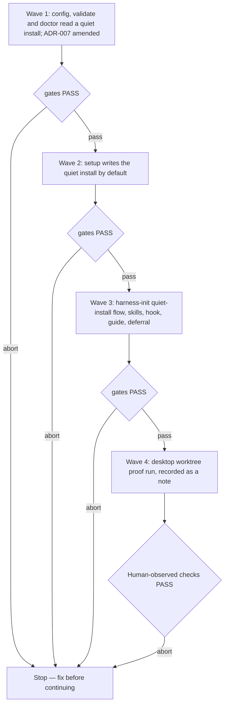

# Quiet install

**Source:** `docs/prds/quiet-install/quiet-install-prd.md` (status `stable`).
**Contract:** ADR-007 (`docs/adrs/adr-007-quiet-install-contract.md`, `stable`), amended in place by wave 1 (see ADR).
**Next:** After the Human approves → `code-plan` → `code-execute`, waves
**1 → 2 → 3 → 4**, in one PR.
**Named proof (this spec's own structural gate):** `proof-quiet-install-spec-obligations`

## Terms

| Term | Resolution |
|------|------------|
| Quiet install | The `linked` layout whose `harnessHome` is `.wolven-harness`, a plain folder inside the git top-level with no git of its own. Detected as `layout: "linked"` with `harnessHome` resolving inside the top-level. The PRD and the dated notes call it the "in-repo install"; that name stays there as history, and wave 1 renames the term in ADR-007. |
| Harness home | The existing contract term, kept: the folder holding `.agents/`, `docs/`, `.qmd/` and the harness `AGENTS.md`. |
| Entry points | First used here: the ignored paths in the repository root that point into the harness home so a runtime loads it (`CLAUDE.local.md`, one `.claude/skills/<name>` link per skill, one `.claude/rules/<name>` link per rule, `.claude/settings.local.json`, `.worktreeinclude`, `.qmd`, each runtime's own). Not the contract's single "entry file". |
| Bootstrap link | First used here: the one entry point setup creates itself, `<runtime skills folder>/harness-init`, a link to the home's `harness-init` skill, for each selected runtime with a skills folder. It is not ignored, so `git status` shows it as untracked until harness-init's wiring ignores it. That is deliberate: it prompts the person to set up the harness or remove it. |
| Occupied entry point | First used here: an entry-point path the client already has that is not a link into the harness home, such as a real `CLAUDE.local.md`, a real `.qmd`, or a client skill named like a harness skill. The client's copy is always kept. |
| Wiring record | First used here: `.wolven-harness/wiring.json`, an ignored file harness-init writes on this machine. It lists each entry point with its outcome (`linked`, `merged`, `prefixed`, `skipped`, `unwired`) and its path, so doctor and a later harness-init run can tell a deliberate choice from missing wiring. No config key records it. |
| Nested `.gitignore` | `.wolven-harness/.gitignore`: ignores the whole home and re-includes itself and the versioned paths. |
| Path map | First used here: the fixed rewrite that setup applies to skill text in a quiet install. It maps `docs/` → `.wolven-harness/docs/` and `.agents/` → `.wolven-harness/.agents/`. It is defined in code, and no config key records it. |
| Full install | First used here: the name people see for today's root layout (`layout: "home"` at a repository root), where git tracks the whole harness. `linked` and `home` are config values and never appear in text people read. |

## Human-facing wording

The reader is a developer who knows git well but may be new to agent
harnesses and spec-driven work, often installing into a repo they don't
own. Every question and summary a person reads uses this text. Prompts,
skill questions, doctor messages and the guide all use the two layout
names, "quiet install" and "full install". A question that names runtimes
or files names the actual ones, such as "Claude Code and Cursor". The
review behind these rules is
`docs/notes/install-copy-review/install-copy-review-note.md`.

Copy rules (R11) apply to every string this initiative adds or changes:

1. **Tracked changes.** A question that writes outside `.wolven-harness/`
   names each tracked client file it creates or changes, as "Tracked
   change: `<path>`" or "New tracked file: `<path>`".
2. **Terms first.** harness-init opens with the introduction below, before
   its first question. Each option explains its term the first time it
   appears, the glossary below applies, and text the person reads says
   "you", never "the Human".
3. **Next step on every stop.** Every stop, block or error says "Nothing
   changed." when that is true, and names the next thing to do.

| Where | Text |
|-------|------|
| Quiet install, description | The harness lives in `.wolven-harness/`, and git sees only what you pick. |
| Full install, description | The harness sits at the repo root, and git tracks all of it. Only for repos you own. |
| harness-init introduction (R11.2) | The harness is the set of instructions, rules and doc folders your coding agent follows. In a quiet install it lives in `.wolven-harness/`. Before anything outside that folder changes, you see the diff and say yes. Nothing is ever pushed. |
| Path question (R5.9) | How much setup do you want right now? Options: "Quick setup (recommended): connect the harness to <runtime names>; everything else can wait." and "Guided setup: walk through every step, skipping whatever you don't want yet." Never "full tour", which would collide with "full install" |
| Layout question (R5.5) | How much of the harness do you want to version in git? Options: "Quiet install" and "Full install", each with its description above |
| Setup next step (R4.3) | Open your coding agent and run the `harness-init` skill to connect the harness. `git status` shows `<bootstrap link paths>` as untracked until you do; that's expected. To drop the harness instead, remove `.wolven-harness/`, `.wolven-harness.json` and those links. For a runtime with no skills folder: ask your agent to read `.wolven-harness/.agents/skills/harness-init/SKILL.md` and follow it. |
| Layout switch confirm (R5.5) | Apply this switch? It removes `.wolven-harness/` and adds tracked files at the root. |
| Layout switch carries (R5.12) | Your edited or added files move to the root: `<paths>`. |
| Layout switch removes wiring (R5.13) | The harness symlinks, hooks, ignore lines and harness block for the quiet install are removed: `<paths>`. |
| Layout switch unclear entry (R5.13) | Can't switch to a full install: `<path>` points into `.wolven-harness/`, and it may not be the harness's. Nothing changed. Remove or keep it by hand, then ask again. |
| Client skills folder kept (R5.14) | Your `.claude/skills/` folder is kept. The harness adds one symlink per skill inside it, and git ignores them. |
| Tracked-edit offer (R6.2) | <runtime> can't read <the harness instructions / rules> from a file only on this machine. Add <change> to `<path>`? Tracked change: `<path>` (or New tracked file: `<path>`). Options: "Yes" and "No, leave <runtime> without it". A No names the manual step |
| Occupied entry point (R5.14) | You already have `<path>`, and it stays as it is. For the harness's `<name>`: merge it into yours (tracked change when `<path>` is tracked), save it next to yours as `wolven-<name>`, or skip it? Options: "Merge into mine", "Save as wolven-<name>", "Skip it" |
| Layout switch blocked (R5.5) | Can't switch to a full install: `<path>` already exists at the repo root. Nothing changed. Move or rename it, then ask again. |
| Versioning question (R5.2) | Which harness folders should git track? Items: "Rules: instructions your agent always follows", "Hooks: scripts Claude Code runs automatically", "Decision records (ADRs): why the code is the way it is. They keep your agent's context accurate over the long run, so keep them current", "Notes", "Requirements and specs", "Postponed-work notes". Footer: "Ticked folders get committed, and your client sees them. Unticked ones stay on this machine and don't reach worktrees." |
| Ignore question (R5.3) | How should we ignore the harness local-only files? Options: "In `.gitignore` (tracked change your client sees)" and "Only on this machine: `.git/info/exclude` (nothing tracked changes)" |
| Wiring question (R5.3) | Create the harness symlinks for <runtime names>? The diff lists each symlink, the Claude Code hooks it sets up, and any tracked change, such as `.dockerignore`. |
| Block question (R5.4) | Add the harness block to <file names>? (Tracked change; `AGENTS.md` is created if missing.) Options: Yes and No only |
| Repo and role question (R5.9) | What's this repo for, and what's your role in it? (Guided setup's first question.) |
| Guided step question (R5.9) | Next: <what the step does, in one line, with any tracked change named>. Run it, or skip? Options: "Run it" and "Skip it". Asked once per step, in order; never shown as a list |
| Migration question (R5.10) | Copy `<file>` into the harness as a decision record? Your file is not changed. |
| Checks question (R5.11) | How should we check the harness? Options: "Only when I run it (recommended): `wolven-harness validate`" and "On every pull request: new tracked file `.github/workflows/<file>`, which your client sees" |
| Commit question (R5.6) | Commit these <N> files to `<branch>`? Nothing is pushed. |
| No remote (R5.6) | This repo has no remote, so there is nothing to commit for. Your changes stay in the working tree. |
| Local-only list (R5.6) | These stay on this machine, and git ignores them: `<paths>`. |
| Kept client paths (R5.6, R5.14) | Kept as yours: `<path>` (`<merged / saved as wolven-<name> / skipped>`). |
| Packaging, with `.dockerignore` line (R5.6) | Docker builds skip the harness: your `.dockerignore` now excludes `.wolven-harness/`. Archives and rsync deploys need their own exclusion. |
| Packaging, no `.dockerignore` (R5.6) | Packaging that ignores `.gitignore` (a Docker build, an archive, an rsync deploy) picks up the whole harness, unticked docs included. Exclude `.wolven-harness/` there. |

Glossary for text people read:

| Internal term | Say instead |
|---------------|-------------|
| ADR | decision record (ADR) |
| PRD, spec | requirements, spec |
| deferral | postponed-work note |
| claim | a reference to decision NNN |
| links, entry points | symlinks |
| wired / unwired | set up / not set up to read the harness |
| harness home, `linked`, `home`, `codeRepo` | never shown |
| stub | template skill |
| drift | edited since install |
| the Human | you |

## Repository grounding

| Surface | Present today | Role for this initiative |
|---------|----------------|----------------------------|
| `src/setup/options.ts` `resolveOptions` | yes | Picks `root` / `outside` mode; gains the quiet-install mode decision |
| `src/setup/index.ts` `runSetup` | yes | Root scaffold, outside scaffold; gains the quiet-install scaffold and its summary and next steps |
| `src/setup/apply.ts` `applyTemplates`, `INSTALLED_AS` | yes | Create-only copy; gains a target root (the harness home) and the nested `.gitignore` template mapping |
| `src/setup/render-wolven.ts` | yes | Renders `WOLVEN.md`; for a quiet install it renders `.wolven-harness/AGENTS.md` directly, with `.wolven-harness/`-prefixed paths |
| `src/setup/config.ts` | yes | Config keys and rules; unchanged keys, read to detect a quiet install |
| `src/setup/runtimes.ts` `RUNTIME_REGISTRY` | yes | Per-runtime skills, rules, entry and hook wiring; read by harness-init's quiet-install table and by doctor |
| `src/validate/{index,repo,spine,profile,claims,adr-folders,legacy,config}.ts` | yes | Every check is root-relative; gains a harness-home root and a file list that includes ignored home files |
| `src/doctor/{index,env-checks,runtime-checks,drift}.ts` | yes | Already resolves `harnessHome` for `linked`; `doctor-docs`, runtime wiring and drift gain quiet-install shapes |
| `templates/.agents/skills/harness-init/references/layout.md` | yes | Home and linked layouts; gains a quiet-install section |
| `templates/.agents/skills/harness-init/references/convention.md` | yes | Records `commitConvention` for `codeRepo`; gains the quiet-install case |
| `templates/.agents/skills/{code-commit,code-pr}/SKILL.md` | yes | Convention rule for the harness home; gains the quiet-install rule |
| `templates/.agents/hooks/secret-path-guard.mjs` | yes | Reused; its command path moves under the home |
| `templates/.qmd/index.yml` | yes | Collections are `./docs/...`, relative to the `.qmd` folder's parent |
| `templates/.wolven-harness/gitignore` (nested `.gitignore` template) | no | New |
| `.wolven-harness/wiring.json` (wiring record) | no | New; written by harness-init, read by doctor (R3.6, R5.15) |
| `docs/notes/quiet-install-fixture-walk/quiet-install-fixture-walk-note.md` | yes | Twelve persona walks; R4.1, R4.3, R5.5, R5.6 and R5.12–R5.15 settle its findings F1–F8 |
| `docs/notes/quiet-install-runtimes/quiet-install-runtimes-note.md` | yes | The source of R6.2's rows: each non-Claude runtime's documented entry points, its tracked-edit offer, and its manual step |
| `docs/prds/quiet-install/quiet-install-prd.md` G1, AC-1.1 | yes | Amended with the Human's yes on 2026-11-03 to match R4.1's footprint: the root config, the home `AGENTS.md`, approved tracked client edits and the untracked bootstrap links |
| `templates/.agents/hooks/worktree-parity.mjs` | no | New `SessionStart` check |
| `site/layout.md`, `site/install.md` | yes | Gain the quiet-install layout and the uninstall guide |
| `docs/deferrals/docs-root/docs-root-deferral.md` | yes | Its trigger fires with a fixed path; narrowed by this initiative |
| `test/contract.test.ts` | yes | Pins ADR-007's config keys and codes; fails until the ADR and code agree |
| `harness:validate`, `pnpm test`, `pnpm lint`, `pnpm comments` | yes | Gates reused |

## Surface walk

- **In scope:** `src/setup/**`, `src/validate/**`, `src/doctor/**`, the
  templates listed above, `templates/.agents/skills/harness-init/**`,
  `templates/.agents/skills/harness-doctor/**` (refresh applies the fixed
  path map), `templates/.agents/skills/{code-commit,code-pr}/SKILL.md`,
  `site/{layout,install}.md`, `docs/deferrals/docs-root/`, ADR-007's text,
  and the tests that pin each.
- **Out of mutate scope (unchanged):** `src/comments/**` (comment judging
  reads root-relative diffs and needs no home); `src/setup/package-manager.ts`
  and `package-script.ts` (not called in the quiet-install mode);
  `src/cli.ts` command table (no new command); the `skills` command
  (`src/skills/**`); setup's outside-repository mode and subfolder refusal
  in `src/setup/options.ts`; `harness-score` (an external package).

## Waves

The gates for waves 1–3 are `pnpm build`, `pnpm test`, `pnpm lint`,
`pnpm comments` and `node dist/cli.js validate`, all exit 0. A failed gate
aborts before the next wave. All four waves land in one PR. Wave 2's
commit, the one that flips the default, carries a `BREAKING CHANGE:` footer
naming the new default, so release-please's changelog flags it.

## Requirements (obligation ↔ proof)

### R1 — The fixed quiet-install path map (wave 1)

| ID | Obligation | Named proof | Evidence shape |
|----|------------|--------------|------------------|
| R1.1 | The quiet-install path map is fixed in code as two literal prefixes, `docs/` → `.wolven-harness/docs/` and `.agents/` → `.wolven-harness/.agents/`. It applies only to a quiet install, and no config key records it | `proof-quiet-install-fixed-map` | Unit test: the map holds exactly those two entries, and applying it for a `home` install returns the text unchanged |
| R1.2 | ADR-007 records the fixed map and leaves its config table unchanged, and `test/contract.test.ts` passes with the code's key list | `proof-quiet-install-contract` | `pnpm test` runs `contract.test.ts` green |
| R1.3 | One function applies the fixed map to skill text. Setup's install and restore (R4.1, R4.5), doctor's drift (R3.4) and harness-doctor's refresh all call it. It replaces a key only where the key starts a path token, meaning the key sits at the start of a line or follows whitespace, a backtick, a quote or `(`. Any other occurrence stays as written | `proof-quiet-install-pathmap-boundary` | Unit test: a `docs/` key rewrites `` `docs/adrs/` `` and `(docs/specs/x)`, and leaves `site/docs/`, `https://example.com/docs/` and `mydocs/` unchanged |

### R2 — Validate reads a quiet install from its home (wave 1)

| ID | Obligation | Named proof | Evidence shape |
|----|------------|--------------|------------------|
| R2.1 | In a quiet install, run anywhere in the repository, validate runs profile, spine, claims and adr-folder checks with the harness home as their root, and prints each path with the `.wolven-harness/` prefix | `proof-quiet-install-validate-root` | Fixture repo with a quiet install and a bad ADR filename under `.wolven-harness/docs/adrs/`: the finding names `.wolven-harness/docs/adrs/...` |
| R2.2 | The scanned file list for a quiet install is every file under the harness home, ignored files included (skills, `AGENTS.md`, unticked docs), and no file outside it | `proof-quiet-install-validate-scan` | Fixture: an ignored skill with no frontmatter fails `skill-frontmatter`; a broken claim in an ignored skill fails `claim-missing` |
| R2.3 | A client file outside the home that mentions an ADR number (one that exists in the home and one that does not) is neither a claim nor a finding | `proof-quiet-install-client-claims` | Fixture `src/app.ts` mentioning both: validate exits 0 and `claims:` counts only home files |
| R2.4 | The root's own `docs/` is not a profile folder in a quiet install: a client `docs/adrs/notes.md` with no frontmatter raises nothing | `proof-quiet-install-client-docs` | Fixture: validate exits 0 |
| R2.5 | `harness-ignored` checks only the paths the nested `.gitignore` re-includes, and reports one that a root rule ignores; ignored entry points and unversioned home paths are not reported | `proof-quiet-install-ignored-scope` | Fixtures: root `.gitignore` with `docs/` and `*.md` → no finding (re-include holds); root `.gitignore` with `.wolven-harness/` → `harness-ignored` on each re-included path; ignored `CLAUDE.local.md` → no finding |
| R2.6 | In a quiet install, the `ignore` config entries are relative to the harness home | `proof-quiet-install-ignore-entries` | Fixture with `ignore: ["vendor/**"]` drops `.wolven-harness/vendor/**` only |
| R2.7 | A repository with no config, or with `home` or a `linked` home outside the top-level, validates exactly as today | `proof-quiet-install-validate-unchanged` | The existing validate suites pass unchanged |
| R2.8 | In a quiet install, a tracked or untracked-but-not-ignored `.md` file outside the home whose frontmatter `type` is a profile type (`adr`, `prd`, `spec`, `note`, `deferral`, `map`) raises the `harness-misplaced` warning (exit 0). The warning names the file and the home path it belongs under | `proof-quiet-install-misplaced` | Fixture with `docs/adrs/stray-decision.md` at the root carrying `type: adr`: one `harness-misplaced` warning naming `.wolven-harness/docs/adrs/`, exit 0. A root `README.md` with `type: guide` raises nothing |

### R3 — Doctor checks a quiet install (wave 1)

| ID | Obligation | Named proof | Evidence shape |
|----|------------|--------------|------------------|
| R3.1 | `doctor-docs` in a quiet install checks `.wolven-harness/docs/adrs/` instead of `docs/`: it fails when that path is ignored, naming the rule (including one that ignores `.wolven-harness/`), and passes when only unticked docs folders are ignored | `proof-quiet-install-doctor-docs` | `test/doctor-env.test.ts` cases for both |
| R3.2 | Runtime checks accept the quiet-install entry points for Claude Code: `CLAUDE.local.md` linking to the home's `AGENTS.md` satisfies `doctor-entry`; `.claude/rules/` holding one link per home rule satisfies `doctor-rules`; `.claude/skills/` holding one link per home skill satisfies `doctor-skills`, beside any client skills in the same folder | `proof-quiet-install-doctor-claude` | `test/doctor-runtime.test.ts` fixture for a quiet-install Claude install: no error |
| R3.3 | For every other selected runtime, doctor checks the entry points listed for it in harness-init's quiet-install table (R6.2); a runtime harness-init left unwired fails its wiring code with the manual step as `fix:` | `proof-quiet-install-doctor-runtimes` | One fixture per registry runtime wired the quiet-install way → no error; one with Codex unwired → `doctor-entry` error naming the manual step |
| R3.4 | In a quiet install, drift applies the fixed map (R1.3) to template text before comparing installed skills. A skill setup wrote is therefore not `doctor-drift-edited`, and a later hand edit still is | `proof-quiet-install-drift-pathmap` | `test/doctor-drift.test.ts`: mapped skill → no warning; mapped plus edited → `doctor-drift-edited` |
| R3.5 | `doctor-code-repo` does not run for a quiet install, which records no `codeRepo` | `proof-quiet-install-no-code-repo` | Fixture: no `doctor-code-repo` finding |
| R3.6 | In a quiet install, doctor reads the wiring record (R5.15) when it exists. An entry point recorded as `merged`, `prefixed` or `skipped` raises no wiring error; doctor reports it as a warning naming the kept client path and the outcome. An entry point recorded as `linked` that is missing or dangling still fails its wiring code. With no record, doctor checks as R3.2–R3.3 say | `proof-quiet-install-doctor-record` | `test/doctor-runtime.test.ts`: a record with a skipped `code-commit` skill and no link → warning, no error; a record saying `linked` with the link removed → `doctor-skills` error |

### R4 — Setup writes the quiet install by default (wave 2)

| ID | Obligation | Named proof | Evidence shape |
|----|------------|--------------|------------------|
| R4.1 | At a git top-level with no `.wolven-harness.json`, setup writes `.wolven-harness/.gitignore` before any other path, then the selected templates under `.wolven-harness/` with the fixed map applied to skill text (R1.3), then `.wolven-harness.json` at the root with `layout: "linked"` and `harnessHome: ".wolven-harness"`, then one bootstrap link per selected runtime that has a skills folder. Setup ignores no bootstrap link. When the link's path already exists, setup keeps it, creates no link there, and prints the `SKILL.md` path line instead. Nothing else outside the home changes | `proof-quiet-install-setup-default` | `test/setup-quiet-install.test.ts`: write order recorded by an injected writer; `git status --porcelain` lists only `.wolven-harness/.gitignore`, the re-included home paths, `.wolven-harness.json` and `.claude/skills/harness-init` as untracked; that link resolves to the home's `harness-init/SKILL.md`; an installed skill names `.wolven-harness/docs/adrs/`. A fixture with a client `.claude/skills/harness-init` keeps its bytes and prints the path line |
| R4.2 | The nested `.gitignore` ignores everything in the home and re-includes itself, `AGENTS.md`, `.agents/rules/`, `.agents/hooks/` and `docs/adrs/`. `AGENTS.md` is always re-included, so the harness block in a client file (R5.4) never points at a missing file. The `.gitignore` ships as a dotless template mapped in `INSTALLED_AS` | `proof-quiet-install-nested-gitignore` | Byte check of the installed file; `git check-ignore` on a skill (ignored), and on an ADR and the home `AGENTS.md` (both not ignored) |
| R4.3 | The quiet-install scaffold adds no `package.json` script and creates no runtime wiring outside the home other than the bootstrap links (R4.1). Its next steps name `wolven-harness validate` and print the wording table's setup next step, naming each bootstrap link and the `SKILL.md` path for a runtime with no skills folder | `proof-quiet-install-setup-scope` | Fixture with a `package.json`: unchanged bytes; stdout names `wolven-harness validate`, the untracked bootstrap link and the remove-instead line |
| R4.4 | In a quiet install, setup writes the harness instructions straight to `.wolven-harness/AGENTS.md` (create-only) and writes no `WOLVEN.md`. That file belongs to the harness, not the client, and it names every harness path with the `.wolven-harness/` prefix. The full install keeps `WOLVEN.md`, because its root `AGENTS.md` is the person's own | `proof-quiet-install-render` | Snapshot of the rendered `.wolven-harness/AGENTS.md`; no `WOLVEN.md` anywhere after a quiet-install setup; a rerun leaves an edited home `AGENTS.md` unchanged |
| R4.7 | Setup's summary and next steps call the result the quiet install and print its one-line description from the wording table. They never print a layout value (`linked`, `home`) | `proof-quiet-install-setup-wording` | stdout snapshot of a quiet-install setup: the name and description are present, and `linked` and `home` are absent |
| R4.5 | A rerun with a recorded quiet install creates only missing paths under the home and never rewrites an existing nested `.gitignore`. Each skill it restores gets the fixed map applied (R1.3), so a teammate's fresh clone ends up with the same skill text as the first install. It also creates each missing bootstrap link, as R4.1 does | `proof-quiet-install-setup-rerun` | Second run: the edited `.gitignore` and an edited skill are unchanged, and a deleted skill is restored. Fresh-clone fixture: only the committed paths plus the quiet-install config, then `setup`, then `doctor` shows no `doctor-drift-edited`, the restored skill names `.wolven-harness/docs/adrs/`, and `.claude/skills/harness-init` resolves |
| R4.6 | A config recording `home` or no `layout` keeps today's root scaffold, and the subfolder refusal and outside mode are unchanged | `proof-quiet-install-setup-unchanged` | Existing `setup-*` suites pass; one new case with a `home` config |

### R5 — harness-init picks the layout, then versions and wires the quiet install (wave 3)

These obligations are skill text the agent follows; their proofs are text
checks in `test/skill-harness-init.test.ts` and `test/harness-init-layout.test.ts`,
and wave 4 drives them end to end.

| ID | Obligation | Named proof | Evidence shape |
|----|------------|--------------|------------------|
| R5.1 | `layout.md` gains a quiet-install section that `harness-init` follows when the config records a quiet install. Quick setup runs it right after the path question; guided setup runs it after the guided steps (R5.9) | `proof-quiet-install-init-section` | Text check: the section is present, and its place on each path is stated |
| R5.2 | It asks which harness folders git should track, using the wording table's items. Rules, hooks and decision records are ticked by default; notes, requirements and specs, and postponed-work notes are not. Each item carries its explanation, and the footer from the wording table follows the list. It edits only the nested `.gitignore` to match. The harness `AGENTS.md` is always tracked and is not a checkbox | `proof-quiet-install-init-version` | Text check: the six items with their explanations and defaults, the footer, and no `AGENTS.md` checkbox |
| R5.3 | It asks where the entry-point ignore lines go (`.gitignore` or `.git/info/exclude`), then checks every entry-point path (R5.14) and shows one diff of every entry point and ignore line for the recorded runtimes, from the quiet-install table, and writes only on a yes; a no leaves everything outside the home unchanged. The ignore lines cover the bootstrap links too, so they stop showing as untracked. When the root has a `.dockerignore`, the same diff adds `.wolven-harness/` to it. On a yes it also writes the wiring record (R5.15) | `proof-quiet-install-init-wire` | Text check: the entry-point check before the diff, one diff, one approval, the decline path, the bootstrap links in the ignore lines, the `.dockerignore` line, and the wiring record |
| R5.4 | In a quiet install, setup never creates or edits the client's root `AGENTS.md` or `CLAUDE.md`; wiring them is harness-init's job, done with the smallest edit that works. The harness block is the same lean marked block in both files (`<!-- wolven-harness:start -->` … `end`): at most three lines of plain text saying the repo uses the Wolven harness, that its instructions are in `.wolven-harness/AGENTS.md`, and that harness docs go under `.wolven-harness/docs/`. When the person says yes to Amp's tracked-edit offer (R6.2), the block gains a fourth line, `@.wolven-harness/AGENTS.md`. It is text, not an `@` import: an import of an ignored file does not expand in a worktree, and `CLAUDE.local.md` stays Claude Code's loader, so the harness `AGENTS.md` loads once. harness-init adds the block to each root `AGENTS.md` or `CLAUDE.md` the client has. When a selected runtime reads `AGENTS.md` (Codex, Cursor, Amp, opencode, Copilot, Antigravity) and the client has none, harness-init creates a root `AGENTS.md` that holds only the block. The question offers Yes and No only, and the block is part of the one wiring diff (R5.3). On a no, the runtimes that read that file stay unwired, and doctor names them (R3.3) | `proof-quiet-install-init-agents-conflict` | Text check: the block's text and its three-line cap, the fourth `@` line only after Amp's offer, no `@` import, no other line changed, the created `AGENTS.md`, Yes and No as the only options, and the declined outcome. The `proof-quiet-install-setup-scope` fixture with a client `AGENTS.md` and `CLAUDE.md` keeps both byte-identical after setup |
| R5.5 | Before the quiet-install section, harness-init asks whether to keep the quiet install (the default) or switch to a full install, for a repo the person owns. On a switch it shows the diff (move `.wolven-harness/docs/` to the root `docs/`, carry edited and added files to the root (R5.12), remove the quiet-install wiring (R5.13), remove the rest of `.wolven-harness/`, and rewrite `.wolven-harness.json` to `layout: "home"`), then asks the confirm question from the wording table. On a yes it applies the diff and reruns `setup`, which writes the root scaffold (R4.6). On a no, nothing changes and the quiet install stays. If the move would overwrite an existing root path, the switch stops before the diff with the blocked message from the wording table | `proof-quiet-install-init-fork` | Text check: the question comes before the quiet-install section; the diff, then the confirm question, then the apply; the decline path; and the blocked message. R4.6's `home` config case covers the rerun |
| R5.6 | In both installs, harness-init makes one commit offer, at the end, in place of today's per-phase offers. It uses the wording table's commit question, naming the current branch and saying that nothing is pushed, and lists every path with a tracked/new tag. The list holds only paths git would track. For a quiet install that is the nested `.gitignore`, the home `AGENTS.md`, the ticked home folders, `.wolven-harness.json`, and each tracked root file it created or edited with the person's yes, such as the root `.gitignore`, `AGENTS.md`, `CLAUDE.md` or `.dockerignore`. Ignored entry points and the wiring record are never in it and are never force-added; the closing lists them with the wording table's local-only line, and lists each kept client path (R5.14) with its outcome. The session note is in the list only when Notes is ticked; otherwise the closing says it was kept on this machine only. On a yes it passes the listed paths by name to `code-commit`. When the repository has no remote, it makes no offer and says why, using the wording table's text. It also states two things. First, packaging: with the approved `.dockerignore` line, the wording table's packaging line for that case; without one, the line that warns the whole home, unticked docs included, reaches packaging that ignores `.gitignore`. Second, a worktree gets only the folders git tracks: an unticked docs folder can't be read from a worktree session, and a write to it lands in the worktree's ignored copy, which is lost when the worktree is removed | `proof-quiet-install-init-statement` | Text check: one offer at the end, no per-phase offers left in `SKILL.md`, the branch and "nothing is pushed", the tagged path list limited to trackable paths, no force-add, the local-only and kept-path lines, the session-note rule, the hand-off to `code-commit`, the no-remote text, both packaging lines with their condition, and the worktree statement |
| R5.7 | In a quiet install, harness-init skips step 0: setup already wrote `.wolven-harness/AGENTS.md` (R4.4), and there is no `WOLVEN.md` to fold | `proof-quiet-install-init-step0` | Text check |
| R5.8 | harness-init asks each quiet-install question with the wording table's text, and `layout.md` uses the two layout names with their descriptions | `proof-quiet-install-init-wording` | Text check: each question string from the wording table is present in `layout.md` |
| R5.9 | The lean path ("Quick setup") asks no goal question, in either install. In a quiet install it runs the quiet-install section (R5.2–R5.6) and hands back. Guided setup opens with the wording table's repo-and-role question, which replaces the goal. It then offers each remaining phase one at a time, in order (migration, research, skill suggestions, score, then the checks question, which carries its own skip), each with the guided step question. There is no coverage checklist. A skipped step goes under Left for later. Guided setup then runs the quiet-install section. The closing asks what to work on next | `proof-quiet-install-lean-path` | Text check in `lean-path.md` and `SKILL.md`: the quick-setup option text, no goal question, the quiet-install section on the lean path; guided setup opens with the repo-and-role question, asks the step question once per phase in order, and has no coverage checklist |
| R5.10 | In a quiet install, migration copies each legacy decision record into `.wolven-harness/docs/adrs/` in harness format, and never moves, renames, rewrites or deletes a client file. Its question uses the wording table's text | `proof-quiet-install-migration-copy` | Text check in `adr-migration.md`: copy, never `git mv`, for a quiet install, plus the question text |
| R5.11 | In a quiet install, the "how should we check the harness?" question offers two options, in this order: "Only when I run it" (recommended) and "On every pull request", plus "Skip it" on guided setup, each worded as in the wording table. "With your existing checks" is not offered, because a quiet install adds no `package.json` script | `proof-quiet-install-checks-question` | Text check in `validate-wiring.md` for both options, their order and text, and the absent third option |
| R5.12 | The layout switch (R5.5) keeps the person's content. Before the diff, harness-init lists every file under `.wolven-harness/.agents/`, ignored files included, and finds each one doctor's drift reports as edited and each one no template installed. The diff moves each such file to the same path at the root, with the fixed map reversed on skill text, beside the `docs/` move, and shows them with the wording table's carry line. Unedited template files are dropped, and the setup rerun recreates them. A carried file whose root path already exists blocks the switch with the blocked message | `proof-quiet-install-switch-keeps` | Text check in `layout.md`: ignored files listed, edited and added files carried with the map reversed, the carry line, unedited files dropped, and the collision block |
| R5.13 | The same switch diff removes every quiet-install entry point the harness owns: the per-skill and per-rule links, `CLAUDE.local.md`, `.qmd`, the harness hook entries in `.claude/settings.local.json`, the harness lines in `.worktreeinclude`, the harness ignore lines in `.gitignore` or `.git/info/exclude`, the `.dockerignore` line, the bootstrap links, and the harness block in the client's `AGENTS.md` and `CLAUDE.md`. The wiring record names which entry points the harness made. Client content around them is kept, and kept client paths (R5.14) are not touched. After the setup rerun, harness-init checks that no entry point still points into `.wolven-harness/`. An entry that points into the home but that the record does not name stops the switch with the unclear-entry message, before anything changes | `proof-quiet-install-switch-unwires` | Text check in `layout.md`: each removed entry kind, the wiring record as the owner list, kept client paths untouched, the check after the rerun, and the unclear-entry stop |
| R5.14 | Before the wiring diff, harness-init checks each entry-point path. Claude Code skills are always one link per skill, so a client's real `.claude/skills/` folder is kept and gets the links beside its own skills; the wording table's kept-folder line says so at that moment. For an occupied entry point it keeps the client's copy and asks the occupied-entry-point question. "Merge into mine" shows the merged text in the wiring diff and names a tracked change when the path is tracked. "Save as wolven-<name>" links the harness copy beside the client's under that name. "Skip it" creates nothing there. It never replaces, moves or deletes a client path | `proof-quiet-install-occupied` | Text check in `layout.md`: per-skill links, the kept-folder line, the question with its three options, the tracked-change note on merge, and no replace or delete of a client path |
| R5.15 | harness-init writes the wiring record on each approved wiring, and reads it on a rerun, so it asks again only for an entry point that is missing and has no recorded outcome. The nested `.gitignore` keeps the record ignored | `proof-quiet-install-wiring-record` | Text check in `layout.md` for the record's fields and outcomes and the rerun rule; byte check that the nested `.gitignore` does not re-include `wiring.json` |

### R6 — Entry points per runtime (wave 3)

| ID | Obligation | Named proof | Evidence shape |
|----|------------|--------------|------------------|
| R6.1 | Claude Code's quiet-install entry points are `CLAUDE.local.md` (file link to `.wolven-harness/AGENTS.md`), `.claude/skills/` (a real folder with one link per home skill, the bootstrap link among them), `.claude/rules/` (a real folder with one file link per home rule), `.claude/settings.local.json` (the secret guard and the worktree-parity hooks), `.worktreeinclude` (listing `CLAUDE.local.md`, `.claude/rules/`, `.claude/rules/*.md`, each linked `.claude/skills/<name>`, `.claude/settings.local.json`) and `.qmd` (link to the home's `.qmd`) | `proof-quiet-install-claude-entry` | The quiet-install table in `layout.md` lists exactly these; doctor's Claude fixture (R3.2) uses the same set |
| R6.2 | Every other registry runtime has a row in the quiet-install table, copied from the runtimes research note. Each row names its entry points from the runtime's documented load paths, each an ignored path in the root, with a source link. Skills are one link per skill in `.agents/skills/` (Kiro: `.kiro/skills/`). When an ignored path can't wire a piece, the row names the tracked edit that would, and harness-init always offers it in the one wiring diff with the wording table's tracked-edit question. A No, or a runtime with no working tracked edit (Codex instructions), leaves the piece unwired with the row's manual step. Generated entry points (Cursor `.mdc` rules, Copilot instruction files, Kiro steering, the Antigravity rule) are covered by doctor's drift check. The wiring diff (R5.3) and doctor's fixtures (R3.3) use the same rows | `proof-quiet-install-runtime-table` | Text check: eight rows, a source per row, every non-Claude registry id present, each row matching the research note, the tracked-edit question for each row that has one, and Codex's manual step |
| R6.3 | Hook commands in the quiet-install entry points run scripts under `$CLAUDE_PROJECT_DIR/.wolven-harness/.agents/hooks/` (Claude) or the equivalent home path (Cursor) | `proof-quiet-install-hook-paths` | Text check of the table's hook JSON |

### R7 — Worktree parity warning (wave 3)

| ID | Obligation | Named proof | Evidence shape |
|----|------------|--------------|------------------|
| R7.1 | `worktree-parity.mjs` exits 0 always, and prints a warning naming each missing entry point when the session's project folder has no `CLAUDE.local.md` or no `.claude/rules/` | `proof-quiet-install-parity-hook` | `test/worktree-parity.test.ts`: complete folder → no output; each missing path → its warning; exit 0 in every case |
| R7.2 | `setup` copies the script into every install's `.agents/hooks/`, and only the quiet-install entry points wire it | `proof-quiet-install-parity-wiring` | `test/setup-hook-wiring.test.ts`: root scaffold wires no `SessionStart` |

### R8 — Commit convention in a quiet install (wave 3)

| ID | Obligation | Named proof | Evidence shape |
|----|------------|--------------|------------------|
| R8.1 | In a quiet install, `convention.md` records `commitConvention` at the root with no `codeRepo`, and `code-commit` and `code-pr` apply it to every commit, harness paths included | `proof-quiet-install-convention` | `test/convention-skills.test.ts` text checks |
| R8.2 | In a quiet install, `code-commit` and `code-pr` stage a path under `.wolven-harness/` only when the Human names it, and never stage with `git add -A` or `git add .` | `proof-quiet-install-no-home-staging` | `test/convention-skills.test.ts` text check in both skills |

### R9 — Uninstall guide, layout page and the docs-root deferral (wave 3)

| ID | Obligation | Named proof | Evidence shape |
|----|------------|--------------|------------------|
| R9.1 | `site/install.md` gains a manual uninstall guide: list what setup and harness-init created, keep a copy of any edited skill or rule, move harness docs to keep, remove the rest, then run `setup` at the root | `proof-quiet-install-uninstall-guide` | `pnpm docs:build` exit 0; text check of the steps |
| R9.2 | `site/layout.md` documents the quiet install as the default at a repository root, and the full install by that name | `proof-quiet-install-layout-page` | `pnpm docs:build` exit 0; text check |
| R9.3 | The docs-root deferral is narrowed: the harness docs root is fixed at `<harnessHome>/docs/`, and a `docsDir` key stays deferred | `proof-quiet-install-deferral` | `node dist/cli.js validate` exit 0 on the edited deferral |

### R10 — Desktop worktree proof (wave 4)

| ID | Obligation | Named proof | Evidence shape |
|----|------------|--------------|------------------|
| R10.1 | A fixture made by the built `setup` and a `harness-init` run repeats the fourth proof run's checks in a Claude Code desktop worktree session: skills, `AGENTS.md`, rules and the secret guard load, and the worktree's `.claude/settings.local.json` is present; an ADR written to `.wolven-harness/docs/adrs/` is untracked on the worktree branch with no block or prompt; `git status` at the root is empty | `proof-quiet-install-worktree-run` | A note at `docs/notes/quiet-install-proof/quiet-install-proof-note.md` with the check table, observed by the Human |
| R10.2 | In the same run, deleting the worktree's `CLAUDE.local.md` and starting a new session shows the parity warning | `proof-quiet-install-worktree-warning` | Same note |

### R11 — Copy rules (wave 3)

These rules cover every string added or changed in waves 1–3. Their checks
run at the end of wave 3, so the messages added in waves 1 and 2 are checked
there too.

| ID | Obligation | Named proof | Evidence shape |
|----|------------|--------------|------------------|
| R11.1 | Every harness-init question that writes outside `.wolven-harness/`, in either install, names each tracked client file it creates or changes, in the copy rules' form | `proof-quiet-install-tracked-changes` | Text check over `SKILL.md` and its references: each question that leads to a write outside the home carries a "Tracked change:" or "New tracked file:" line |
| R11.2 | harness-init opens with the wording table's introduction, before its first question. Text the person reads uses the glossary and says "you", never "the Human": questions, the session-note template, the stub template, and the closing | `proof-quiet-install-terms-first` | Text check: the introduction comes before the path question; no "the Human" and no glossary term left in a string the person reads, across `harness-init` and its references |
| R11.3 | Every stop, block or error message this initiative adds says "Nothing changed." when true and names the next step: harness-init's stops, the layout switch block and unclear-entry stop, `harness-misplaced`, `doctor-docs`, the quiet-install `doctor-entry`, and the parity warning | `proof-quiet-install-next-step` | Message snapshots in the validate, doctor and parity suites, plus a text check of the stops in harness-init, each with its next step |

## Nine-dimension landings

| Dimension | Landing kind | Landing |
|-----------|---------------|---------|
| validation | obligation ↔ proof | R1.1 / `proof-quiet-install-fixed-map`; R2.5 / `proof-quiet-install-ignored-scope` |
| failure modes | obligation ↔ proof | Edited or added harness files lost in a layout switch: R5.12 / `proof-quiet-install-switch-keeps`. Symlinks left pointing into a removed home: R5.13 / `proof-quiet-install-switch-unwires`. A client path occupying an entry point: R5.14 / `proof-quiet-install-occupied`. Ignored files in the commit list: R5.6 / `proof-quiet-install-init-statement`. Harness doc written outside the home: R2.8 / `proof-quiet-install-misplaced`. Path rewrite over-matching: R1.3 / `proof-quiet-install-pathmap-boundary`. Root rule ignoring the home: R3.1 / `proof-quiet-install-doctor-docs`. Lost entry points in a worktree: R7.1 / `proof-quiet-install-parity-hook`. Client `AGENTS.md` or `CLAUDE.md` left unwired: R5.4 / `proof-quiet-install-init-agents-conflict`. Home paths swept into a client commit: R8.2 / `proof-quiet-install-no-home-staging`. A client file edited without warning: R11.1 / `proof-quiet-install-tracked-changes`. A client decision record moved or rewritten: R5.10 / `proof-quiet-install-migration-copy` |
| idempotency and retry | obligation ↔ proof | R4.5 / `proof-quiet-install-setup-rerun`; harness-init reruns ask only for missing entry points with no recorded outcome: R5.15 / `proof-quiet-install-wiring-record` |
| authorization | `n/a` | Unchanged surface: no credential or permission is added; the secret guard `templates/.agents/hooks/secret-path-guard.mjs` is reused as is, only its command path moves (R6.3) |
| concurrency and ordering | obligation ↔ proof | Nested `.gitignore` first: R4.1 / `proof-quiet-install-setup-default`. Worktree copies are taken at creation, so a rule changed later reaches only new worktrees; the guide states it (R9.2) |
| data lifecycle | obligation ↔ proof | Unticked docs live only in the local home and stay out of a Docker build context: R5.3 / `proof-quiet-install-init-wire`. The uninstall guide keeps edited files and docs before removal: R9.1 / `proof-quiet-install-uninstall-guide` |
| external-dependency failure | `n/a` + obligation | `n/a` for git and qmd: unchanged surfaces `src/validate/index.ts` (exits 1 without git) and `doctor-qmd` in `src/doctor/env-checks.ts`. `.worktreeinclude` link copying is undocumented: R7.1 warns when it fails |
| state transitions | obligation ↔ proof | No config → quiet install with untracked bootstrap links (R4.1); bootstrap links → ignored by harness-init's wiring (R5.3); `home` config → kept (R4.6); recorded quiet install → rerun into the home (R4.5); quiet install → full install by harness-init's confirmed switch (R5.5); unwired → wired by harness-init (R5.3) |
| observability | obligation ↔ proof | Validate prints home-prefixed paths: R2.1 / `proof-quiet-install-validate-root`. Doctor names unwired runtimes: R3.3 / `proof-quiet-install-doctor-runtimes`. Doctor tells a recorded skip from missing wiring: R3.6 / `proof-quiet-install-doctor-record` |

## Unresolved

| Identifier | Decision needed | Owner | Blocking effect | Disposition |
|------------|-------------------|-------|-------------------|--------------|
| `U-cursor-ignored-rules` | Whether Cursor loads rules from a gitignored `.cursor/rules/`; never probed | maintainer | Non-blocking: R6.2 wires from Cursor's docs | Probe during wave 4 if Cursor is at hand; record the result in the proof note |
| `U-score-quiet` | How `harness-score` should rate a quiet install, since it scores from files at the root | maintainer | Non-blocking: harness-init's score step may report low | Defer with a trigger: a score report on a quiet install that misleads the Human |
| `U-runtimes-ignored-load` | Whether each non-Claude runtime loads its entry points from ignored paths; the docs are silent for all of them (runtimes note) | maintainer | Non-blocking: R6.2 wires from the docs, and doctor checks only that the paths exist | Probe in wave 4 for each runtime at hand; record the results in the proof note |
| `U-sibling-verdict` | Whether the second Jury's sibling-folder verdict and its proposed deferrals are dropped | Human | Non-blocking | Resolve before archiving `docs/notes/jury-verdict-journeys/` |

## Out of scope

- An `uninstall` command, a migration command, or any new CLI command.
- A configurable docs root (`docsDir`).
- Proof runs for runtimes other than Claude Code (Cursor optional, see `U-cursor-ignored-rules`).
- Setup outside a repository, and the subfolder refusal.
- Committing anything without the person's yes.
- An undo line in setup's summary and harness-init's closing: deferred to
  0.4.1 in WolvenTech/wolven-harness#95.

## Pragmatic-guard refuses

- A deprecation-warning release before the default flips. The Human ruled
  on 2026-11-03 that the one consumer is aware, and ADR-007 is amended to
  match. The `BREAKING CHANGE:` footer on wave 2's commit is the only
  notice.
- A `wire` command or a second setup pass: setup writes what is fixed;
  harness-init does what needs discovery and the Human.
- A `pathMap` config key, or a path rewrite made by an agent. The map is
  two fixed literal prefixes, applied in code.
- A `--layout` flag on setup. A person who owns the repo switches to the
  full install through harness-init (R5.5).

## Acceptance

### Wave 1

- [x] `proof-quiet-install-fixed-map` PASS — R1.1
- [x] `proof-quiet-install-contract` PASS — R1.2
- [x] `proof-quiet-install-pathmap-boundary` PASS — R1.3
- [x] `proof-quiet-install-validate-root` PASS — R2.1
- [x] `proof-quiet-install-validate-scan` PASS — R2.2
- [x] `proof-quiet-install-client-claims` PASS — R2.3
- [x] `proof-quiet-install-client-docs` PASS — R2.4
- [x] `proof-quiet-install-ignored-scope` PASS — R2.5
- [x] `proof-quiet-install-ignore-entries` PASS — R2.6
- [x] `proof-quiet-install-validate-unchanged` PASS — R2.7
- [x] `proof-quiet-install-misplaced` PASS — R2.8
- [x] `proof-quiet-install-doctor-docs` PASS — R3.1
- [x] `proof-quiet-install-doctor-claude` PASS — R3.2
- [x] `proof-quiet-install-doctor-runtimes` PASS — R3.3
- [x] `proof-quiet-install-drift-pathmap` PASS — R3.4
- [x] `proof-quiet-install-no-code-repo` PASS — R3.5
- [x] `proof-quiet-install-doctor-record` PASS — R3.6

### Wave 2

- [ ] `proof-quiet-install-setup-default` PASS — R4.1
- [ ] `proof-quiet-install-nested-gitignore` PASS — R4.2
- [ ] `proof-quiet-install-setup-scope` PASS — R4.3
- [ ] `proof-quiet-install-render` PASS — R4.4
- [ ] `proof-quiet-install-setup-rerun` PASS — R4.5
- [ ] `proof-quiet-install-setup-unchanged` PASS — R4.6
- [ ] `proof-quiet-install-setup-wording` PASS — R4.7

### Wave 3

- [ ] `proof-quiet-install-init-section` PASS — R5.1
- [ ] `proof-quiet-install-init-version` PASS — R5.2
- [ ] `proof-quiet-install-init-wire` PASS — R5.3
- [ ] `proof-quiet-install-init-agents-conflict` PASS — R5.4 (client `AGENTS.md` and `CLAUDE.md`)
- [ ] `proof-quiet-install-init-fork` PASS — R5.5
- [ ] `proof-quiet-install-init-statement` PASS — R5.6
- [ ] `proof-quiet-install-init-step0` PASS — R5.7
- [ ] `proof-quiet-install-init-wording` PASS — R5.8
- [ ] `proof-quiet-install-lean-path` PASS — R5.9
- [ ] `proof-quiet-install-migration-copy` PASS — R5.10
- [ ] `proof-quiet-install-checks-question` PASS — R5.11
- [ ] `proof-quiet-install-switch-keeps` PASS — R5.12
- [ ] `proof-quiet-install-switch-unwires` PASS — R5.13
- [ ] `proof-quiet-install-occupied` PASS — R5.14
- [ ] `proof-quiet-install-wiring-record` PASS — R5.15
- [ ] `proof-quiet-install-claude-entry` PASS — R6.1
- [ ] `proof-quiet-install-runtime-table` PASS — R6.2
- [ ] `proof-quiet-install-hook-paths` PASS — R6.3
- [ ] `proof-quiet-install-parity-hook` PASS — R7.1
- [ ] `proof-quiet-install-parity-wiring` PASS — R7.2
- [ ] `proof-quiet-install-convention` PASS — R8.1
- [ ] `proof-quiet-install-no-home-staging` PASS — R8.2
- [ ] `proof-quiet-install-uninstall-guide` PASS — R9.1
- [ ] `proof-quiet-install-layout-page` PASS — R9.2
- [ ] `proof-quiet-install-deferral` PASS — R9.3
- [ ] `proof-quiet-install-tracked-changes` PASS — R11.1
- [ ] `proof-quiet-install-terms-first` PASS — R11.2
- [ ] `proof-quiet-install-next-step` PASS — R11.3

### Wave 4

- [ ] `proof-quiet-install-worktree-run` PASS — R10.1
- [ ] `proof-quiet-install-worktree-warning` PASS — R10.2

## Eval / gates

| Gate | Command / check | When | PASS | Abort |
|------|-------------------|------|------|-------|
| Build | `pnpm build` | End of waves 1–3 | exit 0 | Fix; do not proceed |
| Tests | `pnpm test` | End of waves 1–3 | exit 0, `contract.test.ts` included | Fix; do not proceed |
| Lint | `pnpm lint` | End of waves 1–3 | exit 0 | Fix; do not proceed |
| Comments | `pnpm comments` | End of waves 1–3 | `comments: ok` | Fix; do not proceed |
| Integrity | `node dist/cli.js validate` | End of each wave | exit 0 | Fix; do not proceed |
| Guide | `pnpm docs:build` | End of wave 3 | exit 0 | Fix; do not proceed |
| Breaking marker | `git log --format=%B origin/main..HEAD \| grep -q '^BREAKING CHANGE:'` | Before the PR opens | exit 0 | Amend wave 2's commit message |
| Desktop proof | R10 checks in the proof note | Wave 4 | every row observed as stated | Fix the failing wave; do not open the PR for review |
| Spec obligations | `proof-quiet-install-spec-obligations` — every acceptance box names one R row; every R row has one acceptance box; all nine landings present; every `n/a` cites an unchanged surface | Before `code-plan` | all hold | Do not plan |

## Cross-domain leak table

| Leak | Refuse |
|------|--------|
| Pushing the branch or opening the PR | `code-pr`, on the Human's ask |
| Publishing the release | The release flow (`release-please`, `npm-trusted-publishing`) |
| Rating a quiet install's maturity | `harness-score`, outside this repo (`U-score-quiet`) |
| Moving the one consumer's install | The consumer, by the uninstall guide |
| An executable plan from this skill | `code-plan` only |

## ADR

ADR-007 holds. Wave 1 amends it in place with the `adr` skill and the
Human's confirmation, before the branch merges, because no release has
shipped it yet:

- Consequences: drop the deprecation-warning release; the Human waived
  change-policy step 2 on 2026-11-03 for the one aware consumer.
- Terms: "in-repo install" becomes "quiet install", and the root layout's
  name for people is "full install".
- Quiet install: setup applies the fixed path map to skill text (R1.1),
  and writes `.wolven-harness/AGENTS.md` directly with no `WOLVEN.md`
  (R4.4), so `step0-pending` never fires there. The config table is
  unchanged.
- Setup modes: a git top-level whose config records a quiet install
  scaffolds into its harness home (R4.5). Outside the home, setup now also
  writes one untracked, unignored bootstrap link per runtime skills folder
  (R4.1), which replaces "no runtime wiring there".
- Consequences: harness-init commits no ignored entry point, so the
  "separate choice" to commit the entry points is dropped (R5.6). The
  layout switch carries edited files and removes the quiet-install wiring
  (R5.12, R5.13).
- Wiring record: `.wolven-harness/wiring.json` is a local file outside the
  config table, which stays unchanged (R5.15).
- Doctor: the quiet-install shapes of `doctor-docs` and the runtime checks
  (R3.1–R3.3), and `doctor-code-repo` not running without `codeRepo`.
