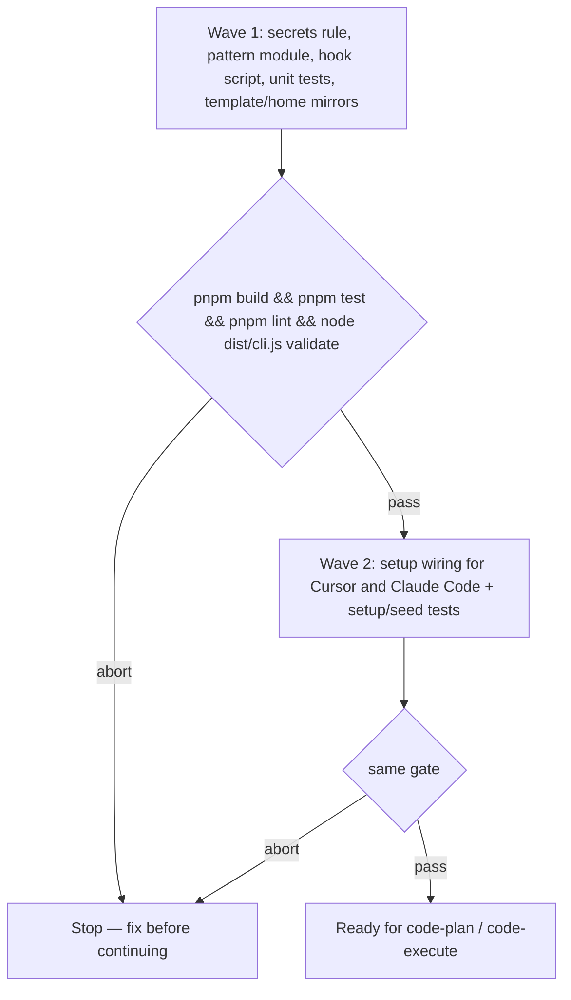

# Secret-path guard (issue 80 slice)

**Source:** `docs/prds/secret-path-guard/secret-path-guard-prd.md` (status `stable`)
**Next:** After the Human approves → `code-plan` → `code-execute`, waves **1 → 2**
**Named proof (this spec's own structural gate):** `proof-secret-path-guard-spec-obligations`

## Terms

- **Secret-shaped path:** A filesystem path or shell token that matches the pattern list from [wolven-harness#80](https://github.com/WolvenTech/wolven-harness/issues/80) (extensions, basename prefixes, home credential dirs, and `.env*` except `.env.example`). Path-level matching only — no file-content entropy scan in this slice.
- **Pre-tool hook:** A runtime callback that runs before an agent Read or shell tool executes, wired from `.agents/hooks/secret-path-guard.mjs`.
- **Deny:** The hook blocks the tool call outright with a message that cites `.agents/rules/secrets.md`. It does not use an ask-the-Human decision at the hook (per PRD resolution, Rafael 2026-10-26).
- **Rule-only runtime:** A selected runtime with no native hook wiring in this slice (for example Codex, antigravity); coverage is the shipped `secrets.md` standing rule and inline harness rules listing.

## Repository grounding

| Surface | Present today | Role for this initiative |
|---------|----------------|----------------------------|
| `templates/.agents/rules/{qmd-first,yagni-strict,comments,project-skill-precedence}.md` | yes | Existing standing rules copied by `setup`; `secrets.md` joins them |
| `.agents/rules/*.md` | yes | Harness-home copies of template rules; gains `secrets.md` |
| `templates/.agents/hooks/README.md` | yes | Placeholder README; documents the new guard hook |
| `.agents/hooks/default-branch.sh` | yes | Package-repo git hook only — not shipped in `templates/` (unchanged) |
| `src/setup/apply.ts` (`applyTemplates`) | yes | Copies template tree into consumer repos when paths are missing |
| `src/setup/runtimes.ts` (`wireRuntimes`, `createFile`) | yes | Wires skills, entry stubs, and native rules today; gains hook config wiring for Cursor and Claude Code |
| `src/setup/index.ts` | yes | Orchestrates template copy then `wireRuntimes` |
| `test/setup-surfaces.test.ts` | yes | Asserts exact paths `setup` creates — must include new template files |
| `test/seed-extract.test.ts` | yes | Asserts shipped hook seed shape — must allow documented guard hooks |
| `AGENTS.md` (runtime dependencies) | yes | Invariant: no new runtime npm dependencies beyond Node built-ins and existing `yaml` / `@clack/prompts` |
| `pnpm test`, `pnpm lint`, `node dist/cli.js validate` | yes | Wave gates and integrity check |
| `docs/deferrals/default-branch-guard/default-branch-guard-deferral.md` | yes | Precedent: agent hook JSON paths (`.cursor/hooks.json`, `.claude/settings.json`) — consumer install deferred there; this slice wires the secret guard only |

## Surface walk

- **In scope:**
  - `templates/.agents/rules/secrets.md` and `.agents/rules/secrets.md`
  - `templates/.agents/hooks/secret-paths.mjs`, `secret-path-guard.mjs`, and `templates/.agents/hooks/README.md`
  - `src/setup/runtimes.ts` (and tests) for Cursor / Claude Code hook wiring when those runtimes are selected
  - `test/secret-path-guard.test.ts` (or equivalent) for pattern and shell-form matching
  - `test/setup-surfaces.test.ts`, `test/seed-extract.test.ts`, and any setup wiring tests extended for hook JSON
- **Out of mutate scope (unchanged):**
  - `src/validate/**` other than doc claims introduced by this spec
  - `src/doctor/**`, harness-score drops and checks
  - Pre-commit secret scanning (`simple-git-hooks`, `.agents/hooks/default-branch.sh` consumer story)
  - `.wolven-harness.json` pattern overrides
  - Native hook wiring for Codex, Copilot, Gemini, OpenCode, Amp, Kiro, and antigravity (follow-up)
  - `renderer/**`, `site/**`, release workflows

## Waves

A failed gate aborts before the next wave.

## Requirements (obligation ↔ proof)

### R1 — Standing rule (`secrets.md`)

Traces to PRD US-2 (AC-2.1, AC-2.2).

| ID | Obligation | Named proof | Evidence shape |
|----|------------|--------------|------------------|
| R1.1 | `templates/.agents/rules/secrets.md` ships with YAML frontmatter `alwaysApply: true`, instructs agents never to read or print secret-shaped files, and tells agents to ask the Human when access is truly needed. `.agents/rules/secrets.md` matches the template byte-for-byte. | `proof-secret-path-guard-secrets-rule` | File inspect; diff template vs harness home |
| R1.2 | After `setup` with Codex selected (inline rules mode), rendered `WOLVEN.md` / harness standing-rules surfaces list `secrets.md` alongside the other standing rules. | `proof-secret-path-guard-inline-rules-list` | `test/setup-surfaces.test.ts` or dedicated setup test with `--runtimes codex` |

### R2 — Pattern module (`secret-paths.mjs`)

Traces to PRD goal “no new runtime dependencies” and issue #80 pattern list.

| ID | Obligation | Named proof | Evidence shape |
|----|------------|--------------|------------------|
| R2.1 | `secret-paths.mjs` exports pure functions that classify paths and shell command strings against the #80 list: `*.pem`, `*.key`, `*.p12`, `*.pfx`, `id_rsa*`, `id_ed25519*`, `.env*` except `.env.example`, `*.keystore`, `.npmrc`, `.netrc`, and home dirs `~/.ssh/`, `~/.aws/`, `~/.config/gcloud/` (and project-relative equivalents). | `proof-secret-path-guard-pattern-list` | `pnpm test` — fixture paths |
| R2.2 | `.env.example` is never classified as secret-shaped. | `proof-secret-path-guard-env-example-allow` | `pnpm test` |
| R2.3 | Shell forms used in #80 are detected when they target secret-shaped paths: at minimum `cat`, `head`, `find … -exec cat`, and `grep -r` (including quoted and `./` relative paths). | `proof-secret-path-guard-shell-forms` | `pnpm test` |
| R2.4 | Pattern logic uses only Node built-in modules — no new runtime dependency in `package.json`. | `proof-secret-path-guard-no-runtime-dep` | Inspect `package.json`; hook imports |

### R3 — Hook entrypoint (`secret-path-guard.mjs`)

Traces to PRD US-1 (AC-1.1–AC-1.3) and resolved hook behavior (deny outright).

| ID | Obligation | Named proof | Evidence shape |
|----|------------|--------------|------------------|
| R3.1 | Given a Read-like payload for `certs/client.pem`, the hook exits with a deny outcome and a stderr/JSON message that cites `secrets.md` / the secrets standing rule. | `proof-secret-path-guard-deny-read-pem` | `pnpm test` invoking the hook module |
| R3.2 | Given a shell command `cat ./secrets/id_rsa`, the hook denies before execution would occur. | `proof-secret-path-guard-deny-shell-cat` | `pnpm test` |
| R3.3 | Given a Read of `.env.example`, the hook allows the call (success exit, no deny payload). | `proof-secret-path-guard-allow-env-example` | `pnpm test` |
| R3.4 | The hook never emits an ask-the-Human / permission-request decision — only allow or deny. | `proof-secret-path-guard-no-ask-hook` | `pnpm test` or grep hook source |

### R4 — `setup` ships templates and wires Cursor + Claude Code

Traces to PRD scope **In** and resolved rule-only runtimes decision.

| ID | Obligation | Named proof | Evidence shape |
|----|------------|--------------|------------------|
| R4.1 | Full `setup` copies `secret-paths.mjs`, `secret-path-guard.mjs`, and `secrets.md` into the consumer tree when missing (same skip-if-exists semantics as other templates). | `proof-secret-path-guard-setup-templates` | Extended `test/setup-surfaces.test.ts` |
| R4.2 | When Cursor is among selected runtimes, `setup` writes `.cursor/hooks.json` that registers the guard for pre-tool Read and shell events per Cursor's hook schema, pointing at `.agents/hooks/secret-path-guard.mjs`. | `proof-secret-path-guard-cursor-wiring` | Setup fixture test + JSON inspect |
| R4.3 | When Claude Code is among selected runtimes, `setup` writes `.claude/settings.json` with a `PreToolUse` hook entry for the same script per Claude Code's settings schema. | `proof-secret-path-guard-claude-wiring` | Setup fixture test + JSON inspect |
| R4.4 | Selecting only inline runtimes (for example Codex alone) does not write Cursor or Claude hook config; rule-only coverage remains acceptable. | `proof-secret-path-guard-no-hook-for-inline-only` | Setup test with `--runtimes codex` |

### R5 — Regression floor

| ID | Obligation | Named proof | Evidence shape |
|----|------------|--------------|------------------|
| R5.1 | `pnpm test`, `pnpm lint`, and `node dist/cli.js validate` pass after both waves. | `proof-secret-path-guard-gates-pass` | CI-local commands |

## Nine-dimension landings

| Dimension | Landing kind | Landing |
|-----------|---------------|---------|
| validation | obligation ↔ proof | R2.1–R2.3 and R5.1 — `pnpm test` exercises pattern and hook fixtures; `node dist/cli.js validate` checks new docs. |
| failure modes | obligation ↔ proof | R3.1–R3.3 — deny on secret paths; allow on `.env.example`; R3.4 — no silent allow on malformed hook input (hook exits non-zero or deny-safe default — exact behavior fixed in implementation, tested in R3). |
| idempotency and retry | obligation ↔ proof | R4.1 — `setup` skip-if-exists: re-running `setup` does not overwrite an existing consumer hook file (same as `createFile` / `applyTemplates` today). |
| authorization | obligation ↔ proof | R1.1 and R3.1 — agent tool boundary enforcement; no elevation path through the hook (deny only). Human approval flow stays in the standing rule text, not the hook. |
| concurrency and ordering | n/a | Unchanged surface: `wireRuntimes` order and template walk in `src/setup/apply.ts` — hook wiring runs after templates copy in existing `setup` sequence. |
| data lifecycle | n/a | Unchanged surface: hook reads tool metadata only; no persistence of paths or file contents. Cited unchanged surface: hook scripts under `.agents/hooks/`. |
| external-dependency failure | obligation ↔ proof | R2.4 — hook runs with Node only; no network or npm install at hook time. |
| state transitions | obligation ↔ proof | R3.1–R3.3 — tool call transitions blocked at pre-tool boundary; R4.2/R4.3 — first-time `setup` creates hook config, re-run skips when file exists. |
| observability | obligation ↔ proof | R3.1 — deny message cites the standing rule so operators see why the tool was blocked in hook output. |

## Unresolved

| Identifier | Decision needed | Owner | Blocking effect | Disposition |
|------------|-------------------|-------|-------------------|--------------|
| `U-pre-commit-scan` | Pre-commit secret scan: built-in `secret-paths.mjs` vs scanner dependency | Rafael / deferred | Non-blocking for this slice | Defer per PRD non-goals and pragmatic-guard note (need 2/10; complexity 5 built-in vs 8 dependency). Revisit when a commit-side incident or explicit follow-up spec is opened. |
| `U-hook-config-merge` | When `.cursor/hooks.json` or `.claude/settings.json` already exists, `setup` skips today — merge guard entries vs leave manual | Rafael | Blocks R4.2/R4.3 acceptance in repos with existing hook config | Resolve before Wave 2 ships, or document skip-only behavior and a doctor follow-up |
| `U-native-hook-follow-up` | Wire guard on remaining runtimes (Codex, Copilot, Gemini, …) | Rafael | Non-blocking | Follow-up initiative after slice 1; rule-only acceptable now |

## Out of scope

- Pre-commit staged secret scan (issue #80 item 4).
- `wolven-harness doctor` / harness-score enforcement for the guard (item 5).
- Configurable pattern overrides in `.wolven-harness.json` (item 6).
- Shipping `default-branch.sh` or git `simple-git-hooks` wiring into consumers.
- Content/entropy secret detection (API keys embedded in non-secret-shaped filenames).
- Ask-the-Human hook decisions.

## Pragmatic-guard refuses

- Refuse a pre-commit scanner dependency or npm secret-scan package in this slice — deferred; prefer reusing `secret-paths.mjs` when item 4 returns.
- Refuse wiring all nine runtimes in one change — rule-only coverage is enough for hookless runtimes now.
- Refuse doctor/score/overrides expansion — explicit PRD non-goals.
- Refuse a plugin/registry abstraction for hooks — one guard script and direct `setup` wiring.

## Acceptance

### Wave 1

- [ ] `secrets.md` template and harness-home copy ship with `alwaysApply: true` (pairs with R1.1, `proof-secret-path-guard-secrets-rule`)
- [ ] `secret-paths.mjs` implements the #80 pattern list, `.env.example` allowance, and shell forms (pairs with R2.1–R2.3, `proof-secret-path-guard-pattern-list`, `proof-secret-path-guard-env-example-allow`, `proof-secret-path-guard-shell-forms`)
- [ ] No new runtime npm dependency (pairs with R2.4, `proof-secret-path-guard-no-runtime-dep`)
- [ ] `secret-path-guard.mjs` denies read/shell on secret paths, allows `.env.example`, never asks (pairs with R3.1–R3.4, `proof-secret-path-guard-deny-read-pem`, `proof-secret-path-guard-deny-shell-cat`, `proof-secret-path-guard-allow-env-example`, `proof-secret-path-guard-no-ask-hook`)

### Wave 2

- [ ] `setup` copies hook and rule templates (pairs with R4.1, `proof-secret-path-guard-setup-templates`)
- [ ] Cursor and Claude Code hook wiring when selected (pairs with R4.2–R4.3, `proof-secret-path-guard-cursor-wiring`, `proof-secret-path-guard-claude-wiring`)
- [ ] Codex-only setup does not write hook JSON (pairs with R4.4, `proof-secret-path-guard-no-hook-for-inline-only`)
- [ ] Inline rules list includes `secrets.md` (pairs with R1.2, `proof-secret-path-guard-inline-rules-list`)
- [ ] Full gate suite green (pairs with R5.1, `proof-secret-path-guard-gates-pass`)

## Eval / gates

| Gate | Command / check | When | PASS | Abort |
|------|-------------------|------|------|-------|
| Integrity | `pnpm build && node dist/cli.js validate` | End of each wave | exit 0 | Fix profile / ADR claims |
| Test suite | `pnpm test` | End of each wave | exit 0 | Fix failing tests |
| Lint | `pnpm lint` | End of each wave | exit 0 | Biome fix |
| Spec obligations | `proof-secret-path-guard-spec-obligations` — each acceptance box pairs one R-row proof; all nine landings; each `n/a` cites an unchanged surface | Before `code-plan` | all hold | Do not plan |

## Cross-domain leak table

| Leak | Refuse |
|------|--------|
| Pre-commit scan, doctor, score, `.wolven-harness.json` overrides | PRD non-goals / `U-pre-commit-scan` deferral |
| Default-branch guard consumer install | `docs/deferrals/default-branch-guard/` — separate initiative |
| An executable plan from this skill | `code-plan` only |

## ADR

None needed this initiative. Built-in Node pattern matching and template-shipped hooks follow existing setup and dependency conventions (`AGENTS.md`); no new architecture claim beyond what issue #80 describes.

## Section checklist

| Section | Required when | Present |
|---------|-----------------|---------|
| Source | Always | yes |
| Repository grounding | Always | yes |
| Surface walk | Always | yes |
| Waves | Multi-batch work | yes |
| Requirements with obligation ↔ proof | Always | yes |
| Nine-dimension landings | Always | yes |
| Unresolved | Always | yes |
| Out of scope | Always | yes |
| Pragmatic-guard refuses | Always | yes |
| Acceptance | Always | yes |
| Eval / gates | Always | yes |
| Cross-domain leak table | Always | yes |
| ADR | Always | yes |
