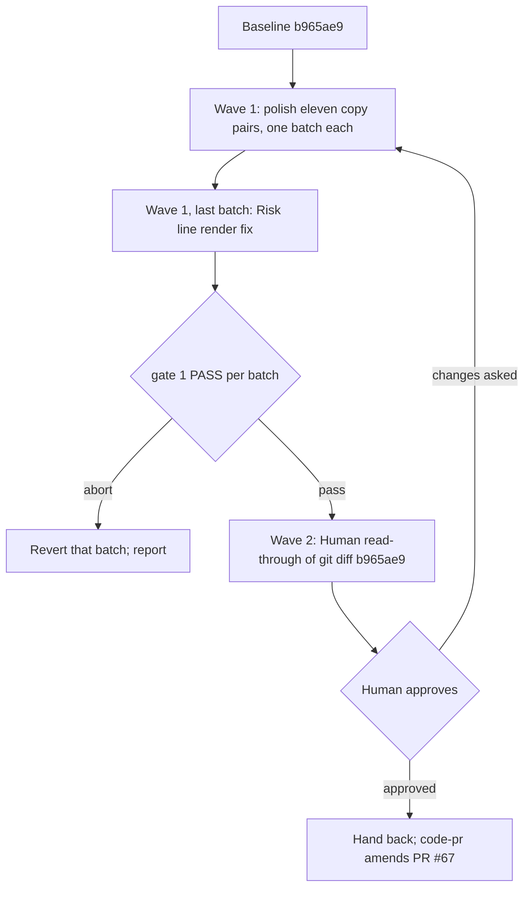

# Polish the copy PR #67's template trim left behind

**Source:** `docs/prds/templates-copy-polish/templates-copy-polish-prd.md` (status `stable`)
**Next:** After the Human approves → `code-plan` → `code-execute`; wave
**1 → 2**.
**Named proof (this spec's own structural gate):** `proof-templates-copy-polish-spec-obligations`

## Repository grounding

The polish lands on PR #67's branch, `claude/templates-verbosity-review-cb52a2`.
**Baseline** is that branch's head `b965ae9`; **trim base** is `d7cb269`, the
commit PR #67 branched from. A **changed section** is a section (the text
under one heading) holding at least one hunk of `git diff d7cb269 b965ae9`.

| Surface | Present today | Role for this initiative |
|---------|----------------|----------------------------|
| The eleven shipped files listed under Surface walk, each in `templates/.agents/…` and `.agents/…` | yes | Polished in their changed sections only |
| `test/skill-copies.test.ts` | yes | Fails when the two skill copies differ; `qmd-first.md` has no such test, so `cmp` checks it |
| `test/skill-code-pr.test.ts`, `test/skill-code-commit.test.ts`, `test/skill-code-spec.test.ts`, `test/skill-code-plan.test.ts`, `test/skill-code-execute.test.ts`, `test/harness-init-note.test.ts`, `test/harness-init-stub.test.ts`, `test/skill-harness-init.test.ts`, `test/template-residue.test.ts`, `test/skill-handoff.test.ts`, `test/claims.test.ts`, `test/seed-extract.test.ts`, `test/setup-*.test.ts` | yes | Pin headings, phrases and shapes in the eleven files; read only |
| `proof-templates-trim-wave-examples` in `test/skill-code-commit.test.ts` | yes | Pins the wave examples' headings, one subject, one to three body lines, and at least two joined `type(scope):` subjects in the bad one; not their wording |
| `proof-templates-trim-pr-caps` in `test/skill-code-pr.test.ts` | yes | Pins `**Task:**` as the last Summary line and `**Risk:**` as the last Verification line |
| `docs/specs/archived/templates-trim/templates-trim-spec.md` | yes | Names the two `qmd-first` rules (its R1.7) that item 2 must keep |
| ADR-004 (`docs/adrs/adr-004-standalone-skills-contract.md`) | yes | Lists the contents of template files as not contract, so no ADR is owed |

Term challenge:

| Term | Resolution |
|------|--------------|
| Trim fallout | Defined in the PRD: a reference the file no longer defines, a count that no longer matches, a clipped or run-on sentence, or an example about this repo's own work |
| Voice | Defined in the PRD: the register of the prose the trim left alone in the same skill |
| Neighbour | A sentence PR #67 left untouched inside a changed section |
| Copy pair, pinned | Reused from the templates-trim spec: the two copies of one file; text a test under `test/` or code under `src/` matches |

## Surface walk

- **In scope (both copies each, changed sections only):**
  - `rules/qmd-first.md`
  - `skills/code-commit/SKILL.md`, `skills/code-commit/references/commit-examples.md`
  - `skills/code-execute/references/builder-brief.md`
  - `skills/code-plan/references/EXAMPLE-units.md`
  - `skills/code-pr/SKILL.md`, `skills/code-pr/references/pr-body-template.md`
  - `skills/code-spec/references/EXAMPLE.md`, `skills/code-spec/references/TEMPLATE.md`
  - `skills/harness-init/references/session-note-template.md`, `skills/harness-init/references/stub-template.md`
- **Out of mutate scope (unchanged):**
  - Every file under `test/` and `src/`, and `package.json`
  - Sections of the eleven files that hold no hunk of `git diff d7cb269 b965ae9`
  - The fenced ```` ```markdown ```` note in `session-note-template.md`
  - `docs/prds/archived/templates-trim/`, `docs/specs/archived/templates-trim/`
  - Every other shipped file, and PR #67's title and body

## Waves

Wave 1 polishes the eleven copy pairs; each pair is its own mutate batch and
shares no path with another. Its last batch, after the eleven, is the
`**Risk:**` render fix (R6.1), kept apart from the copy polish so the
read-through sees it as one change. Wave 2 is the Human's read-through of
the whole polish diff. A failed gate aborts before the next wave.



Gate 1 is
`pnpm test && pnpm build && node dist/cli.js validate && pnpm comments && pnpm lint`,
plus the batch's own proofs below.

## Requirements (obligation ↔ proof)

### R1 — No trim fallout (US-1)

| ID | Obligation | Named proof | Evidence shape |
|----|------------|--------------|------------------|
| R1.1 | Every obligation ID a shipped example cites resolves inside its file: `R1.3` in `code-spec/references/EXAMPLE.md` is either defined or explained by a restored line saying which IDs are elided, or no longer cited (AC-1.1) | `proof-templates-copy-polish-refs-resolve` | Command: every `R[0-9]+\.[0-9]+` that `grep -o` finds in `EXAMPLE.md` is either a table row ID or named in an elision line |
| R1.2 | A count matches what is left: `code-pr/SKILL.md` Pragmatic-guard names the one Pre-merge closure box in the singular (AC-1.2) | `proof-templates-copy-polish-counts` | Command: `grep -c "closure boxes" templates/.agents/skills/code-pr/SKILL.md` is 0 |
| R1.3 | Meaning comes back only where a remaining sentence uses something the file no longer explains: the session-note template says again what **Left for later** holds; a cleanly cut idea (the session-note Anti-patterns section, the Mega-unit example) stays cut (AC-1.3) | `proof-templates-copy-polish-restore-scope` | Inspect: the batch diff lists each restored idea with the sentence that pointed at it; `grep -c "## Anti-patterns"` on the session-note template and `grep -c "Mega-unit"` on `EXAMPLE-units.md` are both 0 |
| R1.4 | Pinned text stays byte-identical, and the fenced session note diffs empty against the baseline; where no rewording works, the spot is named for the read-through and no test changes (AC-1.4) | `proof-templates-copy-polish-pins-held` | Command: `pnpm test` exit 0; `git diff --name-only b965ae9` lists no path under `test/` or `src/`; the fenced block extracted from `b965ae9` and from the result diffs empty |

### R2 — One voice in changed sections (US-2)

| ID | Obligation | Named proof | Evidence shape |
|----|------------|--------------|------------------|
| R2.1 | The known fragments become full sentences or cells in their section's voice: "research for no effort" (`qmd-first.md`), "a failed gate stops the next" and "tick only with evidence" (`code-spec/references/TEMPLATE.md`); any other fragment in a changed section gets the same treatment (AC-2.1) | `proof-templates-copy-polish-fragments` | Command: `grep -c` for each of the three phrases is 0 across both copies; other fragments are checked in the R5.1 read-through |
| R2.2 | `qmd-first.md` item 2 splits into one sentence per rule and still states both templates-trim R1.7 rules: read the file before treating the indexed body as the decision, and name neither number when index and file disagree (AC-2.2) | `proof-templates-copy-polish-qmd-split` | Command: `grep -c` finds "read" + "file before" and "neither number" in item 2; item 2 holds no em dash joining a rule |
| R2.3 | A batch changes only changed sections: every hunk of `git diff b965ae9` for a file sits under a heading that also holds a hunk of `git diff d7cb269 b965ae9` (AC-2.3) | `proof-templates-copy-polish-sections-only` | Inspect: list each polish hunk's heading next to the matching PR #67 hunk heading |
| R2.4 | A changed section names a concept as its skill's `SKILL.md` names it — Owns, Pre-merge closure, wave batch, the Human — with the same capitalisation (AC-2.4) | `proof-templates-copy-polish-terms` | Inspect: the batch diff introduces no synonym for a term its `SKILL.md` already defines |

### R3 — Neutral wave examples (US-3)

| ID | Obligation | Named proof | Evidence shape |
|----|------------|--------------|------------------|
| R3.1 | The good and bad wave examples in `commit-examples.md` describe the avatar-upload feature the shipped templates already use, and name neither this repo's PR body, its wave commit rule nor Wave A (AC-3.1) | `proof-templates-copy-polish-neutral-examples` | Command: in the two wave sections, `grep -ci` for `Wave A`, `PR body` and `wave commit` is 0, and for `avatar` is at least 1 each |
| R3.2 | The rewritten examples keep the pinned shape (AC-3.2) | `proof-templates-trim-wave-examples` | Test: `pnpm test` (`skill-code-commit`) passes unchanged |

### R4 — Copies and gates (all stories)

| ID | Obligation | Named proof | Evidence shape |
|----|------------|--------------|------------------|
| R4.1 | Both copies of every touched file are byte-identical after each batch | `proof-templates-copy-polish-copies` | Command: `pnpm test` (`skill-copies`) and `cmp templates/.agents/rules/qmd-first.md .agents/rules/qmd-first.md` |
| R4.2 | The repo gates pass after each batch (PRD goal "Nothing pinned moves") | `proof-templates-copy-polish-gates` | Command: gate 1, exit 0 |

### R6 — Risk line renders on its own (wave 1, last batch)

| ID | Obligation | Named proof | Evidence shape |
|----|------------|--------------|------------------|
| R6.1 | In the fenced body of `pr-body-template.md`, a blank line separates the last Verification bullet from `**Risk:**`, so the Risk line renders as its own paragraph, not inside the bullet; `**Risk:**` stays the last content line of Verification and no other line moves (scope note in the PRD) | `proof-templates-copy-polish-risk-line` | Command: the line before `**Risk:**` in the fence is empty; `pnpm test` (`proof-templates-trim-pr-caps`) passes unchanged |

### R5 — Human read-through (wave 2)

| ID | Obligation | Named proof | Evidence shape |
|----|------------|--------------|------------------|
| R5.1 | The Human reads `git diff b965ae9` for the eleven pairs and finds no remaining fallout and no clipped or run-on sentence in a changed section; every spot R1.4 named is shown. Changes the Human asks for loop back to wave 1 (PRD goals "No trim fallout is left" and "one voice") | `proof-templates-copy-polish-read-through` | The Human's explicit approval in the session, quoted in the hand-back |

## Nine-dimension landings

| Dimension | Landing kind | Landing |
|-----------|---------------|---------|
| validation | obligation ↔ proof | R4.2 / `proof-templates-copy-polish-gates` and R1.4 / `proof-templates-copy-polish-pins-held` — gates green, no test or source file in the diff |
| failure modes | obligation ↔ proof | R1.4 — a fix that would move pinned text is reworded around it or named for the read-through, never forced through a test change; a red batch reverts its pair alone |
| idempotency and retry | obligation ↔ proof | R2.3 / `proof-templates-copy-polish-sections-only` — changed sections are measured against the fixed `d7cb269..b965ae9` diff, so a retried batch has the same scope |
| authorization | `n/a` | Unchanged surface: `code-pr` keeps `disable-model-invocation: true`; `src/**` adds no permission check |
| concurrency and ordering | obligation ↔ proof | R4.1 / `proof-templates-copy-polish-copies` — both copies change in one batch; the eleven batches share no path and run in any order |
| data lifecycle | `n/a` | Unchanged surface: `setup` creates only missing paths (`src/setup/**`, unchanged), so consumer repos keep their copies |
| external-dependency failure | `n/a` | Unchanged surface: `package.json` adds no dependency |
| state transitions | obligation ↔ proof | R5.1 / `proof-templates-copy-polish-read-through` — wave 2 goes from read-through to approved only on the Human's explicit word, and back to wave 1 on a change request |
| observability | obligation ↔ proof | R1.3 / `proof-templates-copy-polish-restore-scope` and R2.3 — each batch lists its restored ideas and its hunk headings for the read-through |

## Unresolved

| Identifier | Decision needed | Owner | Blocking effect | Disposition |
|------------|-------------------|-------|-------------------|--------------|
| `U-risk-line-render` | In `pr-body-template.md`, `**Risk:**` follows the last Verification bullet with no blank line, so CommonMark renders it inside that bullet. Fix it in this round? | Human (maintainer) | Non-blocking | Resolved: fix it in this round as the last wave 1 batch (R6.1) |
| `U-pr-amend` | Do PR #67's title and body change once the polish lands? | Human (maintainer) | Non-blocking: belongs to `code-pr` | Resolved: yes — after wave 2, `code-pr` amends PR #67's title and body to cover the polish |

## Out of scope

- Any byte target; the templates-trim 15–20% band is not re-checked.
- Any file under `test/` or `src/`, and any pinned string.
- Sections PR #67 did not change, other shipped files, and the archived templates-trim docs.
- Ideas the trim removed cleanly.
- A voice guide.

## Pragmatic-guard refuses

- A script, `package.json` command or test for prose checks; the proofs run `grep`, `cmp` and `git diff`.
- New tests pinning the polished wording.
- Restructuring a file, renaming a heading, or moving text between sections to read better.
- Polishing a sentence outside a changed section because it "could be clearer".

## Acceptance

### Wave 1 — per copy pair

- [ ] `proof-templates-copy-polish-refs-resolve` PASS (R1.1)
- [ ] `proof-templates-copy-polish-counts` PASS (R1.2)
- [ ] `proof-templates-copy-polish-restore-scope` PASS (R1.3)
- [ ] `proof-templates-copy-polish-pins-held` PASS (R1.4)
- [ ] `proof-templates-copy-polish-fragments` PASS (R2.1)
- [ ] `proof-templates-copy-polish-qmd-split` PASS (R2.2)
- [ ] `proof-templates-copy-polish-sections-only` PASS (R2.3)
- [ ] `proof-templates-copy-polish-terms` PASS (R2.4)
- [ ] `proof-templates-copy-polish-neutral-examples` PASS (R3.1)
- [ ] `proof-templates-trim-wave-examples` PASS (R3.2)
- [ ] `proof-templates-copy-polish-copies` PASS (R4.1)
- [ ] `proof-templates-copy-polish-gates` PASS (R4.2)
- [ ] `proof-templates-copy-polish-risk-line` PASS (R6.1)

### Wave 2 — read-through

- [ ] `proof-templates-copy-polish-read-through` PASS (R5.1)

## Eval / gates

| Gate | Command / check | When | PASS | Abort |
|------|-------------------|------|------|-------|
| Integrity | `pnpm build && node dist/cli.js validate` | End of every batch | exit 0 | Fix; do not proceed |
| Tests | `pnpm test` | End of every batch | exit 0 | Revert that pair; report the pin |
| Comments | `pnpm comments` | End of every batch | exit 0 | Fix |
| Lint | `pnpm lint` | End of every batch | exit 0 | Fix with Biome |
| Copies | `pnpm test` (`skill-copies`) and `cmp` on the `qmd-first.md` pair | End of every batch | identical | Re-copy the `templates/` file |
| Scope | `git diff --name-only` on the batch's own changes | End of every batch | only the batch's copy pair | Revert the stray path |
| Read-through | The Human reads `git diff b965ae9` | Wave 2 | explicit approval | Loop back to wave 1 with the Human's notes |
| Spec obligations | `proof-templates-copy-polish-spec-obligations` — every acceptance box pairs with one R row and one proof; all nine landings; each `n/a` cites an unchanged surface | Before `code-plan` | all hold | Do not plan |

## Cross-domain leak table

| Leak | Refuse |
|------|--------|
| Amending PR #67's title or body | `code-pr`, after wave 2 (`U-pr-amend`) |
| Trimming `harness-init/SKILL.md` or `code-execute/SKILL.md` | The later PRD the templates-trim spec deferred |
| Changing a test to let a polish through | Not this lane; pinned text stays |
| An executable plan from this skill | `code-plan` only |

## ADR

None needed this initiative. ADR-004 lists the contents of template files as
not contract, so polishing them changes no decision on record.

## Section checklist

| Section | Required when | Present |
|---------|-----------------|---------|
| Source | Always | yes |
| Repository grounding | Always | yes |
| Surface walk | Always | yes |
| Waves | Multi-batch work | yes |
| Requirements with obligation ↔ proof | Always | yes |
| Nine-dimension landings | Always — all nine named | yes |
| Unresolved | Always | yes |
| Out of scope | Always | yes |
| Pragmatic-guard refuses | Always | yes |
| Acceptance | Always | yes |
| Eval / gates | Always | yes |
| Cross-domain leak table | Always | yes |
| ADR | Always | yes |
