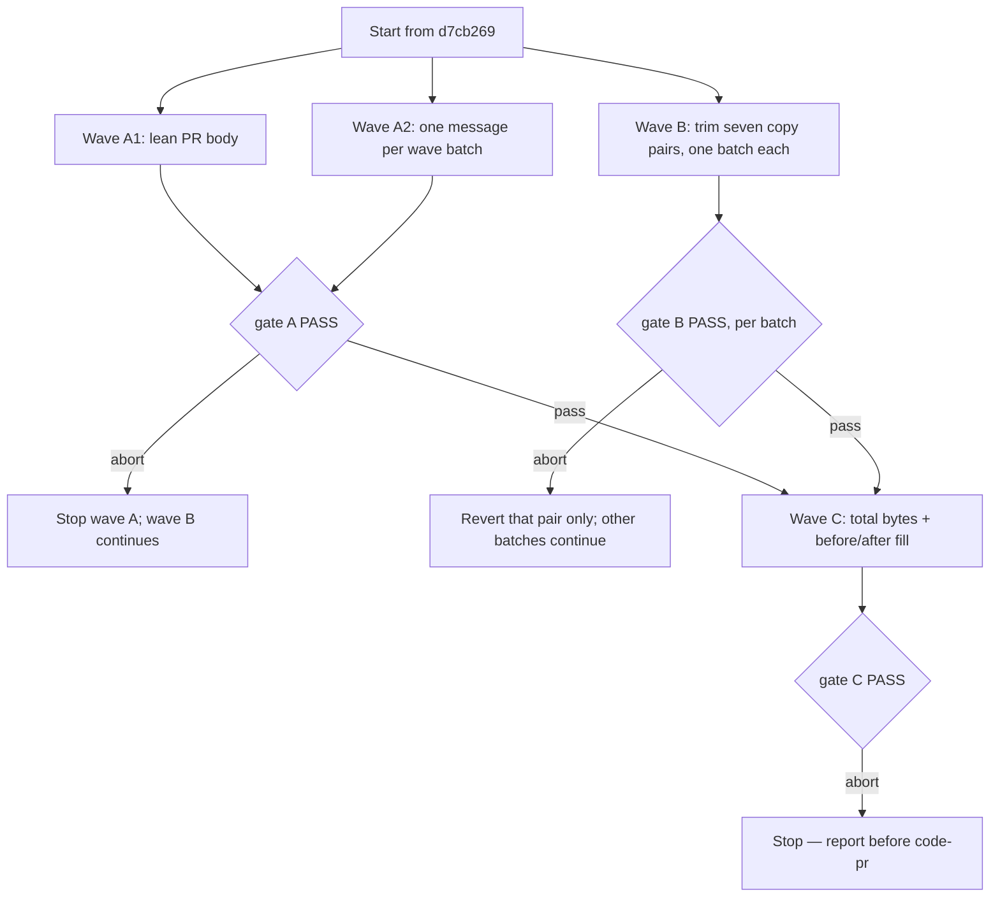

# Trim the shipped templates without cutting contract

**Source:** `docs/prds/templates-trim/templates-trim-prd.md` (status `stable`)
**Next:** After the Human approves → `code-plan` → `code-execute`. Waves
**A** and **B** are independent; wave **C** runs once both have passed.
**Named proof (this spec's own structural gate):** `proof-templates-trim-spec-obligations`

## Repository grounding

Every shared skill file lives in two byte-identical copies:
`templates/.agents/skills/<skill>/…` (shipped) and `.agents/skills/<skill>/…`
(this repo's own). `test/skill-copies.test.ts` fails on any difference. The
rule `qmd-first.md` has the same two copies under `templates/.agents/rules/`
and `.agents/rules/`, and no test compares them. Byte counts are from the
base commit `d7cb269`.

| Surface | Present today | Role for this initiative |
|---------|----------------|----------------------------|
| `code-pr/references/pr-body-template.md` (2,870 B) | yes | Rewritten to the lean shape (wave A) |
| `code-pr/SKILL.md` | yes | Hard gates 9, 10 and 12, the EXAMPLE section and the Pragmatic-guard line restate the body; rewritten with it (wave A) |
| `code-pr/references/pre-merge-closure.md` | yes | Keeps the closure steps; unchanged |
| `code-commit/SKILL.md`, `code-commit/references/commit-examples.md` | yes | Gain the wave-batch message rule and its good and bad example (wave A) |
| `code-spec/references/EXAMPLE.md` (5,232 B) | yes | Trimmed (wave B) |
| `code-plan/references/EXAMPLE-units.md` (4,857 B) | yes | Trimmed (wave B) |
| `harness-init/references/session-note-template.md` (5,702 B; fenced block 2,655 B) | yes | Trimmed outside the fenced block (wave B) |
| `code-spec/references/TEMPLATE.md` (4,385 B) | yes | Trimmed (wave B) |
| `code-execute/references/builder-brief.md` (2,773 B) | yes | Trimmed (wave B) |
| `harness-init/references/stub-template.md` (5,016 B) | yes | Trimmed (wave B); rendered verbatim into a consumer `SKILL.md` |
| `.agents/rules/qmd-first.md` (1,717 B) | yes | Trimmed (wave B); loaded on every run |
| `test/skill-code-pr.test.ts` | yes | Lines 80-101 and 140-154 pin the old body headings; rewritten to pin the new ones (wave A) |
| `test/skill-code-commit.test.ts` | yes | Gains pins for the wave-batch rule and examples (wave A); its `autocommit` ban on the skill body stays |
| `test/skill-code-spec.test.ts`, `test/skill-code-plan.test.ts`, `test/harness-init-note.test.ts`, `test/harness-init-stub.test.ts`, `test/skill-harness-init.test.ts`, `test/skill-code-execute.test.ts`, `test/seed-extract.test.ts`, `test/claims.test.ts`, `test/template-residue.test.ts` | yes | Pin headings, columns and phrases in the wave B files; read only, never edited by this initiative |
| `test/skill-copies.test.ts` | yes | Fails when the two skill copies differ |
| ADR-004 (`docs/adrs/adr-004-standalone-skills-contract.md`) | yes | Lists "the contents of template files" and "the set of skills and their text" as not contract, so no ADR is owed |

Term challenge:

| Term | Resolution |
|------|--------------|
| Wave batch | Reused from `code-commit/SKILL.md`: "a wave's units at a wave gate". A wave of one unit is not a wave batch for the new rule |
| Pinned | A heading, column, phrase or string a test under `test/` or code under `src/` matches |
| Copy pair | The `templates/.agents/…` and `.agents/…` copies of one file, always changed together |
| Baseline | The byte count of a file at `d7cb269`; the PRD's 32.5 KB total is 32,552 B exactly |

## Surface walk

- **In scope (owned paths, both copies each):**
  - Wave A1, PR body: `templates/.agents/skills/code-pr/references/pr-body-template.md`, `.agents/skills/code-pr/references/pr-body-template.md`, `templates/.agents/skills/code-pr/SKILL.md`, `.agents/skills/code-pr/SKILL.md`, `test/skill-code-pr.test.ts`
  - Wave A2, wave commit: `templates/.agents/skills/code-commit/SKILL.md`, `.agents/skills/code-commit/SKILL.md`, `templates/.agents/skills/code-commit/references/commit-examples.md`, `.agents/skills/code-commit/references/commit-examples.md`, `test/skill-code-commit.test.ts`
  - Wave B, one batch per copy pair:
    - `templates/.agents/skills/code-spec/references/EXAMPLE.md`, `.agents/skills/code-spec/references/EXAMPLE.md`
    - `templates/.agents/skills/code-plan/references/EXAMPLE-units.md`, `.agents/skills/code-plan/references/EXAMPLE-units.md`
    - `templates/.agents/skills/harness-init/references/session-note-template.md`, `.agents/skills/harness-init/references/session-note-template.md`
    - `templates/.agents/skills/code-spec/references/TEMPLATE.md`, `.agents/skills/code-spec/references/TEMPLATE.md`
    - `templates/.agents/skills/code-execute/references/builder-brief.md`, `.agents/skills/code-execute/references/builder-brief.md`
    - `templates/.agents/skills/harness-init/references/stub-template.md`, `.agents/skills/harness-init/references/stub-template.md`
    - `templates/.agents/rules/qmd-first.md`, `.agents/rules/qmd-first.md`
- **Out of mutate scope (unchanged):**
  - `src/**` — no CLI, `setup` or `validate` change
  - `package.json` — no dependency or script change
  - `code-pr/references/pre-merge-closure.md` and `code-pr/references/host-operations.md`
  - `code-execute/SKILL.md`, `harness-init/SKILL.md`, `code-ci/SKILL.md`, `code-review/SKILL.md`
  - The small templates (`adr-template`, `prd-template`, `TEMPLATE-plan`, `note-template`, `ticket-format`), `WOLVEN.md`, `docs/WRITING-PROFILE.md`
  - The vendor skills `prototype`, `the-fool`, `the-jury`, `handoff`
  - Every test file not listed under wave A

## Waves

Wave A changes pinned contract and updates its tests in the same batch. Wave
B changes no test. The two share no path, so neither waits on the other: a
failed gate in A stops A only, and a failed gate in B stops that file's
batch only. Wave C needs both.



The gate for every batch in A and B is
`pnpm test && pnpm build && node dist/cli.js validate && pnpm comments && pnpm lint`,
plus the batch's own proofs below.

## Requirements (obligation ↔ proof)

Byte checks read the baseline with `git show d7cb269:<path> | wc -c` and
the result with `wc -c < <path>`, on the `templates/` copy.

### R1 — Shorter templates, same contract (US-1, wave B)

| ID | Obligation | Named proof | Evidence shape |
|----|------------|--------------|------------------|
| R1.1 | Each wave B file shrinks by its budget against its baseline. "About N%" means N ± 5 points: `EXAMPLE.md` 25–35%, `EXAMPLE-units.md` 20–30%, `session-note-template.md` 15–20%, `TEMPLATE.md` 10–15%, `builder-brief.md` 5–15%, `stub-template.md` 0–10%, `qmd-first.md` 15–20% (AC-1.1) | `proof-templates-trim-file-budgets` | Command: per-file before/after bytes and percentage, each inside its band |
| R1.2 | The four repo gates pass after each file's batch (AC-1.2) | `proof-templates-trim-gates-green` | Command: the wave gate, exit 0 |
| R1.3 | Every `n/a` string in a wave B file at the baseline is still present after its trim, including `n/a — full tour` and `n/a — basics` (AC-1.2) | `proof-templates-trim-na-kept` | Command: per file, every line holding `n/a` at the baseline is still found by `grep -F` in the result |
| R1.4 | A wave B batch changes only its own copy pair: no `test/`, `src/` or other template file, so reverting the pair alone restores the baseline run (AC-1.3) | `proof-templates-trim-revert-alone` | Command: `git diff --name-only` for the batch lists exactly two paths |
| R1.5 | Both copies of every touched file stay byte-identical; for `qmd-first.md`, which no test compares, `cmp` is the check | `proof-templates-trim-copies-identical` | Command: `pnpm test` (`skill-copies`) and `cmp templates/.agents/rules/qmd-first.md .agents/rules/qmd-first.md` |
| R1.6 | The fenced ```` ```markdown ```` block in `session-note-template.md` is byte-identical to the baseline; only the prose around it is trimmed | `proof-templates-trim-note-fence` | Command: extract the fenced block from baseline and result, `diff` is empty |
| R1.7 | `qmd-first.md` keeps its two unpinned rules: `qmd get` returns the stored body, so read the file before treating it as the decision; and when index and file disagree, name neither number as the limit to use | `proof-templates-trim-qmd-rules` | Inspect the trimmed rule; `grep -c` finds both rules |

### R2 — Agents still learn the shape (US-2, wave B)

| ID | Obligation | Named proof | Evidence shape |
|----|------------|--------------|------------------|
| R2.1 | `EXAMPLE.md` still holds the `## Obligation ↔ proof` table with acceptance boxes, one `n/a` landing that cites an unchanged surface, one Unresolved row with an empty Disposition, and the Waves `mermaid` diagram (AC-2.1) | `proof-templates-trim-spec-example-kinds` | Command: `grep` for `## Obligation ↔ proof`, `- [ ]`, `` `n/a` `` with `Unchanged surface`, `empty until`, ```` ```mermaid ```` |
| R2.2 | `EXAMPLE-units.md` still holds the work-units table with `spawn` and `inline` cells, a `STOP` row, an Unresolved table whose Disposition reads "empty until decided", and one bad re-slice example (AC-2.1) | `proof-templates-trim-plan-example-kinds` | Command: `pnpm test` (`skill-code-plan`) plus `grep` for `` `spawn` ``, `` `inline` ``, `(bad — re-slice)` |
| R2.3 | A rule a wave B file states in two places keeps one copy: the copy a test pins when one is pinned, and the restatement goes (AC-2.2) | `proof-templates-trim-single-copy` | Inspect the batch diff: each removed restatement is listed with the kept copy's heading |
| R2.4 | A wave B batch that loses an R2.1 or R2.2 row kind is not accepted until the kind is restored (AC-2.3) | `proof-templates-trim-kind-restore` | Gate B aborts on an R2.1 or R2.2 miss; the batch reruns green |

### R3 — A lean PR body (US-3, wave A1)

| ID | Obligation | Named proof | Evidence shape |
|----|------------|--------------|------------------|
| R3.1 | The fenced body in `pr-body-template.md` has exactly three headings, `## Summary`, `## Verification` and `## Before merge`. Summary holds two or three lines and the bullets `**What:**`, `**Why:**` and `**How:**`. No Agent/Model line, Overview, Changes Made, Checklist or Risk & Reviewer Notes, and no instruction to re-list acceptance criteria (AC-3.1) | `proof-templates-trim-pr-shape` | Test in `test/skill-code-pr.test.ts` |
| R3.2 | The template states each What, Why and How bullet is at most 140 characters; Verification holds one to three bullets, each naming a command; a `Task:` line (spec, plan or ticket reference) appears only when one exists, and a `Risk:` line only when the risk is Medium or High, both at the end of Summary; no empty placeholder is left (AC-3.2) | `proof-templates-trim-pr-caps` | Test pins the caps and the two conditional lines |
| R3.3 | Before merge holds `- [ ] Manual test` and `- [ ] CI green`, plus `- [ ] Pre-merge closure` only when the diff adds or changes files under `docs/specs`, `docs/prds` or `docs/adrs`, linking `pre-merge-closure.md`. The four-box closure block is gone. The checkbox reset rule stays: every box starts as `[ ]` and is ticked only from this session's evidence (AC-3.3) | `proof-templates-trim-pr-before-merge` | Test pins the three boxes, the three folders and `checkbox reset`, and that the four closure items are absent |
| R3.4 | `N/A` with a stated reason stays valid for a docs-only change with no gate to run, and any gate that ran is named with its command; the template's docs-only scenario says the same (AC-3.4) | `proof-templates-trim-pr-evidence` | Existing test `N\/A.{0,60}docs-only` on the skill body, plus a pin on the template's docs-only scenario |
| R3.5 | `code-pr/SKILL.md` restates only the new shape: hard gates 9, 10 and 12 and the Pragmatic-guard line name Summary, Verification and Before merge, never Overview, Checklist or Verification & Testing. Gate 11's phrase "needed only to claim merge-ready or to tick a closure checkbox" stays. Template, skill and test change in one batch, both copies (AC-3.5) | `proof-templates-trim-pr-agree` | Test: no old heading is required, and the skill body matches none of them |
| R3.6 | The SKILL.md EXAMPLE becomes `## EXAMPLE — filled body`: one feature PR body in the new shape, with Before merge boxes ticked after the reset, at most 25 lines inside its fence, What/Why/How bullets of at most 140 characters, and one to three Verification bullets that name `harness:validate` (PRD goal: about 20 lines, at most 25) | `proof-templates-trim-pr-length` | Test counts the fenced lines and bullet lengths of the EXAMPLE |

### R4 — One lean message per wave batch (US-4, wave A2)

| ID | Obligation | Named proof | Evidence shape |
|----|------------|--------------|------------------|
| R4.1 | `code-commit/SKILL.md` states that a wave batch of more than one unit gets one Conventional Commit: a subject that states the batch's outcome and a body of at most three lines, with no per-unit subjects joined (AC-4.1) | `proof-templates-trim-wave-message-rule` | Test pins the rule's wording in the skill body |
| R4.2 | The rule is scoped to a multi-unit wave batch: a one-unit wave and a standalone commit keep the existing message rules, get no invented batch summary and no three-line cap, and the split for unrelated contexts stays. The body still never says `autocommit` (AC-4.2) | `proof-templates-trim-wave-scope` | Test: the rule names the wave batch; `## Multi-commit heuristics` and the existing `autocommit` ban still pass |
| R4.3 | The `## Atomic commit gate` section is unchanged: the work and only that batch's plan-completion marks land in one commit (AC-4.3) | `proof-templates-trim-plan-mark-unchanged` | Command: the section's text equals the baseline; existing atomic plan-mark test passes |
| R4.4 | `commit-examples.md` holds one good wave message under `## Good` and one bad concatenated message under `## Bad examples`; the good one has one subject and a body of at most three lines, the bad one joins two or more `type(scope):` subjects; the test pins both (AC-4.4) | `proof-templates-trim-wave-examples` | Test in `test/skill-code-commit.test.ts` |

### R5 — Total and output shape (wave C)

| ID | Obligation | Named proof | Evidence shape |
|----|------------|--------------|------------------|
| R5.1 | The eight files (the seven wave B files plus `pr-body-template.md`) shrink in total by 4,883–6,510 B, 15–20% of 32,552 B (AC-1.1) | `proof-templates-trim-total-budget` | Command: summed before/after bytes and percentage |
| R5.2 | One spec and one plan filled from the same short ask against the baseline skills and again against the trimmed skills keep the same headings, table header rows and `n/a` reasons (PRD goal "Agent output keeps its shape") | `proof-templates-trim-fill-compare` | Command: `diff` of the two fills' heading lines, table header rows and `n/a` lines is empty, or each difference is listed and accepted by the Human; the fills live in a scratch folder, not the repo |

## Nine-dimension landings

| Dimension | Landing kind | Landing |
|-----------|---------------|---------|
| validation | obligation ↔ proof | R1.2 / `proof-templates-trim-gates-green` and R3.5 / `proof-templates-trim-pr-agree` — the repo gates, and tests that pin the new PR shape |
| failure modes | obligation ↔ proof | R1.4 / `proof-templates-trim-revert-alone` — a red batch reverts its copy pair alone; R2.4 / `proof-templates-trim-kind-restore` — a lost row kind aborts the batch. A per-file budget that a pin blocks stops that batch and is reported with the pin named, never met by cutting pinned text |
| idempotency and retry | obligation ↔ proof | R1.1 / `proof-templates-trim-file-budgets` — budgets measure against `d7cb269`, not the current tree, so a retried trim does not compound. If a wave B file changed on `main` since `d7cb269`, that batch stops and reports before trimming |
| authorization | `n/a` | Unchanged surface: `code-pr` keeps `disable-model-invocation: true` and its ask-only rule; `src/**` adds no permission check |
| concurrency and ordering | obligation ↔ proof | R1.5 / `proof-templates-trim-copies-identical` — both copies change in one batch. Waves A and B share no path and run in either order; wave C runs after both |
| data lifecycle | obligation ↔ proof | R3.3 / `proof-templates-trim-pr-before-merge` — the closure checklist leaves the body and its steps stay in the unchanged `pre-merge-closure.md`. Consumer repos keep their copies: `setup` creates only missing paths (`src/setup/**`, unchanged) |
| external-dependency failure | `n/a` | Unchanged surface: `package.json` adds no dependency; the host renders the PR body as Markdown, as today |
| state transitions | obligation ↔ proof | R3.3 — each Before merge box goes `[ ]` → `[x]` only on this session's evidence; R4.3 / `proof-templates-trim-plan-mark-unchanged` — the plan mark still flips in the same commit as its work |
| observability | obligation ↔ proof | R5.1 / `proof-templates-trim-total-budget` — per-file and total bytes are printed before and after; R5.2 / `proof-templates-trim-fill-compare` — the fill diff is printed |

## Unresolved

| Identifier | Decision needed | Owner | Blocking effect | Disposition |
|------------|-------------------|-------|-------------------|--------------|
| `U-trim-depth` | Is 15–20% enough for the non-PR templates, or is a deeper cut with more risk wanted? | Human (maintainer) | Non-blocking: waves B and C run on the PRD's 15–20% | *(empty until the Human decides)* |
| `U-output-quality` | Does a trimmed example make agent output worse where no test would notice? | Human (maintainer) | Non-blocking for A and B; R5.2 is the check, and a difference the Human does not accept blocks wave C | *(empty until the Human decides)* |
| `U-skill-trim-prd` | Does the `harness-init` and `code-execute` `SKILL.md` trim (about 12 KB each) become its own PRD? | Human (maintainer) | Non-blocking: out of this spec's scope | Defer: a later PRD, the PRD's default taken |

## Out of scope

- Trimming any `SKILL.md` other than `code-commit` and `code-pr`.
- The small templates, `WOLVEN.md`, `docs/WRITING-PROFILE.md`, and the vendor skills.
- Omitting empty sections from any template other than the PR body.
- Changing `pre-merge-closure.md`, `code-ci` or `code-review`.
- New tests for the wave B files: their row kinds are checked by the R2 commands at the gate.

## Pragmatic-guard refuses

- HTML-comment guidance inside any template, the PR body included: `pr-body-template.md` and `stub-template.md` are consumed verbatim, so guidance stays as prose outside the fence.
- A script, `package.json` command or `src/` code for byte counting; the gate runs `wc -c` and `git show`.
- Restructuring a file to reach its budget: removing or renaming a pinned heading, column or phrase.
- A wave-message rule in `code-execute/SKILL.md`; the rule lives in `code-commit` only.

## Acceptance

### Wave A1 — PR body

- [ ] `proof-templates-trim-pr-shape` PASS (R3.1)
- [ ] `proof-templates-trim-pr-caps` PASS (R3.2)
- [ ] `proof-templates-trim-pr-before-merge` PASS (R3.3)
- [ ] `proof-templates-trim-pr-evidence` PASS (R3.4)
- [ ] `proof-templates-trim-pr-agree` PASS (R3.5)
- [ ] `proof-templates-trim-pr-length` PASS (R3.6)

### Wave A2 — wave commit

- [ ] `proof-templates-trim-wave-message-rule` PASS (R4.1)
- [ ] `proof-templates-trim-wave-scope` PASS (R4.2)
- [ ] `proof-templates-trim-plan-mark-unchanged` PASS (R4.3)
- [ ] `proof-templates-trim-wave-examples` PASS (R4.4)

### Wave B — trim, per copy pair

- [ ] `proof-templates-trim-file-budgets` PASS for all seven files (R1.1)
- [ ] `proof-templates-trim-gates-green` PASS after each batch (R1.2)
- [ ] `proof-templates-trim-na-kept` PASS (R1.3)
- [ ] `proof-templates-trim-revert-alone` PASS for each batch (R1.4)
- [ ] `proof-templates-trim-copies-identical` PASS (R1.5)
- [ ] `proof-templates-trim-note-fence` PASS (R1.6)
- [ ] `proof-templates-trim-qmd-rules` PASS (R1.7)
- [ ] `proof-templates-trim-spec-example-kinds` PASS (R2.1)
- [ ] `proof-templates-trim-plan-example-kinds` PASS (R2.2)
- [ ] `proof-templates-trim-single-copy` PASS (R2.3)
- [ ] `proof-templates-trim-kind-restore` PASS (R2.4)

### Wave C — total and shape

- [ ] `proof-templates-trim-total-budget` PASS (R5.1)
- [ ] `proof-templates-trim-fill-compare` PASS (R5.2)

## Eval / gates

| Gate | Command / check | When | PASS | Abort |
|------|-------------------|------|------|-------|
| Integrity | `pnpm build && node dist/cli.js validate` | End of every batch | exit 0 | Fix; do not proceed |
| Tests | `pnpm test` | End of every batch | exit 0 | Wave A: fix in the batch. Wave B: revert that pair |
| Comments | `pnpm comments` | End of every wave A batch (wave B adds no comment under `src/`, `test/` or `renderer/`) | exit 0 | Fix the added test comments |
| Lint | `pnpm lint` | End of every batch | exit 0 | Fix with Biome |
| Copies | `pnpm test` (`skill-copies`) and `cmp` on the `qmd-first.md` pair | End of every batch | identical | Re-copy the `templates/` file |
| Row kinds | R2.1 and R2.2 `grep` commands | End of the `EXAMPLE.md` and `EXAMPLE-units.md` batches | every kind found | Restore the kind |
| Budgets | R1.1 per file; R5.1 total | Each wave B batch; wave C | inside the band | Stop and report the shortfall or overshoot |
| Fill compare | R5.2 `diff` | Wave C | empty, or each difference accepted by the Human | Stop before `code-pr` |
| Spec obligations | `proof-templates-trim-spec-obligations` — every acceptance box pairs with one R row and one proof; all nine landings; each `n/a` cites an unchanged surface | Before `code-plan` | all hold | Do not plan |

## Cross-domain leak table

| Leak | Refuse |
|------|--------|
| Trimming `harness-init/SKILL.md` or `code-execute/SKILL.md` | A later PRD (`U-skill-trim-prd`) |
| Making existing consumer repos pick up the new templates | Not this lane: `setup` never overwrites, and the deferral `setup-drift-check` holds that question |
| Rewording `pre-merge-closure.md` for a single closure box | Not in the PRD's scope |
| An executable plan from this skill | `code-plan` only |

## ADR

None needed this initiative. ADR-004 lists the contents of template files
and the skills' text as not contract, so the new PR body and commit-message
rule change no decision on record.

## Section checklist

| Section | Required when | Present |
|---------|-----------------|---------|
| Source | Always | yes |
| Repository grounding | Always | yes |
| Surface walk | Always | yes |
| Waves | The work spans more than one mutate batch | yes |
| Requirements with obligation ↔ proof | Always | yes |
| Nine-dimension landings | Always — all nine named | yes |
| Unresolved | Always | yes |
| Out of scope | Always | yes |
| Pragmatic-guard refuses | Always | yes |
| Acceptance | Always | yes |
| Eval / gates | Always | yes |
| Cross-domain leak table | Always | yes |
| ADR | Always | yes |
