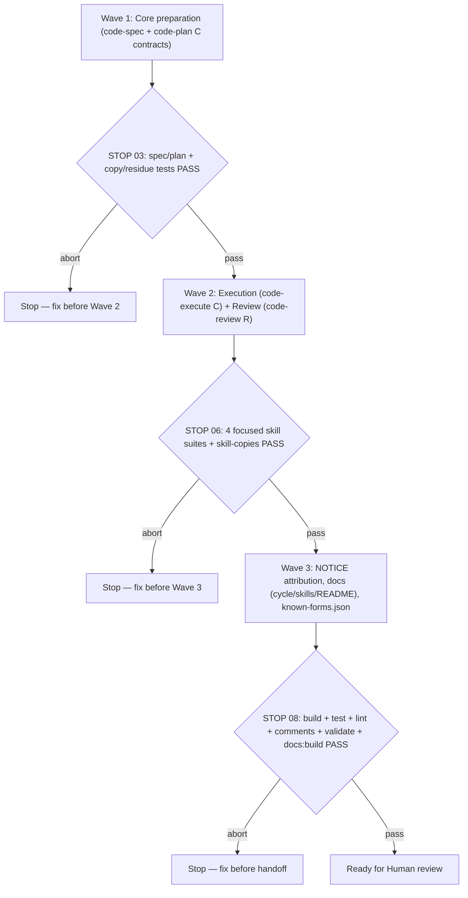

# TLC workflow integration (C + R) for code skills

**Source:** Confirmed ask from the 2026-11-03 grilling closeout on `docs/notes/tlc-workflow-integration/tlc-workflow-integration-note.md` and `docs/notes/tlc-workflow-jury/tlc-workflow-jury-note.md`: *"Confirmed — draft the C + R spec at docs/specs/tlc-workflow-integration/tlc-workflow-integration-spec.md"* (adopting C + R permanently, refusing Option B's script runtime and synthetic trial).
**Next:** After the Human approves → `code-plan` → `code-execute`, wave **1 → 2 → 3**.
**Named proof (this spec's own structural gate):** `proof-tlc-workflow-integration-spec-obligations`

## Term challenge

| Term | Resolution |
|------|------------|
| **Option C (contract-first intermediate)** | Strengthens `code-spec`, `code-plan`, and `code-execute` with source/capture authority, revision-bound approvals, criterion/test/passing-output tables, pre-edit baseline checks, manual evidence freshness, author assertion inspection, and risk-triggered independent adequacy, without adding skill-local `.mjs` runner scripts or an inline JSON proof manifest. |
| **Subset R (selected Judge review practices)** | Strengthens `code-review` with deterministic checks first, official-source grounding for external-behavior claims, verified candidates, a five-inline-nit cap, stable finding IDs across rounds (allowing late material findings), and reviewed-head recheck before posting, while remaining independently usable without core workflow mutations. |
| **Binding capture vs. inspiration** | A visual screenshot or capture supplied as an implementation reference is binding unless labeled inspiration; explicit departures require Human approval in the spec. |
| **Risk-triggered independent adequacy** | A fresh read-only review pass required when any in-scope obligation touches money/payment state, identity/authorization/secrets, persistent-data deletion/retention/migration/irreversible writes, concurrency/retry/idempotency/cross-process ordering, or external-service request/response/failure contracts. |
| **Author-reviewed adequacy** | Routine closeout where the author inspects each selected test and records expected outcome, assertion, and the plausible wrong implementation it catches; never labeled `independent`. |
| **Degraded assurance** | Explicit state recorded when a triggered independent review or binding browser capture cannot run in the current runtime; requires explicit Human acceptance to close, retaining the limitation in the plan's inline record. |

## Repository grounding

| Surface | Present today | Role for this initiative |
|---------|---------------|--------------------------|
| `.agents/skills/code-spec/**` and `templates/.agents/skills/code-spec/**` | yes | Add source/capture inventory, approved departures, revision-bound approval record, observable criterion/proof identity, five-trigger risk classification in nine dimensions, high-risk tiny-work guard, optional workflow revision marker, and `NOTICE` |
| `.agents/skills/code-plan/**` and `templates/.agents/skills/code-plan/**` | yes | Add criterion/test/group/expected-passing-line evidence table, test placement, approval bound to spec revision, explicit verification disposition (`independent` vs. `author-reviewed`), grandfathering rule, and `NOTICE` |
| `.agents/skills/code-execute/**` and `templates/.agents/skills/code-execute/**` | yes | Add pre-edit baseline gate, manual evidence freshness procedure, author assertion self-check, risk-triggered independent adequacy (`references/verification-brief.md`), capture/gesture separation (`references/capture-review.md`), explicit Human acceptance for degraded assurance, high-risk tiny-work guard, and `NOTICE` |
| `.agents/skills/code-review/**` and `templates/.agents/skills/code-review/**` | yes | Add subset R (available checks first, scoped official-source research log, verified candidates, five-inline-nit cap, stable finding IDs in `references/review-record.md`, late material findings, reviewed-head recheck, standalone R usability) and `NOTICE` |
| `test/skill-code-spec.test.ts`, `test/skill-code-plan.test.ts`, `test/skill-code-execute.test.ts`, `test/skill-code-review.test.ts` | yes | Extend focused contract suites with C + R obligation proofs while preserving existing guarantees |
| `test/skill-copies.test.ts`, `test/template-residue.test.ts`, `test/known-forms.test.ts` | yes | Enforce byte-identical `.agents/skills/` and `templates/.agents/skills/` trees, no concrete ADR tokens in guarded templates, and synchronized `known-forms.json` |
| `site/cycle.md`, `site/skills.md`, `README.md`, `known-forms.json` | yes | Update user-facing workflow, tiny-work caveat, upgrade guidance, and template hashes (`pnpm gen:known-forms`) |
| `src/cli.ts`, `src/setup/**`, `src/skills/**`, `src/doctor/**`, `src/validate/**`, `src/comments/**` | yes | Unchanged runtime/CLI implementation (`ADR-006`) |

## Surface walk

- **In scope:**
  - `.agents/skills/code-spec/{SKILL.md,NOTICE,references/TEMPLATE.md,references/EXAMPLE.md}` and matching `templates/.agents/skills/code-spec/**`
  - `.agents/skills/code-plan/{SKILL.md,NOTICE,references/TEMPLATE-plan.md,references/EXAMPLE-units.md}` and matching `templates/.agents/skills/code-plan/**`
  - `.agents/skills/code-execute/{SKILL.md,NOTICE,references/builder-brief.md,references/verification-brief.md,references/capture-review.md}` and matching `templates/.agents/skills/code-execute/**`
  - `.agents/skills/code-review/{SKILL.md,NOTICE,references/review-criteria.md,references/review-record.md}` and matching `templates/.agents/skills/code-review/**`
  - `test/skill-code-spec.test.ts`, `test/skill-code-plan.test.ts`, `test/skill-code-execute.test.ts`, `test/skill-code-review.test.ts`
  - `site/cycle.md`, `site/skills.md`, `README.md`, and `known-forms.json` (via `pnpm gen:known-forms`)
  - `docs/specs/tlc-workflow-integration/tlc-workflow-integration-spec.md` and `docs/specs/tlc-workflow-integration/tlc-workflow-integration-plan.md`
- **Out of mutate scope (unchanged):**
  - All CLI/TypeScript runtime files under `src/**` and `package.json` dependencies/scripts (`ADR-006`)
  - `.agents/skills/code-pr/references/host-operations.md` and other non-target skills
  - `.agents/code-commit.config.yml` cadence schema and defaults
  - `site/layout.md`, `site/commands.md`, `site/install.md`, and `site/runtimes.md`

## Waves

- **Wave 1 gate:** `pnpm exec tsx --test test/skill-code-spec.test.ts test/skill-code-plan.test.ts test/skill-copies.test.ts test/template-residue.test.ts` passes (`exit 0`). A failed gate aborts before Wave 2.
- **Wave 2 gate:** `pnpm exec tsx --test test/skill-code-spec.test.ts test/skill-code-plan.test.ts test/skill-code-execute.test.ts test/skill-code-review.test.ts test/skill-copies.test.ts test/template-residue.test.ts` passes (`exit 0`). A failed gate aborts before Wave 3.
- **Wave 3 gate:** `pnpm gen:known-forms && pnpm build && pnpm test && pnpm lint && pnpm comments && pnpm validate && pnpm docs:build` passes (`exit 0`). A failed gate aborts before completion.

## Requirements (obligation ↔ proof)

### R1 — `code-spec` C contract (`test/skill-code-spec.test.ts`)

| ID | Obligation | Named proof | Evidence shape |
|----|------------|-------------|----------------|
| R1.1 | `code-spec` (`SKILL.md`, `references/TEMPLATE.md`, `references/EXAMPLE.md`) records source authority, binding capture vs. inspiration inventory, approved departures, revision-bound Human approval (words, date, artifact revision), and an optional workflow revision marker that grandfathers earlier specs/plans | `proof-tlc-spec-sources-and-approval` | `pnpm exec tsx --test test/skill-code-spec.test.ts` asserts sections/fields in skill, template, and example, and `renderInto` still passes `validate` |
| R1.2 | `code-spec` classifies C's five independent-review risk triggers in the nine dimensions (money/payment state; identity/authorization/secrets; persistent-data deletion/retention/migration/irreversible writes; concurrency/retry/idempotency/cross-process ordering; external-service request/response/failure contracts), treats `unknown` as a typed blocker under `Unresolved`, and forbids bypassing `code-spec` via the one-file tiny-work shortcut when any of the five triggers applies | `proof-tlc-spec-risk-triggers-and-tiny-guard` | `pnpm exec tsx --test test/skill-code-spec.test.ts` asserts all five triggers, `unknown` blocker rule, and the high-risk one-file guard |

### R2 — `code-plan` C contract (`test/skill-code-plan.test.ts`)

| ID | Obligation | Named proof | Evidence shape |
|----|------------|-------------|----------------|
| R2.1 | `code-plan` (`SKILL.md`, `references/TEMPLATE-plan.md`, `references/EXAMPLE-units.md`) maps obligations/proofs to concrete test paths/names, grouped project test commands, expected passing output lines, and unit-local test placement while keeping the six-column vertical work-units table (`#`, `Unit`, `Depends`, `Owns`, `Subagent`, `Done when`) | `proof-tlc-plan-evidence-table` | `pnpm exec tsx --test test/skill-code-plan.test.ts` parses the evidence table and six-column unit table in template/example and verifies `renderInto` passes `validate` |
| R2.2 | `code-plan` records approval bound to the locked spec revision, states the explicit verification disposition (`independent` when triggered vs. `author-reviewed` when routine), preserves grandfathering of existing approved plans without retrofitting fields, and keeps standalone review (`A + R`) independent of core preparation stops | `proof-tlc-plan-approval-and-disposition` | `pnpm exec tsx --test test/skill-code-plan.test.ts` asserts spec-revision approval binding, verification disposition values, grandfathering rule, and review-only gate independence |

### R3 — `code-execute` C contract (`test/skill-code-execute.test.ts`)

| ID | Obligation | Named proof | Evidence shape |
|----|------------|-------------|----------------|
| R3.1 | `code-execute` (`SKILL.md`, `references/builder-brief.md`) runs declared build/baseline checks before feature mutation, stops affected mutation on a red baseline until explicit disposition (never silently fixing unrelated scope or relabeling failure as a pass), and enforces the manual evidence freshness procedure (recording `HEAD` SHA plus relevant tracked, untracked, generated, and ignored inputs before and after proof runs, invalidating affected evidence if inputs change afterward, without claiming an automated digest gate) | `proof-tlc-execute-baseline-and-freshness` | `pnpm exec tsx --test test/skill-code-execute.test.ts` asserts pre-edit baseline stop/disposition rules, manual before/after input identity procedure, and preservation of the seven mandatory resume fields and commit cadence |
| R3.2 | `code-execute` replaces the blanket independent-verifier refusal with C's two-path adequacy policy: routine work requires author assertion inspection (recording expected outcome, assertion, and plausible wrong implementation caught, labeled `author-reviewed`, never `independent`); triggered work dispatches a fresh read-only reviewer via `references/verification-brief.md` (checking assertions and two spec-grounded boundary probes, with one consolidated repair and rereview pass); binding captures follow `references/capture-review.md` (separating visual screenshots at capture viewport from behavioral gesture proofs); high-risk one-file changes cannot bypass triggered review; and unavailable mandatory independent/browser review requires explicit Human acceptance to close as `degraded` with the limitation retained | `proof-tlc-execute-adequacy-and-captures` | `pnpm exec tsx --test test/skill-code-execute.test.ts` asserts `references/verification-brief.md`, `references/capture-review.md`, `author-reviewed` vs. triggered `independent` rules, one-file high-risk guard, and explicit Human acceptance for degraded assurance |

### R4 — `code-review` subset R (`test/skill-code-review.test.ts`)

| ID | Obligation | Named proof | Evidence shape |
|----|------------|-------------|----------------|
| R4.1 | `code-review` (`SKILL.md`, `references/review-criteria.md`, `references/review-record.md`) runs available repository checks first (recording exact outcomes and unavailable checks without equating unavailable to pass), inventories touched external surfaces and grounds external-behavior findings in official sources fetched during review (stating zero surfaces when none exist), verifies candidates against current code/refs, and caps inline nits at five (reporting overflow in the summary) | `proof-tlc-review-checks-research-and-nit-cap` | `pnpm exec tsx --test test/skill-code-review.test.ts` asserts check-first ordering, official-source research rule, candidate verification, and five-inline-nit cap |
| R4.2 | `code-review` maintains a stable finding ledger (`references/review-record.md`) across rounds (tracking prior findings as `fixed`, `open`, or `accepted` with evidence, and reporting late material defects plainly rather than forfeiting them), re-checks the reviewed `HEAD` SHA before posting (refreshing grounding/anchors if moved and stating non-atomic host limits), and preserves ask-only invocation, `Blocking`/`Nit` labels, three verdicts, host-operations routing, and never-merge boundaries | `proof-tlc-review-ledger-and-head-recheck` | `pnpm exec tsx --test test/skill-code-review.test.ts` asserts `references/review-record.md`, ledger states, late-finding rule, reviewed-head recheck + non-atomic limit, and existing hard gates |

### R5 — Attribution, synchronized trees, documentation, and `known-forms.json`

| ID | Obligation | Named proof | Evidence shape |
|----|------------|-------------|----------------|
| R5.1 | Every modified skill folder (`code-spec`, `code-plan`, `code-execute`, `code-review`) ships a `NOTICE` file in both `.agents/skills/<skill>/` and `templates/.agents/skills/<skill>/` crediting Felipe Rodrigues / Tech Leads Club (`tlc-spec-driven` 4.1.0 / `the-judge` 1.4.0 at commit `1da2195067c14ae5d44dc615b31cb26f50ebeb91`), linking CC-BY-4.0, and stating Wolven modifications; both skill trees remain byte-identical and free of concrete ADR tokens in guarded templates | `proof-tlc-attribution-and-sync` | `pnpm exec tsx --test test/skill-copies.test.ts test/template-residue.test.ts` and focused assertions in `test/skill-code-*.test.ts` verify `NOTICE` presence/contents and tree parity |
| R5.2 | `site/cycle.md`, `site/skills.md`, and `README.md` reflect the C + R workflow (including the high-risk exception to the one-file shortcut and coherent upgrade/rollback guidance via `wolven-harness doctor` / `harness-doctor` or manual core-folder replacement with backup), `known-forms.json` is regenerated via `pnpm gen:known-forms`, and the full repository gate (`pnpm build && pnpm test && pnpm lint && pnpm comments && pnpm validate && pnpm docs:build`) passes | `proof-tlc-docs-and-known-forms` | `pnpm gen:known-forms && pnpm build && pnpm test && pnpm lint && pnpm comments && pnpm validate && pnpm docs:build` exits `0` |

## Nine-dimension landings

| Dimension | Landing kind | Landing |
|-----------|--------------|---------|
| validation | obligation ↔ proof | R1.1 (`proof-tlc-spec-sources-and-approval`), R2.1 (`proof-tlc-plan-evidence-table`), and R5.2 (`proof-tlc-docs-and-known-forms`) — rendered templates, skill frontmatter, links, and `known-forms.json` pass `wolven-harness validate` and full suite |
| failure modes | obligation ↔ proof | R3.1 (`proof-tlc-execute-baseline-and-freshness`) and R4.1 (`proof-tlc-review-checks-research-and-nit-cap`) — red pre-edit baseline stops affected mutation until explicit disposition; unavailable checks or review tools remain visible and are never relabeled as passes |
| idempotency and retry | obligation ↔ proof | R3.2 (`proof-tlc-execute-adequacy-and-captures`) and R4.2 (`proof-tlc-review-ledger-and-head-recheck`) — adequacy review allows one consolidated repair and rereview pass before escalating; review ledger tracks stable finding IDs across rounds and re-fetches `HEAD` before posting |
| authorization | obligation ↔ proof | R1.1 (`proof-tlc-spec-sources-and-approval`), R1.2 (`proof-tlc-spec-risk-triggers-and-tiny-guard`), and R3.2 (`proof-tlc-execute-adequacy-and-captures`) — revision-bound Human approval for specs/plans/departures, explicit Human acceptance required to close unavailable mandatory review/capture as degraded, and preserved opt-in commit/remote boundaries |
| concurrency and ordering | obligation ↔ proof | R2.2 (`proof-tlc-plan-approval-and-disposition`), R3.1 (`proof-tlc-execute-baseline-and-freshness`), and R4.2 (`proof-tlc-review-ledger-and-head-recheck`) — wave stops and disjoint `Owns` remain enforced; manual before/after input identity detects concurrent/post-run worktree edits; reviewed-head recheck narrows stale review races while disclosing non-atomic host limits |
| data lifecycle | obligation ↔ proof | R2.2 (`proof-tlc-plan-approval-and-disposition`) and R3.1 (`proof-tlc-execute-baseline-and-freshness`) — all execution, freshness, dispatch, and adequacy state stays inline in `docs/specs/<slug>/<slug>-plan.md` with no sidecar `.specs/` directory or lessons database; existing approved plans are grandfathered |
| external-dependency failure | obligation ↔ proof | R3.2 (`proof-tlc-execute-adequacy-and-captures`) and R4.1 (`proof-tlc-review-checks-research-and-nit-cap`) — unavailable subagent dispatch or browser capture degrades explicitly and requires Human acceptance when mandatory; missing `code-pr`, `code-spec`, `code-plan`, or `pragmatic-guard` preserves existing explicit stop/fallback rules |
| state transitions | obligation ↔ proof | R1.1 (`proof-tlc-spec-sources-and-approval`), R2.2 (`proof-tlc-plan-approval-and-disposition`), and R3.1 (`proof-tlc-execute-baseline-and-freshness`) — `draft` → `stable` requires explicit revision-bound Human word; units transition from pending → verified (uncommitted at `autocommit: false`) → committed (`[x]` mark coupled with commit) |
| observability | obligation ↔ proof | R3.2 (`proof-tlc-execute-adequacy-and-captures`) and R4.2 (`proof-tlc-review-ledger-and-head-recheck`) — inline plan tables record `author-reviewed` vs. `independent` vs. `degraded` status, before/after input identity, and capture review outcomes; `references/review-record.md` records check outcomes, official sources, and finding ledger |

## Unresolved

| Identifier | Decision needed | Owner | Blocking effect | Disposition |
|------------|-----------------|-------|-----------------|-------------|
| *(none — all material choices settled in the 2026-11-03 grilling session)* | | | | |

## Out of scope

- Installing `tlc-spec-lean` or adding a fourth mandatory planning artifact (`design.md` / `checks.md` / `.specs/` state directory)
- Modifying CLI commands, flags, exit codes, finding codes, or installer replacement rules under `src/**` (`ADR-006`)
- Adding runtime npm dependencies to `package.json`
- Changing `.agents/code-commit.config.yml` defaults (`autocommit: false`, `autocommit-rule: wave`) or auto-chaining `code-pr`, `code-review`, or `code-ci`
- Importing The Judge's Python review gate, GitHub-only posting script, six-pass ceremony, 1,000-line file blocker, or universal security exclusions

## Pragmatic-guard refuses

| Field | Value |
|-------|-------|
| Need | 2/10 — C + R's explicit tables, pre-edit baseline, manual freshness procedure, and risk-triggered independent review address the identified contract gaps without a custom script runtime |
| Complexity | 8/10 — Option B requires four skill-local `.mjs` scripts (`check-spec.mjs`, `check-plan.mjs`, `check-proofs.mjs`, `check-completion.mjs`), a versioned inline JSON proof manifest parser, cross-platform command/count adapters, worktree digest exclusion logic, and a dedicated gate test suite |
| Verdict | **Refuse** Option B's script runtime, inline JSON proof manifest, universal non-tiny independent verifier, and synthetic Unit 09 trial |
| Simpler path | Ship **C + R** directly as markdown skill contracts, reference templates, focused contract tests, attribution notices, and updated documentation |
| Deferral | None — C + R is adopted permanently; reopen deterministic runner tooling only if real post-adoption defects demonstrate manual C tables are insufficient |

## Acceptance

### Wave 1

- [ ] R1.1 (`proof-tlc-spec-sources-and-approval`) PASS — `code-spec` documents source authority, binding captures vs. inspiration, approved departures, revision-bound approval, and optional workflow revision marker
- [ ] R1.2 (`proof-tlc-spec-risk-triggers-and-tiny-guard`) PASS — `code-spec` lands the five independent-review risk triggers, `unknown` blocker rule, and high-risk one-file tiny-work guard
- [ ] R2.1 (`proof-tlc-plan-evidence-table`) PASS — `code-plan` lands the criterion/test/group/passing-output evidence table and unit-local test placement alongside the six-column work-unit table
- [ ] R2.2 (`proof-tlc-plan-approval-and-disposition`) PASS — `code-plan` lands spec-revision approval binding, explicit verification disposition, grandfathering of old plans, and standalone R gate independence

### Wave 2

- [ ] R3.1 (`proof-tlc-execute-baseline-and-freshness`) PASS — `code-execute` lands pre-edit baseline stop/disposition rules and the manual before/after input freshness procedure
- [ ] R3.2 (`proof-tlc-execute-adequacy-and-captures`) PASS — `code-execute` lands `author-reviewed` vs. triggered `independent` adequacy (`references/verification-brief.md`), capture/gesture separation (`references/capture-review.md`), high-risk tiny-work guard, and explicit Human acceptance for degraded assurance
- [ ] R4.1 (`proof-tlc-review-checks-research-and-nit-cap`) PASS — `code-review` lands check-first execution, official-source grounding for external claims, candidate verification, and five-inline-nit cap
- [ ] R4.2 (`proof-tlc-review-ledger-and-head-recheck`) PASS — `code-review` lands `references/review-record.md` stable finding ledger, late material findings rule, reviewed-head recheck, and preserved host/ask-only/no-merge gates

### Wave 3

- [ ] R5.1 (`proof-tlc-attribution-and-sync`) PASS — `NOTICE` files exist in all four skills across `.agents/skills/` and `templates/.agents/skills/`, and `test/skill-copies.test.ts` + `test/template-residue.test.ts` pass
- [ ] R5.2 (`proof-tlc-docs-and-known-forms`) PASS — `site/cycle.md`, `site/skills.md`, `README.md`, and `known-forms.json` are updated and `pnpm build && pnpm test && pnpm lint && pnpm comments && pnpm validate && pnpm docs:build` exits `0`

## Eval / gates

| Gate | Command / check | When | PASS | Abort |
|------|-----------------|------|------|-------|
| Spec obligations | `proof-tlc-workflow-integration-spec-obligations` — 1:1 acceptance ↔ obligation ↔ proof mapping; all nine dimensions landed; `Unresolved` empty | Before `code-plan` | all hold | Do not plan |
| Wave 1 gate | `pnpm exec tsx --test test/skill-code-spec.test.ts test/skill-code-plan.test.ts test/skill-copies.test.ts test/template-residue.test.ts` | End of Wave 1 | exit 0 | Fix before Wave 2 |
| Wave 2 gate | `pnpm exec tsx --test test/skill-code-spec.test.ts test/skill-code-plan.test.ts test/skill-code-execute.test.ts test/skill-code-review.test.ts test/skill-copies.test.ts test/template-residue.test.ts` | End of Wave 2 | exit 0 | Fix before Wave 3 |
| Integrity & full gate | `pnpm gen:known-forms && pnpm build && pnpm test && pnpm lint && pnpm comments && pnpm validate && pnpm docs:build` | End of Wave 3 | exit 0 | Fix; do not hand off |

## Cross-domain leak table

| Leak | Refuse |
|------|--------|
| An executable unit table or implementation work from `code-spec` | Hand off to `code-plan` after spec approval |
| Option B `.mjs` proof-runner scripts or inline JSON verification contract | Refused via `pragmatic-guard` (C + R selected) |
| Automatic core-skill overwrite inside `wolven-harness setup` or `skills` | Preserve `ADR-006`; use `wolven-harness doctor` / `harness-doctor` or documented manual core replacement |
| Committing, pushing, opening a PR, or merging during `code-spec` / `code-plan` | Separate asks via `code-commit` / `code-pr` |

## ADR

None needed this initiative — this specification refines the markdown workflow contracts inside `code-spec`, `code-plan`, `code-execute`, and `code-review` while preserving the public CLI, standalone skills, install-anywhere, and doctor contracts recorded in `ADR-006`.
