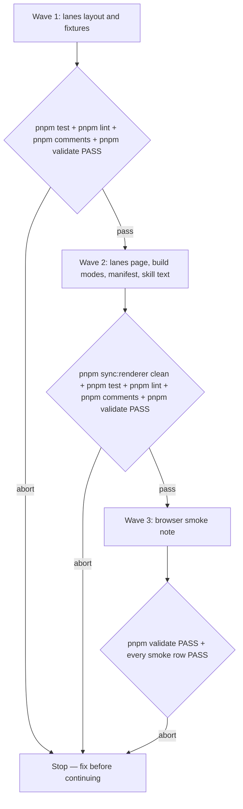

# Wayfinder lanes canvas

**Source:** `docs/prds/wayfinder-lanes/wayfinder-lanes-prd.md` (status `stable`).
**Next:** After the Human approves → `code-plan` → `code-execute`, waves **1 → 2 → 3**.
**Named proof (this spec's own structural gate):** `proof-wayfinder-lanes-spec-obligations`

## Term challenge

The QMD index in this worktree held 0 files in every collection, so terms were checked by reading `docs/` directly.

| Term | Resolution |
|------|------------|
| map, ticket, canvas, destination, frontier, fog, undermined, radial layout | Reused from the archived [wayfinder PRD](../../prds/archived/wayfinder/wayfinder-prd.md) |
| lanes layout, lane, line, Start | Defined at first use in the lanes PRD; reused here unchanged |
| state (`now`, `redo`, `claimed`, `blocked`, `decided`, `oos`) | `RadialLayout.model` in `renderer/radial.js` derives it; reused, never re-derived |
| cross link | New here: the track drawn from a ticket's second or later blocker when that blocker's line continues elsewhere |
| radial page | New here: `<slug>-radial-canvas.html`, the page `build-canvas.mjs --radial` writes |

## Repository grounding

| Surface | Present today | Role for this initiative |
|---------|----------------|----------------------------|
| `renderer/radial.js` (`RadialLayout.model`, `frontierList`, `handoff`, `copyText`) | yes | Reused unchanged: ticket state, frontier list, and the hand-off and copy text |
| `renderer/canvas.js` (`CanvasCore`: camera, pan, wheel, `showErrors`, `copyText`) | yes | Reused unchanged by the lanes page |
| `renderer/logic.js` (`JourneyMapLogic.validate`) | yes | Reused unchanged by `build-canvas.mjs` |
| `renderer/radial-draw.js`, `renderer/radial.html` | yes | Unchanged; drawn only into the radial page |
| `renderer/lanes.js`, `renderer/lanes-draw.js`, `renderer/lanes.html` | no | New: lanes layout (no DOM), lanes drawing and panel, lanes page shell |
| `renderer/sync.mjs` `MANIFEST.wayfinder` | yes | Gains the three lanes files |
| `templates/.agents/skills/wayfinder/scripts/build-canvas.mjs` and its `.agents/skills/` copy | yes | Default build writes the lanes page; `--radial` writes the radial page |
| `templates/.agents/skills/wayfinder/SKILL.md` and its `.agents/skills/` copy | yes | "The canvas" section names lanes, and radial built only when asked |
| `test/radial-model.test.ts`, `test/radial-text.test.ts` | yes | Unchanged; they keep proving the model and the hand-off text the lanes page reuses |
| `test/wayfinder-canvas.test.ts`, `test/wayfinder-install.test.ts`, `test/renderer-copies.test.ts`, `test/skill-wayfinder.test.ts`, `test/skill-copies.test.ts` | yes | Extended for the lanes default, `--radial` and the new manifest |
| `test/fixtures/wayfinder/billing-30-canvas.json`, `billing-30-reached-canvas.json`, `billing-30/`, `errors/`, `reference/` | yes | Reused as layout and build fixtures |
| `test/fixtures/wayfinder/starter-canvas.json`, `medium-canvas.json` | no | New: the PRD's 5-ticket and 12-ticket maps, copied from the prototype's `maps/` output |
| `docs/notes/wayfinder-smoke/wayfinder-smoke-note.md` | yes | Shape model for this spec's browser smoke note |
| Prototype `prototypes/wayfinder-metro/lines.js` (untracked) | yes, untracked | Design source only; never copied in (prototype skill: rewrite on promotion) |

## Surface walk

- **In scope:**
  - `renderer/lanes.js`, `renderer/lanes-draw.js`, `renderer/lanes.html`, and the `MANIFEST.wayfinder` entry in `renderer/sync.mjs`, plus their synced copies under `templates/.agents/skills/wayfinder/renderer/` and `.agents/skills/wayfinder/renderer/`.
  - `build-canvas.mjs` in both wayfinder copies.
  - "The canvas" section of the wayfinder `SKILL.md` in both copies.
  - New tests and fixtures under `test/`.
  - `docs/notes/wayfinder-lanes-smoke/wayfinder-lanes-smoke-note.md`.
- **Out of mutate scope (unchanged):**
  - `renderer/radial.js`, `renderer/radial-draw.js`, `renderer/radial.html`, `renderer/logic.js` and `renderer/canvas.js`, byte-identical to `origin/main`.
  - Every `journey-map` file: `renderer/draw.js`, `renderer/page.html`, and both `journey-map` skill folders.
  - The ticket file format, the map sections, the build's error rules, and the `docs/maps/.gitignore` that `setup` writes (`*-canvas.json`, `*-canvas.html`).
  - `src/`: the CLI and `setup`. The shipped file list grows only through `sync.mjs`.

## Design (frozen)

### Layout rules in `renderer/lanes.js`

`renderer/lanes.js` is a classic script with no DOM, loadable by `node:vm` like `radial.js`. It sets `globalThis.LanesLayout = { layout }`, and `layout(model)` takes `RadialLayout.model(canvas)`. All layout decisions are deterministic:

1. **Depth.** A ticket's depth is 1 plus the deepest depth among its existing blockers. A ticket with no blockers has depth 1.
2. **Rows.** Start is first. Tickets follow by depth, then by id. The fog row comes next, only when fog is non-empty, and the destination row is last. Every ticket therefore sits below each of its blockers.
3. **Lines.** Walk the tickets in row order. Each ticket's *primary* blocker is its deepest blocker, ties broken by the lowest id.
   - A ticket that is not out of scope continues its primary blocker's line when that line is not out of scope and still ends at the primary blocker.
   - Otherwise the ticket starts a new line: from its primary blocker (a fork), or from Start when it has no blockers (a root).
   - An out-of-scope ticket always starts a new line, which is grey.
   - **Other blockers, one at a time:** a blocker whose line still ends at it, and is not out of scope, ends that line at this ticket (a join). Any other blocker draws a cross link in this ticket's line colour.
   - **Line ends:** a line still open after the walk ends at the destination, or in a buffer stop when it is out of scope.
4. **Lanes.** Each line spans from its starting row to its end row. Lines take the lowest free lane index, starting from 0, in order of starting row and then line id. Two lines share a lane only when their row spans do not overlap.
5. **Colours.** The *n*th non-grey line takes palette slot `n mod 12`. A slot is a CSS custom property (`--lane-0` to `--lane-11`) that `lanes.html` defines once for light and once for dark, so a colour-mode switch recolours the page without redrawing it.
6. **Track.** A track into a ticket is solid when that ticket's state is `decided`, `now`, `claimed` or `redo`, and dashed otherwise. A track into the destination is solid only when `model.reached` holds. An out-of-scope line is dotted grey.

### Drawing in `renderer/lanes-draw.js`

`renderer/lanes-draw.js` draws the rows, the gutter, the Start, fog and destination bars, and the panel.

- **Reused, never re-implemented:** `CanvasCore` for the camera and the error panel, and `RadialLayout.frontierList`, `handoff` and `copyText` for the panel lists and the copied text.
- **Fit:** the page fits the content width with zoom capped at 1, aligned to the top under the header. Rows below the fold are reached by scroll or drag. Nothing shrinks the page to fit its height.
- **Rows:** one row per ticket, at a fixed row height: marker in its lane, number, full title, and the state word. A blocked ticket's state adds "waits on …", and a claimed ticket's adds `claimed_by`.
- **Markers:** take-now is an amber ring with a pulse, claimed is blue with an initials badge, and a stale claim adds an orange outline. Redo is a dashed red ring and blocked a dashed grey ring. A decided ticket is filled in its line colour, or a dark ring when it is an interchange (it touches more than one line). An out-of-scope ticket is struck through.
- **Dimming:** hovering, focusing or opening a ticket keeps it, its blockers, its dependents and the tracks joining them at full strength, and dims everything else.
- **Panel:** the same sections as `radial-draw.js`, in the same order.
- **Keyboard:** Tab follows row order, Enter or Space opens the panel, and Escape closes it.

### Page shell in `renderer/lanes.html`

`renderer/lanes.html` is the lanes page shell, adapted from `radial.html` and leaving it untouched.

- It declares `color-scheme: light dark`, with every colour a token and a dark token set under `prefers-color-scheme: dark`.
- It drops the "All labels" control.
- **Below 900px:** each row is two lines, with the state word under the title. The panel becomes the bottom sheet that `radial.html` already uses.
- It loads no remote script.

### Build in `build-canvas.mjs`

- **`build-canvas.mjs <map>`:**
  - Inlines `logic.js`, `canvas.js`, `radial.js`, `lanes.js` and `lanes-draw.js` into `lanes.html`.
  - Writes `<slug>-canvas.html` and `<slug>-canvas.json`.
  - Prints `wayfinder: wrote <path> (N tickets)`.
- **`build-canvas.mjs --radial <map>`:**
  - Inlines `logic.js`, `canvas.js`, `radial.js` and `radial-draw.js` into `radial.html`, as today.
  - Writes `<slug>-radial-canvas.html` and the same `<slug>-canvas.json`.
  - Prints its own path.
- **Errors:** both modes keep today's error rules and exit codes, and write their page with the error data. Any other flag exits 1 naming it and writes nothing.

## Waves

A failed gate aborts before the next wave starts.

## Requirements (obligation ↔ proof)

### R1 — Lanes layout (PRD US-1)

| ID | Obligation | Named proof | Evidence shape |
|----|------------|--------------|------------------|
| R1.1 | `lanes.js` runs under `node:vm` with no DOM and sets `LanesLayout.layout` | `proof-wayfinder-lanes-vm` | `test/lanes-layout.test.ts` |
| R1.2 | On the starter, medium, billing-30 and reached fixtures, every ticket gets exactly one row, and every row sits below each of its blockers' rows | `proof-wayfinder-lanes-rows` | Same test, all four fixtures |
| R1.3 | Lines follow Layout rule 3. On billing-30: 06 continues 03's line and joins 04's line, so it is an interchange; 19 forks a new line from 03 with a cross link from 04; every out-of-scope ticket ends in a buffer stop; every other open line ends at the destination | `proof-wayfinder-lanes-lines` | Same test, asserting named tickets |
| R1.4 | Lane indexes are non-negative, and no two lines in one lane overlap in row span | `proof-wayfinder-lanes-packing` | Same test, all four fixtures |
| R1.5 | Track solidity follows Layout rule 6: billing-30 has dashed tracks into each blocked ticket and the destination, and the reached fixture has no dashed track | `proof-wayfinder-lanes-track` | Same test |
| R1.6 | A ticket blocked only by an out-of-scope ticket forks from that ticket's line and its track into the destination stays dashed (billing-30 ticket 27, blocked by 30) | `proof-wayfinder-lanes-oos-blocker` | Same test |
| R1.7 | `layout` is deterministic and does not mutate the model | `proof-wayfinder-lanes-deterministic` | Same test, deep-equal across two calls plus a model snapshot |

### R2 — Lanes page and build modes (PRD US-1, US-2, US-3)

| ID | Obligation | Named proof | Evidence shape |
|----|------------|--------------|------------------|
| R2.1 | The default build writes `<slug>-canvas.html` holding `lanes.html`'s shell and the `lanes.js` and `lanes-draw.js` bytes, without `radial-draw.js` | `proof-wayfinder-lanes-default-build` | `test/wayfinder-canvas.test.ts` |
| R2.2 | `--radial` writes `<slug>-radial-canvas.html` holding `radial.html`'s shell and the `radial-draw.js` bytes, and prints its path | `proof-wayfinder-radial-on-ask` | Same file |
| R2.3 | The radial files are byte-identical to `origin/main` | `proof-wayfinder-radial-unchanged` | `git diff --exit-code origin/main -- renderer/radial.js renderer/radial-draw.js renderer/radial.html` |
| R2.4 | A map with errors exits 1 naming the ticket in both modes, and each page carries the error data | `proof-wayfinder-lanes-build-errors` | `test/wayfinder-canvas.test.ts`, over `test/fixtures/wayfinder/errors/` |
| R2.5 | An unknown flag exits 1 naming the flag and writes nothing | `proof-wayfinder-lanes-bad-flag` | Same file |
| R2.6 | `lanes-draw.js` gets its copied text only from `RadialLayout.handoff` and `copyText`, and its frontier list only from `frontierList` | `proof-wayfinder-lanes-handoff-reuse` | `test/lanes-layout.test.ts`: a grep asserts those calls and no "Use the wayfinder skill" string in `lanes-draw.js` |
| R2.7 | `MANIFEST.wayfinder` lists the three lanes files, and every copy matches `renderer/` byte for byte | `proof-wayfinder-lanes-manifest` | `test/renderer-copies.test.ts` |
| R2.8 | A standalone wayfinder install builds a lanes page holding the lanes scripts, and its shipped scripts pass a consumer comment check | `proof-wayfinder-lanes-standalone` | `test/wayfinder-install.test.ts` |
| R2.9 | `lanes.html` has no `<script src=`, declares `color-scheme: light dark`, and defines `--lane-0` to `--lane-11` in both the light and the dark token sets | `proof-wayfinder-lanes-shell` | `test/wayfinder-canvas.test.ts`, inspecting the built page |
| R2.10 | `<slug>-radial-canvas.html` matches the `*-canvas.html` line in the `docs/maps/.gitignore` that `setup` writes, so `git check-ignore` reports it ignored | `proof-wayfinder-radial-ignored` | `test/wayfinder-canvas.test.ts`, running `git check-ignore` in a temp repo |
| R2.11 | Two builds in either mode give the same page and JSON bytes | `proof-wayfinder-lanes-build-deterministic` | `test/wayfinder-canvas.test.ts`, extending `proof-wayfinder-build-deterministic` to both modes |

### R3 — Skill text (PRD US-3)

| ID | Obligation | Named proof | Evidence shape |
|----|------------|--------------|------------------|
| R3.1 | The wayfinder skill's "The canvas" section says the page draws lanes, names `--radial` and `<slug>-radial-canvas.html` as built only when the Human asks, and says the radial view is never offered | `proof-wayfinder-skill-radial-ask` | `test/skill-wayfinder.test.ts` |
| R3.2 | The one-line canvas offer after charting and after a close names only the canvas | `proof-wayfinder-skill-offer-unchanged` | Same file: the existing offer wording, and no "radial" inside it |
| R3.3 | The template and installed copies of the wayfinder skill stay identical | `proof-lean-init-copies-identical` (existing) | `test/skill-copies.test.ts` |

### R4 — Nothing around the canvas moves (PRD goal 3)

| ID | Obligation | Named proof | Evidence shape |
|----|------------|--------------|------------------|
| R4.1 | Every journey-map file, `logic.js` and `canvas.js` are byte-identical to `origin/main` | `proof-wayfinder-lanes-journey-map-untouched` | `git diff --exit-code origin/main -- renderer/logic.js renderer/canvas.js renderer/draw.js renderer/page.html templates/.agents/skills/journey-map .agents/skills/journey-map` |
| R4.2 | A wayfinder-only renderer change still leaves journey-map byte-identical | `proof-wayfinder-subset-isolation` (existing) | `test/renderer-copies.test.ts` |

### R5 — Browser behaviour (PRD AC-1.1, AC-1.2, AC-1.3, AC-2.1 to AC-2.3, AC-4.1, AC-4.2)

| ID | Obligation | Named proof | Evidence shape |
|----|------------|--------------|------------------|
| R5.1 | On a 1440-pixel-wide window, billing-30 opens at zoom 100%, with every row's number, title and state at full size, no two rows' text overlapping, and lower rows reached by scrolling | `proof-wayfinder-lanes-smoke-desktop` | Smoke note row with a screenshot reference |
| R5.2 | The starter, medium and reached maps draw their Start, fog and destination bars, and the reached map's bar marks the destination reached, with the `create-prd` or `code-spec` next step in the panel | `proof-wayfinder-lanes-smoke-maps` | Smoke note rows |
| R5.3 | Clicking, tapping or pressing Enter on a row opens the panel with the same sections as the radial page for that ticket, and its copy button puts the same text on the clipboard | `proof-wayfinder-lanes-smoke-panel` | Smoke note row comparing the two pages for tickets 16, 21, 09 and 24 |
| R5.4 | Hover, focus or an open panel dims everything outside the ticket, its blockers and its dependents | `proof-wayfinder-lanes-smoke-dim` | Smoke note row |
| R5.5 | With the OS in dark mode the page draws dark with distinct lanes, markers and text, and switching to light recolours it without reloading | `proof-wayfinder-lanes-smoke-dark` | Smoke note row, both modes |
| R5.6 | At 375 pixels wide, row text keeps its size, each state word sits under its title, and the panel opens as a bottom sheet | `proof-wayfinder-lanes-smoke-phone` | Smoke note row |

## Nine-dimension landings

| Dimension | Landing kind | Landing |
|-----------|---------------|---------|
| validation | obligation ↔ proof | R2.4 / `proof-wayfinder-lanes-build-errors`: both pages show today's validator errors |
| failure modes | obligation ↔ proof | R2.5 / `proof-wayfinder-lanes-bad-flag`: an unknown flag exits 1 and writes nothing |
| idempotency and retry | obligation ↔ proof | R2.11 / `proof-wayfinder-lanes-build-deterministic`: two builds in either mode give the same bytes |
| authorization | `n/a` | Unchanged surface: `build-canvas.mjs` runs locally, reads only the map folder and writes beside it, with no credential or network call |
| concurrency and ordering | `n/a` | Unchanged surface: `build-canvas.mjs` is a single synchronous process per map. Row order is fixed by Layout rule 2 and proven by R1.2 |
| data lifecycle | obligation ↔ proof | R2.10 / `proof-wayfinder-radial-ignored`: the radial page stays derived and untracked under the existing `docs/maps/.gitignore` |
| external-dependency failure | obligation ↔ proof | R2.9 / `proof-wayfinder-lanes-shell`: no remote script. The Google Fonts stylesheet is the only remote asset, with a `system-ui` fallback, as `radial.html` has today |
| state transitions | obligation ↔ proof | R1.5 / `proof-wayfinder-lanes-track`: the open-to-reached transition turns every dashed track solid. Ticket states come from the unchanged `RadialLayout.model` |
| observability | obligation ↔ proof | R2.2 / `proof-wayfinder-radial-on-ask` asserts the printed path. The default build keeps today's `wayfinder: wrote … (N tickets)` line |

## Unresolved

| Identifier | Decision needed | Owner | Blocking effect | Disposition |
|------------|-------------------|-------|-------------------|--------------|
| `U-prototype-disposal` | Keep the untracked prototype files on the throwaway branch as a primary source, or delete them | Human | Non-blocking | Resolve before pre-merge closure of the implementing PR |

## Out of scope

- An in-page toggle between lanes and radial, and any unprompted radial offer.
- Dark mode or any other change to the radial page.
- Any journey-map change.
- Ticket format, map sections, error rules, and `setup`'s `docs/maps/.gitignore`.

## Pragmatic-guard refuses

- A shared panel module extracted from `radial-draw.js`. It would change a file R2.3 freezes. `lanes-draw.js` carries its own panel DOM and reuses `RadialLayout`'s text functions (R2.6).
- A layout options object, a theme switcher, or a palette config. One palette in two token sets covers the PRD.
- A second JSON format. Both pages read the same `<slug>-canvas.json`.
- Edge routing or crossing minimisation beyond Layout rules 3 and 4.

## Acceptance

### Wave 1

- [ ] `proof-wayfinder-lanes-vm` PASS (R1.1)
- [ ] `proof-wayfinder-lanes-rows` PASS on all four fixtures (R1.2)
- [ ] `proof-wayfinder-lanes-lines` PASS (R1.3)
- [ ] `proof-wayfinder-lanes-packing` PASS (R1.4)
- [ ] `proof-wayfinder-lanes-track` PASS (R1.5)
- [ ] `proof-wayfinder-lanes-oos-blocker` PASS (R1.6)
- [ ] `proof-wayfinder-lanes-deterministic` PASS (R1.7)

### Wave 2

- [ ] `proof-wayfinder-lanes-default-build` PASS (R2.1)
- [ ] `proof-wayfinder-radial-on-ask` PASS (R2.2)
- [ ] `proof-wayfinder-radial-unchanged`: `git diff --exit-code origin/main -- renderer/radial.js renderer/radial-draw.js renderer/radial.html` exits 0 (R2.3)
- [ ] `proof-wayfinder-lanes-build-errors` PASS (R2.4)
- [ ] `proof-wayfinder-lanes-bad-flag` PASS (R2.5)
- [ ] `proof-wayfinder-lanes-handoff-reuse` PASS (R2.6)
- [ ] `proof-wayfinder-lanes-manifest` PASS (R2.7)
- [ ] `proof-wayfinder-lanes-standalone` PASS (R2.8)
- [ ] `proof-wayfinder-lanes-shell` PASS (R2.9)
- [ ] `proof-wayfinder-radial-ignored` PASS (R2.10)
- [ ] `proof-wayfinder-lanes-build-deterministic` PASS (R2.11)
- [ ] `proof-wayfinder-skill-radial-ask` PASS (R3.1)
- [ ] `proof-wayfinder-skill-offer-unchanged` PASS (R3.2)
- [ ] `proof-lean-init-copies-identical` PASS (R3.3)
- [ ] `proof-wayfinder-lanes-journey-map-untouched`: the R4.1 `git diff --exit-code` exits 0 (R4.1)
- [ ] `proof-wayfinder-subset-isolation` PASS (R4.2)

### Wave 3

- [ ] `proof-wayfinder-lanes-smoke-desktop` PASS in the smoke note (R5.1)
- [ ] `proof-wayfinder-lanes-smoke-maps` PASS (R5.2)
- [ ] `proof-wayfinder-lanes-smoke-panel` PASS (R5.3)
- [ ] `proof-wayfinder-lanes-smoke-dim` PASS (R5.4)
- [ ] `proof-wayfinder-lanes-smoke-dark` PASS (R5.5)
- [ ] `proof-wayfinder-lanes-smoke-phone` PASS (R5.6)

## Eval / gates

| Gate | Command / check | When | PASS | Abort |
|------|-------------------|------|------|-------|
| Tests | `pnpm test` | End of waves 1 and 2 | exit 0 | Fix; do not proceed |
| Lint | `pnpm lint` | End of waves 1 and 2 | exit 0 | Fix; do not proceed |
| Comments | `pnpm build && pnpm comments` | End of waves 1 and 2 | exit 0, no findings | Fix; do not proceed |
| Renderer copies | `pnpm sync:renderer` prints nothing on a second run, and `git status` shows no drift under the skill copies | End of wave 2 | Clean | Run sync, re-gate |
| Frozen files | The R2.3 and R4.1 `git diff --exit-code` commands | End of wave 2 | exit 0 | Revert the frozen file; do not proceed |
| Integrity | `pnpm build && pnpm validate` | End of each wave | exit 0 | Fix; do not proceed |
| Spec obligations | `proof-wayfinder-lanes-spec-obligations`: each acceptance box names one R-row proof, each R row has one box, no proof serves two rows, all nine landings are present, and each `n/a` cites an unchanged surface | Before `code-plan` | All hold | Do not plan |

## Cross-domain leak table

| Leak | Refuse |
|------|--------|
| Toggle between views in one page, or an unprompted radial offer | Out of scope for this spec |
| Dark mode for the radial page | A new PRD if the Human asks; out of scope here |
| Deleting or keeping the prototype files | The Human, via `U-prototype-disposal` |
| Commits, pushes and the implementing PR | `code-commit` / `code-pr` on an explicit ask |
| An executable plan from this skill | `code-plan` only |

## ADR

None needed this initiative. The lanes page follows the existing per-skill renderer manifest pattern in `renderer/sync.mjs`. Which layout is the default is a product requirement, owned by the PRD.
